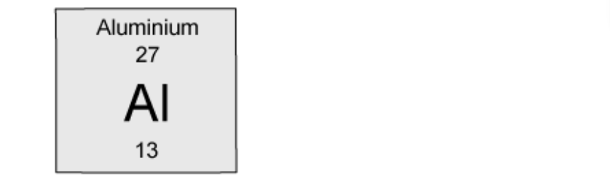

# Exam Questions — The Nucleus
**5. Nuclear Physics** · Cambridge (CIE) IGCSE science (0654 & 0973)
> Source: [https://www.savemyexams.com/igcse/science/cie/co-ordinated-sciences-double-award/23/physics/topic-questions/](https://www.savemyexams.com/igcse/science/cie/co-ordinated-sciences-double-award/23/physics/topic-questions/) · 7 questions across 1 sets

## Multiple Choice Questions (7 questions)

### Q1 — medium — 1 marks

**Q1** [1 mark]

How many neutrons are in a nucleus of aluminium? The chemical symbol is given below:

### Q2 — medium — 1 marks

**Q2** [1 mark]

Which of the following statements would **not** be correct for the nucleus of **any** atom?

### Q3 — easy — 1 marks

**Q3** [1 mark]

An atom consists of electrons orbiting a nucleus. The nucleus contains protons and neutrons.

For the atom to be neutral, which statement about the atom **must** be correct?

### Q4 — easy — 1 marks

**Q4** [1 mark]

The nuclide notation for a generic element is given below:

`bold X presubscript straight Z presuperscript straight A`

Which of the following is the correct definition of each of the terms?

|   | **X** | **A** | **Z** |
|---|---|---|---|
| **A** | symbol | nucleon number | proton number |
| **B** | symbol | proton number | nucleon number |
| **C** | symbol | neutron number | proton number |
| **D** | nucleon number | proton number | neutron number |

### Q5 — hard — 1 marks

**Q5** [1 mark]

**Extended tier only**

Nuclear reactions can release huge amounts of energy.

Which nuclear reaction takes place in the Sun and which nuclear reaction takes place in a nuclear power station?

|   | **The Sun** | **A nuclear power station** |
|---|---|---|
| **A** | fusion | fusion |
| **B** | fusion | fission |
| **C** | fission | fission |
| **D** | fission | fusion |

### Q6 — hard — 1 marks

**Q6** [1 mark]

**Extended tier only**

Fusion is a type of nuclear reaction.

Which term below is a **correct **statement about nuclear fusion?

### Q7 — hard — 1 marks

**Q7** [1 mark]

A neutron and a proton are near to a positive nucleus.

If anything, what would happen to the proton and the neutron due to the charge on the nucleus?
