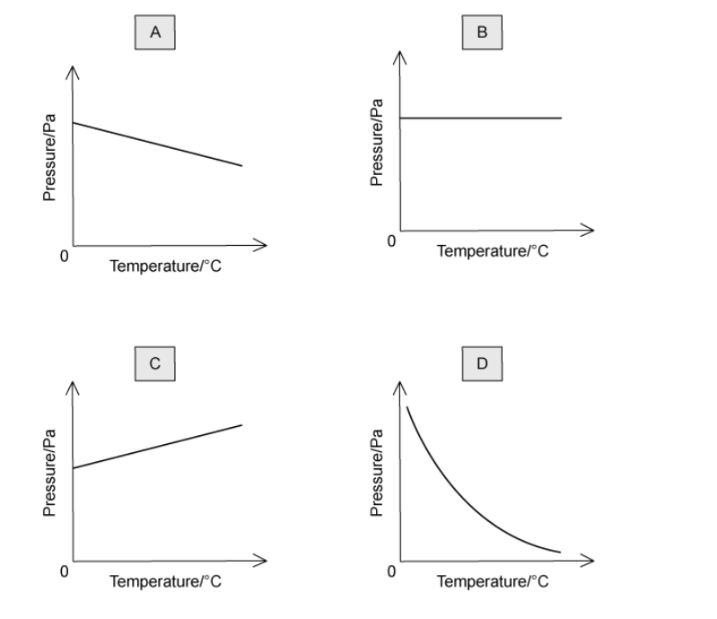
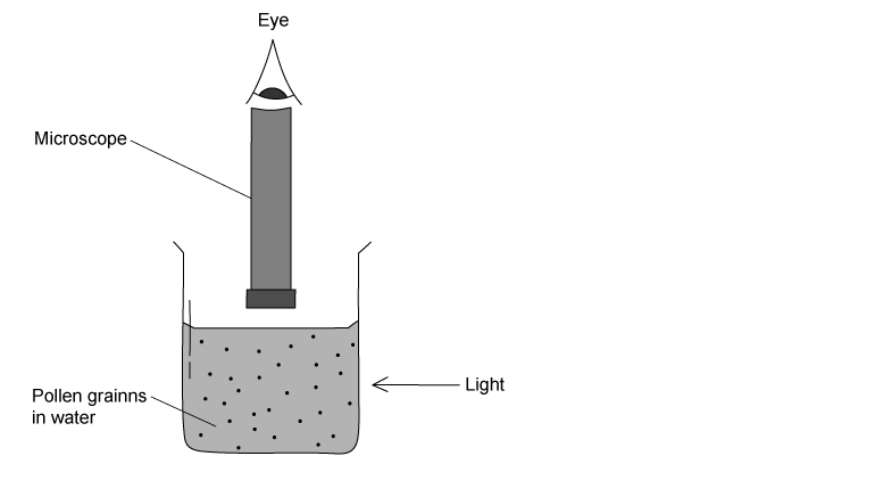

# Exam Questions — Kinetic Particle Model of Matter
**2. Thermal Physics** · Cambridge (CIE) IGCSE science (0654 & 0973)
> Source: [https://www.savemyexams.com/igcse/science/cie/co-ordinated-sciences-double-award/23/physics/topic-questions/](https://www.savemyexams.com/igcse/science/cie/co-ordinated-sciences-double-award/23/physics/topic-questions/) · 11 questions across 1 sets

## Multiple Choice Questions (11 questions)

### Q1 — medium — 1 marks

**Q1** [1 mark]

Smoke particles are observed through a microscope. The smoke particles are seen to move in random, rapid motion.

What causes the smoke particles to move in this way?

### Q2 — medium — 1 marks

**Q2** [1 mark]

Some properties of a substance are listed.

1. The particles vibrate about fixed positions.
2. It has no fixed shape.
3. It is difficult to compress.

Which properties are correct for a solid?

### Q3 — medium — 1 marks

**Q3** [1 mark]

A beaker of water, at its boiling point of 100 °C, is heated so that the liquid starts to become a gas, also at 100 °C.

Which row of the table correctly compares the liquid phase with the gas phase under these conditions?

|   | **Average distance between the particles** | **Average speed of the particles** |
|---|---|---|
| **A** | the same in the liquid and the gas | the same in the liquid and the gas |
| **B** | greater in the liquid | greater in the gas |
| **C** | greater in the gas | greater in the liquid |
| **D** | greater in the gas | the same in the liquid and the gas |

### Q4 — easy — 1 marks

**Q4** [1 mark]

The diagrams represent the molecules in two different states of matter. The arrows show the motion of the molecules.

Which state represents a solid?

### Q5 — medium — 1 marks

**Q5** [1 mark]

**Extended tier only**

A sealed yet empty (except for air) plastic drinks bottle is left outside in the sunshine on a warm day.

Which row of the table correctly describes what happens to the average speed of the air molecules, and to the pressure inside the bottle?

|   | **Average speed of particles** | **Pressure inside bottle** |
|---|---|---|
| **A** | increases | increases |
| **B** | increases | decreases |
| **C** | decreases | increases |
| **D** | decreases | decreases |

### Q6 — medium — 1 marks

**Q6** [1 mark]

**Extended tier only**

Air is trapped inside a cylinder. The volume of the cylinder cannot change.

The temperature of the air is increased.

Which of the graphs below shows the correct relationship between pressure and temperature?

### Q7 — hard — 1 marks

**Q7** [1 mark]

**Extended tier only**

A syringe is half filled with air and sealed. The plunger is then pulled outwards, causing the volume of the gas to increase.

This is done slowly, so that the expansion happens at a constant temperature.

What happens to the pressure of the gas, and to the speed of the air molecules?

|   | **Pressure inside syringe** | **Speed of air molecules** |
|---|---|---|
| **A** | stays the same | stays the same |
| **B** | increases | decreases |
| **C** | decreases | stays the same |
| **D** | decreases | decreases |

### Q8 — hard — 1 marks

**Q8** [1 mark]

In an experiment to determine the nature of liquids, some very tiny pollen grains are suspended in water. They are illuminated by a bright light, and observed under a microscope.

The view through the microscope is of small, bright dots, which move about at random, rapidly and they frequently change direction.

Which of the following would be the correct explanation for the observation through the microscope?

### Q9 — easy — 1 marks

**Q9** [1 mark]

Descriptions of two different states of matter are shown below.

To which state of matter do each of the descriptions fit?

| *X: the molecules are very close together, in fixed positions. They vibrate around these fixed positions.*  *Y: the molecules move rapidly and randomly in straight lines until they collide with something. The molecules are spaced apart very far.* |
|---|

*   *

|   | **State X** | **State Y** |
|---|---|---|
| **A** | solid | liquid |
| **B** | solid | gas |
| **C** | liquid | gas |
| **D** | gas | liquid |

### Q10 — easy — 1 marks

**Q10** [1 mark]

A popular demonstration of kinetic theory is to view smoke particles through a microscope, while illuminating them with a bright light.

The diagram shows the view of the smoke particles through a microscope. They are moving about randomly.

What causes the motion of the smoke particles?

### Q11 — easy — 1 marks

**Q11** [1 mark]

**Extended tier only**

A sealed piston is used to expand a gas. No gas escapes during the process.

What happens to both the density of the gas and to its pressure when it is expanded in this way?

|   | **Density** | **Pressure** |
|---|---|---|
| **A** | stays the same | stays the same |
| **B** | increases | decreases |
| **C** | decreases | stays the same |
| **D** | decreases | decreases |
