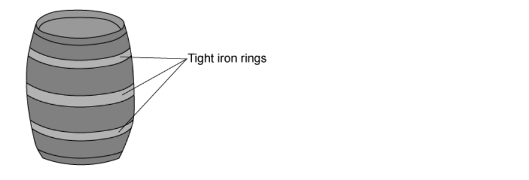
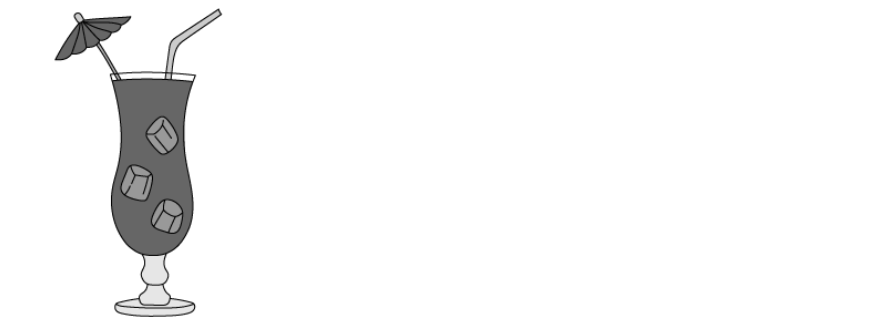

# Exam Questions — Thermal Properties & Temperature
**2. Thermal Physics** · Cambridge (CIE) IGCSE science (0654 & 0973)
> Source: [https://www.savemyexams.com/igcse/science/cie/co-ordinated-sciences-double-award/23/physics/topic-questions/](https://www.savemyexams.com/igcse/science/cie/co-ordinated-sciences-double-award/23/physics/topic-questions/) · 13 questions across 1 sets

## Multiple Choice Questions (13 questions)

### Q1 — medium — 1 marks

**Q1** [1 mark]

**Extended tier only**

Wooden barrels are often reinforced by putting tight iron rings around them.

What procedure would make it easier to get the iron ring onto the barrel?

### Q2 — medium — 1 marks

**Q2** [1 mark]

The diagram shows four water molecules in a swimming pool. It also shows how much energy each molecule has.

Which of the water molecules is most likely to *evaporate* from the liquid?

### Q3 — easy — 1 marks

**Q3** [1 mark]

Below are four statements about evaporation. One of them is correct.

Which statement is correct?

### Q4 — medium — 1 marks

**Q4** [1 mark]

**Extended tier only**

A National Grid engineer connects an electrical cable between two pylons.

The cable is a bit too tight.

What could happen to the wire if the weather became very cold, and why?

|   | **What could happen?** | **Why?** |
|---|---|---|
| **A** | The wire sags low | It expands |
| **B** | The wire breaks | It contracts |
| **C** | The wire breaks | It becomes brittle |
| **D** | The wire’s resistance increases | It contracts |

### Q5 — easy — 1 marks

**Q5** [1 mark]

A substance, which is initially in its solid form, is heated at a constant rate.

The graph shows how its temperature changes with time.

Between which points is the substance partly a liquid and partly a gas?

### Q6 — medium — 1 marks

**Q6** [1 mark]

An iron cube is heated by a Bunsen burner.

Which of its properties decreases?

### Q7 — hard — 1 marks

**Q7** [1 mark]

**Extended Tier Only**

In a children’s experiment, a saucer of water is left outside to evaporate.

Which row shows weather conditions that will each cause the rate of evaporation from the saucer to increase?

|   | **Temperature** | **Wind speed** |
|---|---|---|
| **A** | warm | windy |
| **B** | warm | still |
| **C** | cool | windy |
| **D** | cool | still |

### Q8 — easy — 1 marks

**Q8** [1 mark]

Which statement best describes a metal experiencing thermal expansion?

### Q9 — medium — 1 marks

**Q9** [1 mark]

The water in outdoor swimming pools gradually evaporates.

How does the process of evaporation affect the temperature of the water in the swimming pool and what is the effect on the average kinetic energy of the water molecules?

|   | **Temperature** | **Average kinetic energy per molecule** |
|---|---|---|
| **A** | reduces | reduces |
| **B** | stays the same | stays the same |
| **C** | increases | increases |
| **D** | reduces | stays the same |

### Q10 — easy — 1 marks

**Q10** [1 mark]

What are the upper and lower fixed points on a Celsius scale thermometer?

|   | **Upper** | **Lower** |
|---|---|---|
| **A** | The boiling point of saturated salt solution. | The freezing point of salt-water |
| **B** | The normal temperature of the human body | The freezing point of salt-water |
| **C** | The boiling point of pure water | The freezing point of pure water |
| **D** | The boiling point of pure water | Absolute zero |

### Q11 — hard — 1 marks

**Q11** [1 mark]

Drinks are often cooled by putting ice cubes into them.

A delicious cocktail is initially at a temperature of 12℃, when a few ice cubes are put into the drink.

After some time has passed, some of the ice has melted, and the temperature of the cocktail has dropped to 7 ℃.

What is the temperature of the remaining, unmelted ice?

### Q12 — easy — 1 marks

**Q12** [1 mark]

A substance is cooled. The graph below shows how its temperature changes over time.

What is happening in the portion of the graph labelled XY?

### Q13 — medium — 1 marks

**Q13** [1 mark]

In order to calibrate a degrees Celsius thermometer, the lowest fixed point can be found by placing the thermometer in:
