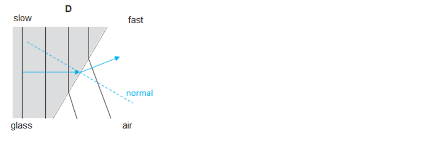
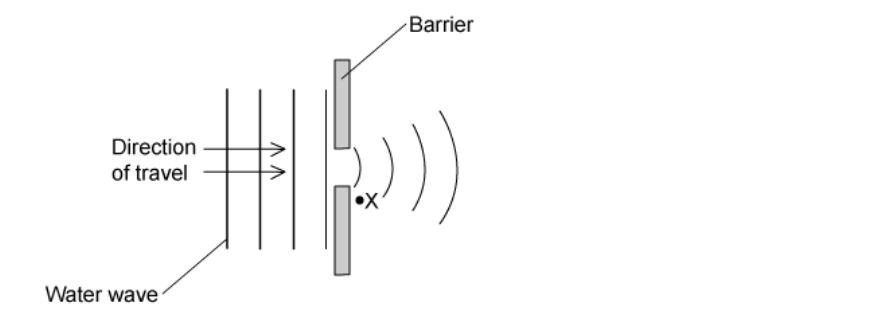

# Mark Schemes — General Properties of Waves
**3. Waves** · Cambridge (CIE) IGCSE science (0654 & 0973)

## Multiple Choice Questions (18 questions)

### Q1
**Final answer:** **The correct answer is A**

- Diffraction is most significant when the wavelength of the wave is similar to or larger than the size of the gap or obstacle
- To increase diffraction, the wavelength should be increased, or the gap size should be decreased
- Decreasing the frequency of the waves increases their wavelength (since wave speed is constant, $v = f λ$)
- Making the gap narrower also increases the extent of diffraction
- Therefore, decreasing the frequency and making the gap narrower will cause the waves to diffract more

**B** is incorrect as making the gap wider would decrease diffraction

**C** is incorrect as increasing the frequency would decrease the wavelength, thus decreasing diffraction

**D** is incorrect as both increasing the frequency and making the gap wider would decrease diffraction

### Q2
**Final answer:** ** The correct answer is A**

- In transverse waves, the vibrations are perpendicular to the direction of energy transfer

  - Examples of transverse waves include electromagnetic waves, such as light, and seismic S-waves
- In longitudinal waves, the vibrations are parallel to the direction of energy transfer

  - Examples of longitudinal waves include sound and seismic P-waves

### Q3
**Final answer:** **The correct answer is C**

- Frequency is a measure of how many cycles or crests pass a specific point in a given amount of time
- It is usually measured in hertz (Hz), where 1 Hz equals one wave per second

**A** is incorrect as it describes the amplitude of the wave.

**B** is incorrect as it describes the wavelength.

**D** is incorrect as it describes the period of the wave (the time for one complete cycle).

### Q4
**Final answer:** **The correct answer is ****D**** because:**

- This one’s a bit tricky. You have to realise the relationship between speed, frequency and wavelength, and you need to know what remains the same and what changes during each phenomenon.
- **Speed = frequency x wavelength.**

- Frequency is always the same during any interaction.
- When a wave is reflected, its speed remains the same. Therefore, its wavelength remains the same
- When a wave is diffracted, its speed remains the same. Therefore, its wavelength remains the same
- When a wave is refracted, its speed *always* changes. Therefore, its wavelength changes

**A **is incorrect as wavelength does not change during reflection or diffraction.

**B **is incorrect as wavelength does change during refraction.

**C **is incorrect as wavelength does not change during reflection.

### Q5
**Final answer:** **The correct answer is ****B ****because:**

- Every wavefront that hits the boundary has to leave the boundary.
- Since frequency is defined as the number of waves (or wavefronts) that pass a point per second, this has to be the same on both sides of the boundary.
- Anything else can change.

**A** is incorrect as wavelength changes when a wave refracts.

**C** is incorrect as amplitude can change when a wave refracts, especially if the water's depth changes.

**D** is incorrect as by definition, speed changes when a wave refracts.

### Q6
**Final answer:** **The incorrect answer is ****C**** because:**

- Sound waves, just like all waves, transfer energy without transferring matter.
- The idea that sound waves push air away from the source is incorrect.

**A **is incorrect as sound waves *are* longitudinal.

**B **is incorrect as sound waves *do* transfer energy away from the source.

**D **is incorrect as sound waves *do* cause objects to vibrate

### Q7
**Final answer:** **The correct answer is ****C**** because: **

- Sound waves are always longitudinal.

All the other waves are transverse.

### Q8
**Final answer:** **The correct answer is ****A**** because:**

- The wave equation, $v=fλ$ applies here.
- $1500=f\times0.05m$ (don’t forget to convert cm to m)
- $\frac{1500}{0.05}==30,000\mathrm{Hz}=30\mathrm{kHz}$

**B **is incorrect as the speed has been incorrectly multiplied by the distance in metres.

**C **is incorrect as the speed has been incorrectly multiplied by the distance in cm.

**D **is incorrect as the wavelength has not been converted to metres.

### Q9
**Final answer:** **The correct answer is ****D**** because:**

- Wave speed is a measure of how much distance a wave crosses per second.
- The units are, therefore, of distance / time, or metres / seconds, metres per second.

**A **is incorrect as this is the unit of frequency.

**B **is incorrect as this is the unit of wavelength, and sometimes amplitude as well.

**C **is incorrect as this is the unit of time period.

### Q10
**Final answer:** **The correct answer is ****D**** because:**

- Amplitude is shown on the diagram, as is wavelength.
- Amplitude is the maximum distance from the equilibrium position of any point on a wave.

**A **is incorrect as this is the definition of frequency.

**B **is incorrect as this is the definition of wavelength.

**C **is incorrect as this is the standard error made by students when defining amplitude.

### Q11
**Final answer:** **The correct answer is ****D**** because: **

- In this case, frequency is given by:

  - $frequency=\frac{numberofwaves}{timetaken}=\frac{6}{3.2}=1.88\mathrm{Hz}$

**A **is incorrect as this is not the correct answer.

**B **is incorrect as the number of waves has incorrectly been multiplied by the time.

**C **is incorrect as the time has been incorrectly divided by the number of waves. This would give the time period, not the frequency.

### Q12
**Final answer:** **The correct answer is ****C**** because:**

- A wavelength is the distance between two identical points on a wave.
- Q and S are identical points because they are both in the equilibrium position **and** the string is pointing in identical directions to their left and right, i.e. up on the left and down on the right.
- A common mistake is to think Q and R are 1 wavelength apart because they are both on the equilibrium line. However, the string is pointing in opposite directions at each of these points.
- There are plenty more ways to explain wavelength, like: to complete a wave you have to go up, down and back up again, but I rather like the first explanation.
- It’s much easier to explain with a diagram:

**A **is incorrect as P and S are 1.25 wavelengths apart.

**B **is incorrect as Q and R are half a wavelength apart.

**D **is incorrect as P and R are 0.75 wavelengths apart.

### Q13
**Final answer:** **The correct answer is ****D**** because:**

- As light rays leave the glass, they refract away from the normal.
- The normal is drawn at 900 to the surface of the glass, shown by a dotted line.
- The direction of travel is at 900 to the wavefronts, as shown.

**A **is incorrect as this is what would happen if the wave slowed down when leaving the glass.

**B **is incorrect as the wavefronts do not continue in a straight line, they change direction.

**C **is incorrect as note that every other wavefront in the air has no wavefront in the glass to line up with; wavefronts have been created from nowhere. This is not possible.

### Q14
**Final answer:** **The correct answer is ****D**** because:**

- Maximum diffraction occurs when the wavelength is comparable in size to the gap through which the waves are travelling.
- Therefore, making the gap a little bigger, will mean that the gap size does not match the wavelength size to an even greater extent, and the effect will lessen.

**A **is incorrect as changing the speed would have no effect on the diffraction (although changing the wavelength would).

**B **is incorrect as changing the speed would have no effect on the diffraction (although changing the wavelength would).

**C **is incorrect as the gap is slightly larger than the wavelength. Making it smaller, and, therefore, closer in size to the wavelength, would increase the diffraction effect.

### Q15
**Final answer:** **The correct answer is ****A**** because:**

- The wave equation, $v=fλ$applies here.
- Rearrange: $λ=\frac{v}{f}$
- If *v* doubles, and *f* stays the same: $λ=\frac{2v}{f}$
- $\frac{2v}{f}$is twice as big as $\frac{v}{f}$, the original wavelength.

The other answers are incorrect because they do not get the algebra correct.

### Q16
**Final answer:** **The correct answer is ****B**** because:**

- **Sound** is a **longitudinal** wave.
- All **electromagnetic** waves are **transverse**.
- Both infrared and red light waves are electromagnetic waves, so they are transverse.

### Q17
**Final answer:** **The correct answer is ****C**** because:**

- Diffraction is the name given to the spreading out of waves as they pass through a gap, as shown in the diagram below.

**A **is incorrect as reflection is what happens when waves bounce off a boundary.

**B **is incorrect as refraction is what happens when waves change speed and (usually) direction when they cross a boundary.

**D **is incorrect as dispersion is the spreading out of the different colours of (usually) light when they are passed through a prism.

### Q18
**Final answer:** **The correct answer is ****B**** because:**

- Water waves travel more quickly on the surface of water when the water is deep compared to when it is shallow.
- The change in speed causes the change in direction.

**A **is incorrect as the speed decreases, it does not increase.

**C **& **D **are incorrect as the frequency remains constant when a wave crosses a boundary.
