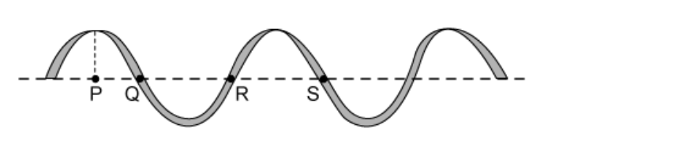
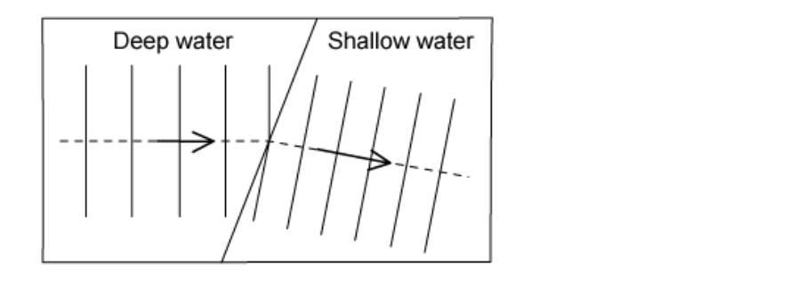

# Exam Questions — General Properties of Waves
**3. Waves** · Cambridge (CIE) IGCSE science (0654 & 0973)
> Source: [https://www.savemyexams.com/igcse/science/cie/co-ordinated-sciences-double-award/23/physics/topic-questions/](https://www.savemyexams.com/igcse/science/cie/co-ordinated-sciences-double-award/23/physics/topic-questions/) · 18 questions across 1 sets

## Multiple Choice Questions (18 questions)

### Q1 — medium — 1 marks

**Q1** [1 mark]

Water waves approach a narrow gap in a barrier. The diagram shows what happens to the wavefronts as they pass through the gap.

Which change causes the waves to diffract more?

### Q2 — medium — 1 marks

**Q2** [1 mark]

Which row correctly classifies each wave type?

|   | light | sound | seismic S-waves |
|---|---|---|---|
| **A** | transverse | longitudinal | transverse |
| **B** | longitudinal | transverse | transverse |
| **C** | transverse | transverse | longitudinal |
| **D** | longitudinal | longitudinal | transverse |

### Q3 — medium — 1 marks

**Q3** [1 mark]

Which statement is the correct definition of the frequency of a wave?

### Q4 — hard — 1 marks

**Q4** [1 mark]

**Extended tier only**

With skillful use of particular laboratory equipment, water can be used to demonstrate reflection, refraction and diffraction.

For each of these, which row shows whether or not the wavelength of the water waves changes?

|   | **Reflection** | **Refraction** | **Diffraction** |
|---|---|---|---|
| **A** | yes | yes | yes |
| **B** | no | no | no |
| **C** | yes | yes | no |
| **D** | no | yes | no |

### Q5 — medium — 1 marks

**Q5** [1 mark]

Water waves travel from deeper water to more shallow water. This causes them to refract.

Which wave property always remains the same when refraction occurs?

### Q6 — medium — 1 marks

**Q6** [1 mark]

**Extended tier only**

Which of the following statements about sound waves is incorrect?

### Q7 — medium — 1 marks

**Q7** [1 mark]

**Extended tier only**

Which of the following waves are longitudinal?

### Q8 — hard — 1 marks

**Q8** [1 mark]

Sound waves travel at a speed of 1500 m/s through a substance. Their wavelength is 5.00 cm.

What is their frequency?

### Q9 — easy — 1 marks

**Q9** [1 mark]

What is the unit of wave speed?

### Q10 — easy — 1 marks

**Q10** [1 mark]

What is the definition of the word **amplitude**?

### Q11 — hard — 1 marks

**Q11** [1 mark]

A small child throws a stone into a very still pond.

Where the stone hits the water, waves travel outwards in a circular pattern until they reach the side of the pond.

In a very uncharacteristic move for a small child, he notices that six waves arrive in a time of 3.2 s (the child has a remarkably accurate internal clock).

To 3 significant figures, what is the frequency of the waves?

### Q12 — easy — 1 marks

**Q12** [1 mark]

Which two points on the wave are exactly one wavelength apart?

### Q13 — hard — 1 marks

**Q13** [1 mark]

The diagrams below show the wavefront diagrams of light as it passes from glass into air. They are magnified many times.

Which diagram correctly shows what happens to the wavefronts as they pass the glass-air boundary?

### Q14 — hard — 1 marks

**Q14** [1 mark]

The diagram shows a plane water wave approaching a gap as viewed from above.

How could the situation be changed so that the waves on the far side of the gap do not spread out as far?

### Q15 — medium — 1 marks

**Q15** [1 mark]

The speed of a wave is doubled. The frequency remains the same.

What happens to the wavelength of the wave?

### Q16 — easy — 1 marks

**Q16** [1 mark]

**Extended tier only**

The following table shows some examples of waves

Which row correctly lists the nature of each of the wave types?

|   | **Sound waves** | **Infrared waves** | **Red light waves** |
|---|---|---|---|
| **A** | transverse | longitudinal | transverse |
| **B** | longitudinal | transverse | transverse |
| **C** | longitudinal | longitudinal | transverse |
| **D** | transverse | transverse | longitudinal |

### Q17 — easy — 1 marks

**Q17** [1 mark]

**Extended tier only**

What is the name given to the effect that allows the wavefronts to reach point X, shown on the diagram?

### Q18 — medium — 1 marks

**Q18** [1 mark]

When water waves travel from deeper water into more shallow water they are refracted.

Why does the wave change direction in the manner shown?
