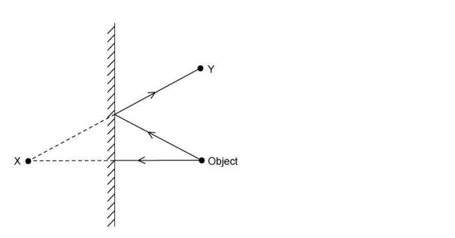

# Mark Schemes — Light
**3. Waves** · Cambridge (CIE) IGCSE science (0654 & 0973)

## Multiple Choice Questions (15 questions)

### Q1
**Final answer:** **The correct answer is C**

- The sound travels from the student to the wall and then back again to be heard as an echo
- The speed of sound in air is about $330m/s$
- The total distance travelled by the sound is calculated using the equation:

$\text{total distance}=\text{speed}\times\text{time}$

$\text{total distance}=330\times1.2=396\text{m}$

- The distance $d$ to the wall is exactly half of the total distance travelled by the sound:

$d=\frac{396}{2}=198m$

- This is approximately equal to $200m$, which is option **C**

**A** is incorrect as this corresponds to a speed of sound of $\frac{50\times2}{1.2}\approx83m/s$, which is too low.

**B** is incorrect as this corresponds to a speed of sound of $\frac{100\times2}{1.2}\approx167m/s$, which is too low.

**D** is incorrect as this corresponds to a speed of sound of $\frac{400\times2}{1.2}\approx667m/s$, which is too high.

> **[exam-tip]**
> When dealing with echo questions, always remember that the sound travels twice the distance to the reflecting surface — once going and once returning. A common mistake is to forget to halve the total distance calculated. Make sure you identify whether the question asks for the one-way distance or the total distance travelled by the sound.

### Q2
**Final answer:** **The correct answer is ****B**** because:**

- The ray diagram demonstrates how the image is formed.
- Where the projected rays cross, is where a virtual image is formed.
- Virtual images are formed by projected rays, while real images are formed by the convergence of actual light rays.
- Plane mirrors always form virtual images.

**Y** is the location at which the eye would be positioned in order to see the image clearly.

### Q3
**Final answer:** **The correct answer is ****A ****because:**

- This question is about total internal reflection.
- If the angle of incidence is greater than the critical angle, the light will be totally internally reflected.
- Total internal reflection only works when the substance the light is going from has a higher refractive index than the substance it is going to, from glass to air for example.

**B** is incorrect as substance A must have a greater refractive index than substance B.

**C and D** are incorrect as the angle of incidence must be greater than the critical angle.

### Q4
**Final answer:** **The correct answer is ****B**** because:**

- This is a question about total internal reflection and the critical angle. We know this because light is being reflected **inside** a material, rather than from its surface.
- $n=\frac{1}{sinc}$
- The angle of incidence (in this case, the critical angle, *c*) is the angle **between the normal and the incident ray**. We are given the other angle. Therefore:
- $c=90-48=42^{\circ}$
- $n=\frac{1}{sin42}$
- $n=1.494$

Each of the other answers contains a common mistake made by students.

**A** is incorrect as sin was not used.

**C** is incorrect as sin was not used in the calculation of this answer, and a number of decimal places were ignored.

**D** is incorrect as the wrong angle was used in the calculation

### Q5
**Final answer:** **The correct answer is ****B ****because:**

- Light has to disperse a little as it passes through the prism.
- Light has to refract in the correct direction: towards the normal on the way in and away from the normal on the way out.

**A** is incorrect as light refracts in the wrong direction, and it does not disperse at all inside the prism.

**C** is incorrect as the light does not disperse in the prism, though it does refract in the right direction.

**D** is incorrect as light does disperse in the prism, but refracts in the wrong direction.

### Q6
**Final answer:** **The correct answer is**** D**** because:**

- When light passes from a denser medium into a less dense medium

  - It speeds up
  - It bends away from the normal

### Q7
**Final answer:** **The correct answer is ****D**** because:**

- This diagram shows how the image is produced and the correct path of the light ray.
- Note that the angle of incidence equals the angle of reflection, and no light passes through the mirror, as you would expect.

**A** is incorrect as the angle of incidence does not equal the angle of reflection.

**B** is incorrect as the image is not in the correct position.

**C** is incorrect as the angle of incidence does not equal the angle of reflection.

### Q8
**Final answer:** **The correct answer is ****A**** because:**

- The critical angle is the angle of **incidence** when the angle of **refraction** is exactly 90° and light is **refracted** along the boundary

It would be useful to learn this definition by heart, so that you are entirely confident when you sit the exam

### Q9
**Final answer:** **The correct answer is ****C**** because:**

- $n=\frac{sini}{sinr}$
- $sinr=\frac{sini}{n}$
- `r space equals s i n to the power of negative 1 end exponent open parentheses fraction numerator s i n space i over denominator n end fraction close parentheses`
- `r space equals space s i n to the power of negative 1 end exponent open parentheses fraction numerator s i n space 27 over denominator 1.33 end fraction close parentheses`
- $r=19.95^{\circ}$

Each of the other answers contains a common mistake made by students.

**A** is incorrect as the arcsin of the final answer was not found.

**B** is incorrect as sin was not used at all, the student divided angle of incidence by refractive index. Be careful, this one can give you a misleadingly close answer for small angles!

**D** is incorrect as the equation was incorrectly rearranged to obtain this answer.

### Q10
**Final answer:** **The correct answer is ****B ****because:**

- This question is about total internal reflection.
- If the angle of incidence is greater than the critical angle, 42**o** in this case, the light will be totally internally reflected, and no light will escape the rod.
- The angle of incidence is 44**o**, which is 2**o** greater than the critical angle. Therefore, no light is refracted and all the light is reflected.

**A** is incorrect as no light is refracted out of the perspex rod.

**C** is incorrect as light is reflected. Some light is always reflected, whether or not the angle of incidence is greater than the critical angle.

**D** is incorrect as light is reflected. Some light is always reflected, whether or not the angle of incidence is greater than the critical angle.

### Q11
**Final answer:** **The correct answer is ****A**** because:**

- `n equals. fraction numerator sin open parentheses a n g l e space o f space i n c i d e n c e close parentheses over denominator sin open parentheses a n g l e space o f space r e f r a c t i o n close parentheses end fraction`
- P is the correct angle of incidence
- S is the correct angle of refraction

The other answers have one or more of the angles incorrect.

### Q12
**Final answer:** **The correct answer is ****D**** because:**

- The white light is split into its constituent colours because different colours are refracted through different angles.
- From least refracted (closer to B) to most refracted (closer to A) the colours run in the order you have probably learned them: **red**, orange, yellow, **green**, blue, indigo, **violet**.
- As the question asks us to list them in order from A to B, we reverse this list.

### Q13
**Final answer:** **The correct answer is ****D ****because **

- Images in a plane mirror are always reflected left to right but not top to bottom.
- This diagram shows the actual clock:

### Q14
**Final answer:** **The correct answer is ****A ****because:**

- Light refracts as it moves from air to glass

  - This is demonstrated by a change in speed
  - Light slows down when it enters glass
- Red light has the largest wavelength in the visible spectrum but it carries the least energy
- On the other hand, violet light has the shortest wavelength and carries the largest amount of energy

  - Therefore, red light slows down by less than violet light
- The change in speed is related to the change in angle

  - The slower the speed, the larger the angle of refraction
- When light passes from the glass to the air, all the light returns to the same speed as before

**B** is incorrect as light does not speed up as it enters the glass, it slows down as it moves through the glass and speeds up again as it leaves

**C **and** D** are incorrect as frequency does not change at all as light passes from air into glass or from glass into air

### Q15
**Final answer:** **The correct answer is ****B ****because **

- The focal length is the distance from the lens at which parallel light rays would converge. This is shown in diagram B.

The other answers do not label the focal length correctly.
