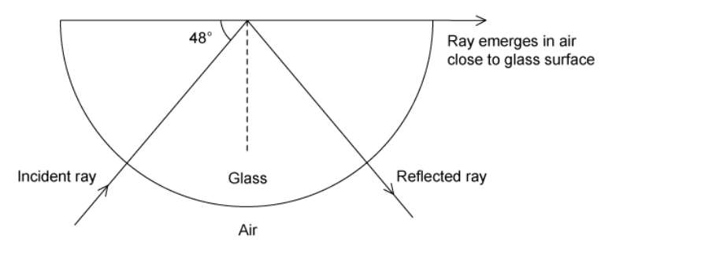
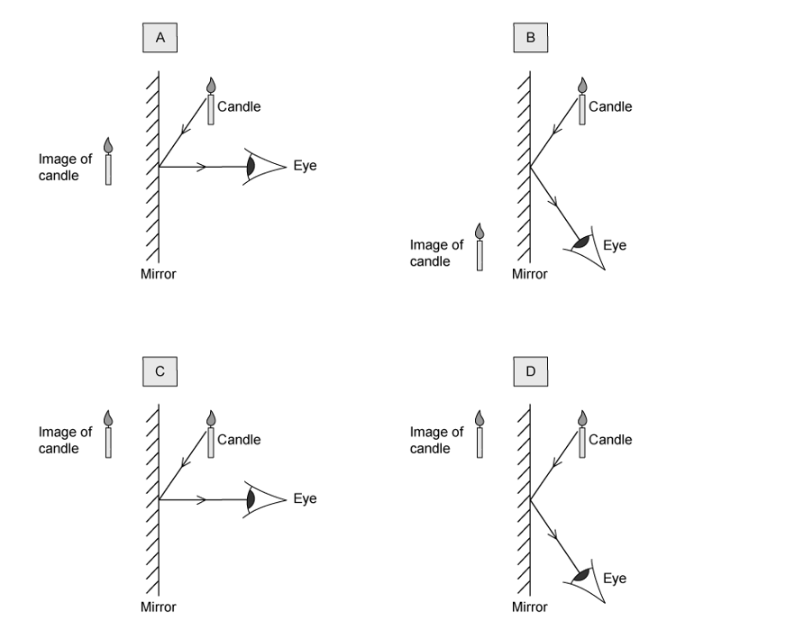
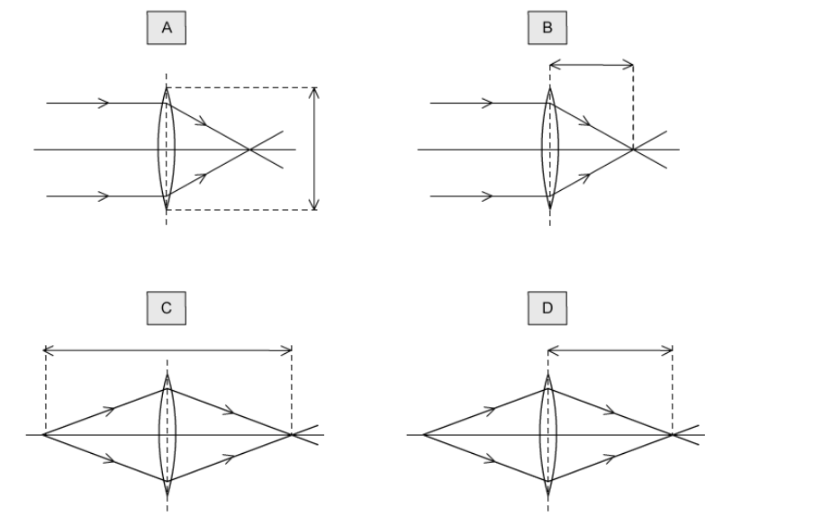

# Exam Questions — Light
**3. Waves** · Cambridge (CIE) IGCSE science (0654 & 0973)
> Source: [https://www.savemyexams.com/igcse/science/cie/co-ordinated-sciences-double-award/23/physics/topic-questions/](https://www.savemyexams.com/igcse/science/cie/co-ordinated-sciences-double-award/23/physics/topic-questions/) · 15 questions across 1 sets

## Multiple Choice Questions (15 questions)

### Q1 — medium — 1 marks

**Q1** [1 mark]

A student stands at a distance $d$ from a wall. He claps his hands and hears an echo $1.2\text{s}$ later.

What is the approximate value of $d$?

### Q2 — easy — 1 marks

**Q2** [1 mark]

**Extended tier only**

An object is placed in front of a mirror. Where is the image formed, and is the image real or virtual?

|   | **Image location** | **Image type** |
|---|---|---|
| **A** | X | real |
| **B** | X | virtual |
| **C** | Y | real |
| **D** | Y | virtual |

### Q3 — hard — 1 marks

**Q3** [1 mark]

**Extended tier only**

The diagram shows a ray of light being totally internally reflected at the boundary between substances A and B.

Which row in the table must be true?

|   | **Angle of incidence** | **Substance A** |
|---|---|---|
| **A** | greater than critical angle | greater refractive index than B |
| **B** | greater than critical angle | smaller refractive index than B |
| **C** | less than critical angle | greater refractive index than B |
| **D** | less than critical angle | smaller refractive index than B |

### Q4 — hard — 1 marks

**Q4** [1 mark]

**Extended tier only**

A ray of light is shone into a semi-circular glass block so that it makes an angle of 48° with the rear, flat edge of the block as shown.

Calculate the refractive index of the glass.

### Q5 — medium — 1 marks

**Q5** [1 mark]

A physics teacher demonstrates dispersion for her class. She asks the students to draw a diagram of the dispersion.

The diagrams show four examples of what different students drew. One of them is correct. Which one?

### Q6 — easy — 1 marks

**Q6** [1 mark]

When light passes from a denser material into a less dense material

### Q7 — medium — 1 marks

**Q7** [1 mark]

**Extended tier only**

Which of the diagrams below shows both the correct position of the image, and the correct path the light rays must have taken to the eye?

### Q8 — easy — 1 marks

**Q8** [1 mark]

**Extended tier only**

Identify the correct definition of the critical angle.

### Q9 — hard — 1 marks

**Q9** [1 mark]

**Extended tier only**

Light enters a flat water surface at an angle of 27 °.

The refractive index of water is 1.33.

At what angle does the light ray refract?

### Q10 — medium — 1 marks

**Q10** [1 mark]

**Extended tier only**

The diagram shows a ray of light inside a perspex rod.

Perspex has a critical angle of 42o.

Which row in the table correctly states whether there is any light reflected from the surface, and whether there is any light refracted out of the perspex rod?

|   | **Light reflected?** | **Light refracted?** |
|---|---|---|
| **A** | yes | yes |
| **B** | yes | no |
| **C** | no | yes |
| **D** | no | no |

### Q11 — hard — 1 marks

**Q11** [1 mark]

**Extended tier only**

The diagram shows light passing from air into glass. A number of angles have been labelled on the diagram.

Which of the equations could be used to correctly calculate the refractive index, *n*, of the glass?

### Q12 — easy — 1 marks

**Q12** [1 mark]

The diagram shows white light passing through a prism.

Which of the following gives colours in the correct order from A to B?

### Q13 — easy — 1 marks

**Q13** [1 mark]

A teacher has a clock mounted in such a way that students can only see its reflection in a plane mirror.

The diagram shows the reflection of the clock.

What time is shown on the clock?

### Q14 — hard — 1 marks

**Q14** [1 mark]

The image below shows white light being split into its constituent colours by a glass prism.

Why does a prism cause white light to be dispersed?

### Q15 — medium — 1 marks

**Q15** [1 mark]

Which of the images correctly shows the focal length of the thin converging lens?
