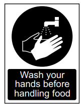
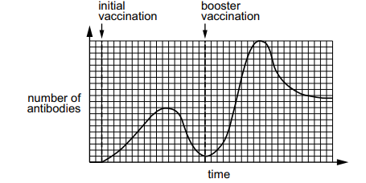
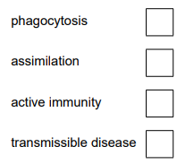

# Exam Questions — Diseases & Immunity
**10. Diseases & Immunity** · Cambridge (CIE) IGCSE science (0653)
> Source: [https://www.savemyexams.com/igcse/science/cie/combined-science/23/biology/topic-questions/](https://www.savemyexams.com/igcse/science/cie/combined-science/23/biology/topic-questions/) · 4 questions across 1 sets

## Exam Questions (4 questions)

### Q1 — medium — 7 marks

**Q1** [2 marks]

Fig. 1.1 shows a sign from a restaurant kitchen.

**Fig. 1.1**

Explain why the message in the sign is important for controlling the spread of disease.

*Source: Specimen 0653/04 Q1A*

**Q1** [3 marks]

A person is is given an initial vaccination for a disease. A few weeks later the person is given a booster vaccination. A booster vaccination is an additional vaccination for the same disease.

Fig. 1.2 shows how the number of antibodies in the body of the person changes after each vaccination.

(i) Describe **two** differences between the response to the initial vaccination and the response to the booster vaccination shown in Fig. 1.2.

[2]

(ii) Place a tick (**✓**) in the box that describes the response shown in Fig. 1.2.

[1]

*Source: Specimen 0653/04 Q1B(I)*

**Q1** [2 marks]

Explain how platelets in the blood help defend the body against disease.

*Source: Specimen 0653/04 Q1C*

### Q2 — easy — 1 marks

**Q2** [1 mark]

White blood cells defend the human body against pathogens.

State one other way the human body defends itself against pathogens.

*Source: Specimen 2025 0653/03 Q1D*

### Q3 — easy — 1 marks

**Q3** [1 mark]

What produces active immunity?

|   | infection by a pathogen | vaccination |
|---|---|---|
| **A** | ✓ | ✓ |
| **B** | ✓ | ✗ |
| **C** | ✗ | ✓ |
| **D** | ✗ | ✗ |

*Source: Specimen 2025 0653/02 Q9*

### Q4 — easy — 1 marks

**Q4** [1 mark]

Which word best describes a disease-causing organism?

*Source: Specimen 2025 0653/01 Q10*

