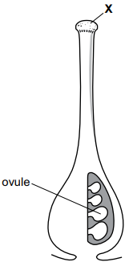

# Exam Questions — Reproduction in Plants & Humans
**14. Reproduction** · Cambridge (CIE) IGCSE science (0653)
> Source: [https://www.savemyexams.com/igcse/science/cie/combined-science/23/biology/topic-questions/](https://www.savemyexams.com/igcse/science/cie/combined-science/23/biology/topic-questions/) · 1 questions across 1 sets

## Exam Questions (1 questions)

### Q1 — medium — 2 marks

**Q1** [2 marks]

Fig. 2.4 shows a drawing of the carpel from an insect-pollinated flower.

**Fig. 2.4**

(i) Identify the part labelled X on Fig. 2.4.

[1]

(ii) Describe fertilisation in an ovule.

[1]

*Source: Specimen 2025 0653/03 Q2C(I)*

