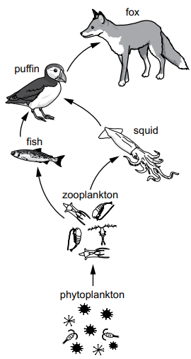
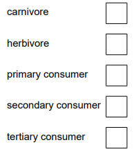

# Exam Questions — Energy & Feeding Relationships
**15. Organisms & Their Environment** · Cambridge (CIE) IGCSE science (0653)
> Source: [https://www.savemyexams.com/igcse/science/cie/combined-science/23/biology/topic-questions/](https://www.savemyexams.com/igcse/science/cie/combined-science/23/biology/topic-questions/) · 3 questions across 1 sets

## Exam Questions (3 questions)

### Q1 — medium — 9 marks

**Q1** [7 marks]

Fig. 3.1 shows a food web:

(i) Identify the producer in Fig. 3.1.

[1]

(ii) Place a tick (**✓**) in each box that describes the puffin in Fig. 3.1.

[2]

(iii) Pollution in the ocean can kill squid.

Explain how this may reduce the number of foxes.

[2]

(iv) Pollution is one reason why squid may become endangered.

State two other reasons why squid may become endangered.

[2]

*Source: Specimen 2025 0653/03 Q3A*

**Q1** [2 marks]

Decomposers are important organisms in ecosystems.

Complete the description of a decomposer.

A decomposer is an organism that gets its .................. from dead or waste .................. material.

*Source: Specimen 2025 0653/03 Q3B*

### Q2 — medium — 1 marks

**Q2** [1 mark]

Which reasons explain why deforestation contributes to climate change?

|   | **species become extinct** | **increased risk of flooding** | **increase in atmospheric carbon dioxide** |
|---|---|---|---|
| **A** | ✗ | ✗ | ✓ |
| **B** | ✓ | ✓ | ✗ |
| **C** | ✗ | ✓ | ✗ |
| **D** | ✓ | ✗ | ✗ |

*Source: Specimen 2025 0653/02 Q13*

### Q3 — medium — 1 marks

**Q3** [1 mark]

Which row contains the words that can replace **X**, **Y** and **Z** in the description of a food chain?

Energy from the Sun is transferred as …**X**… to be stored as …**Y**… energy in a …**Z**… .

|   | **X** | **Y** | **Z** |
|---|---|---|---|
| **A** | chemical | light | consumer |
| **B** | chemical | kinetic | producer |
| **C** | light | chemical | producer |
| **D** | light | kinetic | consumer |

*Source: Specimen 2025 0653/01 Q12*

