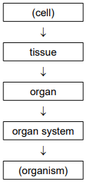

# Mark Schemes — Cell Structure & Size of Specimens
**2. Organisation of the Organism** · Cambridge (CIE) IGCSE science (0653)

## Exam Questions (6 questions)

### Q1
| letter in Fig. 1.1 | name of structure | function |
|---|---|---|
| **A** | (cell) membrane | controls the movement of substances into and out of cells |
| **D** | mitochondria | (site of aerobic) respiration |
| G | vacuole | support |

> **[mark-scheme]**
> - A: (cell) membrane **[1 mark]**
> - D: (site of aerobic) respiration **[1 mark]**
> - G **[1 mark]**
> - Vacuole: support **[1 mark]**
> 
> Accept storage

> **[exam-tip]**
> Learn each cell structure by pairing it with its single most important function — mitochondria with respiration, vacuole with storage/support — so you can recall them quickly.

> **[mark-scheme]**
> - One sequential pair correct **[1 mark]**
> - All three in the correct order **[2 marks]**

> **[exam-tip]**
> The order of biological organisation runs smallest to largest: cell, tissue, organ, organ system, organism — link each level to a concrete example (a cell, the stomach lining tissue, the stomach organ, the digestive system) to help it stick.

### Q2
**Final answer:** **The correct answer is C**

- Magnification = image size ÷ actual size
- Convert units so both are in the same unit: 35 mm = 35 000 μm
- Magnification = 35 000 ÷ 5500 = 6.4

### Q3
**Final answer:** **The correct answer is C**

- Magnification = image size ÷ actual size
- Magnification = 35 ÷ 5.5 = 6.4

### Q4
**Final answer:** **The correct answer is A**

- Blood is a connective tissue, a group of similar cells working together to perform a shared function

**B** is incorrect because the heart is an organ, not a tissue

**C** is incorrect because plasma is the liquid component of blood, not a tissue in its own right

**D** is incorrect because a plasmid is a small circular DNA molecule found in bacteria, not a tissue

### Q5
**Final answer:** **The correct answer is B**

- The mitochondria are the site of aerobic respiration, where most energy is released for the cell

### Q6
**Final answer:** **The correct answer is C**

- The plasmid is the small circular DNA molecule found in bacteria, separate from the main chromosomal DNA
