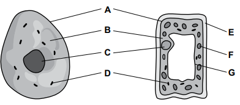
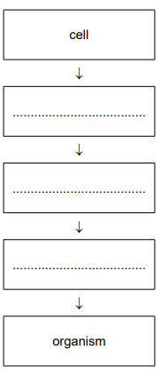
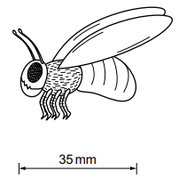
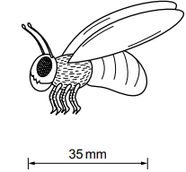
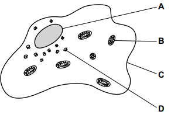
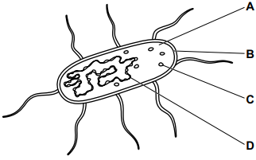

# Exam Questions — Cell Structure & Size of Specimens
**2. Organisation of the Organism** · Cambridge (CIE) IGCSE science (0653)
> Source: [https://www.savemyexams.com/igcse/science/cie/combined-science/23/biology/topic-questions/](https://www.savemyexams.com/igcse/science/cie/combined-science/23/biology/topic-questions/) · 6 questions across 1 sets

## Exam Questions (6 questions)

### Q1 — easy — 6 marks

**Q1** [4 marks]

Fig. 1.1 shows an animal cell and a plant cell.

**Fig 1.1**

Table 1.1 shows the names and functions of some of the structures of the cells labelled in Fig. 1.1.

| letter in Fig. 1.1 | name of structure | function |
|---|---|---|
| **A** | ...................... | controls the movement of substances into and out of cells |
| **D** | mitochondria | ...................... |
| .......... | vacuole | ...................... |

*Source: Specimen 2025 0653/03 Q1A*

**Q1** [2 marks]

Fig. 1.2 shows some structures organised in order of increasing size, starting with the smallest size.

**Fig. 1.2**

Use the words from the list to complete Fig. 1.2.

**organ         organ system         tissue**

*Source: Specimen 2025 0653/03 Q1B*

### Q2 — medium — 1 marks

**Q2** [1 mark]

The actual length of a phorid fly is 5500 μm long.

What is the magnification of this diagram of a phorid fly?

*Source: Specimen 2025 0653/02 Q2*

### Q3 — medium — 1 marks

**Q3** [1 mark]

The actual length of a phorid fly is 5.5 mm.

What is the magnification of this diagram of a phorid fly?

*Source: Specimen 2025 0653/01 Q5*

### Q4 — easy — 1 marks

**Q4** [1 mark]

What is a type of tissue in a living organism?

*Source: Specimen 2025 0653/01 Q4*

### Q5 — easy — 1 marks

**Q5** [1 mark]

Which label shows the site of aerobic respiration in this diagram of an animal cell?

*Source: Specimen 2025 0653/01 Q3*

### Q6 — easy — 1 marks

**Q6** [1 mark]

Which label represents a plasmid in this diagram of a bacterium?

*Source: Specimen 2025 0653/01 Q2*

