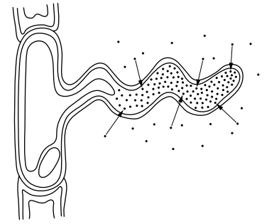
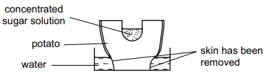
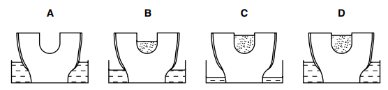

# Exam Questions — Diffusion, Osmosis & Active Transport
**3. Movement into & out of Cells** · Cambridge (CIE) IGCSE science (0653)
> Source: [https://www.savemyexams.com/igcse/science/cie/combined-science/23/biology/topic-questions/](https://www.savemyexams.com/igcse/science/cie/combined-science/23/biology/topic-questions/) · 3 questions across 1 sets

## Exam Questions (3 questions)

### Q1 — medium — 1 marks

**Q1** [1 mark]

The diagram shows a root hair cell.

Which type of transport is shown by the arrows in this diagram?

*Source: Specimen 2025 0653/02 Q4*

### Q2 — easy — 1 marks

**Q2** [1 mark]

Which factor would decrease the rate of diffusion from a plant cell?

*Source: Specimen 2025 0653/02 Q3*

### Q3 — medium — 1 marks

**Q3** [1 mark]

The diagram shows an uncooked potato being used in an experiment. The skin of the potato was removed as shown.

The experiment was left for a few hours.

Which diagram shows the result?

*Source: Specimen 2025 0653/01 Q6*

