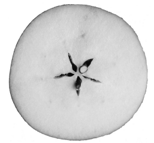
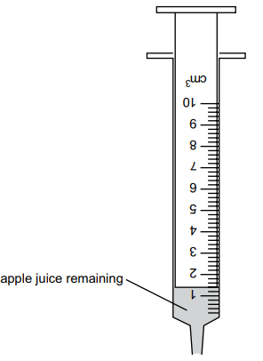

# Exam Questions — Biological Molecules
**4. Biological Molecules** · Cambridge (CIE) IGCSE science (0653)
> Source: [https://www.savemyexams.com/igcse/science/cie/combined-science/23/biology/topic-questions/](https://www.savemyexams.com/igcse/science/cie/combined-science/23/biology/topic-questions/) · 3 questions across 1 sets

## Exam Questions (3 questions)

### Q1 — medium — 7 marks

**Q1** [3 marks]

A student investigates vitamin C in apple juice.

The student is provided with half an apple and some apple juice.

Fig. 1.1 shows the cut surface of the apple provided.

**Fig. 1.1**

In the box, make a large drawing of the cut surface of the apple shown in Fig. 1.1.

*Source: Specimen 2025 0653/06 Q1A*

**Q1** [4 marks]

The student tests the apple juice using DCPIP.

DCPIP is a dark blue solution that turns colourless when vitamin C is added.

The greater the amount of vitamin C in the apple juice, the fewer the drops of apple juice needed to turn the DCPIP colourless.

**Procedure:**

The student:

- puts 2.0 cm3 DCPIP into a test-tube
- fills a syringe with 10.0 cm3 of apple juice
- adds apple juice to the DCPIP in the test-tube until the DCPIP turns colourless
- records in Table 1.1 the volume of apple juice remaining in the syringe for experiment 1.

The student repeats the procedure and records the volume of apple juice remaining in the syringe for experiment 2 in Table 1.1.

The student repeats the procedure again for experiment 3.

Fig. 1.2 shows the volume of apple juice remaining in the syringe in experiment 3.

**Fig. 1.2**

(i) Record in Table 1.1 the volume of apple juice remaining in the syringe in experiment 3.

**Table 1.1**

| experiment | volume of apple juice remaining in syringe / cm³ | volume of apple juice added to the DCPIP / cm³ |
|---|---|---|
| 1 | 1.3 | 8.7 |
| 2 | 1.5 | 8.5 |
| 3 |   |   |

[1]

(ii) Calculate the volume of apple juice added to the DCPIP in experiment 3.

Record your answer in Table 1.1.

[1]

(iii) Calculate the average volume of apple juice added.

[1]

(iv) Suggest why the student repeats the experiment.

[1]

*Source: Specimen 2025 0653/06 Q1B(I)*

### Q2 — medium — 7 marks

**Q2** [3 marks]

You are going to investigate vitamin C in apple juice.

You are provided with half an apple and some apple juice.

In the box, make a large drawing of the cut surface of the apple.

*Source: Specimen 0653/05 Q1A*

**Q2** [4 marks]

You will test the apple juice using DCPIP.

DCPIP is a dark blue solution that turns colourless when vitamin C is added.

The greater the amount of vitamin C in the apple juice, the fewer the drops of apple juice needed to turn the DCPIP colourless.

(i) **Procedure**

- Use a pipette to put 4 drops of DCPIP into each of three test-tubes.
- Use a clean pipette to add drops of apple juice to one of the test-tubes until the solution becomes colourless. Count the number of drops as you add them.
- Record the number of drops added. This is experiment 1. Record your results in Table 1.1.
- Repeat with the other two test-tubes (experiment 2 and experiment 3) and record your results in Table 1.1.

**Table 1.1 **

| Experiment | Number of drops of apple juice added |
|---|---|
| 1 |   |
| 2 |   |
| 3 |   |

(ii) Calculate the average number of drops of apple juice added for the three experiments.

[1]

(iii) Suggest one limitation of using a pipette in this procedure

[1]

*Source: Specimen 0653/05 Q1B(I)*

### Q3 — medium — 1 marks

**Q3** [1 mark]

The data shows the concentrations of sugar and starch in an onion.

| total sugar including reducing sugar (g per 100 g) | starch (g per 100 g) |
|---|---|
| 3.7 | 0.0 |

The onion is tested with Benedict's solution and iodine solution.

Which set of results is correct?

|   | Benedict’s solution | iodine solution |
|---|---|---|
| **A** | blue | blue-black |
| **B** | blue | yellow-brown |
| **C** | red | blue-black |
| **D** | red | yellow-brown |

*Source: Specimen 2025 0653/01 Q7*

