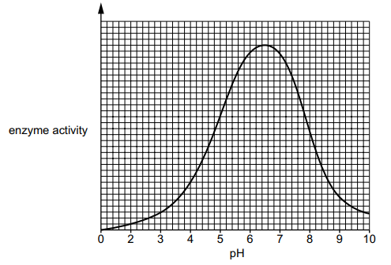

# Exam Questions — Enzymes
**5. Enzymes** · Cambridge (CIE) IGCSE science (0653)
> Source: [https://www.savemyexams.com/igcse/science/cie/combined-science/23/biology/topic-questions/](https://www.savemyexams.com/igcse/science/cie/combined-science/23/biology/topic-questions/) · 1 questions across 1 sets

## Exam Questions (1 questions)

### Q1 — medium — 4 marks

**Q1** [4 marks]

Fig. 3.2 shows the effect of pH on enzyme activity.

**Fig. 3.2**

(i) The enzyme in Fig. 3.2 is active in the mouth.

When the enzyme reaches the stomach, the enzyme activity changes.

Explain why the enzyme activity changes.

[3]

(ii) Draw a curve on Fig. 3.2 to show the activity of a protease enzyme found in the stomach.

[1]

*Source: Specimen 0653/04 Q3B(I)*

