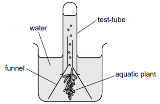
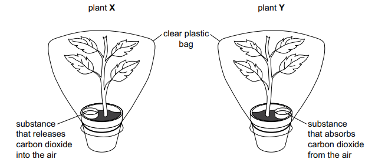
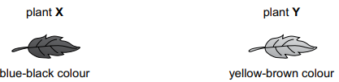
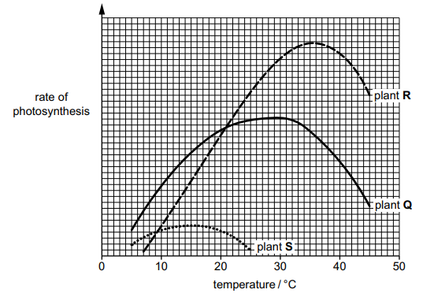

# Exam Questions — Photosynthesis & Leaf Structure
**6. Plant Nutrition** · Cambridge (CIE) IGCSE science (0653)
> Source: [https://www.savemyexams.com/igcse/science/cie/combined-science/23/biology/topic-questions/](https://www.savemyexams.com/igcse/science/cie/combined-science/23/biology/topic-questions/) · 4 questions across 1 sets

## Exam Questions (4 questions)

### Q1 — hard — 7 marks

**Q1** [7 marks]

When an aquatic plant is exposed to light, it produces bubbles of oxygen gas.

Plan an investigation to determine the relationship between light intensity and the volume of oxygen gas produced by the aquatic plant.

You are provided with the apparatus shown in Fig. 2.1.

**Fig.2.1**

You may use any other common laboratory apparatus in your plan.

In your plan, include:

- any **additional** apparatus and chemicals that you will use
- a brief description of the method, explaining any safety precautions you will take
- what you will measure
- which variables you will control
- how you will process your results to form a conclusion.

You may include a labelled diagram.

You may include a results table (you are not required to enter any readings in the table).

*Source: Specimen 2025 0653/06 Q2*

### Q2 — medium — 2 marks

**Q2** [2 marks]

Plants photosynthesise.

State the balanced symbol equation for photosynthesis.

*Source: Specimen 0653/04 Q2B*

### Q3 — medium — 6 marks

**Q3** [3 marks]

A student investigates photosynthesis using the set-up shown in Fig. 2.1.

**Fig. 2.1**

The student puts the plants in the same warm room with plenty of light.

After three days, the student uses iodine solution to test a leaf from each plant.

Fig. 2.2 shows the results.

**Fig. 2.2**

(i) Complete the sentences to explain the results in Fig. 2.2.

The colour of the iodine solution shows that only the leaf from plant X contains .................................................. .

This investigation shows that photosynthesis requires the presence of .................................................. .

[2]

(ii) State the name of the green pigment needed for photosynthesis.

[1]

*Source: Specimen 2025 0653/03 Q2A(I)*

**Q3** [3 marks]

Photosynthesis is an enzyme-controlled reaction.

Fig. 2.3 shows the effect of temperature on the rate of photosynthesis for three different plants.

(i) Identify the temperature at which the rate of photosynthesis for plant **Q** is highest.

[1]

(ii) In a desert, temperatures are often higher than 40 °C.

Explain why plant S would not survive in a desert.

Use the word enzyme in your answer.

[2]

*Source: Specimen 2025 0653/03 Q2B(I)*

### Q4 — medium — 1 marks

**Q4** [1 mark]

An aquatic plant is placed in a beaker of water containing hydrogencarbonate indicator and kept in the dark.

Which colour will the hydrogencarbonate indicator be after 24 hours?

*Source: Specimen 2025 0653/02 Q6*

