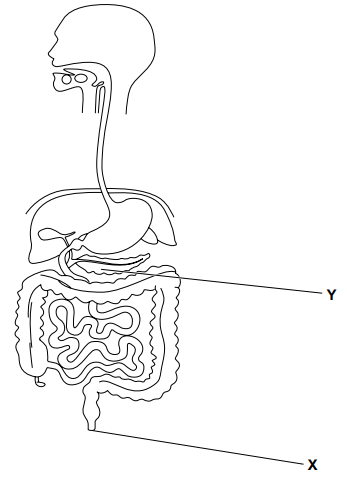

# Exam Questions — Human Diet & Digestion
**7. Human Nutrition** · Cambridge (CIE) IGCSE science (0653)
> Source: [https://www.savemyexams.com/igcse/science/cie/combined-science/23/biology/topic-questions/](https://www.savemyexams.com/igcse/science/cie/combined-science/23/biology/topic-questions/) · 1 questions across 1 sets

## Exam Questions (1 questions)

### Q1 — medium — 4 marks

**Q1** [4 marks]

Fig. 3.1 shows part of the human digestive system.

**Fig. 3.1**

(i) State the function of the part labelled **X** on Fig. 3.1.

[1]

(ii) Complete these sentences about the part labelled Y on Fig. 3.1.

The part labelled Y is the .................................................. .

Part Y releases an enzyme to break down fats and oils. This enzyme is called .................................................. .

Fats and oils are broken down into smaller molecules called .................................................. and ..................................................

[3]

*Source: Specimen 0653/04 Q3A(I)*

