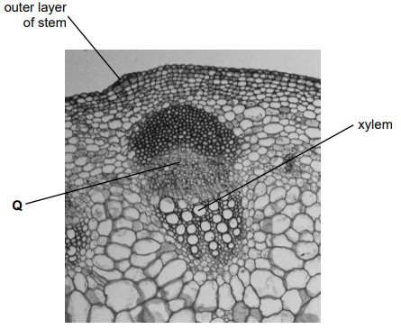
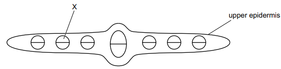

# Exam Questions — Transport in Plants
**8. Transport in Plants** · Cambridge (CIE) IGCSE science (0653)
> Source: [https://www.savemyexams.com/igcse/science/cie/combined-science/23/biology/topic-questions/](https://www.savemyexams.com/igcse/science/cie/combined-science/23/biology/topic-questions/) · 2 questions across 1 sets

## Exam Questions (2 questions)

### Q1 — medium — 2 marks

**Q1** [2 marks]

Fig. 2.1 shows a section of a plant stem.

(i) Circle the substances transported by the cells labelled **Q** on Fig. 2.1.

**      amino acids                 fatty acids                   glycerol                   glucose                                                                              nitrate ions                   starch                       sucrose**

[1]

(ii) One function of xylem is transport.

State one other function of xylem.

[1]

*Source: Specimen 0653/04 Q2A(I)*

### Q2 — medium — 1 marks

**Q2** [1 mark]

The diagram shows a cross-section through a leaf.

What are the functions of the tissue labelled X?

1. transport of amino acids
2. transport of sucrose
3. transport of water
4. support

*Source: Specimen 2025 0653/01 Q8*

