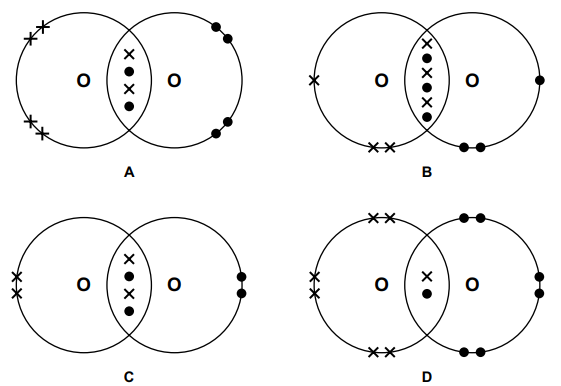

# Exam Questions — Simple Molecules & Covalent Bonds
**2. Atoms, Elements & Compounds** · Cambridge (CIE) IGCSE science (0653)
> Source: [https://www.savemyexams.com/igcse/science/cie/combined-science/23/chemistry/topic-questions/](https://www.savemyexams.com/igcse/science/cie/combined-science/23/chemistry/topic-questions/) · 1 questions across 1 sets

## Exam Questions (1 questions)

### Q1 — medium — 1 marks

**Q1** [1 mark]

Which dot-and-cross diagram shows the outer shell electrons in a molecule of oxygen, O₂?

*Source: Specimen 2025 0653/02 Q16*

