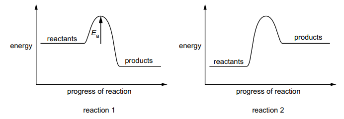
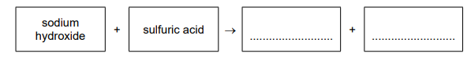

# Exam Questions — Exothermic & Endothermic Reactions
**5. Chemical Energetics** · Cambridge (CIE) IGCSE science (0653)
> Source: [https://www.savemyexams.com/igcse/science/cie/combined-science/23/chemistry/topic-questions/](https://www.savemyexams.com/igcse/science/cie/combined-science/23/chemistry/topic-questions/) · 2 questions across 1 sets

## Exam Questions (2 questions)

### Q1 — medium — 3 marks

**Q1** [2 marks]

Fig. 4.1 shows the reaction pathway diagrams for two reactions.

The activation energy for reaction 1 is represented by the arrow Ea.

(i) Define activation energy.

[1]

(ii) On Fig. 4.1, draw and label an arrow to show the activation energy for reaction 2.

[1]

*Source: Specimen 0653/04 Q4A(I)*

**Q1** [1 mark]

During reaction 2, the temperature of the reaction mixture changes.

State how the temperature changes.

Give a reason for your answer.

*Source: Specimen 0653/04 Q4B*

### Q2 — medium — 3 marks

**Q2** [3 marks]

The electrolysis shown in Fig. 4.1 produces the alkali sodium hydroxide.

Aqueous sodium hydroxide reacts with dilute sulfuric acid.

(i) Complete the word equation for this reaction.

[1]

(ii) The reaction between aqueous sodium hydroxide and dilute sulfuric acid is exothermic.

State what is meant by an exothermic reaction.

[2]

*Source: Specimen 2025 0653/03 Q4D(I)*

