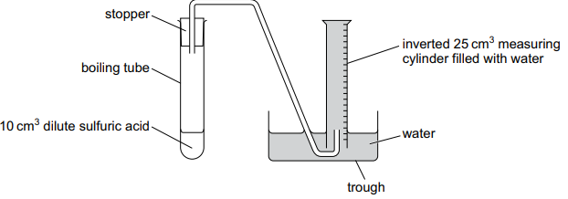
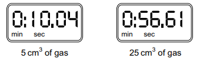
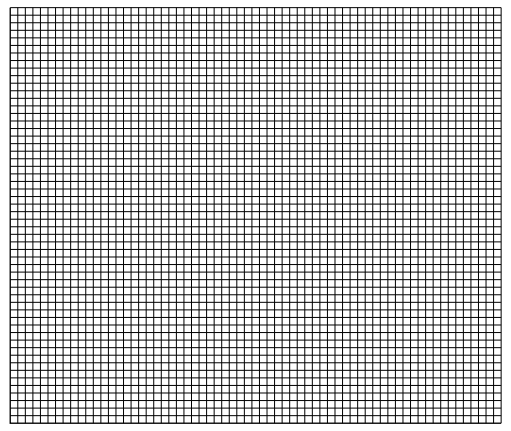
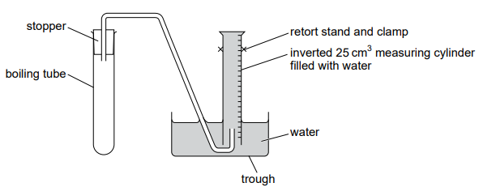

# Exam Questions — Chemical Change & Rate of Reaction
**6. Chemical Reactions** · Cambridge (CIE) IGCSE science (0653)
> Source: [https://www.savemyexams.com/igcse/science/cie/combined-science/23/chemistry/topic-questions/](https://www.savemyexams.com/igcse/science/cie/combined-science/23/chemistry/topic-questions/) · 5 questions across 1 sets

## Exam Questions (5 questions)

### Q1 — medium — 9 marks

**Q1** [9 marks]

**Procedure **

The student:

- uses a measuring cylinder to measure 10 cm3 of dilute sulfuric acid
- adds the dilute sulfuric acid to a boiling tube
- sets up apparatus as shown in Fig. 3.1

**Fig. 3.1**

- removes the stopper from the boiling tube
- adds one spatula of metal F to the boiling tube
- puts the stopper back into the boiling tube and starts the stop-watch
- records in Table 3.1 the time taken to collect 5 cm3 , 10 cm3 , 15 cm3 , 20 cm3 and 25 cm3 of gas.

(i) Fig. 3.2 shows the stop-watch readings for 5 cm3 and 25 cm3 of gas collected.

**Fig.3.2**

Record in Table 3.1 the time taken to the nearest second to collect 5 cm3 and 25 cm3 of gas.

**Table 3.1**

| volume of gas collected / cm³ | time taken / s |
|---|---|
| 5 |   |
| 10 | 22 |
| 15 | 34 |
| 20 | 46 |
| 25 |   |

[2]

(ii) State the independent variable and the dependent variable in this investigation.

[1]

(iii) On the grid, plot a graph of volume of gas collected (vertical axis) against time taken.

[3]

(iv) Draw the line of best fit.

[1]

(v) Describe the relationship between the volume of gas collected and the time taken.

[1]

(vi) Suggest one possible source of error in the measurement of the time taken.

[1]

(vii) Suggest one way to obtain a more accurate measurement of the volume of gas collected.

[1]

*Source: Specimen 2025 0653/06 Q3B(I)*

### Q2 — medium — 11 marks

**Q2** [11 marks]

**Procedure**

- Set up the apparatus as shown in Fig. 3.1.

**Fig. 3.1**

- Use the 10 cm3 measuring cylinder to measure 10 cm3 of dilute sulfuric acid.
- Remove the stopper from the boiling tube.
- Add the dilute sulfuric acid to the boiling tube.
- Add about 1 cm3 of aqueous copper(II) sulfate to the boiling tube.
- Add a spatula of metal **F** to the boiling tube.
- Put the stopper back into the boiling tube and start the stop-watch.

(i) Record in Table 3.1 the time taken to collect 5 cm3 , 10 cm3 , 15 cm3 , 20 cm3 and 25 cm3 of gas.

Record each time to the nearest second.

**Table 3.1**

| volume of gas collected  / cm3 | time taken  / s |
|---|---|
| 5 |   |
| 10 |   |
| 15 |   |
| 20 |   |
| 25 |   |

[3]

(ii) State the independent variable and the dependent variable in this investigation.

independent variable ......................................................................................................... dependent variable ............................................................................................................

[1]

(iii) On the grid, plot a graph of volume of gas collected (vertical axis) against time taken.

[3]

(iv) Draw the line of best fit.

[1]

(v) Describe the relationship between the volume of gas collected and the time taken.

[1]

(vi) Suggest one possible source of error in the measurement of the time taken.

[1]

(vii) Suggest one way to obtain a more accurate measurement of the volume of gas collected.

[1]

*Source: Specimen 0653/05 Q3A(II)*

### Q3 — medium — 4 marks

**Q3** [4 marks]

Calcium carbonate reacts with dilute hydrochloric acid to produce calcium chloride.

(i) State the names of the other **two** products in this reaction.

[2]

(ii) The rate of this reaction can be increased by increasing the temperature of the hydrochloric acid.

Explain why.

Use ideas about particle collisions and energy in your answer.

[2]

*Source: Specimen 0653/04 Q4C(I)*

### Q4 — medium — 4 marks

**Q4** [2 marks]

Iron reacts with dilute hydrochloric acid to form hydrogen and a salt.

(i) Explain why this is a chemical change.

[1]

(ii) State the test for hydrogen and give the observation for a positive result.

test .................................................

observation .....................................

[1]

*Source: Specimen 2025 0653/03 Q6C(I)*

**Q4** [2 marks]

Iron is used as a catalyst in some chemical reactions.

Describe what is meant by a catalyst.

*Source: Specimen 2025 0653/03 Q6D*

### Q5 — medium — 1 marks

**Q5** [1 mark]

Which statement explains how a catalyst increases the rate of a chemical reaction?

*Source: Specimen 2025 0653/02 Q19*

