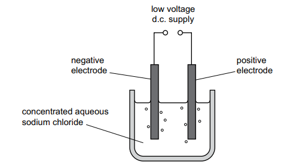

# Exam Questions — Electrochemistry
**4. Electrochemistry** · Cambridge (CIE) IGCSE science (0653)
> Source: [https://www.savemyexams.com/igcse/science/cie/combined-science/23/chemistry/topic-questions/](https://www.savemyexams.com/igcse/science/cie/combined-science/23/chemistry/topic-questions/) · 2 questions across 1 sets

## Exam Questions (2 questions)

### Q1 — medium — 3 marks

**Q1** [1 mark]

Fig. 4.1 shows the electrolysis of concentrated aqueous sodium chloride using inert electrodes.

State the name of the positive electrode.

*Source: Specimen 2025 0653/03 Q4A*

**Q1** [2 marks]

Identify the gases produced at the electrodes.

positive electrode: ..................

negative electrode: ..................

*Source: Specimen 2025 0653/03 Q4B*

### Q2 — medium — 1 marks

**Q2** [1 mark]

Which row identifies the product at each electrode during the electrolysis of molten potassium bromide using inert electrodes?

|   | anode | cathode |
|---|---|---|
| **A** | bromide ions | potassium ions |
| **B** | bromine | potassium |
| **C** | potassium | bromine |
| **D** | potassium ions | bromide ions |

*Source: Specimen 2025 0653/02 Q18*

