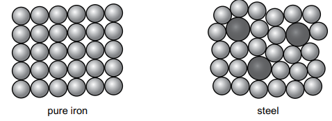

# Exam Questions — Properties, Uses & Alloys of Metals
**9. Metals** · Cambridge (CIE) IGCSE science (0653)
> Source: [https://www.savemyexams.com/igcse/science/cie/combined-science/23/chemistry/topic-questions/](https://www.savemyexams.com/igcse/science/cie/combined-science/23/chemistry/topic-questions/) · 1 questions across 1 sets

## Exam Questions (1 questions)

### Q1 — easy — 7 marks

**Q1** [3 marks]

Table 5.1 gives information about aluminium and copper:

**Table 5.1**

|   | Aluminium | Copper |
|---|---|---|
| Density in g/cm³ | 2.7 | 8.9 |
| Melting point / (°C) | 660 | 1084 |
| Electrical conductivity | high | high |
| Other information | Forms a layer of aluminium oxide which preventscorrosion | Some copper compounds are toxic |

Use information from Table 5.1 to answer the following questions.

(i) State why aluminium and copper are used in electrical cables.

[1]

(ii) State why aluminium is used in overhead electrical cables.

[1]

(iii) State why copper is not used to make food containers.

[1]

*Source: Specimen 0653/04 Q5A(I)*

**Q1** [4 marks]

Steel is an alloy of iron. There are different types of steel.

Fig. 5.1 shows the arrangement of particles in pure iron and in one type of steel.

**Fig. 5.1**

(i) Describe what is meant by an alloy.

[1]

(ii) Explain why steel is stronger than pure iron.

[2]

(iii) Stainless steel is an alloy of iron. Stainless steel is used to make cutlery because it is strong.

State one other reason why stainless steel is used to make cutlery.

[1]

*Source: Specimen 0653/04 Q5B(I)*

