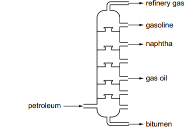
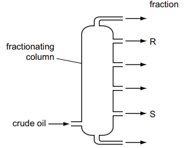

# Exam Questions — Fuels
**11. Organic Chemistry** · Cambridge (CIE) IGCSE science (0653)
> Source: [https://www.savemyexams.com/igcse/science/cie/combined-science/23/chemistry/topic-questions/](https://www.savemyexams.com/igcse/science/cie/combined-science/23/chemistry/topic-questions/) · 3 questions across 1 sets

## Exam Questions (3 questions)

### Q1 — medium — 2 marks

**Q1** [2 marks]

Petroleum is a mixture of hydrocarbons.

The mixture is separated using the fractional distillation apparatus shown in Fig. 5.1.

Two fractions obtained from the distillation of petroleum are refinery gas and gasoline.

State one use of each of these fractions.

refinery gas: ..................

gasoline: ..................

*Source: Specimen 2025 0653/03 Q5A*

### Q2 — medium — 1 marks

**Q2** [1 mark]

The diagram shows a fractionating column used in the separation of petroleum.

Which row explains why fraction R is collected above fraction S?

|   | boiling point of R | average chain length of R |
|---|---|---|
| **A** | higher than S | longer than S |
| **B** | higher than S | shorter than S |
| **C** | lower than S | longer than S |
| **D** | lower than S | shorter than S |

*Source: Specimen 2025 0653/02 Q26*

### Q3 — easy — 1 marks

**Q3** [1 mark]

Petroleum is separated by fractional distillation.

Which fraction is used as a fuel in diesel engines?

*Source: Specimen 2025 0653/01 Q26*

