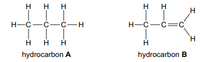

# Exam Questions — Terminology
**11. Organic Chemistry** · Cambridge (CIE) IGCSE science (0653)
> Source: [https://www.savemyexams.com/igcse/science/cie/combined-science/23/chemistry/topic-questions/](https://www.savemyexams.com/igcse/science/cie/combined-science/23/chemistry/topic-questions/) · 1 questions across 1 sets

## Exam Questions (1 questions)

### Q1 — medium — 4 marks

**Q1** [4 marks]

Fig. 5.2 shows two hydrocarbon molecules.

**Fig. 5.2**

(i) State the molecular formula of hydrocarbon A.

[1]

(ii) State which hydrocarbon is saturated.

Give a reason for your answer.

hydrocarbon ...............................................................................................

reason ..........................................................................................................

[1]

(iii) State the chemical test that is used to distinguish between hydrocarbon A and hydrocarbon B.

State the observation for each hydrocarbon.

test ..................................................................................

observation for hydrocarbon A ..........................................................................................

observation for hydrocarbon B ..........................................................................................

[2]

*Source: Specimen 2025 0653/03 Q5B(I)*

