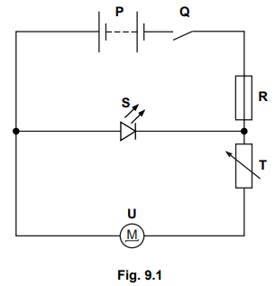
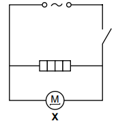
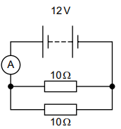
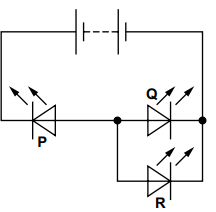
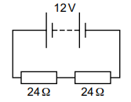

# Exam Questions — Electric Circuits & Electrical Safety
**4. Electricity & Magnetism** · Cambridge (CIE) IGCSE science (0653)
> Source: [https://www.savemyexams.com/igcse/science/cie/combined-science/23/physics/topic-questions/](https://www.savemyexams.com/igcse/science/cie/combined-science/23/physics/topic-questions/) · 6 questions across 1 sets

## Exam Questions (6 questions)

### Q1 — medium — 4 marks

**Q1** [4 marks]

Fig. 9.1 shows a circuit used in a toy car.

**Fig. 9.1**

(i) The resistance of component **T** is $5 . 4 Ω$. The resistance of component **U** is $3 . 5 Ω$.

Calculate the combined resistance of components T and U.

[1]

(ii) The current in component R is 2.7 A. The current in component T is 2.5 A.

Determine the current in component S and component U.

[2]

(iii) State the name of component S.

[1]

*Source: Specimen 0653/04 Q9A(I)*

### Q2 — medium — 4 marks

**Q2** [4 marks]

Fig. 7.1 shows an electric heater connected in a circuit.

**Fig. 7.1**

(i) State the name of component X.

[1]

(ii) The current in component X is 0.5 A.

The current in the heater is 8.3 A.

Circle the value of the current from the source.

0.5 A7.8 A8.3 A8.8 A

[1]

(iii) The electric heater uses 2.0 kW of electrical power.

Electrical energy costs \$0.15 per kWh.

Calculate the cost of using the heater for 5.5 hours.

[2]

*Source: Specimen 2025 0653/03 Q7A*

### Q3 — easy — 1 marks

**Q3** [1 mark]

A teacher wants to connect an electric heater to the mains supply.

The safety label on the heater states that the heater is double-insulated.

What does the teacher know from reading this label?

*Source: Specimen 2025 0653/02 Q38*

### Q4 — medium — 1 marks

**Q4** [1 mark]

The diagram shows a 12 V battery connected to an ammeter and two $10 Ω$ resistors.

What is the reading on the ammeter?

*Source: Specimen 2025 0653/02 Q37*

### Q5 — medium — 1 marks

**Q5** [1 mark]

The diagram shows a battery that is connected to three LEDs, **P**, **Q** and **R**.

Which of the LEDs are lit?

*Source: Specimen 2025 0653/02 Q36*

### Q6 — medium — 1 marks

**Q6** [1 mark]

Two $24 Ω$ resistors are connected in series to a 12 V battery.

What is the current in **one** of the resistors?

*Source: Specimen 2025 0653/01 Q36*

