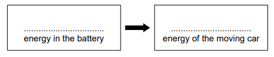
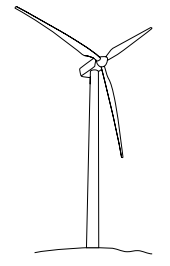
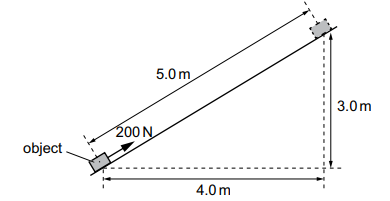

# Exam Questions — Energy, Work & Power
**1. Motion, Forces & Energy** · Cambridge (CIE) IGCSE science (0653)
> Source: [https://www.savemyexams.com/igcse/science/cie/combined-science/23/physics/topic-questions/](https://www.savemyexams.com/igcse/science/cie/combined-science/23/physics/topic-questions/) · 4 questions across 1 sets

## Exam Questions (4 questions)

### Q1 — medium — 9 marks

**Q1** [4 marks]

Fig. 9.1 shows a circuit used in a toy car.

**Fig. 9.1**

(i) The resistance of component **T** is $5 . 4 Ω$. The resistance of component **U** is $3 . 5 Ω$.

Calculate the combined resistance of components T and U.

[1]

(ii) The current in component R is 2.7 A. The current in component T is 2.5 A.

Determine the current in component S and component U.

[2]

(iii) State the name of component S.

[1]

*Source: Specimen 0653/04 Q9A(I)*

**Q1** [5 marks]

Component U is an electric motor. When the motor is switched on, the toy car moves.

(i) Complete Fig. 9.2 to show one energy transfer that occurs.

**Fig. 9.2**

[2]

(ii) The toy car moves for 10 s.

The power input to the motor is 3.6 W.

The useful energy output by the motor is 32 J.

Show that the efficiency of the motor is `89 \%`.

[3]

*Source: Specimen 0653/04 Q9B(I)*

### Q2 — medium — 3 marks

**Q2** [3 marks]

The student climbs a step into the school.

The student has a mass of 55 kg. The step is 0.15 m high.

Calculate the increase in the gravitational potential energy $\Delta E_{p}$ of the student climbing the step.

Include the unit in your answer.

(Take g = 9.8 N/kg)

*Source: Specimen 0653/04 Q7B*

### Q3 — medium — 2 marks

**Q3** [2 marks]

Fig. 7.2 shows a wind turbine used to generate electricity from the power of the wind.

**Fig. 7.2**

A wind turbine produces electrical power of 2200 W at a voltage of 240 V.

Calculate the energy transferred by the wind turbine in 15 seconds.

*Source: Specimen 2025 0653/03 Q7B*

### Q4 — medium — 1 marks

**Q4** [1 mark]

The diagram shows a force of 200 N pulling an object up a slope. The object moves 5.0 m along the slope.

The object moves 3.0 m vertically upwards and 4.0 m horizontally.

How much work is done by the 200 N force?

*Source: Specimen 2025 0653/01 Q30*

