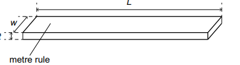
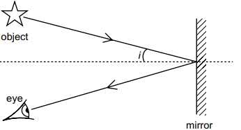

# Mark Schemes — Mass, Weight & Density
**1. Motion, Forces & Energy** · Cambridge (CIE) IGCSE science (0653)

## Exam Questions (4 questions)

### Q1
(i)

> **[mark-scheme]**
> - dashed lines added to show both ends of the metre rule AND a double-headed arrow touching the dashed lines AND the arrow labelled L **[1 mark]**

(ii)

> **[mark-scheme]**
> - w = 2.5 cm **[1 mark]**
> - t = 0.5 cm **[1 mark]**

(iii)

> **[mark-scheme]**
> - the ruler only takes readings with a precision of 0.1 cm (has a smallest division of 0.1 cm) **[1 mark]**

(iv)

To calculate the volume of the metre rule:

- List the known quantities:

- Length, L = 100.0 cm
- Width, w = 2.5 cm
- Thickness, t = 0.5 cm

- Write down the equation:

$V = L \times w \times t$

- Substitute the known values:

$V = 100 . 0 \times 2 . 5 \times 0 . 5$

- Calculate the answer:

V = **125 cm^3^** **[1 mark]**

> **[mark-scheme]**
> 1 mark for a correct final answer of 125 cm3
> 
> - Accept ecf (error carried forward) from part (a)(ii)

> **[exam-tip]**
> When drawing a dimension arrow on a diagram, always add dashed reference lines at both ends first, then draw the double-headed arrow between them and label it clearly — this makes it unambiguous exactly what length you're indicating.
(i)

To calculate the distance $x_{1}$ from the centre of the load to the pivot:

$x_{1} = 67 . 1 - 60 . 0$

x1 = **7.1 cm** **[1 mark]**

> **[mark-scheme]**
> 1 mark for a correct answer of 7.1 cm

(ii)

To calculate the distance $x_{2}$ from the centre of the load to the pivot:

$x_{2} = 84 . 2 - 70 . 0$

x2 = **14.2 cm** **[1 mark]**

> **[mark-scheme]**
> 1 mark for a correct answer of 14.2 cm

(iii)

To calculate the mass M of the metre rule:

`M = 5 \left(\right. x_{1} + x_{2} \left.\right) = 5 \left(\right. 7.1 + 14.2 \left.\right)`

M = **106.5 g** **[1 mark]**

> **[mark-scheme]**
> 1 mark for a correct answer of 106.5 g
> 
> - Accept 106, 107, or 110

> **[exam-tip]**
> This method uses the principle of moments — measuring the load's balance position at two different pivot positions lets you calculate the rule's own mass without weighing it directly, by comparing how far the load must move each time.
(i)

> **[mark-scheme]**
> - (electronic) (top-pan) balance **[1 mark]**

(ii)

> **[mark-scheme]**
> - zero / systematic (error) **[1 mark]**
> - Accept calibration

> **[exam-tip]**
> A zero error (also called a systematic error) means every reading is shifted by the same fixed amount, even when nothing is being measured — check the reading at zero before you start, and correct for it if it's not showing exactly zero.
To calculate the density of the material:

$ρ = \frac{M}{V} = \frac{106.5}{125}$

**Final answer:** $ρ =$**0.852 g/cm^3^**

Rounding to two significant figures:

$ρ =$**0.85 g/cm****3** **[1 mark]**

> **[mark-scheme]**
> 1 mark for a calculation shown giving $0 . 852$
> 
> 1 mark for a correct answer of $0 . 85$, given to two significant figures
> 
> 1 mark for the correct unit, g/cm3
> 
> - Accept ecf from the candidate's own values in parts (a)(iv) and (b)(iii)

> **[exam-tip]**
> Density calculations often ask for a specific number of significant figures — always give your rounded final answer to exactly the number requested, and don't forget to state the unit, since it usually carries its own mark.

### Q2
(i)

> **[mark-scheme]**
> - w and t recorded AND w > t **[1 mark]**
> - both recorded to the nearest 0.1 cm **[1 mark]**

(ii)

> **[mark-scheme]**
> - the ruler only takes readings with a precision of 0.1 cm (has a smallest division of 0.1 cm) **[1 mark]**

(iii)

Using the equation $V = L \times w \times t$ and your measured values of w and t from part (a)(i):

$V = L \times w \times t$

> **[mark-scheme]**
> - correct answer using the candidate's own measured values **[1 mark]**
> - must be consistent with the supervisor's results
> - accept 1 mm for 0.1 cm
> - ignore significant figures

> **[exam-tip]**
> In practical questions, your calculated answers must be consistent with your own measured values, not a fixed "correct" number — as long as your working correctly uses your recorded w and t, you'll gain the mark even if your raw measurements differ slightly from other students'.
(i)

> **[mark-scheme]**
> - $x_{1}$ recorded **[1 mark]**

(ii)

> **[mark-scheme]**
> - $x_{2}$ recorded **[1 mark]**
> - $x_{2}$ larger than $x_{1}$ **[1 mark]**

(iii)

Using the equation `M = 5 \left(\right. x_{1} + x_{2} \left.\right)` and your measured values of $x_{1}$ and $x_{2}$ from parts (b)(i) and (b)(ii):

`M = 5 \left(\right. x_{1} + x_{2} \left.\right)`

> **[mark-scheme]**
> - M calculation correct using the candidate's own values **[1 mark]**
> - value within 10% of the supervisor's value **[1 mark]**

(iv)

> **[mark-scheme]**
> - difficulty in obtaining an exact balance / difficulty in placing the centre of the load over the correct mark on the ruler / other sensible practical difficulty **[1 mark]**

> **[exam-tip]**
> When the mark scheme says "ignore significant figures and rounding errors", small variations caused by your own equipment and measurement technique won't cost you marks — focus on using the correct method and your own consistent data.
Using the equation $ρ = \frac{M}{V}$ and your calculated values of M and V from parts (a)(iii) and (b)(iii):

$ρ = \frac{M}{V}$

> **[mark-scheme]**
> - density correct from the candidate's own values **[1 mark]**
> - answer given to two significant figures **[1 mark]**
> - correct unit, g/cm3 **[1 mark]**

> **[exam-tip]**
> Always check how many significant figures a question asks for — here you must round your final answer to two significant figures, and remember the unit for density from these measurements is g/cm³, not kg/m³.

### Q3
> **[mark-scheme]**
> - water: floats AND ethanol: sinks **[1 mark]**
> - density of poly(ethene) is between the density of water (greater) and ethanol (lower) **[1 mark]**

> **[exam-tip]**
> An object floats in a liquid if its density is lower than the liquid's density, and sinks if its density is higher. Compare the ball's density directly against each liquid's density from the table before deciding.
(i)

To calculate the volume of the aluminium:

- List the known quantities:

- Mass, m = 9.0 g
- Density, $ρ = 2 . 7 \text{g} / \text{cm}^{3}$

- Write down the equation:

$ρ = \frac{m}{V}$

- Rearrange for volume:

$V = \frac{m}{ρ}$

- Substitute the known values:

$V = \frac{9.0}{2.7}$ **[1 mark]**

- Calculate the answer:

V = **3.3 cm****3** **[1 mark]**

> **[mark-scheme]**
> 1 mark for correct substitution into $V = \frac{m}{ρ}$ (accept formula in any form)
> 
> 1 mark for a correct final answer of 3.3 cm3
> 
> - Accept 3 significant figures but no more

(ii)

> **[mark-scheme]**
> - normal drawn correctly AND angle of incidence correctly shown **[1 mark]**
> - reflected ray to eye AND angle of reflection approximately equal to angle of incidence **[1 mark]**

> **[exam-tip]**
> For ray diagrams, always draw the normal as a dashed line at right angles to the mirror at the point of reflection, then measure the angle of incidence and angle of reflection from this normal — not from the mirror surface itself.

### Q4
**Final answer:** **The correct answer is B**

- An object floats when the liquid's density is greater than the object's density
- The block has a density of 1.1 g/cm3, so it floats only in liquids Y (1.2 g/cm3) and Z (1.3 g/cm3), which are both denser than the block
- It sinks in liquid X (1.0 g/cm3), which is less dense than the block

**A** is incorrect because the block also floats in liquid Z, since Z is denser than the block, not just Y

**C** is incorrect because the block sinks in liquid X, since X is less dense than the block

**D** is incorrect because the block floats in both Y and Z, but sinks in X, since X is less dense than the block
