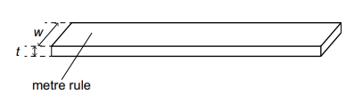
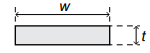
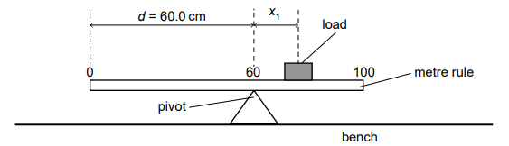
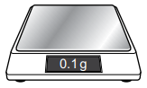
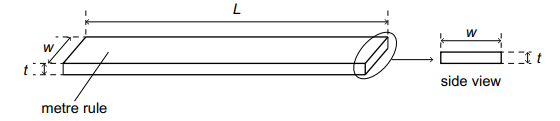
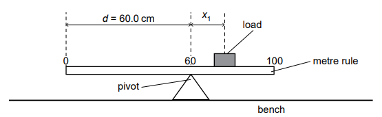
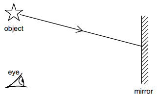

# Exam Questions — Mass, Weight & Density
**1. Motion, Forces & Energy** · Cambridge (CIE) IGCSE science (0653)
> Source: [https://www.savemyexams.com/igcse/science/cie/combined-science/23/physics/topic-questions/](https://www.savemyexams.com/igcse/science/cie/combined-science/23/physics/topic-questions/) · 4 questions across 1 sets

## Exam Questions (4 questions)

### Q1 — medium — 13 marks

**Q1** [5 marks]

A student determines the density of the material used to make a metre rule.

Fig. 4.1 shows the metre rule (not drawn to scale).

**Fig. 4.1 (not to scale)**

(i) On Fig. 4.1, draw a double-headed arrow (↔) to show the length *L* of the metre rule.

[1]

(ii) Fig. 4.2 shows the actual size of the end of the metre rule.

**Fig. 4.2 (actual size)**

Use a ruler to measure width w and thickness t of the metre rule in Fig. 4.2.

Record each measurement to the nearest 0.1 cm.

[2]

(iii) The measurements in (a)(ii) are recorded to the nearest 0.1 cm.

State why it is not appropriate to record the measurements to the nearest 0.01 cm.

[1]

(iv) The length L of the metre rule is 100.0 cm.

Calculate the volume V of the metre rule.

Use your answers to (a)(ii) and the equation shown.

$V = L \times w \times t$

[1]

*Source: Specimen 2025 0653/06 Q4A(I)*

**Q1** [3 marks]

The student determines the mass *M* of the metre rule using a balancing method.

Procedure

The student:

**step 1** places a pivot directly under the 60.0 cm mark on the metre rule.

Fig. 4.3 shows the distance d = 60.0 cm.

**Fig. 4.3 (not to scale)**

**step 2** places a load on the metre rule and adjusts the position of the load so that the rule balances

**step 3** records that the centre of the load is directly above the 67.1 cm mark on the metre rule.

(i) Calculate the distance $x_{1}$ from the centre of the load to the pivot.

[1]

**step 4** moves the pivot so that distance d = 70.0 cm

**step 5** adjusts the position of the load so that the metre rule balances

**step 6** records that the centre of the load is directly above the 84.2 cm mark on the metre rule

(ii) Calculate the distance $x_{2}$ from the centre of the load to the pivot.

[1]

(iii) Use the results for (b)(i) and (b)(ii) to calculate the mass M of the metre rule.

Use the equation shown.

`M = 5 \left(\right. x_{1} + x_{2} \left.\right)`

[1]

*Source: Specimen 2025 0653/06 Q4B(I)*

**Q1** [2 marks]

Fig. 4.4 shows apparatus used for measuring mass.

**Fig. 4.4**

(i) State the name of the apparatus shown in Fig. 4.4.

[1]

(ii) The apparatus in Fig. 4.4 is showing an error.

State the type of error shown in Fig. 4.4.

[1]

*Source: Specimen 2025 0653/06 Q4C(I)*

**Q1** [3 marks]

Use your answers to (a)(iv) and (b)(iii) to calculate the density ρ of the material used to make the metre rule.

Use the equation shown.

$ρ = \frac{M}{V}$

Give your answer to two significant figures.

Give the unit for your answer.

*Source: Specimen 2025 0653/06 Q4D*

### Q2 — medium — 13 marks

**Q2** [4 marks]

You are going to determine the density of the material used to make a metre rule.

Fig. 4.1 shows the length L, width w and thickness t of a metre rule.

**Fig. 4.1 (not to scale)**

(i) Use the ruler to measure the width **w** and thickness **t** of your metre rule.

Record each measurement to the nearest $0 . 1 \text{cm}$.

[2]

(ii) The measurements in (a)(i) are recorded to the nearest $0 . 1 \text{cm}$.

State why it is not appropriate to record the measurements to the nearest $0 . 01 \text{cm}$.

[1]

(iii) The length L of the metre rule is $100 . 0 \text{cm}$.

Calculate the volume V of the metre rule.

Use your answers to (a)(i) and the equation shown.

$V = L \times w \times t$

[1]

*Source: Specimen 0653/05 Q4A(I)*

**Q2** [6 marks]

You are going to determine the mass **M** of the metre rule using a balancing method.

(i)  **Procedure**

**step 1 **                Place the pivot directly under the 60 cm mark on the metre rule.

Fig. 4.2 shows distance d = 60.0 cm.

**Fig. 4.2**

**step 2           ** Place the load on the metre rule.

**step 3               **Adjust the position of the load until the metre rule is as close to balance as possible.

Measure distance x1 from the centre of the load to the pivot.

[1]

(ii) **Procedure**

**step 4**            Remove the load.

**step 5  **           Move the pivot to directly underneath the 70 cm mark so that distance d = 70.0 cm.

**step 6   **            Repeat step 2 and step 3 in (b)(i).

Measure distance X2 from the centre of the load to the pivot.

[2]

(iii) Use your results for (b)(i) and (b)(ii) to calculate the mass M of the metre rule.

Use the equation shown.

M = 5 (x1 + x2)

[2]

(iv) State one practical difficulty involved in using this method to determine M.

[1]

*Source: Specimen 0653/05 Q4B(I)*

**Q2** [3 marks]

Use your answers to (a)(iii) and (b)(iii) to calculate the density ρ of the material used to make the metre rule.

Use the equation shown.

$ρ = \frac{M}{V}$

Give your answer to **two** significant figures.

Give the unit for your answer.

*Source: Specimen 0653/05 Q4C*

### Q3 — medium — 6 marks

**Q3** [2 marks]

A ball made of poly(ethene) has a density of 0.9 g/cm³.

Predict what happens to the ball when placed in a beaker of water and in a beaker of ethanol.

Use the data in Table 9.1 to explain your answer.

water: ..................

ethanol: ..................

explanation: ..................

*Source: Specimen 2025 0653/03 Q9B*

**Q3** [4 marks]

A thin, flat piece of aluminium is used as a mirror.

(i) The piece of aluminium has a mass of 9.0 g.

Use information from Table 9.1 to calculate the volume of the piece of aluminium.

[2]

(ii) Fig. 9.2 shows a person’s eye looking at the reflection of an object placed in front of the aluminium mirror.

**Fig. 9.2**

On Fig. 9.2:

- draw the normal line and label the angle of incidence of the incident ray with the letter i.
- draw the reflected ray to show how the eye is able to see the reflected image of the object.

[2]

*Source: Specimen 2025 0653/03 Q9D*

### Q4 — medium — 1 marks

**Q4** [1 mark]

A solid block has a density of 1.1 g/cm3.

The block is lowered into three liquids, X, Y and Z, with different densities.

The densities of the liquids are:

liquid X: 1.0 g/cm3

liquid Y: 1.2 g/cm3

liquid Z: 1.3 g/cm3

In which of the liquids does the block float?

*Source: Specimen 2025 0653/01 Q29*

