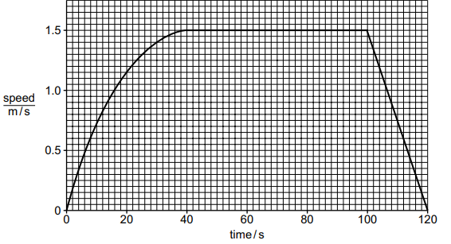
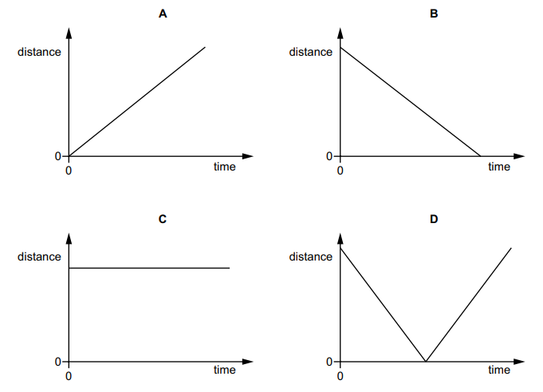

# Exam Questions — Motion
**1. Motion, Forces & Energy** · Cambridge (CIE) IGCSE science (0653)
> Source: [https://www.savemyexams.com/igcse/science/cie/combined-science/23/physics/topic-questions/](https://www.savemyexams.com/igcse/science/cie/combined-science/23/physics/topic-questions/) · 4 questions across 1 sets

## Exam Questions (4 questions)

### Q1 — easy — 1 marks

**Q1** [1 mark]

A rock has a mass of 20 kg. The rock is at rest at a height of 5.0 m above the ground.

It then falls to the ground.

What is the speed of the rock just before it hits the ground?

*Source: Specimen 2025 0653/02 Q29*

### Q2 — medium — 5 marks

**Q2** [5 marks]

Fig. 7.1 shows a speed–time graph for a student walking to school.

**Fig. 7.1**

(i) Determine the time taken by the student to reach maximum speed.

[1]

(ii) On Fig. 7.1, write an X at a point on the graph when the student is decelerating.

[1]

(iii) Determine the distance the student walks at constant speed.

[3]

*Source: Specimen 0653/04 Q7A(I)*

### Q3 — medium — 8 marks

**Q3** [8 marks]

(i) A spacecraft has a mass of 3.1 × 103 kg.

Calculate the weight of the spacecraft on the surface of the Earth.

Include the unit in your answer.

[3]

(ii) The spacecraft is launched into space. The spacecraft accelerates as it moves upwards through the Earth’s atmosphere.

State what is meant by accelerates.

[1]

(iii) The spacecraft travels from the Earth to the Moon in 3.2 days.

Calculate the number of hours in 3.2 days.

[1]

(iv) The distance from the Earth to the Moon is 384 000 km.

Use your answer to (a)(iii) to calculate the average speed of the spacecraft in km/h.

[2]

(v) The spacecraft is controlled by radio waves sent from the Earth.

State whether the radio waves travel to the spacecraft faster, slower or at the same speed as visible light.

Give a reason for your answer.

speed: ..........................................................................................................

reason: .........................................................................................................

[1]

*Source: Specimen 2025 0653/03 Q8A(I)*

### Q4 — easy — 1 marks

**Q4** [1 mark]

The diagrams show four distance–time graphs.

Which graph represents the motion of an object that is at rest?

*Source: Specimen 2025 0653/01 Q28*

