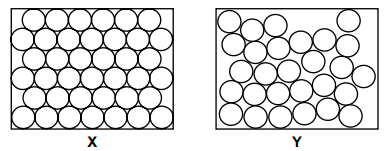

# Exam Questions — Kinetic Particle Model of Matter
**2. Thermal Physics** · Cambridge (CIE) IGCSE science (0653)
> Source: [https://www.savemyexams.com/igcse/science/cie/combined-science/23/physics/topic-questions/](https://www.savemyexams.com/igcse/science/cie/combined-science/23/physics/topic-questions/) · 2 questions across 1 sets

## Exam Questions (2 questions)

### Q1 — medium — 2 marks

**Q1** [2 marks]

Fig. 9.1 shows the arrangements of particles in ethanol and sulfur at a temperature of 25 °C.

**Fig. 9.1**

Use Fig. 9.1 and information from Table 9.1 to state which diagram, X or Y, shows the structure of ethanol and of sulfur at 25°C.

Explain your answer in terms of particles.

ethanol: ..................

sulfur: ..................

explanation: ..................

*Source: Specimen 2025 0653/03 Q9C*

### Q2 — easy — 1 marks

**Q2** [1 mark]

A sample of a substance has a definite shape and a definite volume.

The substance changes state. The sample now has **no** definite shape but still has a definite volume.

What is the name of the change of state?

*Source: Specimen 2025 0653/02 Q30*

