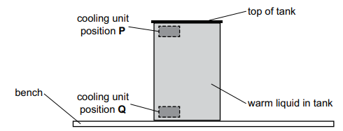

# Exam Questions — Transfer of Thermal Energy
**2. Thermal Physics** · Cambridge (CIE) IGCSE science (0653)
> Source: [https://www.savemyexams.com/igcse/science/cie/combined-science/23/physics/topic-questions/](https://www.savemyexams.com/igcse/science/cie/combined-science/23/physics/topic-questions/) · 3 questions across 1 sets

## Exam Questions (3 questions)

### Q1 — medium — 2 marks

**Q1** [2 marks]

(i) Thermal energy transfer from the Sun to the Earth is mainly due to radiation in one region of the electromagnetic spectrum.

State the name of this region.

[1]

(ii) Electromagnetic radiation from the Sun heats the Earth.

Circle the correct words or phrases to complete the paragraph.

The temperature of the Earth is increasing. This is because the amount of radiation absorbed / emitted by the Earth from the Sun is greater than / less than the amount of radiation absorbed / emitted by the Earth into space.

[1]

*Source: Specimen 0653/04 Q8A(I)*

### Q2 — medium — 1 marks

**Q2** [1 mark]

A tank is full of a warm liquid. A student wants to place a cooling unit inside the tank to cool all the liquid as quickly as possible. There are two possible positions for the cooling unit, **P** and **Q**. The positions are shown in the diagram.

How does cooling affect the density of the liquid and what is the best position for the cooling unit?

|   | effect of cooling | best position for cooling unit |
|---|---|---|
| **A** | decreases density | **P** |
| **B** | decreases density | **Q** |
| **C** | increases density | **P** |
| **D** | increases density | **Q** |

*Source: Specimen 2025 0653/02 Q31*

### Q3 — easy — 1 marks

**Q3** [1 mark]

Which statement about thermal radiation is correct?

*Source: Specimen 2025 0653/01 Q32*

