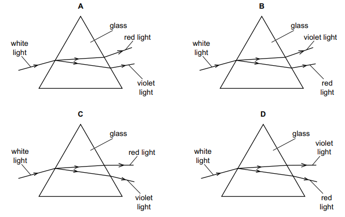

# Exam Questions — Light
**3. Waves** · Cambridge (CIE) IGCSE science (0653)
> Source: [https://www.savemyexams.com/igcse/science/cie/combined-science/23/physics/topic-questions/](https://www.savemyexams.com/igcse/science/cie/combined-science/23/physics/topic-questions/) · 1 questions across 1 sets

## Exam Questions (1 questions)

### Q1 — medium — 1 marks

**Q1** [1 mark]

White light passes through a glass prism and produces a spectrum.

Which diagram shows the paths of the red light and the violet light?

*Source: Specimen 2025 0653/01 Q34*

