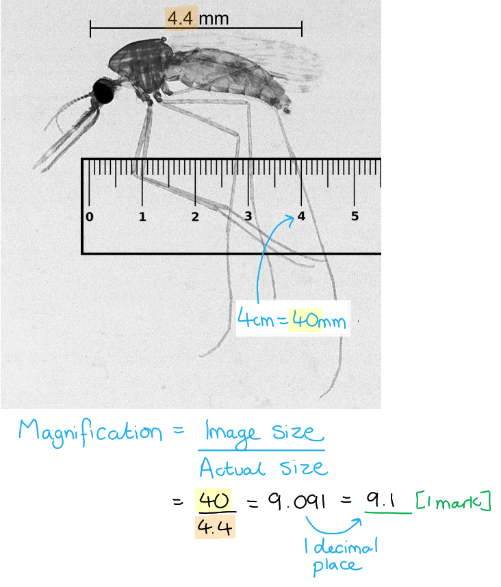
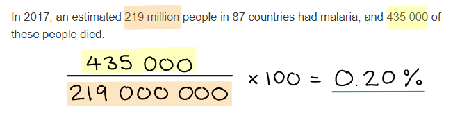

# Mark Schemes — Synoptic Exam Questions (Section C)
**Synoptic Assessment** · Edexcel INTERNATIONAL-A-LEVEL biology (YBI11)

## Exam Questions (9 questions)

### Q1
> **[mark-scheme]**
> (i) X and Y are:
> 
> - X = capsule **[1 mark]**
> - Y = plasmid **[1 mark]**
> 
> (ii) To calculate the actual length of the bacterial cell:
> 
> actual size = image size ÷ magnification
> 
> - Convert the image length to micrometres
> 
>   - 1 cm = 10 mm
>   - 1 mm = 1000 μm
> 
> 8.8 cm = 88 mm
> 
> 88 × 1000 = 88 000 μm
> 
> - Apply the magnification formula
> 
> actual length = 88 000 ÷ 25 000 **[1 mark]**
> 
> = **3.52** μm **[1 mark]**
> 
> Award full marks for the correct answer with no working shown

> **[exam-tip]**
> Take care when identifying structure X. A common mistake would be to interpret the white layer as the plasma membrane and the outer grey layer (X) as the cell wall. This thinking is incorrect because the plasma membrane is much thinner than the cell wall in reality and would never be drawn at roughly equal thickness. In this diagram, the plasma membrane is more likely to be represented by the innermost of the thin black lines defining the layers. The thick white layer must therefore represent the cell wall, which means the outermost grey layer (X) is the capsule. "Cell wall" will not be accepted as an alternative answer.
> 
> For the calculation in part (ii), make sure you convert the image length into the correct units before applying the magnification formula. The image length is given in centimetres, but your final answer must be in micrometres, so the conversion is essential. Doing the conversion at the start of the calculation, rather than at the end, helps you avoid forgetting it altogether — a common cause of lost marks in magnification questions.
> **[mark-scheme]**
> Any **two** from:
> 
> - Antibodies are too large to cross the host cell surface membrane / enter macrophages
> - Antibodies cannot bind to / opsonise / agglutinate intracellular bacteria
> - A cell-mediated response / T killer cells are required to destroy the infected host cells
> 
> **[2 marks]**

> **[exam-tip]**
> This question gives you the key contextual information you need — that *M. tuberculosis* survives inside macrophages — and asks you to apply your knowledge of the immune system to explain why antibodies alone cannot clear the infection. You are not expected to know the specific evasion mechanisms of *M. tuberculosis* from memory; the question gives you what you need to work with.
> 
> To answer well, think about what antibodies are and how they function. Antibodies are large proteins that bind to antigens on the surface of pathogens, leading to opsonisation, agglutination, or neutralisation. If a pathogen is hidden inside a host cell, antibodies cannot reach it because they cannot cross the host cell surface membrane. To gain a further mark, you can refer to the role of T killer cells in the cell-mediated immune response, which can destroy infected host cells.
> **[mark-scheme]**
> - To amplify / increase the number of copies of the DNA **[1 mark]**
> - so that there is enough/more (DNA) to run gel electrophoresis / analyse **OR** because the DNA samples are too small to run gel electrophoresis / analyse **[1 mark]**

> **[exam-tip]**
> Many students simply state that PCR amplifies DNA without explaining *why* amplification is needed. Make sure you link the small quantity of DNA available to the need for more copies so that gel electrophoresis can be carried out effectively.
> **[mark-scheme]**
> - Load the DNA samples/fragments into wells in an agarose gel **AND **apply an electric current (across the gel) **[1 mark]**
> - DNA moves towards the anode/positive electrode **AND** smaller fragments move faster / further in a given time **[1 mark]**
> - Bands (of DNA) are visualised using dye/UV light **AND** the band patterns (position/size/number) are compared between the two bacterial strains **[1 mark]**

> **[exam-tip]**
> Remember that this question asks you to describe gel electrophoresis "to compare the genomes" of bacterial strains. A complete answer must include how the results are used for comparison, not just the technical process. Make sure you explain that band patterns are compared between the two strains — describing only how fragments separate through the gel without mentioning the comparison step will not access full marks.
> **[mark-scheme]**
> - A mutation provides antibiotic resistance to some individuals **[1 mark]**
> - When exposed to the antibiotic the resistant bacteria are more likely to survive **AND** reproduce/replicate **[1 mark]**
> - The resistance allele becomes more frequent / increases in frequency **[1 mark]**

> **[exam-tip]**
> Remember that mutations occur randomly — never suggest that the antibiotic causes the mutation. The antibiotic acts as a selection pressure that favours bacteria that already have resistance mutations, but it doesn't create those mutations.
> 
> Make sure your answer follows the correct sequence: random mutation creates resistance, antibiotic exposure provides selection pressure, resistant bacteria have a survival advantage, and the resistance allele becomes more frequent in the population.

### Q2
> **[mark-scheme]**
> - Substitution **[1 mark]**
> 
> Reject point mutation, as this is not the terminology required by the specification

> **[exam-tip]**
> Remember the different types of gene mutation: substitution (one base replaced by another), insertion (an extra base is added) and deletion (a base is removed). In this case, only one base has changed (C → G) with no bases added or removed, so it is a substitution. Make sure you use the correct terminology.
To determine the amino acid sequence transcribed from this DNA:

- Convert the DNA to mRNA codons

DNA: TAC — GGA — CGT — ATG

mRNA: **AUG — CCU — GCA —  UAC**

- Read the amino acids from the table

methionine — proline — alanine — tyrosine **[1 mark]**

> **[exam-tip]**
> Remember when converting DNA to mRNA, replace thymine (T) with uracil (U) and ensure you use the correct complementary bases (A↔U, C↔G).
> **[mark-scheme]**
> - The CFTR protein is non-functional / cannot transport ions / is blocked **[1 mark]**
> - Chloride ions do not move out of the cells / transport of chloride ions out of cells is reduced **[1 mark]**
> - Water potential inside the cell decreases **OR** solute concentration inside the cell increases **[1 mark]**
> - Water leaves the mucus / enters the cells by osmosis (so the mucus becomes thick and sticky) **[1 mark]**
> 
> Reject "the CFTR protein is mutated"

> **[exam-tip]**
> A common mistake is to state that the CFTR protein is mutated — remember that mutations occur in the gene or DNA, which then codes for a faulty protein.
> 
> Make sure you describe the full sequence of events from the gene mutation through to the final effect on the mucus.
> 
> Use precise A-level terminology throughout — "decreased water potential" will be credited, but "decreased water concentration" will not.
**Final answer:** **The correct answer is B.**

- Thick mucus increases the diffusion pathway between air and blood, which increases the effective thickness of the surface
- According to Fick's law of diffusion, the rate of diffusion is inversely proportional to the thickness of the diffusion pathway, thus reducing the rate of gaseous exchange

**A** is incorrect as mucus would reduce, not increase, the concentration gradient by slowing oxygen reaching the surface

**C** is incorrect as mucus reduces or blocks functional surface area

**D** is incorrect as the carbon dioxide partial pressure in the blood is not directly altered by mucus thickness in the alveoli
The probability that their child will be a carrier of cystic fibrosis can be determined as follows:

- Determine parental genotypes

  - Both parents are unaffected carriers

Mother =  Ff

Father =  Ff

- Determine parental gametes

F  f **AND** F   f **[1 mark]**

- Use Punnett square to determine offspring genotypes and outcomes

|   | **F** | **f** |
|---|---|---|
| **F** | FF | Ff |
| **f** | Ff | ff |

FF, Ff, Ff, ff **[1 mark]**

FF = unaffected **AND** Ff =** **(unaffected) carriers** AND **ff = affected **[1 mark]**

- Determine the probability:

Probability of carrier = **50 % ****[1 mark]**

> **[mark-scheme]**
> Award marks for genotypes and gametes written within a Punnett square, and for phenotypes written as labels for the Punnett square
> 
> Accept 0.5 or  ½
> 
> Accept healthy for unaffected
> 
> Accept cystic fibrosis/CF for affected

> **[exam-tip]**
> Make sure to read the question carefully; many students lose marks by identifying the probability of being affected rather than being a carrier.

### Q3
Toxicants in food could cause Parkinson’s disease because...

Any **three **of the following:

- Toxicant are absorbed into the blood (in the gut); **[1 mark]**
- And it crosses the blood brain barrier; **[1 mark]**
- It prevents the production/less secretion of dopamine / killing dopamine producing cells; **[1 mark]**
- It inhibits the uptake of dopamine by the motor control centres of the brain; **[1 mark]**

**[Total: 3 marks]**

> *Make sure your starting point for this answer is the gut rather than the brain.*
The genes affected by toxicants can be identified by...

Any **two **of the following:

- Using a microarray (to identify an affected gene in a sample; **[1 mark]**
- Technique detail eg. cut DNA using endonuclease enzymes / use of fluorescent dyes / PCR / amplification; **[1 mark]**
- Use of bioinformatics / algorithms to analyse the data from the microarray; **[1 mark]**

***Accept**** reference to use of computer database*

**[Total: 2 marks]**
Scientists could determine the high degree of homology of genes between humans and zebrafish by...

- Using a process to sequence genes/DNA fingerprinting/DNA profiling;** [1 mark]**
- Comparing sequences to show similarities between (species/ humans and zebrafish); ** [1 mark]**
- Showing that the product of the genes have the same/similar/related functions; ** [1 mark]**

***Accept**** reference to amino acid sequence of protein* 
***Accept**** use of PCR to make multiple copies*

**[Total: 3 marks]**

> *The point about comparison here is important for linking back to the root of the question. *
Electrophilic species (ES) of free radicals could be “involved in the modulation of gene expression” by...

Any **three **of the following:

- (The free radicals) targeting/binding to a transcription factor; **[1 mark]**
- They could change the shape of the transcription factor / damage occurs to the transcription factor; **[1 mark]**
- They could prevent binding of the transcription factor to DNA **OR **prevents binding to receptors / promoters **OR** inactivates the transcription factor; **[1 mark]**
- Meaning that RNA polymerase would be unable to bind; **[1 mark]**

**[Total: 3 marks]**

> *Make sure not to just copy information from the provided text directly over to the question. This would never allow you to gain marks. *
ES can damage mtDNA by...

- (Causing breaks in the strands due to) phosphodiester bonds being broken; **[1 mark]**
- (Strands are separated due to) hydrogen bonds being broken; **[1 mark]**
- This in turn causes mutation; **[1 mark]**

**[Total: 3 marks]**

> *Remember that for three marks you need to include three distinct pieces of scientific information. For example, just saying that ES causes mutations without going into more detail here would not allow you to gain three marks. *
The MTT assay could be used to show which of two drugs is more toxic to cells by...

Any **four **of the following:

- The use of living / viable cells; **[1 mark]**
- Reduced NAD is produced during aerobic respiration; **[1 mark]**
- Use the same concentrations of drugs; **[1 mark]**
- Record how long it takes the solution to turn purple / use of colorimeter; **[1 mark]**
- The longer it takes to turn purple the more toxic the drug / the faster it turns purple the less toxic the drug; **[1 mark]**

**[Total: 4 marks]**
The advantages of reprogramming ordinary somatic cells to behave like embryonic stem cells for use in stem cell‐based assays of toxicants are...

Any **two **of the following:

- Individuals have different genetic background / make up; **[1 mark]**
- Because the response to the toxicity is individual / varies person to person; **[1 mark]**
- Because embryonic stem cells do not have to be used so there is no ethical issue; **[1 mark]**

**[Total: 2 marks]**

> *Make sure to avoid being too vague in your answers. For example stating that there are "no ethical issues" without it being in the context of the use of embryonic stem cells would not be enough to gain marks here. *

### Q4
The completed table would include the following:

| **Part of brain** | **Function** |
|---|---|
| cerebellum | **co-ordination of (voluntary) movement**1 |
| **cerebral hemispheres**2 | interpretation of information from the retina |
| medulla oblongata | **regulation of (cardiovascular / breathing system)** |
| **(posterior) pituitary**3 | secretion of ADH |

*1** Accept posture, balance and muscular activity* 
*2** Accept cerebrum / visual cortex / occipital lobe / cerebral cortex*
 *3 **Accept hypothalamus*

All 4 correct cells: **[2 marks]** 
2 or 3 correct cells; **[1 mark]** 
0 or 1 correct cell; **[0 marks]**

**[Total: 2 marks]**
A comparison and contrast of the use of functional magnetic resonance imaging (fMRI) and computed tomography (CT) scans to identify structures like plaques in the brain, as follows:

**Four** from the following, up to **two** for similarities, up to **two** for differences:

**Similarities**

- Both are (neuro-imaging) methods giving high resolution; **[1 mark]**
- Both give images of areas with plaques in the brain; **[1 mark]**

**Differences**

- fMRI is expensive / time-consuming **WHEREAS** CT is cheaper / quicker; **[1 mark]**
- fMRI will show metabolism / oxygen uptake / brain activity **WHEREAS** CT only shows structures; **[1 mark]**
- fMRI uses magnetic resonance **WHEREAS** CT uses X-rays; **[1 mark]**
- fMRI does not use ionising radiation **WHEREAS **CT does (so increased risk of cancer developing); **[1 mark]**

*Ignore fMRI has a higher resolution than CT*

**[Total: 4 marks]**

> *A common error that students should avoid is to describe fMRI and CT scans, rather than giving a real compare and contrast response, in which comparisons need to be written in the same sentence, not as separate paragraphs.*
The amyloid protein may prevent bacterial infection in the brain (paragraphs 7 and 22) as follows:

Any** four** of the following:

- Amyloid protein will cause bacteria to stick together/agglutinate; **[1 mark]**
- Enhancing phagocytosis of the bacteria / stimulates activity of white blood cells1; **[1 mark]**
- Acts as an antibiotic / anti-microbial; **[1 mark]**
- Amyloid protein could disrupt ability of bacteria to adhere directly to host cell; **[1 mark]**
- Amyloid protein prevents the entry of bacteria into cells; **[1 mark]**

*1**Accept a description of phagocytosis; do not accept 'triggers immune response'.*

**[Total: 4 marks]**
The bacterium *Porphyromonas gingivalis* that causes gum disease may invade the brain and cause inflammation in brain regions affected by Alzheimer’s disease (paragraphs 10, 20 and 21) as follows:

Any** four** of the following:

- Bacteria are carried in the blood from (infected) gums; **[1 mark]**
- Bacteria penetrate the blood-brain barrier; **[1 mark]**
- Bacteria /bacterial products cause the release of histamine/chemicals/cytokines; **[1 mark]**
- Resulting in vasodilation; **[1 mark]**
- State a consequence of vasodilation eg. increased blood flow / oedema /increase in white blood cells in the brain/increased oxygen; **[1 mark]**

*Accept 'bacteria can invade white blood cells which cross the blood brain barrier'*

**[Total: 4 marks]**

> *Make sure to link your question back to the idea of **inflammation** in order to get full marks here!*
Gingipains may have a degrading effect on the memory of a person suffering from Alzheimer’s disease (paragraph 12) as follows:

Any** three** of the following:

- Gingipains are enzymes that break down proteins in membranes; **[1 mark]**
- Degrading/breaking down cell membranes **OR** they (permanently) open up transport channels in the membrane; **[1 mark]**
- Which results in loss of brain tissue in the cerebrum **OR** adversely affects the transmission of nerve impulses / action potentials in the cerebrum; **[1 mark]**
- Leading to a reduction in memory (especially short-term memory); **[1 mark]**

**[Total: 3 marks]**
The genetic material from *P. gingivalis* in the cerebral cortex (paragraph 13) could be shown to be active by:

Any** three** of the following:

- The extraction of the infected part of the cerebral cortex; **[1 mark]**
- Use a microarray (to identify mRNAs in sample); **[1 mark]**
- (Analysis of mRNA) to identify genetic material from *P. gingivalis*; **[1 mark]**
- Use of bioinformatics / algorithms to analyse the (enormous quantity of) data (from the microarray); **[1 mark]**

*Accept 'the use of a specific microarray eg. an oligo-nucleotide microarray.*

**[Total: 3 marks]**

> *The key part of this question is how we know the genetic material is **active**. It is not sufficient to just analyse the bacterial **DNA** found in the cerebral cortex, as this will not tell us if it is actively being translated. Instead, the **mRNA** needs to be analysed! The bacterial mRNA will only be present if the bacterial DNA from **P. gingivalis** is actively being translated as mRNA is single-stranded and less stable than DNA, meaning it degrades more quickly.*

### Q5
The structure of a skeletal muscle fibre can be described as follows...

Any **three** of the following:

- A muscle fibre is a single (muscle) cell; **[1 mark]**
- A skeletal muscle cell is multinucleate; **[1 mark]**
- Muscle fibres have a striated appearance due to bands of actin and myosin; **[1 mark]**
- Muscle fibres contain myofibrils in the sarcoplasm; **[1 mark]**
- Myofibrils are made up of many sarcomeres arranged end-to-end; **[1 mark]**

**[Total: 3 marks]**
Myokines may exert endocrine effects on organs such as the liver as follows...

Any **three** of the following:

- Myokines are released in response to a stimulus (e.g. muscle contraction or the arrival of a nerve impulse); **[1 mark]**
- Myokines are transported in the blood to <u>target</u> organs (e.g. the liver); **[1 mark]**
- Myokines bind to <u>receptors</u> on (cell surface) membranes of target cells/tissue; **[1 mark]**
- Myokines bring about effects such as changes in metabolism/rate of respiration / glycogenesis/glycogen production / glycogenolysis/glycogen breakdown / adipose tissue growth; **[1 mark]**

**[Total: 3 marks]**

> *You should be aware that the term 'endocrine' relates to the hormone system, so for myokines to exert **endocrine effects** on organs it would need to function as a hormone. Hormones are released **in response to stimuli** and are **transported in the blood** to specific **target organs** where they **bind to receptors** on the surface of target cells. They then bring about changes to the processes occurring inside the target cells. Note that the processes given as examples here in marking point 4 can all be extracted from the information in the article, which states that myokines have a role in regulating metabolism.*
Changes that occur to muscle structure and composition in the elderly can affect their ability to rise from a chair because...

Any **four** of the following:

- There is a decrease in muscle fibre size/number / loss of muscle mass / increased sarcopenia **SO** leading to reduced movement ability; **[1 mark]**
- There is a decrease in type II/fast twitch muscle fibres **SO** leading to a reduced ability to carry out fast motion / motion that requires high levels of power/force; **[1 mark]**
- There is a reduction in the number of satellite cells **SO** muscle repair/regeneration is reduced; **[1 mark]**
- Muscle proteins break down faster than they are synthesised **SO** muscle repair/regeneration is reduced; **[1 mark]**
- There is reduced force generation (per unit area of muscle) **SO** it is difficult to generate enough force to rise from a chair / lift the whole body; **[1 mark]**

**[Total: 4 marks]**

> *For each of the changes identified from the article here, it is essential that you also explain why this change will affect someone's ability to rise from a chair.*
Ca2+ binding to troponin C allows muscle fibres to contract as follows...

- The binding of Ca2+ causes a change in shape of tropomyosin **SO** exposing the myosin binding sites (on actin); **[1 mark]**
- Myosin heads bind with actin **AND** form cross bridges; **[1 mark]**
- Myosin heads pull actin towards the M line/inwards / myosin heads carry out a power stroke **SO** shortening the sarcomere; **[1 mark]**

**[Total: 3 marks]**
(e) ‘High-energy phosphates’ provide the energy necessary for muscle activity as follows...

Any **two** of the following:

- An example of a high energy phosphate is ATP / ADP / creatine phosphate/phosphocreatine; **[1 mark]**
- Hydrolysis of a phosphate bond in ATP releases energy; **[1 mark]**
- Creatine phosphate/phosphocreatine releases a phosphate that binds to ADP **SO** producing more ATP; **[1 mark]**

***Accept**** references to the specific role of ATP for marking point 2, e.g. "Energy released from ATP allows the release of myosin from actin / enables the power stroke."*

**[Total: 2 marks]**

> *Note that there is some confusion among A-level textbooks about the precise role of ATP in muscle contraction, and this is reflected by there being two options available for this description in the italics section above. It is worth being aware that the general consensus among the scientific literature is that ATP is needed for the **release of the myosin head from actin** and that energy from ATP is required for the **myosin heads to return to their original shape**. The myosin heads can then bind to new binding sites further along the actin and the **release of ADP and Pi **allows a new power stroke to occur.*
Explanations for the effects that a ‘reduction in tendon stiffness’ resulting from ageing could have on the movement at a joint could include...

Any **three** of the following:

- There is a change in tendon materials **OR** there is a loss of collagen / elastin; **[1 mark]**
- (This means that there is) a reduction in the force of contraction exerted on the joint; **[1 mark]**
- There is a reduction in the type of movement that can occur at the joint **OR** the tendon stretches less when the muscles contract/the sarcomere shortens; **[1 mark]**
- There is a decrease in the shock-absorbing ability of the tendons / the ability of the muscles to act as a spring; **[1 mark]**
- (All of the above contribute to) an increased chance of injury / a slip/fall; **[1 mark]**

**[Total: 3 marks]**
Myostatin might act as a negative regulator of muscle growth as follows...

- It could act as a <u>transcription factor</u>; **[1 mark]**
- It could activate genes that code for proteases / that are involved in muscle protein breakdown; **[1 mark]**
- It could inhibit muscle production/growth / differentiation of cells into muscle cells; **[1 mark]**

***Accept ****myogenesis for muscle growth.*

**[Total: 2 marks]**

> *We are told that myostatin is a **protein** and that it has a role in negative** regulation** of muscle growth. A logical conclusion is that it functions as a **transcription factor**, affecting the **expression of genes** involved in muscle production. It could increase the expression of genes that code for proteases that break down muscle protein, or it could decrease the expression of genes that are responsible for muscle growth and the specialisation of muscle cells.*

### Q6
(i) The correct answer is **A** because...

**...tRNA's role is to bind to a specific amino acid, allowing that amino acid to be added to a growing polypeptide chain as dictated by the mRNA codon sequence.**

> *B** is incorrect because tRNA does not identify a base and transport it to a ribosome.*

> *C** is incorrect because tRNA does not form a template for DNA polymerase*

> *D** is incorrect because tRNA does not form a template for RNA polymerase*

(ii) The correct answer is **A** because...

**...the Golgi apparatus's job is to process newly-synthesised proteins and to prepare them for their final role eg. secretion, membrane protein, hormone etc**

> *B, C** and **D** are all incorrect because those organelles have other roles within the cell.*

**[Total: 2 marks]**
The role of DNA polymerase in DNA replication during cell proliferation is:

Any** two** of the following:

- (RNA polymerase) adds <u>complementary</u> nucleotides/bases (to the template strand); **[1 mark]**
- Phosphodiester bonds are formed **OR** formation of H bonds between bases in old and new strand; **[1 mark]**
- (It) proofreads the DNA; **[1 mark]**

**[Total: 2 marks]**
Cytokine genes can be expressed in an activated T lymphocyte as follows:

- (Activation) results in the production of / activation of transcription factors **OR** secondary messenger systems are activated; **[1 mark]**
- (Transcription factor) binds to the promotor region of the cytokine genes; **[1 mark]**
- So (cytokine genes) are transcribed / mRNA is produced / description of transcription (DNA → RNA); **[1 mark]**

**[Total: 3 marks]**

> *This is a question about DNA replication and transcription but in the disguise of a question about immunity. The mention of cytokines in an activated T lymphocyte may send you looking into your theory knowledge of immunity, whereas the examiners are looking for details about how the expression of **any** gene may be controlled. The gene in this question just happens to be one that codes for a specific type of protein, the cytokines. Context is crucial here.*
Different forms of the CD45 protein can be produced from a single CD45 gene as follows:

**Three** from the following:

- The gene for CD45 protein is transcribed into pre mRNA / post transcriptional modification occurs; **[1 mark]**
- A spliceosome / enzyme removes non coding regions / introns from the (pre) mRNA **OR** rearrangement of exons to produce mRNA; **[1 mark]**
- There is translation of (different) mRNA molecules simultaneously; **[1 mark]**
- To produce a CD45 protein with a different primary structure / different 3D/ tertiary structure; **[1 mark]**

*Do not accept reference to DNA splicing*

**[Total: 3 marks]**

*The question could be answered from the point of view of mutation creating new alleles. However, this would earn ***[0 marks]*** with the examiners' mark scheme. The question would be clearer if the wording was:*

> *'Describe how different forms of the CD45 protein can be produced from a single CD45 **gene** **allele**' in order to steer you away from mutation and direct you the correct part of the curriculum, which is one gene coding for more than one protein.*

> *You may have seen other questions where the answer lies in the fact that one gene can code for more than one protein, and be tempted to trot out a well-rehearsed answer. However, your answer must relate to the context of this question, so a generalised answer would not score well. You must relate your answer to the context of the question.*

### Q7
The phrase 'gene variants' (paragraph 4) means...

- Alternative versions/alleles of a gene/sections of DNA; **[1 mark]**
- (That occur) due to changes in the base sequence of the DNA / differences in exons/introns of a gene; **[1 mark]**

**[Total: 2 marks]**

> *Pay close attention to the number of marks available here. The first marking point will be for a reference to alleles, which, when you think back to GCSE, could be a GCSE question. So it should make you think, **what is the second mark for?** The natural progression from there is to provide more detail on what makes one allele different from another, and that is the altered base sequence. Taking an approach like this allows you to gauge how much detail you should put into your answer in order to maximise your haul of marks. *
(b) ‘Tumours...riddled with different mutations’ are good candidates for immunotherapies (paragraph 6) because...

Any **four** of the following:

- (More) mutations change the shape of (more) proteins; **[1 mark]**
- (This is significant) when these are membrane proteins; **[1 mark]**
- (Membrane) proteins are recognised as antigens / are non-self proteins by antigen presenting cells; **[1 mark]**
- (Antigen presenting cells) trigger an immune response / activation of lymphocytes; **[1 mark]**
- (An immune response involves) production of cytotoxic T cells/T killer cells (that will recognise and destroy more cancer cells); **[1 mark]**

***Accept**** other accurate descriptions of the immune response for marking point 4.*

***Ignore**** lymphocytes for marking point 5.*

**[Total: 4 marks]**

> *This question requires you to extract information from the article that is specific to this use of immunotherapy. The best answers will describe the effect of mutation on membrane proteins, creating new antigens that trigger a full immune response. *
A CT scan was used to show that Judy Perkins was free of tumours (paragraph 10 and Figure 1) because...

- A CT scan uses X-rays to produce a (low resolution) image (of soft tissue structures); **[1 mark]**
- The tumour is a soft tissue / has a different density (from other tissues so shows up clearly); **[1 mark]**

**[Total: 2 marks]**

> *You should be aware of the basis on which CT scans work; they use **X-rays **to produce** images** of soft tissue, and different regions of tissue can be distinguished from each other because of their different densities. This means that you should be able to deduce that **tumours must have a different density **to the tissue around them in order to show up on a CT scan.*
A checkpoint inhibitor was given with the lymphocytes in the immunotherapy used to treat Judy Perkins (paragraph 10) because...

Any **two** of the following:

- Cancer/tumour cells produce proteins that act as checkpoints (see paragraph 6); **[1 mark]**
- Checkpoint inhibitors stop the checkpoint proteins from blocking immune cell activation / allow activation of immune cells; **[1 mark]**
- (Tumour-infiltrating) lymphocytes can be activated to kill the tumour cells; **[1 mark]**

**[Total: 2 marks]**

> *You need to be aware of the information in the short sentence at the beginning of the question stem, i.e. that checkpoints are a **type of protein that prevent the activation of immune cells**. If you skim-read the question, or choose not to read it at all, you will miss this vital clue. *
‘A gene variant that produces a defective form of an enzyme’ reduces the effectiveness of clopidogrel (paragraph 16) by...

- The gene variant has an altered DNA base sequence; **[1 mark]**
- (The gene variant) produces a polypeptide/protein with a different primary structure / a different 3D shape/tertiary structure; **[1 mark]**
- The enzyme produced will be folded differently; **[1 mark]**
- The enzyme’s active site will no longer fit clopidogrel/the substrate **OR** fewer enzyme – substrate complexes  will be formed; **[1 mark]**

**[Total: 4 marks]**

> *In this question it is crucial that you start and end your explanations at the right point, i.e. beginning at the** 'gene variant' **and ending at the** 'reduced effectiveness of clopidogrel'**. The gene variant is the result of an altered base sequence, which leads to an altered primary structure and different folding within the enzyme structure. This will affect the shape of the enzyme's active site and prevent the substrate from binding.*
Blood vessels are required to form functioning spinal cord tissue (paragraph 31) because...

Any **three** of the following:

- Capillaries allow for mass transport; **[1 mark]**
- (Mass transport) overcomes the limitations of diffusion / allows a faster rate of diffusion; **[1 mark]**
- (Capillaries) ensure that nutrients / oxygen are delivered to the spinal cord tissue; **[1 mark]**
- Spinal cord cells can carry out (aerobic) respiration / maintain resting potential / produce neurotransmitters; **[1 mark]**

***Accept**** other correctly named process carried out by spinal cord tissue, e.g. protein synthesis / active transport/exocytosis*

**[Total: 3 marks]**
‘A brew of growth factors and other proteins’ can stimulate induced pluripotent stem cells to produce a functioning tissue (paragraph 33) by...

Any **three** of the following:

- Growth factors/proteins bind to receptors (on pluripotent stem cells); **[1 mark]**
- Activating transcription factors / proteins act as transcription factors; **[1 mark]**
- Stem cells proliferate/divide; **[1 mark]**
- (Stem cells) differentiate (to carry out a particular function); **[1 mark]**

**[Total: 3 marks]**

> *Don't be misled here by the term 'growth factor'; this is not a question about plant hormones!*

> *You need to consider how molecules from outside a cell can influence the behaviour of the cell itself and enable it to develop into a tissue. Such molecules would need to be able to communicate with the cell by **binding to a surface receptor**, and then influence gene expression within the cell by acting as a **transcription factor**. For a cell to develop into a tissue it needs to** divide** and **differentiate**.*

### Q8
This virus can cause internal bleeding because...

Any **two **of the following:

- It is taken up by capillary endothelial cells; **[1 mark]**
- (The virus) replicates in (endothelial cells) causing cell lysis; **[1 mark]**
- Creating (large) gaps in the capillary wall; **[1 mark]**

**[Total: 2 marks]**
(b) Our immune systems learn to make antibodies by...

**Final answer:** **Any ****four ****of the following:**

- Antigens are taken up/engulfed by macrophages/antigen-presenting cells by phagocytosis; **[1 mark]**
- Antigens are presented (by macrophages) to T helper cells; **[1 mark]**
- Activated <u>T helper</u> cells release cytokines to activate B cells; **[1 mark]**
- B cells differentiate into plasma cells that release antibodies; **[1 mark]**
- B memory cells are developed; **[1 mark]**

**[Total: 4 marks]**

> *The order of points is important in this question, as well as your use of key terminology, for example T helper cells cannot be simplified to T cells.*
Flushing with water releases the vaccine from the filter because...

Any **two **of the following**:**

- Sugar molecules are bonded to the vaccine molecules by hydrogen bonds; **[1 mark]**
- (Therefore when excess) water is added the water molecules form hydrogen bonds with sugar molecules / vaccine molecules releasing the vaccine; **[1 mark]**
- And the vaccine molecules can dissolve in the water; **[1 mark]**

**[Total: 2 marks]**
A vaccine produced in this way may become less effective because...

- Each time the virus replicates, mutations may occur; **[1 mark]**
- The more mutations that take place, the greater the number of changes in the amino acid sequence of the virus coat proteins; **[1 mark]**
- The immune response is specific and will not produce antibodies against the Ebola virus; **[1 mark]**

**[Total: 3 marks]**
(i) Insect cells could be genetically modified to produce the antigens for an Ebola vaccine by...

- Ebola virus antigen is a protein; **[1 mark]**
- Isolate / synthesise the gene coding for Ebola virus antigen; **[1 mark]**
- Insert the gene into a vector e.g. plasmid, bacterial/viral vectors or liposomes; **[1 mark]**
- Description of method of putting the vector into the insect cell e.g. micro-injection / gene gun / heat shock; **[1 mark]**

> *Try to avoid giving a stock response that is not in the context of the question. Your answer needs to specifically refer to the Ebola virus antigen.*

(ii) Three benefits of using an insect cell to produce the Ebola virus antigen are...

Any **three **of the following:

- It is safer to use genetically modified insect cells than the Ebola virus; **[1 mark] **
- Insect cells are eukaryotic cells / contain endoplasmic reticulum and Golgi apparatus; **[1 mark]**
- When the vaccine protein is made in insect cells it will be (properly) glycosylated / post transcriptionally modified; **[1 mark]**
- Insect cells have a low mutation rate; **[1 mark]**

**[Total: 7 marks]**
The stems of the different versions of haemagglutinin molecules are the same but the heads can be different because...

Any **pair **of the following:

- Different regions of nucleic acid code for the stem and the head; **[1 mark]**
- There is only one version (of nucleic acid) coding for the stem but many versions for the head; **[1 mark]**

**OR**

- Splicing of the gene for haemagglutinin; **[1 mark]**
- Same exons used for the stem and different exons used to code for head; **[1 mark]**

***Allow**** there are more mutations in the gene(s) for the head than in the gene(s) for the stem ***[2 marks]**

**[Total: 2 marks]**

> *Remember that the mutations happen in the DNA, not the haemagglutinin molecules.*

### Q9
The magnification is...

- 40 ÷ 4.4 = 9.1; **[1 mark]**

**[Total: 1 mark]**

> *Make sure your answer is to one decimal place as requested in the question stem. *

The correct answer is **B **because...

**0.20% of the people with malaria died.**

**[Total: 1 mark]**

(i) The function of a nucleolus is...

- Produce ribosomal subunits; **[1 mark]**

(ii) Three differences in ultrastructure between this cell and a cell taken from the root of a plant are...

Any **three **of the following:

- Plant cell would have starch (grain)/amyloplast (instead of glycogen granule); **[1 mark]**
- Plant cell would have a cell wall made from cellulose / plant cell would have lignin / plant cells do not have chitin cell wall; **[1 mark]**
- Plant cell would contain plasmodesmata/one nucleus (whereas this cell does not); **[1 mark]**
- The plant cell vacuole would be larger; **[1 mark]**

**[Total: 4 marks]**

> *Remember that the question is asking about cells from a **root** and therefore they do not have chloroplasts. Any reference to chloroplasts would not gain a mark. *

> *Make sure to use comparative language in your answer, for example instead of saying "plant cell vacuole is large" you should say that it is "larg**er**". *
An evaluation of these treatments are...

> *This is a level-marked question, meaning that this is is marked **according to the levels table**. The indicative content points below the table are **not** to be used in the usual '**one point one mark**' way, but should be used together with the levels table to determine the number of marks which should be awarded. *

| **Level 1** A conclusion may be attempted, demonstrating isolated elements of biological knowledge and understanding but with limited evidence to support the judgement being made.  **[1 mark]** - Description of results using table data.  **[2 marks]** - Consideration of one other point from the list of indicative content below. |
|---|
| **Level 2 **A conclusion is made, demonstrating linkages to elements of biological knowledge and understanding, with occasional evidence to support the judgement being made.  **[3 marks]** - Consideration of two points (other than describing the data) from the list of indicative content below.  **[4 marks]** - Consideration of three points (other than describing the data) from the list of indicative content below. |
| **Level 3 **A conclusion is made, demonstrating sustained linkages to biological knowledge and understanding, with evidence to support the judgement being made.  **[5 marks]** - Consideration of four points (other than describing the data) from the list of indicative content below.  **[6 marks]** - Consideration of five points (other than describing the data) from the list of indicative content below. |

*Indicative content:*

- Description of the table data e.g. a comparison of the numbers of mosquitoes killed/survived
- Consideration of the GM fungus being the most effective treatment
- Consideration that most mosquitoes were resistant to the insecticide used / some were not resistant to insecticide and were killed / inheritance of resistance
- Consideration that resistance arose due to mutation / natural selection / genetic variation in population
- As a gene is only switched on/expressed when the fungus has infected an *Anopheles* mosquito
- The toxin is only produced when the fungus has infected an *Anopheles* mosquito
- Consideration of protein synthesis / detail of the role of rER and Golgi apparatus
- Evaluation of methodology / limitations of the method eg. mosquitoes escaping, small sample size
- Consideration of the wider effects on biodiversity eg. toxin will not poison other insects / humans / organisms whereas insecticides would kill other insects / effect on food chains / biodiversity
- Transfer of the (spider venom) gene to other fungal species

**[Total: 6 marks]**

> *There is lots of information in the question stem here so make sure to consider it all carefully when producing your answer. Remember that high level answers will draw on a range of information, such as the data in the table, information from the question stem, and their own scientific knowledge, to make their conclusion. *
