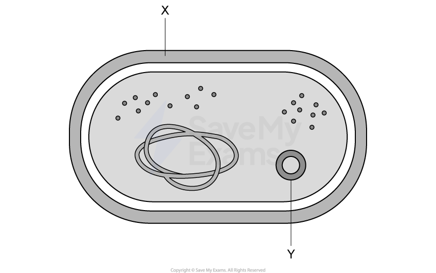
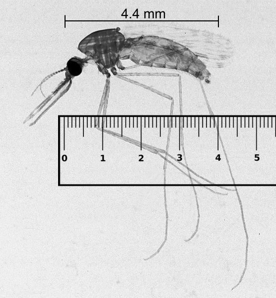
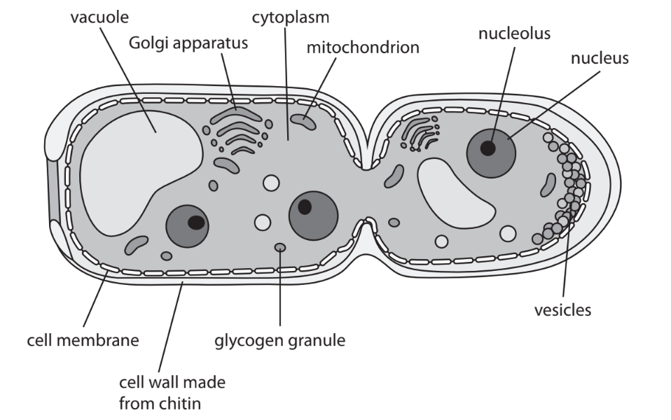

# Exam Questions — Synoptic Exam Questions (Section C)
**Synoptic Assessment** · Edexcel INTERNATIONAL-A-LEVEL biology (YBI11)
> Source: [https://www.savemyexams.com/international-a-level/biology/edexcel/18/topic-questions/](https://www.savemyexams.com/international-a-level/biology/edexcel/18/topic-questions/) · 9 questions across 1 sets

## Exam Questions (9 questions)

### Q1 — easy — 14 marks

**Q1** [4 marks]

*Mycobacterium tuberculosis* is a pathogenic bacterium that infects the lungs, causing tuberculosis (TB).

The diagram shows a representation of an *M. tuberculosis* cell.

(i) Identify structures **X** and **Y**.

[2]

(ii) The length of the cell in the diagram is 8.8 cm. The diagram is magnified 25 000 times.

Calculate the actual length of the *M. tuberculosis* cell shown. Give your answer in μm.

[2]

**Q1** [2 marks]

*M. tuberculosis* evades the host immune system by infecting and surviving inside macrophages.

A patient infected with *M. tuberculosis* was monitored over a four-week period. Blood tests showed sustained high concentrations of specific antibodies, but the number of bacteria in the patient's lungs continued to increase.

Suggest why the production of antibodies alone is not sufficient to clear a *Mycobacterium tuberculosis* infection.

**Q1** [2 marks]

Scientists extracted DNA from *M. tuberculosis* samples and used PCR followed by gel electrophoresis to compare the genomes of antibiotic resistant and non-resistant strains.

Explain why PCR was carried out on the DNA samples before gel electrophoresis.

**Q1** [3 marks]

**Extract:**

Scientists extracted DNA from *M. tuberculosis* samples and used PCR followed by gel electrophoresis to compare the genomes of antibiotic resistant and non-resistant strains.

Describe the process of gel electrophoresis used to compare the genomes.

**Q1** [3 marks]

Antibiotic resistance in *M. tuberculosis* is a growing problem worldwide, making some TB infections difficult to treat.

Explain how antibiotic-resistant strains of *M. tuberculosis* can develop.

### Q2 — medium — 11 marks

**Q2** [1 mark]

Cystic fibrosis (CF) is caused by a mutation in the gene encoding the CFTR protein. The mutation changes one base in the normal CFTR sequence from CCT to CGT.

Name the type of mutation that occurs.

**Q2** [1 mark]

The mutated CFTR gene contains the following DNA sequence:

TAC — GGA — CGT — ATG

Determine the amino acid sequence transcribed from this DNA.

Use the table below.

| mRNA codon | Amino acid |
|---|---|
| AUG | Methionine |
| CCU | Proline |
| GGU | Glycine |
| GCA | Alanine |
| UAC | Tyrosine |
| ACG | Threonine |

**Q2** [4 marks]

**Extract:**

Cystic fibrosis (CF) is caused by a mutation in the gene encoding the CFTR protein.

People with cystic fibrosis produce very thick, sticky mucus

Explain why a mutation in this gene results in the production of very thick, sticky mucus.

**Q2** [1 mark]

The thick mucus accumulates in the airways of the lungs.

Which of the following explains why thick mucus reduces gaseous exchange?

**Q2** [4 marks]

A couple are both unaffected carriers of cystic fibrosis.

Construct a genetic cross and determine the probability of their next child being a carrier.

### Q3 — medium — 20 marks

**Q3** [3 marks]

The [scientific document](https://cdn.savemyexams.com/uploads/2022/11/wbi15-01-que-20220118-scientific-article.pdf) you have studied is adapted from an article in Science Direct: *Assessment of food toxicology* by Alexander Gosslau.

Use the information from the scientific article and your own knowledge to answer the following questions.

Explain how toxicants in food could cause Parkinson’s disease (paragraph 3).

*Source: Jan 2022 WBI15/01 Q8A*

**Q3** [2 marks]

Suggest how the genes affected by toxicants can be identified (paragraph 4).

*Source: Jan 2022 WBI15/01 Q8B*

**Q3** [3 marks]

Explain how scientists could determine the high degree of homology of genes between humans and zebrafish (paragraph 5).

*Source: Jan 2022 WBI15/01 Q8C*

**Q3** [3 marks]

Suggest how electrophilic species (ES) of free radicals could be “involved in the modulation of gene expression” (paragraph 6).

*Source: Jan 2022 WBI15/01 Q8D*

**Q3** [3 marks]

**Extract:**

Suggest how electrophilic species (ES) of free radicals could be "involved in the modulation of gene expression" (paragraph 6).

Suggest how ES can damage mtDNA (paragraph 7).

*Source: Jan 2022 WBI15/01 Q8E*

**Q3** [4 marks]

In the MTT assay, reduced NAD converts an MTT solution from yellow to purple.

Describe how the MTT assay could be used to show which of two drugs is more toxic to cells (paragraph 10).

*Source: Jan 2022 WBI15/01 Q8F*

**Q3** [2 marks]

Explain the advantages of reprogramming ordinary somatic cells to behave like embryonic stem cells for use in stem cell‐based assays of toxicants (paragraph 11).

*Source: Jan 2022 WBI15/01 Q8G*

### Q4 — medium — 20 marks

**Q4** [2 marks]

The [scientific article](https://cdn.savemyexams.com/uploads/2022/11/wbi15-01-que-20211021-scientific-extract.pdf) you have studied is adapted from *Rethinking Alzheimer’s* in *New Scientist *(February 2019).

Use the information from the scientific article and your own knowledge to answer the following questions.

Memory and cognitive function are two processes that occur in the brain (paragraphs 2 and 13).

Different parts of the brain are responsible for specific functions.

Complete the table showing which parts of the brain are responsible for different functions.

| **Part of brain** | **Function** |
|---|---|
| cerebellum |   |
|   | interpretation of information from the retina |
| medulla oblongata |   |
|   | secretion of ADH |

*Source: Oct/Nov 2021 WBI15/01 Q8A*

**Q4** [4 marks]

Some forms of dementia can be diagnosed using brain scans.

Compare and contrast the use of functional magnetic resonance imaging (fMRI) and computed tomography (CT) scans to identify structures like plaques in the brain (paragraph 6).

*Source: Oct/Nov 2021 WBI15/01 Q8B*

**Q4** [4 marks]

**Extract:**

The scientific article you have studied is adapted from Rethinking Alzheimer's in New Scientist (February 2019).

Suggest how the amyloid protein may prevent bacterial infection in the brain (paragraphs 7 and 22).

*Source: Oct/Nov 2021 WBI15/01 Q8C*

**Q4** [4 marks]

**Extract:**

The scientific article you have studied is adapted from Rethinking Alzheimer's in New Scientist (February 2019).

Use the information from the scientific article and your own knowledge to answer the following questions.

Explain how the bacterium *Porphyromonas gingivalis* that causes gum disease may invade the brain and cause inflammation in brain regions affected by Alzheimer’s disease (paragraphs 10, 20 and 21).

*Source: Oct/Nov 2021 WBI15/01 Q8D*

**Q4** [3 marks]

Suggest how gingipains may have a degrading effect on the memory of a person suffering from Alzheimer’s disease (paragraph 12).

*Source: Oct/Nov 2021 WBI15/01 Q8E*

**Q4** [3 marks]

The team found genetic material from *P. gingivalis* in the cerebral cortex (paragraph 13).

Describe how the team could show that this genetic material is active.

*Source: Oct/Nov 2021 WBI15/01 Q8F*

### Q5 — medium — 20 marks

**Q5** [3 marks]

The [scientific document](https://cdn.savemyexams.com/uploads/2022/11/wbi15-01-que-20210430-scientific-article.pdf) you have studied is adapted from an article in Journal of Cachexia, Sarcopenia and Muscle entitled *Skeletal muscle performance and ageing. *(Tieland, 2018).

Use the information from the scientific document and your own knowledge to answer the following questions.

Describe the structure of a skeletal muscle fibre (paragraph 2).

*Source: June 2021 WBI15/01 Q8A*

**Q5** [3 marks]

Explain how myokines may exert endocrine effects on organs such as the liver (paragraph 3).

*Source: June 2021 WBI15/01 Q8B*

**Q5** [4 marks]

Explain why the changes that occur to muscle structure and composition in the elderly can affect their ability to rise from a chair (paragraph 4).

*Source: June 2021 WBI15/01 Q8C*

**Q5** [3 marks]

Explain why Ca2+ binding to troponin C allows muscle fibres to contract (paragraph 5).

*Source: June 2021 WBI15/01 Q8D*

**Q5** [2 marks]

Explain how the ‘high-energy phosphates’ provide the energy necessary for muscle activity (paragraph 11).

*Source: June 2021 WBI15/01 Q8E*

**Q5** [3 marks]

Suggest explanations for the effects that a ‘reduction in tendon stiffness’ resulting from ageing could have on the movement at a joint (paragraph 12).

*Source: June 2021 WBI15/01 Q8F*

**Q5** [2 marks]

Suggest how myostatin might act as a negative regulator of muscle growth (paragraph 13).

*Source: June 2021 WBI15/01 Q8G*

### Q6 — medium — 10 marks

**Q6** [2 marks]

When activated, T lymphocytes can divide rapidly and secrete proteins called cytokines.

These cytokines will activate different types of lymphocyte.

(i) Which is the function of tRNA in cytokine synthesis?

**(1)**

| ☐ | **A** | identifies an amino acid and transports it to a ribosome |
|---|---|---|
| ☐ | **B** | identifies a base and transports it to a ribosome |
| ☐ | **C** | forms a template for DNA polymerase |
| ☐ | **D** | forms a template for RNA polymerase |

(ii) Which organelle is involved in chemically modifying cytokine proteins before they are secreted?

**(1)**

| ☐ | **A** | Golgi apparatus |
|---|---|---|
| ☐ | **B** | ribosome |
| ☐ | **C** | smooth endoplasmic reticulum |
| ☐ | **D** | vesicle |

*Source: Oct/Nov 2021 WBI15/01 Q6A*

**Q6** [2 marks]

Describe the role of DNA polymerase in DNA replication during cell proliferation.

*Source: Oct/Nov 2021 WBI15/01 Q6B*

**Q6** [3 marks]

**Extract:**

When activated, T lymphocytes can divide rapidly and secrete proteins called cytokines.

These cytokines will activate different types of lymphocyte.

Explain how cytokine genes can be expressed in an activated T lymphocyte.

*Source: Oct/Nov 2021 WBI15/01 Q6C*

**Q6** [3 marks]

CD45 is a protein found on the surface of lymphocytes. Different forms of the CD45 protein are found on the surface of different lymphocytes.

Describe how different forms of the CD45 protein can be produced from a single CD45 gene.

*Source: Oct/Nov 2021 WBI15/01 Q6E*

### Q7 — medium — 20 marks

**Q7** [2 marks]

The [scientific document](https://cdn.savemyexams.com/uploads/2022/11/wbi15-01-scientific-article.pdf) you have studied is adapted from an article in *National Geographic*: How personalized medicine is transforming your health care.

Use the information from the scientific document and your own knowledge to answer the following questions.

Explain what is meant by the phrase ‘gene variants’ (paragraph 4).

*Source: Oct/Nov 2020 WBI15/01 Q8A*

**Q7** [4 marks]

**Extract:**

The [scientific document](https://cdn.savemyexams.com/uploads/2022/11/wbi15-01-scientific-article.pdf) you have studied is adapted from an article in *National Geographic*: How personalized medicine is transforming your health care.

Use the information from the scientific document and your own knowledge to answer the following questions.

Explain why ‘tumours...riddled with different mutations’ are good candidates for immunotherapies (paragraph 6).

*Source: Oct/Nov 2020 WBI15/01 Q8B*

**Q7** [2 marks]

Explain why a CT scan was used to show that Judy Perkins was free of tumours (paragraph 10 and Figure 1).

*Source: Oct/Nov 2020 WBI15/01 Q8C*

**Q7** [2 marks]

Checkpoints are a type of protein that prevent the activation of immune cells.

Explain why a checkpoint inhibitor was given with the lymphocytes in the immunotherapy used to treat Judy Perkins (paragraph 10).

*Source: Oct/Nov 2020 WBI15/01 Q8D*

**Q7** [4 marks]

**Extract:**

The phrase 'gene variants' (paragraph 4) means...

- Alternative versions/alleles of a gene/sections of DNA;
- (That occur) due to changes in the base sequence of the DNA / differences in exons/introns of a gene;

Explain how ‘a gene variant that produces a defective form of an enzyme’ reduces the effectiveness of clopidogrel (paragraph 16).

*Source: Oct/Nov 2020 WBI15/01 Q8E*

**Q7** [3 marks]

Researchers have used stem cells to produce spinal cord tissue from individuals with amyotrophic lateral sclerosis.

These functioning tissues contain motor neurones and blood vessels.

Suggest why blood vessels are required to form functioning spinal cord tissue (paragraph 31).

*Source: Oct/Nov 2020 WBI15/01 Q8F*

**Q7** [3 marks]

Suggest how ‘a brew of growth factors and other proteins’ can stimulate induced pluripotent stem cells to produce a functioning tissue (paragraph 33).

*Source: Oct/Nov 2020 WBI15/01 Q8G*

### Q8 — medium — 20 marks

**Q8** [2 marks]

The[ scientific document](https://cdn.savemyexams.com/uploads/2022/11/wbi15-01-que-20210304-scientific-article.pdf) you have studied is adapted from an article in Education in Chemistry: Developing vaccines, Self-defence classes for our immune system.

Use the information from the scientific document and your own knowledge to answer the following questions.

The Ebola virus can infect endothelial cells.

Describe how this virus can cause internal bleeding (paragraph 1).

*Source: Jan 2021 WBI15/01 Q8A*

**Q8** [4 marks]

Explain how ‘our immune systems learn to make another type of protein, called an antibody’ (paragraph 4).

*Source: Jan 2021 WBI15/01 Q8B*

**Q8** [2 marks]

One method of slowing the degradation of vaccine proteins is to dry a mixture of sugars and vaccine on a filter.

Explain why flushing with water releases the vaccine from the filter (paragraphs 8 and 9).

*Source: Jan 2021 WBI15/01 Q8C*

**Q8** [3 marks]

During the production of some vaccines, the virus is allowed to replicate in eggs (paragraph 13).

Explain how a vaccine produced in this way may become less effective.

*Source: Jan 2021 WBI15/01 Q8D*

**Q8** [7 marks]

Scientists are using genetically modified bacteria and insect cells to produce the antigens for Ebola vaccines (paragraph 13).

(i)  Describe how insect cells could be genetically modified to produce the antigens for an Ebola vaccine.

**(4)**

(ii)  Suggest **three** benefits of using an insect cell to produce the Ebola virus antigen.

**(3)**

*Source: Jan 2021 WBI15/01 Q8E*

**Q8** [2 marks]

Suggest why the stems of the different versions of haemagglutinin molecules are the same but the heads can be different (paragraph 15).

*Source: Jan 2021 WBI15/01 Q8F*

### Q9 — medium — 12 marks

**Q9** [1 mark]

Female mosquitoes feed on the blood of other animals to promote the development of their eggs. During this process, infected mosquitoes can transmit the *Plasmodium* parasite.

The *Plasmodium* parasite causes the disease malaria.

The photograph shows a female *Anopheles* mosquito.

A ruler has been included for scale.

Alan R Walker, CC BY-SA 3.0 <https://creativecommons.org/licenses/by-sa/3.0>, via Wikimedia Commons

Calculate the magnification of the *Anopheles* mosquito in this photograph.

Give your answer to one decimal place.

*Source: Jan 2021 WBI12/01 Q7A*

**Q9** [1 mark]

In 2017, an estimated 219 million people in 87 countries had malaria, and 435 000 of these people died.

Which of the following shows the percentage of infected people who died?

☐ **A** 0.02% 
☐ **B** 0.20% 
☐ **C** 99.80% 
☐ **D** 99.98%

*Source: Jan 2021 WBI12/01 Q7B*

**Q9** [4 marks]

The fungus *Metarhizium pingshaense* infects *Anopheles* mosquitoes.

A student drew a labelled diagram of a fungal cell that was dividing.

(i) State the function of a nucleolus.

**(1)**

(ii) Give **three** differences in ultrastructure between this cell and a cell taken from the root of a plant.

**(3)**

*Source: Jan 2021 WBI12/01 Q7C*

**Q9** [6 marks]

Insecticides are chemicals used to kill insects.

*Anopheles* mosquitoes have developed resistance to the insecticides currently used.

*Metarhizium pingshaense* is a fungus that infects *Anopheles* mosquitoes.

Scientists in West Africa have genetically engineered (GE) this fungus using a gene from a spider.

When the GE fungus infects an *Anopheles* mosquito this gene becomes activated. A toxin is released, which kills the mosquito.

In an investigation, four huts each containing a group of 500 breeding pairs of mosquitoes were used.

Three different treatments used to kill mosquitoes were compared with a control group.

The walls and ceiling of the huts were sprayed with the treatment.

The table shows the number of adult mosquitoes in the first two generations of offspring from each hut after spraying.

| **Treatment** | **Number of adult mosquitoes in each generation** |   |
|---|---|---|
| **First** | **Second** |   |
| Control (no treatment) | 921 | 1396 |
| Insecticide | 919 | 1353 |
| Normal fungus | 436 | 455 |
| GE fungus | 399 | 13 |

Evaluate these three treatments.

Use the information in the question, and your own knowledge, to support your answer.

*Source: Jan 2021 WBI12/01 Q7D*

