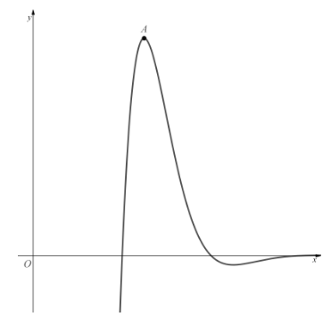
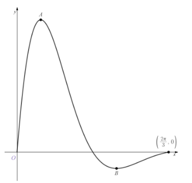

# Exam Questions — Further Differentiation
**Differentiation** · Edexcel International A Level (IAL) Maths (YMA01) — Pure 3
> Source: [https://www.savemyexams.com/international-a-level/maths/edexcel/20/pure-3/topic-questions/differentiation/further-differentiation/exam-questions/](https://www.savemyexams.com/international-a-level/maths/edexcel/20/pure-3/topic-questions/differentiation/further-differentiation/exam-questions/) · 28 questions · total 148 marks

## Q1 — easy — 5 marks · exam-questions

### 1() — 2 marks — structured
A curve has the equation $y=5e^{-2x}$.

Find an expression for  $\frac{dy}{dx}$.

### 2() — 3 marks — structured
(i) Find the gradient of the tangent at the point where $x=1$, giving your answer in the form $-ae^{-2}$ where a is a positive integer to be found.

(ii) Hence show that the gradient of the normal to the curve at the point where $x=1$ is $\frac{1}{10}e^{2}$.

## Q2 — easy — 4 marks · exam-questions

### 1() — 4 marks — structured
Find  $\frac{dy}{dx}$for

(i) $y = \sin ( 3 x^{2} )$,

(ii) $y = 2 \ln ( x^{3} )$ .

## Q3 — easy — 4 marks · exam-questions

### 1() — 4 marks — structured
The curve with equation  $y=e^{x^{2}-9}$  passes through the point with coordinates (-3 , 1).

(i) Find an expression for  $\frac{dy}{dx}$.

(ii) Find the equation of the tangent to the curve at the point (-3 , 1).

## Q4 — easy — 6 marks · exam-questions

### 1() — 3 marks — structured
Differentiate  $(x^{3}-2x)\mathrm{ln}x$with respect to *x*.

### 2() — 3 marks — structured
Differentiate  $e^{x}\mathrm{cos}2x$ with respect to *x*.

## Q5 — easy — 6 marks · exam-questions

### 1() — 3 marks — structured
Differentiate  $\frac{\mathrm{cos}x}{\mathrm{sin}x}$   with respect to *x*

### 2() — 3 marks — structured
Differentiate  $\frac{2x^{2}-3x+4}{\mathrm{sin}3x}$ with respect to $x$.

## Q6 — easy — 2 marks · exam-questions

### 1() — 2 marks — structured
Write down  $\frac{dy}{dx}$  when

(i) $y=\mathrm{sec}5x,$

(ii) $y=\mathrm{cosec}3x.$

## Q7 — easy — 12 marks · exam-questions

### 1() — 4 marks — structured
The function $f(x)$  is defined as

$\mathrm{f} ( x ) = ( x^{2} - 4 x + 4 ) \ln ( x ) , x > 0$

Show that the graph of $y = \mathrm{f} ( x )$  intercepts the *x*-axis at the points (1 , 0) and (2 , 0).

### 2() — 4 marks — structured
Find $\mathrm{f} ' ( x )$.

### 3() — 2 marks — structured
Find the gradient of the tangent at the point (1 , 0).

### 4() — 2 marks — structured
Hence find the equation of the tangent at the point (1 , 0), giving your answer in the form  $ax+by+c=0$, where *a, b* and *c* are integers to be found.

## Q8 — medium — 4 marks · exam-questions

### 1() — 4 marks — structured
A curve has the equation  $y=e^{-3x}+\mathrm{ln}x,x>0.$

Find the gradient of the normal to the curve at the point $( 1 , e^{- 3} )$, giving your answer correct to 3 decimal places.

## Q9 — medium — 7 marks · exam-questions

### 1() — 4 marks — structured
Find  $\frac{dy}{dx}$  for each of the following:

$y = \cos ( x^{2} - 3 x + 7 ) + \sin ( e^{x} )$

### 2() — 3 marks — structured
Find $\frac{dy}{dx}$  for each of the following:

$y = \ln ( 2 x^{3} )$

## Q10 — medium — 4 marks · exam-questions

### 1() — 4 marks — structured
Find the equation of the tangent to the curve  $y=e^{3x^{2}+5x-2}$  at the point $( - 2 , 1 )$, giving your answer in the form$ax+by+c=0$, where *a, b* and *c* are integers.

## Q11 — medium — 6 marks · exam-questions

### 1() — 3 marks — structured
Differentiate with respect to *x*, simplifying your answers as far as possible:

$( 4 \cos x - 3 \sin x ) e^{3 x - 5 }$

### 2() — 3 marks — structured
$( x^{3} - 4 x^{2} + 7 ) \ln x$

## Q12 — medium — 4 marks · exam-questions

### 1() — 4 marks — structured
Differentiate  $\frac{5x^{7}}{\mathrm{sin}2x}$ with respect to *x*.

## Q13 — medium — 6 marks · exam-questions

### 1() — 5 marks — structured
Show that if  $y=\mathrm{cosec}2x$ , then

$\frac{dy}{dx}=-2\mathrm{cosec}2x\mathrm{cot}2x$

### 2() — 1 mark — structured
Hence find the gradient of the tangent to the curve $y = \text{cosec} ( 2 x )$ at the point with coordinates $( \frac{\pi }{3} , \frac{2 \sqrt{3} }{3} )$.

## Q14 — medium — 9 marks · exam-questions

### 1() — 4 marks — structured
The diagram below shows part of the graph of  $y = \mathrm{f} ( x )$, where$\mathrm{f} ( x )$is the function defined by

$\mathrm{f} ( x ) = ( x^{2} - 1 ) \ln ( x + 3 ) , x > - 3$

Points *A, B* and *C* are the three places where the graph intercepts the *x*-axis.

Find $\mathrm{f} ' ( x )$.

### 2() — 2 marks — structured
Show that the coordinates of point *A* are (-2, 0).

### 3() — 3 marks — structured
Find the equation of the tangent to the curve at point *A*.

## Q15 — hard — 6 marks · exam-questions

### 1() — 6 marks — structured
A curve has the equation  $y=e^{-3x}+\mathrm{ln}x,x>0.$

Show that the equation of the tangent to the curve at the point with *x*-coordinate 1 is

$y = ( \frac{e^{3} - 3}{e^{3}} ) x + \frac{4 - e^{3}}{e^{3}}$

## Q16 — hard — 3 marks · exam-questions

### 1() — 3 marks — structured
For $y = \ln ( a x^{n} )$ , where $a>0$ is a real number and $n\geq1$is an integer, show that

$\frac{dy}{dx}=\frac{n}{x}$

## Q17 — hard — 4 marks · exam-questions

### 1() — 4 marks — structured
Find the gradient of the normal to the curve $y=5\mathrm{cos}(e^{x}-\frac{π}{2})$at the point with *x*-coordinate 0.  Give your answer correct to 3 decimal places.

## Q18 — hard — 6 marks · exam-questions

### 1() — 3 marks — structured
Differentiate with respect to* x*, simplifying your answers as far as possible:

$( 2 \sin 3 x - \cos 3 x ) e^{6 - x }$

### 2() — 3 marks — structured
$( x^{2} - x )^{2} \ln 5 x$

## Q19 — hard — 3 marks · exam-questions

### 1() — 3 marks — structured
By writing  $y = \frac{ \mathrm{f} ( x )}{ \mathrm{g} ( x )}$  as $y = \mathrm{f} ( x ) [ \mathrm{g} ( \mathrm{x} ) ]^{- 1 }$ and then using the product and chain rules, show that

$\frac{d y}{d x} = \frac{ \mathrm{g} ( x ) \mathrm{f} ' ( x ) - \mathrm{f} ( x ) \mathrm{g} ' ( x )}{( g ( x ) )^{2}}$

## Q20 — hard — 6 marks · exam-questions

### 1() — 2 marks — structured
Given that $x=\mathrm{sec}7y$ ,

Find  $\frac{dy}{dx}$  in terms of *y*

### 2() — 4 marks — structured
Hence find $\frac{dy}{dx}$ in terms of *x*.

## Q21 — hard — 5 marks · exam-questions

### 1() — 5 marks — structured
The diagram below shows part of the graph of $y = \mathrm{f} ( x )$, where $\mathrm{f} ( x )$is the function defined by

$\mathrm{f} ( x ) = \frac{\sin x}{1 - e^{x} } ,   x > 0$

Point *A* is a maximum point on the graph.

Show that the *x*-coordinate of *A* is a solution to the equation

$\frac{\cos x + e^{x ( \sin x - \cos x )}{ e^{2} x} - 2 e^{x} + 1} = 0$

## Q22 — very_hard — 4 marks · exam-questions

### 1() — 4 marks — structured
A curve has the equation $y=3^{x}+2^{-x}$.

Show that the gradient of the normal to the curve at the point  $( 1 , \frac{ 7}{2} )$ is

$\frac{2}{\mathrm{ln}2-6\mathrm{ln}3}$

## Q23 — very_hard — 4 marks · exam-questions

### 1() — 4 marks — structured
Find the derivative of the function $\mathrm{f} ( x ) = \sin ( \cos ( \ln \frac{1}{x} ) ) , x > 0.$

## Q24 — very_hard — 6 marks · exam-questions

### 1() — 4 marks — structured
Show that the derivative  $y=4^{-x^{4}}$  is

$\frac{d y}{d x} = - ( \ln 4 ) x^{3} 4^{1 - x^{4} }$

### 2() — 2 marks — structured
Hence find the equation of the tangent to the curve at the point $( 1 , 1 \frac{1}{4} )$, giving your answer in the form $y=ax+b$, where *a* and *b* are to be given as exact values.

## Q25 — very_hard — 6 marks · exam-questions

### 1() — 3 marks — structured
Differentiate with respect to *x*, simplifying your answers where possible:

$( 5 + \sin ^{2 } 3 x ) e^{x^{2} - 3 x + 2}$

### 2() — 3 marks — structured
$3^{ \sqrt{x} } ( \sqrt{x} - \frac{1}{ \sqrt{x} } )$

## Q26 — very_hard — 6 marks · exam-questions

### 1() — 6 marks — structured
The diagram below shows the graph of $y = \mathrm{f} ( x )$, where $\mathrm{f} ( x )$ is the function defined by

$\mathrm{f} ( x ) = \frac{\sin 3 x}{e^{2 x - 3} } ,   0 \text{less} \text{or} \text{equal} \text{than} x \text{less} \text{or} \text{equal} \text{than} \frac{2 \pi }{3}$

The points *A *and *B* are maximum and minimum points, respectively.

Find the difference between the *y*-values of the coordinates of *A *and *B*, giving your answer correct to 3 decimal places.

## Q27 — very_hard — 5 marks · exam-questions

### 1() — 5 marks — structured
*A* is the point on the graph of  $y=\mathrm{arctan}x$such that the tangent to the graph at $A$ passes through the point $( 0 , 1 \frac{1}{2} )$.  Show that the *x*-coordinate of *A* satisfies the equation

$x - \tan ( \frac{( 1 + x )^{2}}{2 ( 1 + x^{2} ) } ) = 0$

## Q28 — very_hard — 5 marks · exam-questions

### 1() — 5 marks — structured
A sequence of functions is defined by the recurrence relation

$u_{k + 1} ( x ) = \frac{ \mathrm{d} }{ \mathrm{d} x} u_{k} ( x ) , u_{1} ( x ) = \sin ( x \sqrt{2} )$

Based on that sequence, the function$\mathrm{f}_{n} ( x )$is defined by

$\mathrm{f}_{n} ( x ) = \sum_{r = 1}^{n} u_{r} ( x )$

Calculate the value of $\mathrm{f}_{41} ( \frac{ \mathrm{\pi } \sqrt{2} }{4} )$
