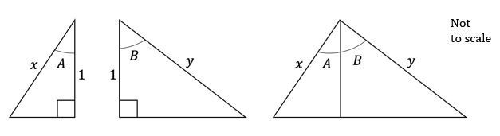
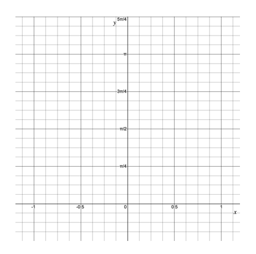

# Exam Questions — Trigonometric Proof
**Trigonometry** · Edexcel International A Level (IAL) Maths (YMA01) — Pure 3
> Source: [https://www.savemyexams.com/international-a-level/maths/edexcel/20/pure-3/topic-questions/trigonometry/trigonometric-proof/exam-questions/](https://www.savemyexams.com/international-a-level/maths/edexcel/20/pure-3/topic-questions/trigonometry/trigonometric-proof/exam-questions/) · 36 questions · total 171 marks

## Q1 — easy — 2 marks · exam-questions

### 1() — 2 marks — structured
Show that

$\mathrm{cot}θ$$\equiv\frac{\mathrm{cos}θ}{\mathrm{sin}θ}$

## Q2 — easy — 5 marks · exam-questions

### 1() — 2 marks — structured
Use the identity

cos$( A + B ) \equiv$cos $A$cos $B-$sin $A$sin $B$

to show that

cos $2A\equiv$cos2 $A-$sin2 $A$

### 2() — 3 marks — structured
Show by counter-example that

cos $2 \\theta \text{not} \equiv$cos $θ+$cos $θ$

## Q3 — easy — 2 marks · exam-questions

### 1() — 2 marks — structured
Prove the identity

$\frac{\mathrm{sin}2θ}{2\mathrm{sin}θ}\equiv\mathrm{cos}θ,θ\neq\mathrm{kπ}$

## Q4 — easy — 4 marks · exam-questions

### 1() — 4 marks — structured
Show that

$\sin ^{2} \\theta ( \sec ^{2} \\theta + cosec^{2} \\theta ) \equiv \sec ^{2} \\theta$

## Q5 — easy — 5 marks · exam-questions

### 1() — 5 marks — structured
(i) Use the quotient rule to show that

$\frac{d}{d x} [ \text{cosec} x ] = \frac{- \cos x}{\sin ^{2} x}$

(ii) Hence show that

$\frac{d}{d x} [ \text{cosec} x ] = - \cot x \text{cosec} x$

## Q6 — easy — 3 marks · exam-questions

### 1() — 3 marks — structured
Show that

$3$ sin $2θ-2$ sin $θ\equiv2$ sin $\\theta ( 3 \cos \\theta - 1 )$

## Q7 — easy — 5 marks · exam-questions

### 1() — 5 marks — structured
Prove the identity

$2$ cosec $2x$cot $x\equiv$cosec2 $x,x\neq\frac{kπ}{2}$

## Q8 — easy — 4 marks · exam-questions

### 1() — 2 marks — structured
Find the value of

(i) $\arccos ( \cos ( 150^{\circ} ) )$

(ii) $\arcsin ( \sin ( 210^{\circ} ) )$

### 2() — 2 marks — structured
Explain why the answer to part (a) (ii) is not $210^{\circ}$.

## Q9 — easy — 3 marks · exam-questions

### 1() — 3 marks — structured
Use the identity

$R$ sin$( \\theta + \ \\alpha ) \equiv R$cos $α$ sin $θ+R$sin $α$ cos $θ$

to show that

$4$ sin`( theta + pi / 4 ) === 2 sqrt( 2 ( sin theta + cos theta )`

## Q10 — medium — 4 marks · exam-questions

### 1() — 4 marks — structured
Given the identity

sin2 $θ+$cos2 $θ\equiv1$

prove the following identities:

(i) sec2 $θ\equiv1+$tan2 $θ$

(ii) cosec2 $θ\equiv1+$cot2 $θ$

## Q11 — medium — 5 marks · exam-questions

### 1() — 5 marks — structured
(i) By using the double angle formula for cosine, prove the identity

cos $4θ\equiv8$ cos4 $θ-8$ cos2 $θ+1$

(ii) Show by counter-example that

sin $4 \\theta \text{not} \equiv 8$ sin4 $θ-8$ sin2 $θ+1$

## Q12 — medium — 3 marks · exam-questions

### 1() — 3 marks — structured
Prove the identity

$\frac{4\mathrm{sin}^{4}θ}{\mathrm{sin}^{2}2θ}\equiv\mathrm{tan}^{2}θθ\neq\mathrm{kπ}$

## Q13 — medium — 4 marks · exam-questions

### 1() — 4 marks — structured
Show that

sin $\\theta ( cosec^{2} \\theta - 2 ) \equiv \frac{\cos 2 \\theta }{\sin \\theta }$

## Q14 — medium — 5 marks · exam-questions

### 1() — 5 marks — structured
Use the quotient rule to show that

$\frac{d}{d x} [ \tan x ] = \sec ^{2} x$

## Q15 — medium — 5 marks · exam-questions

### 1() — 5 marks — structured
Show that

sin $3θ+$sin $θ\equiv4$ sin $θ-4$sin3 $θ$

## Q16 — medium — 5 marks · exam-questions

### 1() — 5 marks — structured
Prove the identity

$\frac{4\mathrm{cot}x\mathrm{cos}2x}{\mathrm{sin}4x}\equiv\mathrm{cosec}^{2}xx\neq\frac{\mathrm{kπ}}{4}$

## Q17 — medium — 4 marks · exam-questions

### 1() — 2 marks — structured
Show that

sin`( arccos ( - 1 half ) ) = sqrt( 3 sin ( pi / 6 )`

### 2() — 2 marks — structured
Show that

`arcsin ( cos (3 pi)/(4) ) = - arcsin ( cos pi / 4 )`

## Q18 — medium — 3 marks · exam-questions

### 1() — 3 marks — structured
Show that

`sqrt( 2 sin ( theta - pi / 4 ) === sin theta - cos theta`

## Q19 — hard — 4 marks · exam-questions

### 1() — 4 marks — structured
Given the identity

cos$( A + B ) =$cos $A$ cos $B$$-$sin $A$ sin $B$

prove the following identities:

(i) cos $2θ\equiv$cos2 $θ-$sin2 $θ$

(ii) cos $2θ\equiv1-2$sin2 $θ$

(iii) cos $2θ\equiv2$cos2 $θ-1$

## Q20 — hard — 5 marks · exam-questions

### 1() — 5 marks — structured
(i) Prove the identity

sin $3θ\equiv3$ sin $θ-4$ sin3 $θ$

(ii) Show by counter-example that

cos $3 \\theta \text{not} \equiv 3$ cos $θ-$$4$ cos3 $θ$

## Q21 — hard — 5 marks · exam-questions

### 1() — 5 marks — structured
Show that

cos $4θ+$cos $\frac{π}{3}\equiv8$ sin4 $θ-8$ sin2 $θ+\frac{3}{2}$

## Q22 — hard — 5 marks · exam-questions

### 1() — 5 marks — structured
Prove that

cot2 $θ-$tan2 $θ\equiv4$ cot $2θ$ cosec $2θ$.

## Q23 — hard — 5 marks · exam-questions

### 1() — 5 marks — structured
Prove the identity

$\frac{1-\mathrm{tan}^{2}x}{\mathrm{cos}2x}\equiv\mathrm{sec}^{2}xx\neq\frac{2k+1}{4}π$

## Q24 — hard — 4 marks · exam-questions

### 1() — 4 marks — structured
Prove the identity

cosec $x\equiv\frac{\frac{1}{2}\mathrm{sec}^{2}\frac{x}{2}}{\mathrm{tan}\frac{x}{2}}$

## Q25 — hard — 5 marks · exam-questions

### 1() — 5 marks — structured
Show that

tan$\frac{x}{2}\equiv\frac{1}{\mathrm{cosec}x+\mathrm{cot}x}x\neq2\mathrm{kπ}$

## Q26 — hard — 6 marks · exam-questions

### 1() — 3 marks — structured
Given that $y = \arcsin ( k x )$, where $k$ is a constant, show that   `x = 1 / k cos ( pi / 2 - y )` .

### 2() — 3 marks — structured
Hence show that the value of $\mathrm{arcsin}kx+\mathrm{arccos}kx$ is constant and independent of $k$. 
Find the value of this constant.

## Q27 — hard — 5 marks · exam-questions

### 1() — 5 marks — structured
Show that

$\frac{10}{4 \cos \\theta + 3 \sin \\theta } \equiv 2 \sec ( \\theta - \ \\alpha )$

where

$\\alpha = \arctan ( \frac{3}{4} )$

## Q28 — very_hard — 6 marks · exam-questions

### 1() — 6 marks — structured
Consider the three triangles, all of height 1, as shown below.

By applying the area of a triangle formula $A=\frac{1}{2}\mathrm{ab} \mathrm{sin}C$  to each one, prove that,

sin$( A + B ) \equiv$sin $A$ cos $B+$sin $B$ cos $A$

Briefly explain why this only proves the result for $A$ and $B$ being acute angles.

## Q29 — very_hard — 4 marks · exam-questions

### 1() — 4 marks — structured
Prove the identity

$\tan 4 \\theta \equiv \frac{4 \tan \\theta ( 1 - \tan ^{2} \\theta )}{1 - 6 \tan ^{2} \\theta + \tan ^{4} \\theta }$

## Q30 — very_hard — 5 marks · exam-questions

### 1() — 5 marks — structured
Prove the identity

$-16$ cot $2θ$ cosec3 $2θ\equiv$sec4 $θ-$cosec4 $θ$

## Q31 — very_hard — 4 marks · exam-questions

### 1() — 4 marks — structured
Show that

`(sqrt( 2 cos ( theta + pi / 4 ))/(sin ( theta - pi / 2 )) === tan theta - 1`

## Q32 — very_hard — 9 marks · exam-questions

### 1() — 4 marks — structured
Show that

sin $3θ\equiv3$ sin $θ$ cos2 $θ-$sin3 $θ$

### 2() — 5 marks — structured
Hence, or otherwise, show that

$\frac{\mathrm{cos}3θ-\mathrm{cos}θ}{\mathrm{sin}3θ\mathrm{sin}θ}\equiv\frac{4\mathrm{cos}θ}{1-4\mathrm{cos}^{2}θ}θ\neq\mathrm{kπ}$

## Q33 — very_hard — 5 marks · exam-questions

### 1() — 5 marks — structured
Show that

$4$cos2 `( x - pi / 6 ) === 3 - 2`sin2 $x+\sqrt{3}$ sin $2x$

## Q34 — very_hard — 6 marks · exam-questions

### 1() — 6 marks — structured
Show that

tan$( \frac{2 x + \mathrm{\pi } }{4} ) \equiv$sec $x+$tan $x$

## Q35 — very_hard — 8 marks · exam-questions

### 1() — 4 marks — structured
On the axes below sketch the graphs of

$y = \arccos ( - x )$  and  $y = \left| \arcsin x \right|$

### 2() — 2 marks — structured
With the help of your sketch, determine the exact solution(s) to the equation

$\arccos ( - x ) = \left| \arcsin x \right|$

### 3() — 2 marks — structured
What can you say about the solution(s) to the equation

$\left| \arccos x \right| = \arcsin ( - x ) ?$

Justify your answer.

## Q36 — very_hard — 9 marks · exam-questions

### 1() — 9 marks — structured
Show that

`1 / ( (sqrt( 3)/(2) cos theta - 1 half sin theta ) ^2 + 1 / ( (sqrt( 3)/(2) sin theta + 1 half cos theta ) ^2 === 4 cosec ^2 ( 2 theta + pi / 3 )`
