# Exam Questions — Continuous Random Variables
**Statistical Distributions** · Edexcel International A Level (IAL) Maths (YMA01) — Statistics 2
> Source: [https://www.savemyexams.com/international-a-level/maths/edexcel/20/statistics-2/topic-questions/statistical-distributions/continuous-random-variables/exam-questions/](https://www.savemyexams.com/international-a-level/maths/edexcel/20/statistics-2/topic-questions/statistical-distributions/continuous-random-variables/exam-questions/) · 36 questions · total 243 marks

## Q1 — easy — 4 marks · exam-questions

### 1() — 4 marks — structured
If $f(x)$  is the probability density function for a random variable, $X$ then the area under the graph of the probability density function must equal 1.

State, with a reason, whether each of the following could be graphs of probability density functions.

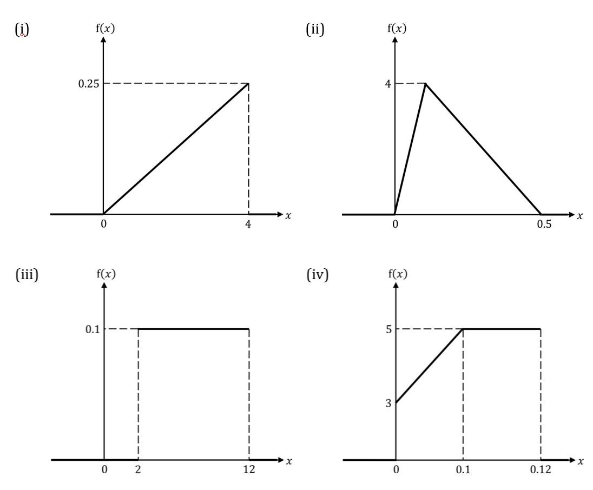

## Q2 — easy — 6 marks · exam-questions

### 1() — 6 marks — structured
If $f(x)$ is the probability density function for a random variable, $X$ which takes values in the interval $( a , b )$ then:

$\int_{a}^{b} \mathrm{f} ( x ) d x = 1$

Use integration to decide whether the following functions could represent probability distribution functions.

(i) $\mathrm{f} ( x ) = \{ \begin{gathered} 2 x & 0 \text{less} \text{or} \text{equal} \text{than} x \text{less} \text{or} \text{equal} \text{than} 1 \\ 0 otherwise. \end{gathered} )$

(ii) $\mathrm{f} ( x ) = \{ \begin{gathered} 1 \frac{1}{3} x^{2} & 1 \text{less} \text{or} \text{equal} \text{than} x \text{less} \text{or} \text{equal} \text{than} 4 \\ 0 otherwise. \end{gathered} )$

(iii) $\mathrm{f} ( x ) = \{ \begin{gathered} \frac{4}{27} ( x^{3} + 1 ) & - 1 \text{less} \text{or} \text{equal} \text{than} x \text{less} \text{or} \text{equal} \text{than} 2 \\ 0 otherwise. \end{gathered} )$

## Q3 — easy — 7 marks · exam-questions

### 1() — 2 marks — structured
The continuous random variable, $X$, has probability density function

$\mathrm{f} ( x ) = \{ \begin{gathered} \frac{1}{24} ( x^{3} + 2 ) & 1 \text{less} \text{or} \text{equal} \text{than} x \text{less} \text{or} \text{equal} \text{than} 3 \\ 0 otherwise. \end{gathered} )$

The value of$P(a<X<b)$ is equal to

$\int_{a}^{b} \mathrm{f} ( x ) d x.$

Find$P(1<X<2).$

### 2() — 3 marks — structured
(i) Explain why $P ( X > 2.5 ) = \int_{2.5}^{3} \frac{1}{24} ( x^{3} + 2 ) d x.$

(ii) Hence find $P(X>2.5)$.

### 3() — 2 marks — structured
State, with a reason, the value of

(i) $P(5<X<10)$

(ii) $P(X=2).$

## Q4 — easy — 4 marks · exam-questions

### 1() — 4 marks — structured
The graph below shows the probability density function of a continuous random variable, $X$.

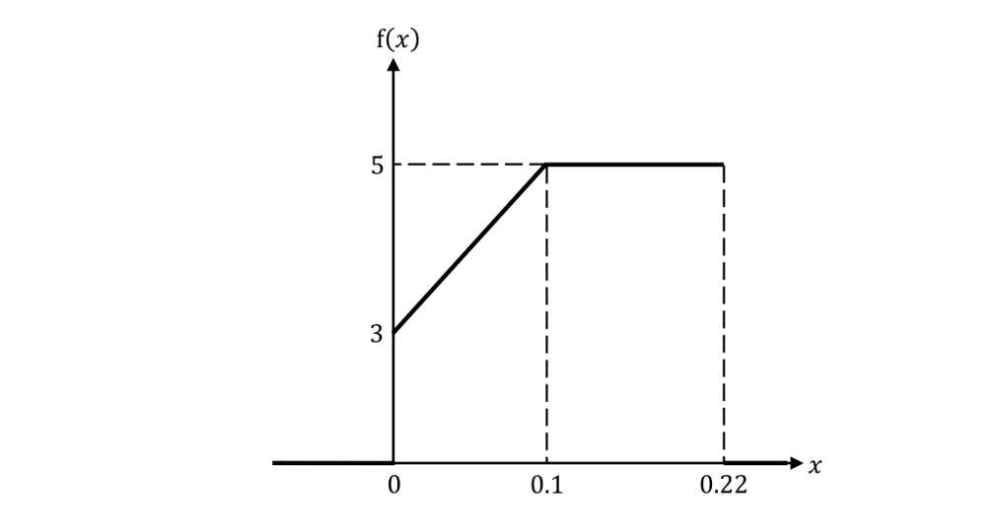

By finding relevant areas under the graph, find:

(i) $P(0<X<0.1)$

(ii) $P(X>0.15)$

(iii) $P(0.05<X<0.12)$.

## Q5 — easy — 4 marks · exam-questions

### 1() — 2 marks — structured
Evaluate the following definite integral, giving your answer in terms of $k$.

$\int_{3}^{9} k ( x^{2} + 3 ) d x$

### 2() — 2 marks — structured
Hence find the value of $k$ given that $\mathrm{f} ( x )$ is a probability density function where

$\mathrm{f} ( x ) = \{ \begin{gathered} k ( x^{2} + 3 ) & 3 \text{less} \text{or} \text{equal} \text{than} x \text{less} \text{or} \text{equal} \text{than} 9 \\ 0 otherwise. \end{gathered} )$

## Q6 — easy — 7 marks · exam-questions

### 1() — 2 marks — structured
The continuous random variable $X$ has probability density function

$\mathrm{f} ( x ) = \{ \begin{gathered} \frac{3}{16} ( x^{2} - 1 ) & 2 \text{less} \text{or} \text{equal} \text{than} x \text{less} \text{or} \text{equal} \text{than} 3 \\ 0 otherwise. \end{gathered} )$

Find  $\int \frac{3}{16} x ( x^{2} - 1 ) d x.$

### 2() — 1 mark — structured
Hence find the value of $E(X)$ using the formula

$\mathrm{E} ( X ) = \int x \mathrm{f} ( x ) \mathrm{d} x.$

### 3() — 2 marks — structured
Find $\int \frac{3}{16} x^{2} ( x^{2} - 1 ) \mathrm{d} x.$

### 4() — 1 mark — structured
Hence find the value of $E(X²)$ using the formula

$\mathrm{E} ( X ² ) = \int x^{2} \mathrm{f} ( x ) \mathrm{d} x.$

### 5() — 1 mark — structured
Hence find the value of $\mathrm{Var}(X)$using the formula $\mathrm{Var}(X)=E(X^{2})-(E(X))².$

## Q7 — easy — 4 marks · exam-questions

### 1() — 4 marks — structured
The mode of a continuous random variable $X$, where it exists, is a value for $X$ where the probability density function is at its maximum.

State the mode, where it exists, of the continuous random variables which have probability density functions show in the graphs below.

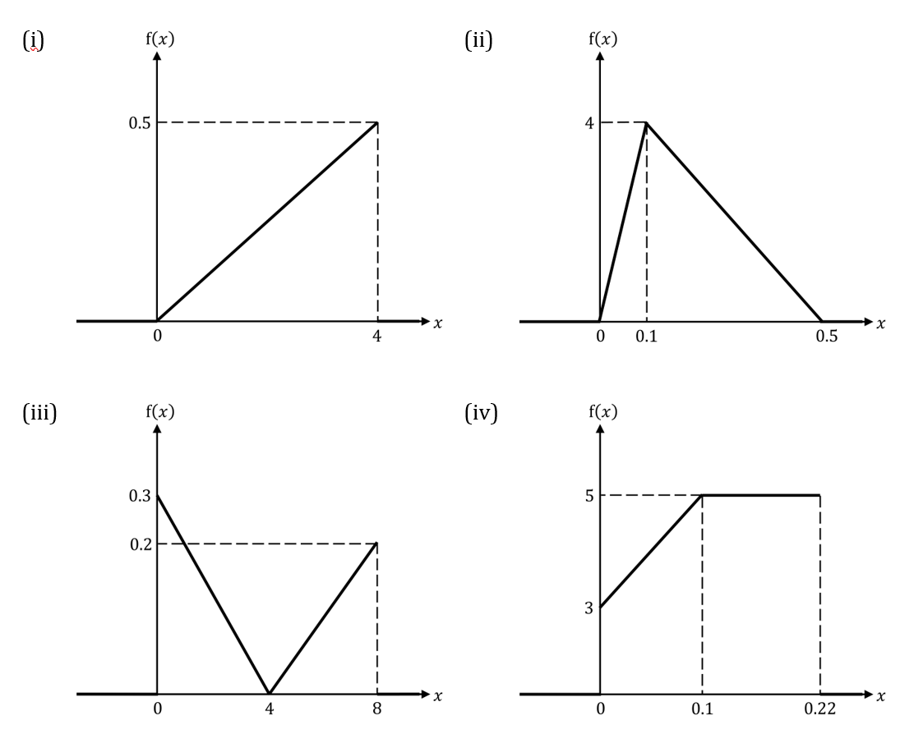

## Q8 — easy — 6 marks · exam-questions

### 1() — 6 marks — structured
The median, $m$, of a continuous random variable $X$, is the value for $X$ which splits the under the graph of the probability density function exactly in half, such that $P(X<m)=0.5$.

Find the value of the median of the continuous random variables which have probability density functions show in the graphs below.

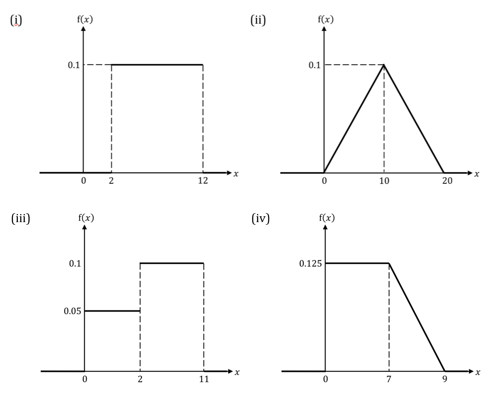

## Q9 — easy — 4 marks · exam-questions

### 1() — 1 mark — structured
The continuous uniform (rectangular) distribution over the interval $( a , b )$ has probability density function

$\mathrm{f} ( x ) = \{ \begin{gathered} \frac{1}{b - a} & a < x < b \\ 0 otherwise. \end{gathered} )$

The random variable $X$ follows a rectangular distribution over the interval $(2,18)$.

The graph below shows the probability density function of $X$. Write down the values of $a,b$ and $c$.

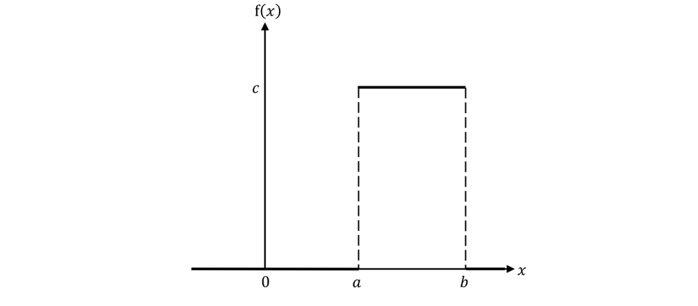

### 2() — 3 marks — structured
Write down

(i) the median of $X$

(ii) the value of $E(X)$

(iii) $P(14<X<18)$.

## Q10 — easy — 6 marks · exam-questions

### 1() — 3 marks — structured
The continuous random variable $X$ has probability density function $\mathrm{f} ( x )$ given by

$\mathrm{f} ( x ) = \{ \begin{gathered} 1 \frac{1}{4} x & 0 \text{less} \text{or} \text{equal} \text{than} x \text{less} \text{or} \text{equal} \text{than} 2 \\ \frac{5}{9} - \frac{1}{9} x & 2 \text{less} \text{or} \text{equal} \text{than} x \text{less} \text{or} \text{equal} \text{than} 5 \\ 0 otherwise. \end{gathered} )$

Find $P(1\leqX\leq4)$ by calculating

$\int_{1}^{2} ( 1 \frac{1}{4} x ) d x + \int_{2}^{4} ( \frac{5}{9} - \frac{1}{9} x ) d x$

### 2() — 3 marks — structured
Find $E(X)$ by calculating

$\int_{0}^{2} ( 1 \frac{1}{4} x ) ( x ) \mathrm{d} x + \int_{2}^{5} ( \frac{5}{9} - \frac{1}{9} x ) ( x ) \mathrm{d} x$

## Q11 — medium — 6 marks · exam-questions

### 1() — 6 marks — structured
State, with a reason, whether each of the following could be graphs of probability density functions.

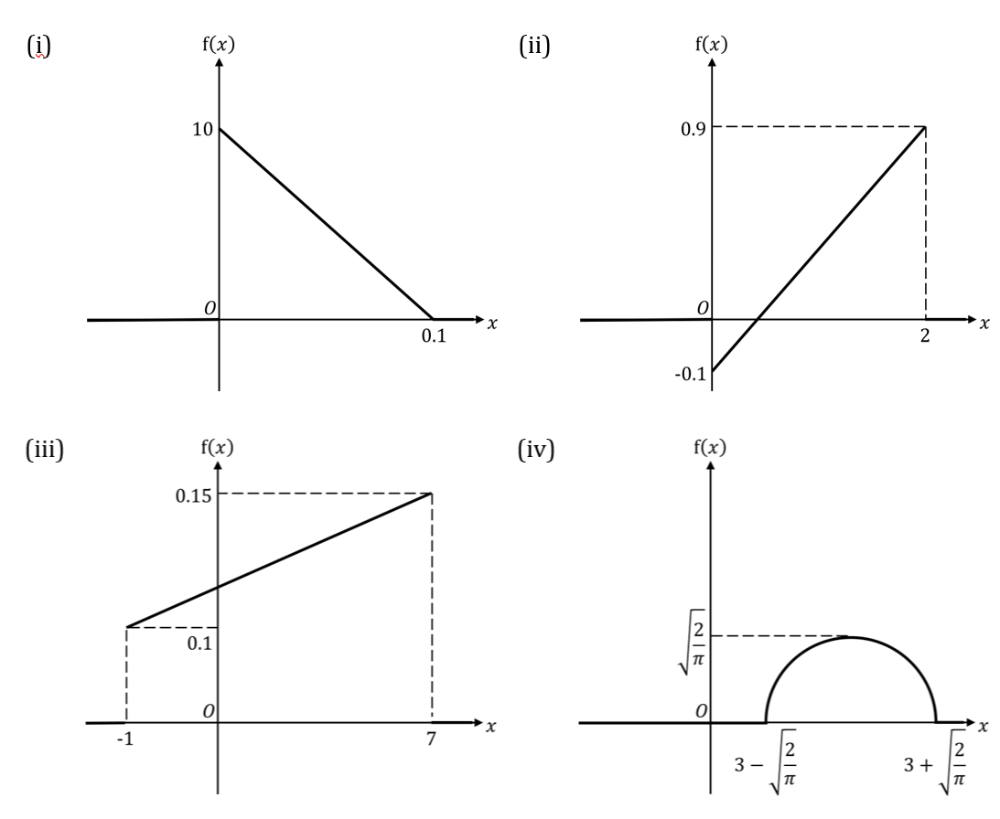

This is a semicircle.

## Q12 — medium — 6 marks · exam-questions

### 1() — 6 marks — structured
State, with a reason, whether the following functions could represent probability distribution functions.

(i) $\mathrm{f} ( x ) = \{ \begin{gathered} 3 ( x^{5} - 2 x^{3} ) & 1 \text{less} \text{or} \text{equal} \text{than} x \text{less} \text{or} \text{equal} \text{than} 2 \\ 0 otherwise. \end{gathered} )$

(ii) $\mathrm{f} ( x ) = \{ \begin{gathered} \frac{3}{8} ( x + 1 )^{2} & - 1 \text{less} \text{or} \text{equal} \text{than} x \text{less} \text{or} \text{equal} \text{than} 1 \\ 0 otherwise. \end{gathered} )$

(iii) $\mathrm{f} ( x ) = \{ \begin{gathered} \frac{6}{x^{2}} & - 3 \text{less} \text{or} \text{equal} \text{than} x \text{less} \text{or} \text{equal} \text{than} - 2 \\ 0 otherwise. \end{gathered} )$

## Q13 — medium — 6 marks · exam-questions

### 1() — 2 marks — structured
The continuous random variable, $X$, has probability density function

$f ( x ) = \{ \begin{gathered} k ( 3 x^{4} - 2 x ) & 1 \text{less} \text{or} \text{equal} \text{than} x \text{less} \text{or} \text{equal} \text{than} 2 \\ 0 otherwise. \end{gathered} )$

Show that $k=\frac{5}{78}.$

### 2() — 4 marks — structured
(i) Find $P(1.2<X<1.8).$

(ii) Find  $P(X<1.5).$

## Q14 — medium — 7 marks · exam-questions

### 1() — 2 marks — structured
The continuous random variable $X$ has probability density function

$\mathrm{f} ( x ) = \{ \begin{gathered} k ( 2 + \sqrt{x} ) & 4 \text{less} \text{or} \text{equal} \text{than} x \text{less} \text{or} \text{equal} \text{than} 9 \\ 0 otherwise. \end{gathered} )$

Show that $k=\frac{3}{68}.$

### 2() — 2 marks — structured
Find $E(X).$

### 3() — 3 marks — structured
Find $\mathrm{Var}(X).$

## Q15 — medium — 4 marks · exam-questions

### 1() — 4 marks — structured
Find the mode of the continuous random variable, $X$, which has probability density function defined by:

(i) $\mathrm{f} ( x ) = \{ \begin{gathered} \frac{2}{21} x & 2 \text{less} \text{or} \text{equal} \text{than} x \text{less} \text{or} \text{equal} \text{than} 5 \\ 0 otherwise. \end{gathered} )$

(ii) $\mathrm{f} ( x ) = \{ \begin{gathered} \frac{1}{9} ( 4 - ( x + 1 )^{2} ) & - 2 \text{less} \text{or} \text{equal} \text{than} x \text{less} \text{or} \text{equal} \text{than} 1 \\ 0 otherwise. \end{gathered} )$

(iii) $\mathrm{f} ( x ) = \{ \begin{gathered} 1 \frac{1}{2} \sin ( x ) & 0 \text{less} \text{or} \text{equal} \text{than} x \text{less} \text{or} \text{equal} \text{than} \pi \\ 0 otherwise. \end{gathered} )$

## Q16 — medium — 5 marks · exam-questions

### 1() — 2 marks — structured
The continuous random variable $X$ has probability density function

$\mathrm{f} ( x ) = \{ \begin{gathered} \frac{5}{62} \sqrt{x^{3}} & 1 \text{less} \text{or} \text{equal} \text{than} x \text{less} \text{or} \text{equal} \text{than} 4 \\ 0 otherwise. \end{gathered} )$

Find an expression, in terms of $m$, for

$\int_{1}^{m} \frac{5}{62} \sqrt{x^{3}} d x.$

### 2() — 3 marks — structured
Hence find the median of $X$.

## Q17 — medium — 6 marks · exam-questions

### 1() — 3 marks — structured
The continuous random variable $X$ follows a continuous uniform distribution over the interval $(3,28)$ so that its probability density function is

$f ( x ) = \{ \begin{gathered} \frac{1}{25} & 3 < x < 28 \\ 0 otherwise. \end{gathered} )$

Find

(i) $P(X<15)$

(ii) $P(20<X<30)$

(iii) $P(X=25).$

### 2() — 3 marks — structured
(i) Write down $E(X)$ .

(ii) Find $\mathrm{Var}(X)$ .

## Q18 — medium — 8 marks · exam-questions

### 1() — 2 marks — structured
May calls her nephew Peter each day to check on him. May enjoys talking so much so that Peter has programmed his phone to disconnect from a call after 15 minutes. The length of a call, in minutes, between May and Peter is denoted by the continuous random variable $T$. It is modelled by the probability density function

$\mathrm{f} ( t ) = \{ \begin{gathered} \frac{1}{1125} t^{2} & 0 \text{less} \text{or} \text{equal} \text{than} t \text{less} \text{or} \text{equal} \text{than} 15 \\ 0 otherwise. \end{gathered} )$

Find the mean length of a call.

### 2() — 3 marks — structured
Find the standard deviation of the lengths of calls.

### 3() — 2 marks — structured
Find the probability that a random call between May and Peter will last longer than 10 minutes.

### 4() — 1 mark — structured
Out of the next 100 calls between May and Peter, estimate the number of them that will last less than 10 minutes.

## Q19 — medium — 7 marks · exam-questions

### 1() — 2 marks — structured
The mass, in kilograms, of a wrestler in a local club is denoted by the continuous random variable $M$. It is modelled by the probability density function

$\mathrm{f} ( m ) = \{ \begin{gathered} k - \frac{1}{9000} ( m - 80 )^{2} & 70 < m < 100 \\ 0 otherwise. \end{gathered} )$

Show that $k=\frac{4}{90}.$

### 2() — 2 marks — structured
Wrestlers who weigh less than 85 kg can enter Heavy Middleweight competitions.

Find the probability that a randomly selected wrestler can enter Heavy Middleweight competition.

### 3() — 3 marks — structured
Wrestlers who weigh less than 80 kg can enter Middleweight competitions.

Given that a wrestler can enter Heavy Middleweight competitions, find the probability that they can also enter Middleweight competitions.

## Q20 — medium — 9 marks · exam-questions

### 1() — 4 marks — structured
The continuous random variable $X$ has probability density function $\mathrm{f} ( x )$ given by

$\mathrm{f} ( x ) = \{ \begin{gathered} 1 \frac{1}{5} ( x - 1 ) & 1 \text{less} \text{or} \text{equal} \text{than} x \text{less} \text{or} \text{equal} \text{than} k \\ 2 - \frac{2}{5} x & k < x \text{less} \text{or} \text{equal} \text{than} 4 \\ 0 otherwise. \end{gathered} )$

Find the value of $k.$

### 2() — 2 marks — structured
Find $P(X<3.5).$

### 3() — 3 marks — structured
Show that $E(X)=3$.

## Q21 — hard — 5 marks · exam-questions

### 1() — 5 marks — structured
State, with a reason, whether the following functions could represent probability distribution functions.

(i) $\mathrm{f} ( x ) = \{ \begin{gathered} 1 \frac{1}{3} ( x^{2} - 2 ) & 1 \text{less} \text{or} \text{equal} \text{than} x \text{less} \text{or} \text{equal} \text{than} 2 \\ 0 otherwise. \end{gathered} )$

(ii) $\mathrm{f} ( x ) = \{ \begin{gathered} \frac{4}{x^{5}} & x \text{greater} \text{or} \text{equal} \text{than} 1 \\ 0 otherwise. \end{gathered} )$

(iii) $\mathrm{f} ( x ) = \{ \begin{gathered} \frac{2}{x^{2}} & - 1 \text{less} \text{or} \text{equal} \text{than} x \text{less} \text{or} \text{equal} \text{than} 2 \\ 0 otherwise. \end{gathered} )$

## Q22 — hard — 8 marks · exam-questions

### 1() — 4 marks — structured
The continuous random variable $X$ has probability density function

`f ( x ) = { table columnalign left columnspacing 1.4ex end | begin inline style 1 fourth x ( x - 1 ) ( x + 1 ) | 1 <= x <= k | | 0 otherwise. | | close`

Find the exact value for $k$ .

### 2() — 4 marks — structured
Find $P(X<E(X)).$

## Q23 — hard — 5 marks · exam-questions

### 1() — 4 marks — structured
Harry is trying to draw specific lengths without measuring equipment. He draws a straight line and stops when he thinks it is 10 cm long. The actual length of Harry’s line, $L$ cm, can be modelled by the probability density function

$\mathrm{f} ( l ) = \{ \begin{gathered} \frac{20}{421} ( l - 10.5 )^{4} & 8 \text{less} \text{or} \text{equal} \text{than} l \text{less} \text{or} \text{equal} \text{than} 12 \\ 0 otherwise. \end{gathered} )$

Estimate the lower quartile of the lengths of Harry’s lines.

### 2() — 1 mark — structured
Harry tries to draw a 10 cm line 80 times.

Write down how many of Harry’s lines you would expect to be less than the lower quartile.

## Q24 — hard — 7 marks · exam-questions

### 1() — 1 mark — structured
The diagram below shows the probability density function, $f(x)$, of a random variable $X$. $f(x)=k$ when $0\leqx\leqa$, otherwise $f(x)=0.$

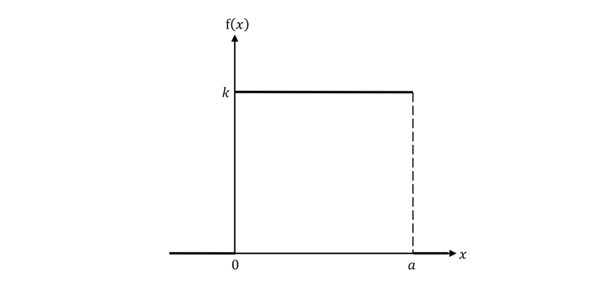

Write down an expression for $k$  in terms of $a$.

### 2() — 1 mark — structured
Write down an expression for $E(X)$ in terms of $a$.

### 3() — 3 marks — structured
Find a simplified expression for $\mathrm{Var}(X)$ in terms of $a$.

### 4() — 2 marks — structured
Given that$P(X>5)=0.6$find the value of $a$.

## Q25 — hard — 6 marks · exam-questions

### 1() — 6 marks — structured
Find the mode of the continuous random variable, $X$, which has probability density function defined by:

(i) $\mathrm{f} ( x ) = \{ \begin{gathered} \frac{3}{140} ( 5 - 6 x - x^{2} ) & - 4 \text{less} \text{or} \text{equal} \text{than} x \text{less} \text{or} \text{equal} \text{than} 0 \\ 0 otherwise. \end{gathered} )$

(ii) $\mathrm{f} ( x ) = \{ \begin{gathered} \frac{3}{34} ( 10 - ( x - 2 )^{2} ) & 3 \text{less} \text{or} \text{equal} \text{than} x \text{less} \text{or} \text{equal} \text{than} 5 \\ 0 otherwise. \end{gathered} )$

(iii) $\mathrm{f} ( x ) = \{ \begin{gathered} 1 \frac{1}{2} ( \sin ( x ) + \cos ( x ) ) & 0 \text{less} \text{or} \text{equal} \text{than} x \text{less} \text{or} \text{equal} \text{than} \frac{\pi }{2} \\ 0 otherwise. \end{gathered} )$

## Q26 — hard — 7 marks · exam-questions

### 1() — 1 mark — structured
The diagram below shows the probability density function, $f(x)$, of a random variable $X$.

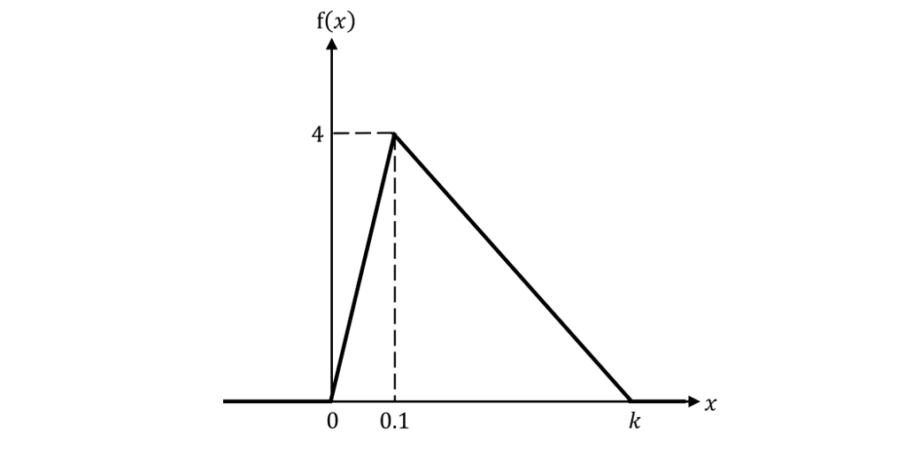

Find the value of $k$.

### 2() — 2 marks — structured
Find $P(X>0.4).$

### 3() — 4 marks — structured
Find the median of $X$.

## Q27 — hard — 9 marks · exam-questions

### 1() — 2 marks — structured
The diagram below shows the probability density function, $\mathrm{f} ( t )$, of a random variable $T$.

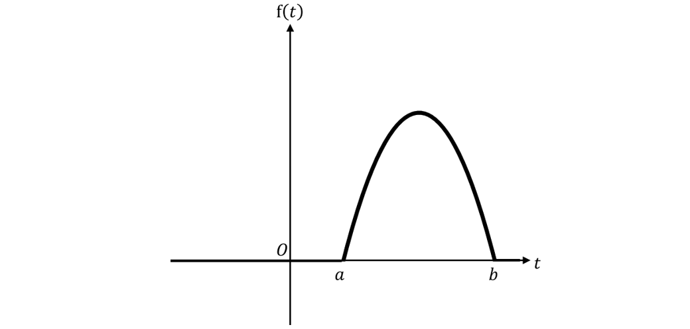

For $a\leqt\leqb,f(t)=\frac{3}{32}(10t-t^{2}-21),$ elsewhere $f(t)=0$.

Find the values of $a$ and $b$.

### 2() — 4 marks — structured
State the value of $E(T)$ and find $\mathrm{Var}(T)$.

### 3() — 1 mark — structured
Find $P(-2\leqT\leq5)$.

### 4() — 2 marks — structured
Given that $P(4\leqT\leq6)=\frac{11}{16}$ find $P(T\geq6).$

## Q28 — hard — 9 marks · exam-questions

### 1() — 2 marks — structured
Geoff is taking part in a quiz where he has 4 seconds to answer each question. The time, in seconds, it takes Geoff to answer a question is denoted $T$ which can be modelled by the probability density function, $f(t),$  shown below.

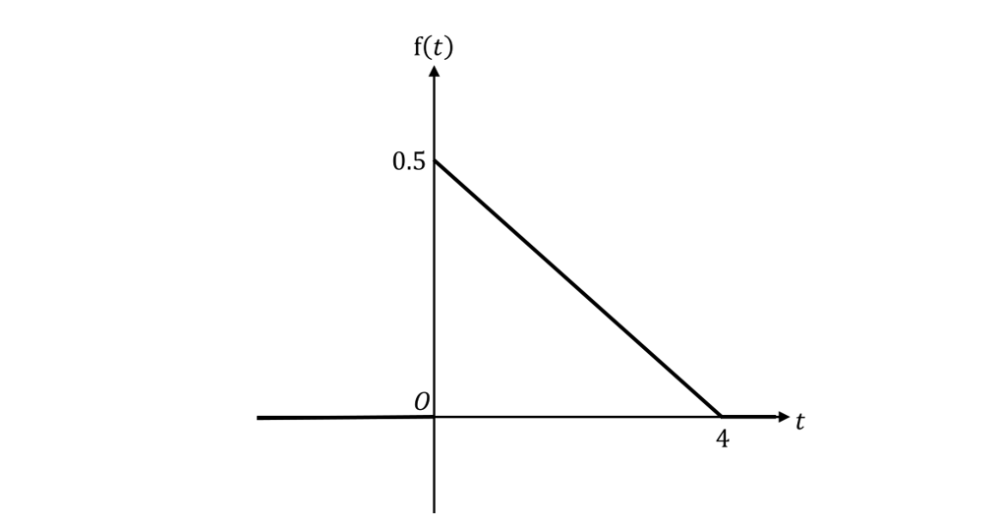

Find the probability that Geoff answers a question in less than 2 seconds.

### 2() — 4 marks — structured
Find the mean time it takes Geoff to answer a question.

### 3() — 3 marks — structured
There are 10 questions in the quiz. Find the probability that for at least one of the questions Geoff takes longer than 3 seconds.

## Q29 — very_hard — 8 marks · exam-questions

### 1() — 2 marks — structured
The diagram below shows the probability density function, $f(x)$, of a random variable $X$.

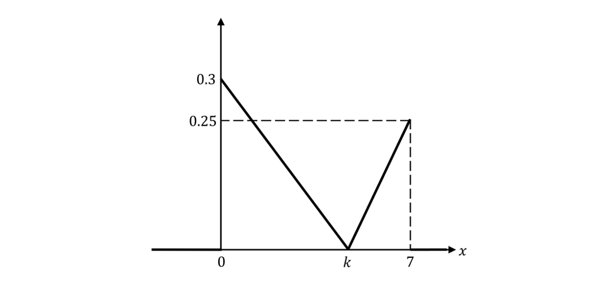

Find the value of $k$.

### 2() — 2 marks — structured
Find $P(X\leq6).$

### 3() — 4 marks — structured
Find the interquartile range of $X$.

## Q30 — very_hard — 6 marks · exam-questions

### 1() — 2 marks — structured
A computer takes $T$ seconds to start up. The random variable, $T$, can be modelled by the probability distribution, $f(t)$, shown below.

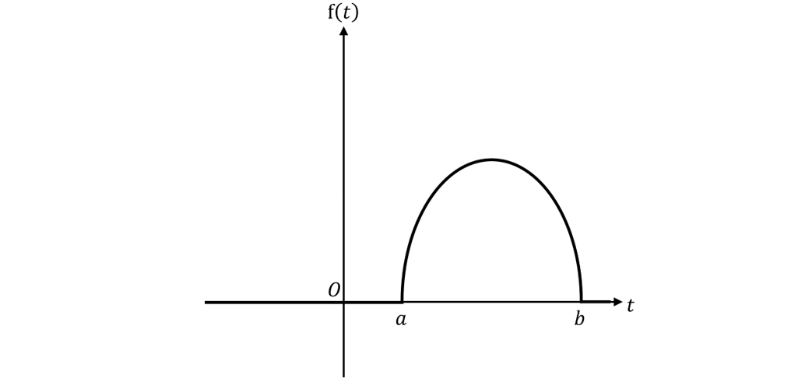

For $a\leqt\leqb,f(t)=\frac{1}{8}π\sqrt{(12t-t^{2}-20)},$ elsewhere $f(t)=0$.

Find the values of $a$ and $b$.

### 2() — 1 mark — structured
State the mean time for the computer to start up.

### 3() — 1 mark — structured
Find probability that the computer takes between 6 and 15 seconds to start up.

### 4() — 2 marks — structured
Given that $P(4\leqT\leq8)=\frac{\sqrt{3}}{2π}+\frac{1}{3},$ find the exact value of $P(T\geq8)$.

## Q31 — very_hard — 10 marks · exam-questions

### 1() — 1 mark — structured
The diagram below shows the probability density function, $g(y)$, of a random variable $Y$.

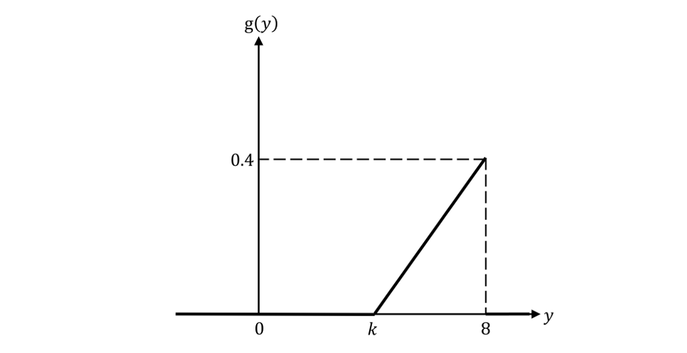

Find the value of $k$.

### 2() — 3 marks — structured
Find $P(5<Y<6).$

### 3() — 2 marks — structured
Find the median of $Y$.

### 4() — 4 marks — structured
Find $E(Y).$

## Q32 — very_hard — 8 marks · exam-questions

### 1() — 5 marks — structured
The random variable, $U$, follows a continuous uniform distribution on the interval $[ a , b ]$. The probability density function  is defined by:

$g ( u ) = \{ \begin{gathered} k \\ 0 \end{gathered} ) \begin{gathered} a \text{less} \text{or} \text{equal} \text{than} u \text{less} \text{or} \text{equal} \text{than} b \\ otherwise. \end{gathered}$

(i) Write down an expression for $k$ in terms of $a$ and $b$.

(ii) Write down an expression for $E(U)$ in terms of $a$ and $b$.

(iii) Show that  $\text{Var} ( U ) = \frac{( b - a )^{2}}{12.}$.

### 2() — 3 marks — structured
Given that $E(U)=8.5$and $\mathrm{Var}(U)=6.75$, find the values of $a$ and $b$.

## Q33 — very_hard — 14 marks · exam-questions

### 1() — 6 marks — structured
A meeting at a company lasts $T$ hours. The random variable $T$ can be modelled by the probability density function

$\mathrm{f} ( t ) = \{ \begin{gathered} \frac{3}{4} t ( t - 2 )^{2} \\ 0 \end{gathered} ) \begin{gathered} 0 \text{less} \text{or} \text{equal} \text{than} t \text{less} \text{or} \text{equal} \text{than} 2 \\ otherwise. \end{gathered}$

Find the mean time of a meeting and find the standard deviation of times.

### 2() — 4 marks — structured
Show that the median length of a meeting is 0.771 hours, correct to 3 significant figures.

### 3() — 4 marks — structured
By using differentiation, find the mode of the times.

## Q34 — very_hard — 11 marks · exam-questions

### 1() — 3 marks — structured
The continuous random variable $X$ has probability density function

$\mathrm{f} ( x ) = \{ \begin{gathered} \frac{k}{x^{3}} \\ 0 \end{gathered} ) \begin{gathered} 2 \text{less} \text{or} \text{equal} \text{than} x \text{less} \text{or} \text{equal} \text{than} a \\ otherwise. \end{gathered}$

Show that $k=\frac{8a^{2}}{a^{2}-4}.$

### 2() — 5 marks — structured
Given that $E(X)=\frac{20}{7},$ show that $a=5$ and hence find the value of $k$.

### 3() — 3 marks — structured
Find the exact value of $\mathrm{Var}(X)$ .

## Q35 — very_hard — 4 marks · exam-questions

### 1() — 1 mark — structured
Paul is travelling around France to try to find the perfect baguette. The random variable $C$ represents the cost, in euros, of a baguette. It can be modelled by the probability density function

$\mathrm{f} ( c ) = \{ \begin{gathered} \frac{1}{36} ( 14 c - c^{2} - 40 ) \\ 0 \end{gathered} ) \begin{gathered} 4 \text{less} \text{or} \text{equal} \text{than} c \text{less} \text{or} \text{equal} \text{than} 10 \\ otherwise. \end{gathered}$

Sketch the graph of $y=f(c).$

### 2() — 1 mark — structured
Explain why the mean price of a baguette is €7.

### 3() — 2 marks — structured
Given that $P(C<9)=\frac{25}{27},$ find the value of $P(5<C<9).$

## Q36 — very_hard — 10 marks · exam-questions

### 1() — 4 marks — structured
The continuous random variable $X$ has probability density function $f(x)$ given by

$\mathrm{f} ( x ) = \{ \begin{gathered} \frac{1}{7} x^{4} & - 1 \text{less} \text{or} \text{equal} \text{than} x \text{less} \text{or} \text{equal} \text{than} 1 \\ \frac{1}{20} x^{3} - \frac{1}{35} x & 1 < x < 3 \\ k 3 \text{less} \text{or} \text{equal} \text{than} x \text{less} \text{or} \text{equal} \text{than} 6 \\ 0 \text{otherwise} \end{gathered} )$

where $k$ is a constant.

Find the exact value of $k$.

### 2() — 2 marks — structured
Find $P(X>0).$

### 3() — 4 marks — structured
Find $E(X)$.
