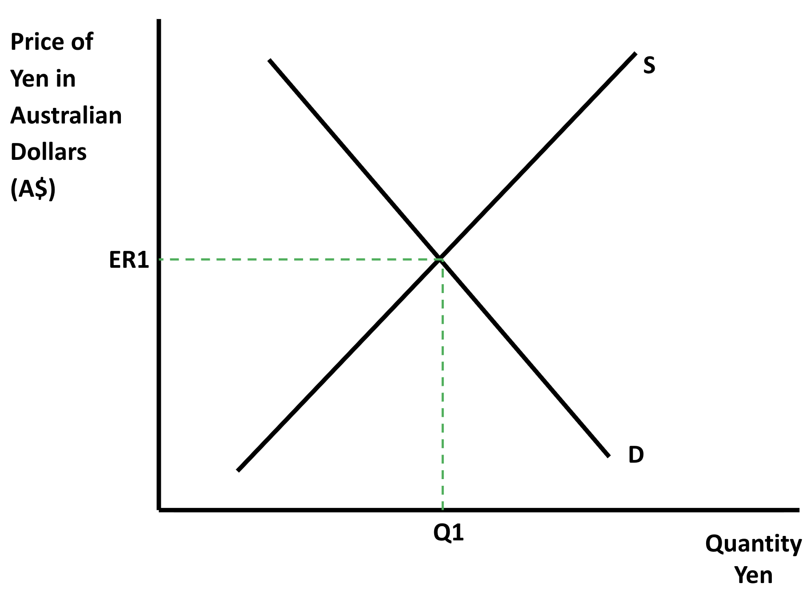
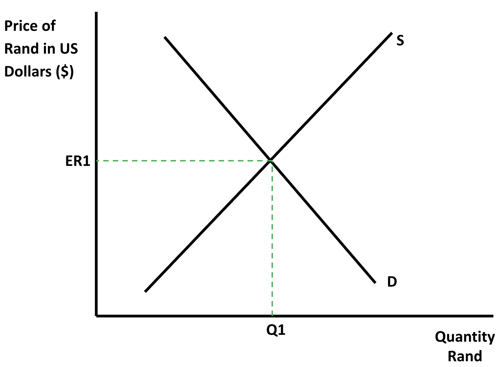
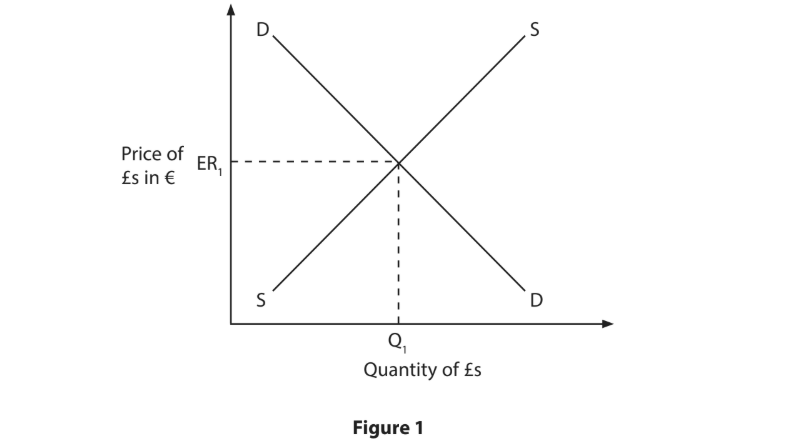
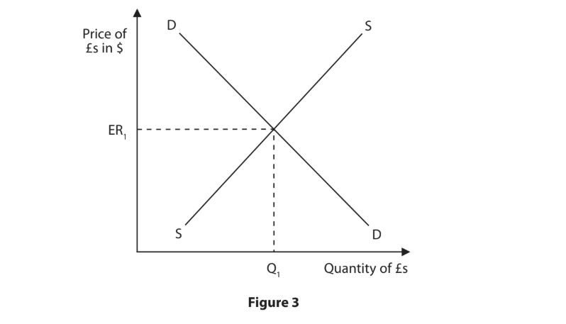
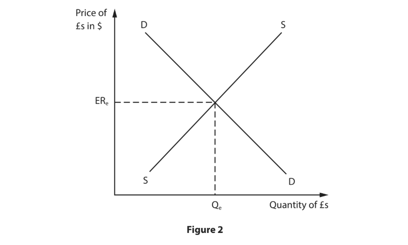
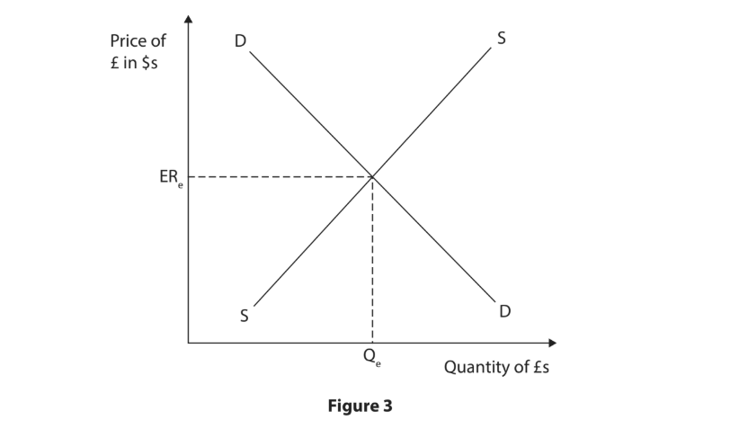
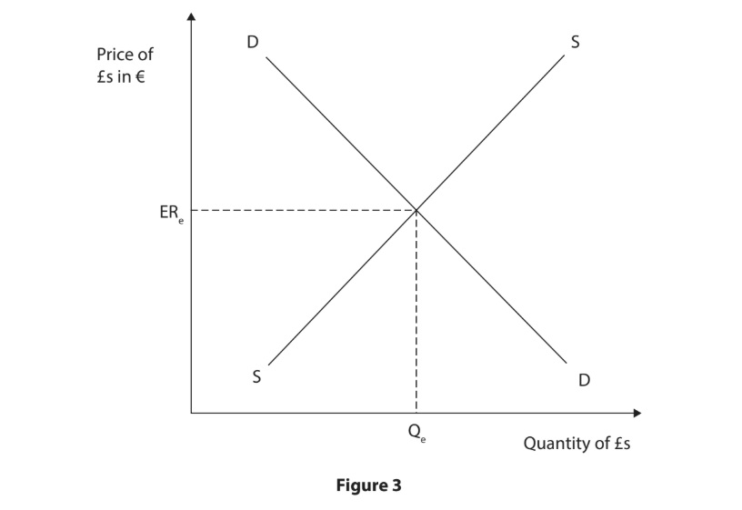

# Exam Questions — Exchange Rates
**The Global Economy** · Edexcel IGCSE economics (4EC1)
> Source: [https://www.savemyexams.com/igcse/economics/edexcel/17/topic-questions/](https://www.savemyexams.com/igcse/economics/edexcel/17/topic-questions/) · 40 questions across 1 sets

## Exam Questions (40 questions)

### Q1 — hard — 12 marks

**Q1** [12 marks]

In December 2023, Argentina's new government devalued the peso by 54% in a single move, followed by smaller monthly devaluations. Monthly inflation initially jumped to 25.5% straight after the devaluation, but annual inflation for 2024 fell to 117.8%, down from 211.4% in 2023. Argentina's trade balance improved by 71.2% over this period, driven by a 16.2% fall in imports while exports fell by only 4.7%, and in 2024 the government recorded its first fiscal surplus in more than a decade.

Evaluate whether Argentina's peso devaluation has been beneficial for the country's economy.

### Q2 — hard — 12 marks

**Q2** [12 marks]

In 2024, the Nigerian naira depreciated by 40.9% against the US dollar, closing the year at ₦1,535 per dollar. This contributed to Nigeria's inflation rate reaching 35% by the end of 2024, with food inflation reaching nearly 40%, as the cost of importing raw materials, fuel and fertiliser rose sharply. However, Nigeria's non-oil exports grew by around 20% in the second half of 2023 and by a further 12% in 2024, particularly in agriculture and manufactured goods.

Evaluate whether the naira's devaluation has been beneficial for Nigeria's economy overall.

### Q3 — hard — 12 marks

**Q3** [12 marks]

Since the end of 2020, the Japanese yen has depreciated by 54% against the US dollar, reaching as low as ¥161.62 per dollar in July 2024. This weak yen has helped Japan achieve a record 30 million tourists in 2024 and has supported Japanese exporters in competing with cheaper Chinese products. However, the weaker yen has also raised the cost of imported goods, contributing to inflation that has become Japanese voters' primary economic concern, and has negatively affected GDP, consumption and investment.

Evaluate whether the depreciation of the yen has been beneficial for Japan's economy overall.

### Q4 — hard — 9 marks

**Q4** [9 marks]

In 2025, the British pound appreciated by 7.46% against the US dollar, rising from a low of \$1.2177 in January to a high of \$1.3743 in July, with an average exchange rate for the year of \$1.319.

Assess whether this appreciation has been more beneficial than costly for UK consumers and businesses.

### Q5 — hard — 9 marks

**Q5** [9 marks]

In 2025, the Swiss franc appreciated by over 12% against other major currencies, driven by its status as a 'safe haven' currency during a period of global economic and political uncertainty. Almost half of Swiss exporting firms say they would consider their exports to the US unprofitable if the franc strengthens much further. At the same time, the stronger franc has lowered the cost of imported raw materials for Swiss firms, allowing many to increase their profit margins even as inflation stays close to zero.

Assess whether this appreciation has been more costly than beneficial for the Swiss economy.

### Q6 — medium — 3 marks

**Q6** [3 marks]

The market for the Japanese yen (¥) in terms of the Australian dollar (A\$) is initially in equilibrium, as shown in the diagram below.

Japan's central bank cuts its interest rate significantly below Australia's interest rate. As a result, Australian investors become less willing to move their money into Japan to invest there.

Using the diagram above, draw the likely effect of this change on the equilibrium exchange rate of the yen (¥) against the Australian dollar (A\$). Label the new curve, the new equilibrium exchange rate and the new equilibrium quantity.

### Q7 — medium — 3 marks

**Q7** [3 marks]

The market for South African rand (R) in terms of US dollars (\$) is initially in equilibrium, as shown in the diagram below.

South Africa's demand for imported oil from the US rises sharply.

Using the diagram above, draw the likely effect of this increase in oil imports on the equilibrium exchange rate of the rand (R) against the US dollar (\$). Label the new curve, the new equilibrium exchange rate and the new equilibrium quantity.

### Q8 — medium — 6 marks

**Q8** [6 marks]

A fictional country, Kelvaria, has recently raised its interest rate significantly above the interest rates of its major trading partners, attracting a large inflow of foreign investment.

Analyse the impact of this interest rate rise on Kelvaria's exporters.

### Q9 — medium — 3 marks

**Q9** [3 marks]

A country's currency depreciates significantly against the currencies of its major trading partners.

Explain how this could affect a domestic manufacturer that imports raw materials from abroad.

### Q10 — medium — 3 marks

**Q10** [3 marks]

A country's central bank significantly cuts its interest rate.

Explain how this could affect the supply of the country's currency on the foreign exchange market.

### Q11 — easy — 2 marks

**Q11** [2 marks]

What is meant by the term 'depreciation' of a currency?

### Q12 — easy — 2 marks

**Q12** [2 marks]

Increased demand for a country's currency on the foreign exchange market causes its value to rise significantly against other currencies.

Describe the likely effect of this on the price of the country's exports.

### Q13 — easy — 1 marks

**Q13** [1 mark]

State one factor that could cause an increase in the supply of a currency on the foreign exchange market.

### Q14 — easy — 1 marks

**Q14** [1 mark]

Define the term 'exchange rate'.

### Q15 — easy — 1 marks

**Q15** [1 mark]

Which one of the following would cause an increase in the supply of a currency on the foreign exchange market?

### Q16 — medium — 3 marks

**Q16** [3 marks]

In December 2017 the Thai baht appreciated to its highest value in 2 years against the US dollar. The Thai baht is predicted to continue its gradual appreciation in 2018.

Explain **one **disadvantage of an appreciating currency for an economy such as Thailand.

*Source: June 2019 Paper 2R Q2E*

### Q17 — medium — 3 marks

**Q17** [3 marks]

The UK exports goods to eurozone countries. Using the diagram below, draw the effects of an increase in exports from the UK to the eurozone on the exchange rate of the £. Label the new curve, the new equilibrium exchange rate and the new equilibrium quantity.

*Source: June 2019 Paper 2R Q1F*

### Q18 — medium — 3 marks

**Q18** [3 marks]

In October 2017 the currency of the Philippines, the peso, fell to its lowest level against the US dollar in more than 11 years.

Explain **one **advantage of having a depreciating currency for an economy such as the Philippines.

*Source: June 2019 Paper 2 Q2E*

### Q19 — easy — 2 marks

**Q19** [2 marks]

Rachel buys a t-shirt for 1 000 Kenyan shillings (KES) when she is on holiday.
The exchange rate is £1 = 137.73 KES.

Calculate, to two decimal places, the price in sterling (£) of Rachel’s t-shirt. You are advised to show your working.

*Source: June 2019 Paper 2 Q1E*

### Q20 — easy — 1 marks

**Q20** [1 mark]

In 2018, the Indonesian rupiah depreciated to its lowest levels since 1997 against other major currencies.

This depreciation is likely to have caused

*Source: Nov 2020 Paper 2R Q2A*

### Q21 — easy — 5 marks

**Q21** [2 marks]

What is meant by the term exchange rate?

*Source: Nov 2020 Paper 2 Q2D*

**Q21** [3 marks]

In 2018, Germany had a current account surplus of €268bn. Germany uses the euro (€) which had recently weakened against other major currencies.

Explain **one **reason why a fall in the value of the euro (€) may have resulted in a positive impact on Germany’s current account.

*Source: Nov 2020 Paper 2 Q2E*

### Q22 — easy — 7 marks

**Q22** [1 mark]

In an exchange rate system with no government intervention, a decrease in the exchange rate is known as

*Source: Jan 2020 Paper 2R Q3B*

**Q22** [6 marks]

The demand for the US\$ changed following the publication in 2019 of the latest US growth rate report.

Analyse the impact of currency speculators on the supply and demand of the currency for a country such as the US.

*Source: Jan 2020 Paper 2R Q3D*

### Q23 — easy — 2 marks

**Q23** [2 marks]

What is meant by the term revaluation?

*Source: Jan 2020 Paper 2R Q2D*

### Q24 — easy — 5 marks

**Q24** [2 marks]

Calculate **the price in Indian Rupees (INR)** of machinery which costs \$150 000 when the exchange rate is \$1 = 70.66 INR. You are advised to show your working.

*Source: Jan 2020 Paper 2R Q1E*

**Q24** [3 marks]

Figure 1 shows the supply and demand of the pound (£) in terms of the euro (€).

Using the diagram below, draw the effects on the exchange rate of the pound  (£) of a decrease in UK exports to Eurozone countries. Label the new curve, the new equilibrium exchange rate and the new equilibrium quantity.

*Source: Jan 2020 Paper 2R Q1F*

### Q25 — easy — 1 marks

**Q25** [1 mark]

In an exchange rate system without government intervention, a rise in the exchange rate is known as

*Source: Jan 2020 Paper 2 Q3B*

### Q26 — easy — 1 marks

**Q26** [1 mark]

A government can try to stop its exchange rate from appreciating by

*Source: Nov 2021 Paper 2 Q3A*

### Q27 — easy — 1 marks

**Q27** [1 mark]

A depreciation in a country’s exchange rate is most likely to lead to which **one **of the following?

*Source: Nov 2021 Paper 2 Q2A*

### Q28 — easy — 2 marks

**Q28** [2 marks]

In August 2019 Inter Milan, an Italian football club, paid £73m to Manchester United for the transfer of footballer Romelu Lukaku. The exchange rate was £1 = €1.08.

Calculate** the price Inter Milan paid in euros (€) **for the transfer of Romelu Lukaku. You are advised to show your working.

*Source: Nov 2021 Paper 2 Q1E*

### Q29 — easy — 1 marks

**Q29** [1 mark]

An appreciation in a country’s exchange rate is most likely to lead to which **one **of the following?

*Source: June  2021 Q2A*

### Q30 — easy — 1 marks

**Q30** [1 mark]

A decrease in the exchange rate caused by government intervention is known as

*Source: June 2022 Paper 2R Q1B*

### Q31 — medium — 3 marks

**Q31** [3 marks]

Figure 3 shows the supply of and demand for the UK pound (£) in terms of US dollars (\$) and the equilibrium exchange rate.

Using the diagram below, draw the effects on the exchange rate of the UK pound (£) from an increase in UK exports to the US. Label the new curve, the new equilibrium exchange rate and the new equilibrium quantity.

*Source: June 2022 Paper 2 Q2F*

### Q32 — easy — 1 marks

**Q32** [1 mark]

How many UK pounds (£) can be bought with \$50 if the exchange rate is \$1 = £0.75?

*Source: Nov 2023 Paper 2 Q3A*

### Q33 — easy — 4 marks

**Q33** [1 mark]

What is the main reason for a government to devalue its currency?

*Source: Nov 2023 Paper 2 Q2A*

**Q33** [3 marks]

Figure 2 shows the supply of and demand for UK pounds (£) in terms of US dollars (\$) and the equilibrium exchange rate.

Using the diagram below, draw the effect of an increase in UK exports to the US on the equilibrium exchange rate of the UK pound (£). Label the new curve, the new equilibrium exchange rate and the new equilibrium quantity.

*Source: Nov 2023 Paper 2 Q2F*

### Q34 — easy — 1 marks

**Q34** [1 mark]

If the exchange rate changes from £1 = \$1.40 to £1 = \$1.30 then

*Source: Jan 2023 Paper 2R Q3B*

### Q35 — easy — 2 marks

**Q35** [2 marks]

Calculate the **price in euros (€)** of a UK manufactured car priced at £15000 when the exchange rate is £1 = €1.10. You are advised to show your working.

*Source: Jan 2023 Paper 2R Q1E*

### Q36 — hard — 9 marks

**Q36** [9 marks]

In 2020, 2% of US exports went to Australia. The main categories of goods exported included machinery, vehicles, medical instruments and aircraft. The US dollar (\$) depreciated against the Australian dollar (AUD) in 2020.

With reference to the data above and your knowledge of economics, assess the likely impact on the demand for US exports to Australia after the depreciation of the US dollar.

*Source: Jan 2023 Paper 2 Q2G*

### Q37 — easy — 4 marks

**Q37** [1 mark]

Which **one** of the following is a rise in the value of an exchange rate in a floating exchange rate system?

*Source: Nov 2024 Paper 2 Q2A*

**Q37** [3 marks]

Figure 3 shows the supply of and demand for UK pounds (£) and the equilibrium exchange rate against the US dollar (\$).

Using the diagram below, draw the likely effect of a decrease in imports from the US on the equilibrium exchange rate of the UK pound (£) against the US dollar (\$). Label the new curve, the new equilibrium exchange rate and the new equilibrium quantity.

*Source: Nov 2024 Paper 2 Q2F*

### Q38 — easy — 2 marks

**Q38** [2 marks]

Figure 5 shows the adult entry fee into the Corcovado National Park in Costa Rica and the current exchange rate between the British pound (£) and the Costa Rican colón (CRC).

| Entry fee for 1 adult | 1600 CRC |
|---|---|
| Exchange rate: £ to CRC | £1 = 672 CRC |

**Figure 5**

Calculate, to two decimal places, **the price in British pounds (£) **of a park entry fee for 1 adult into the Corcovado National Park. You are advised to show your working.

*Source: June 2024 Paper 2R Q4A*

### Q39 — medium — 3 marks

**Q39** [3 marks]

Figure 3 shows the supply of and demand for UK pounds (£), as well as the equilibrium exchange rate against the euro (€). UK interest rates increased from 4% to 4.25% in March 2023.

Using the diagram below, draw the likely effect of this rise in UK interest rates on the equilibrium exchange rate of the UK pound (£) against the euro (€). Label the new curve, the new equilibrium exchange rate and the new equilibrium quantity.

*Source: June 2024 Paper 2R Q2F*

### Q40 — easy — 1 marks

**Q40** [1 mark]

The exchange rate between the US dollar (\$) and the British pound (£) is \$1 = £0.80

How many US dollars (\$) would it take to purchase £150?

*Source: June 2024 Paper 2 Q3B*

