# Mark Schemes — International Trade
**The Global Economy** · Edexcel IGCSE economics (4EC1)

## Exam Questions (53 questions)

### Q1
The scale of investment and job creation generated by the CHIPS Act subsidies suggests they have been highly effective.** [K]** With \$33.7 billion of the \$52.7 billion already awarded to 32 projects by January 2025, expected to create over 125,000 jobs,** [Ap]** the subsidies appear to have directly achieved the government's goal of rebuilding domestic semiconductor manufacturing capacity, supporting significant new employment in an industry that is important for both the economy and national security.** [An]** The programme has also reportedly sparked \$450 billion in additional private sector investment, suggesting the subsidies have encouraged far more investment than the government itself has spent.** [An]**

However, subsidies of this scale carry a significant cost and are not guaranteed to succeed.** [Ev]** The \$52.7 billion cost of the CHIPS Act represents a large opportunity cost for the government, since this same money could have been spent on other priorities such as healthcare or education,** [Ap]** and there is no guarantee that the semiconductor factories being built will remain competitive with established, lower-cost foreign producers once the subsidies eventually end, meaning some of this spending could ultimately fail to create a permanently self-sufficient industry.** [An]** If the subsidised firms are unable to compete without ongoing government support, the government may need to continue funding them indefinitely, adding to the total cost.** [An]**

Overall, whether the CHIPS Act is an effective way to support a domestic industry depends on whether the new semiconductor factories can become genuinely competitive once the subsidies are removed.** [Ev]** In the short term, the scale of jobs created and private investment sparked suggests strong early success. In the long term, however, the policy will only be judged truly effective if the US semiconductor industry can compete internationally without needing permanent government support, which will not be clear for several more years.** [Ev]** It also depends on how the \$450 billion in private investment is judged: if this investment continues to grow the industry after government funding ends, the subsidy will have achieved lasting change, but if private investment falls away once the subsidies stop, much of the initial benefit could prove temporary.** [Ev]**

**[12 marks]**

> **[mark-scheme]**
> This is a 'levelled response' question
> 
> - **[Ap]** = application to the data given (4 marks)
> - **[An]** = analysis / chain of reasoning (4 marks)
> - **[Ev]** = evaluation (4 marks)
> 
> Although there are no separate **[K] marks**, both application and analysis must be built on **clear and accurate economic knowledge and understanding**
> 
> Therefore, each KAA paragraph should follow:
> 
> - Valid knowledge point → Application → Analysis
> - Each valid point made in the answer does not equal a mark, the response is judged holistically against the level descriptors
> 
> A concluding paragraph is essential to scoring evaluation marks
> 
> **Mark allocation**
> 
> A 12 mark (Level 3) answer will include answers which:
> 
> - **Application [Ap]**: demonstrates specific and accurate knowledge and understanding by developing relevant points, with appropriate application of economic terms, concepts and theories
> - **Analysis [An]**: information presented will demonstrate excellent selectivity and organisation, with a chain of reasoning that is coherent and logical
> - **Evaluation [Ev]**: offers more than one viewpoint, with a well-balanced and coherent argument leading to a supported judgement or conclusion
> 
> **Alternative content**
> 
> The answer above is just one example of how to respond to this question. Additional information which could be used in the answer includes:
> 
> - Foreign governments could retaliate against the CHIPS Act with their own subsidies, potentially triggering a costly subsidy race rather than a lasting US advantage
> - Whether the jobs created are genuinely new, rather than simply relocated from elsewhere in the US economy, could be evaluated instead
> - Any other relevant and valid evaluation is acceptable

> **[exam-tip]**
> - Make the conclusion specific: say what the outcome depends on (here, whether the industry becomes competitive without ongoing support), not just that subsidies are 'good' or 'bad'
> - A good conclusion doesn't rescue a thin analysis. Both sides still need to be developed and applied to the CHIPS Act specifically
> - Use the real figures given (\$52.7bn total, \$33.7bn awarded, 125,000+ jobs, \$450bn private investment) rather than writing generally about subsidies

### Q2
The collapse of the Appellate Body has seriously weakened the WTO's ability to enforce trade rules.** [K]** With 68% of panel rulings historically being appealed, but no Appellate Body members in place since November 2020 to hear these appeals,** [Ap]** countries that lose a WTO dispute can effectively block the ruling from ever being enforced simply by appealing it 'into the void', meaning the WTO can no longer reliably guarantee that its own rulings will actually be followed.** [An]** This has visibly reduced confidence in the system, shown by the number of new disputes brought to the WTO falling to around one-third of its pre-crisis level, as countries increasingly doubt that bringing a case is worthwhile.** [An]**

However, the WTO continues to carry out several of its roles even without a working Appellate Body.** [Ev]** Disputes can still be heard and ruled on at the initial panel stage, and only the majority that are appealed become stuck in the current limbo,** [Ap]** meaning a meaningful share of trade disputes are still being resolved through the WTO rather than through unilateral action, and the organisation continues to run trade negotiations, monitor existing agreements and provide a forum for cooperation between member countries even while this specific part of its system is dysfunctional.** [An]** In addition, some members, including the EU, have created an alternative appeal arrangement (the MPIA) among willing participants, showing the underlying desire for a rules-based system has not disappeared entirely.** [An]**

Overall, whether the WTO is still effective depends on which of its functions is being judged.** [Ev]** As a dispute-enforcement body specifically, the WTO is currently much weaker than before 2020, since a losing country can simply refuse to accept an unfavourable ruling with no consequence. As a broader forum for negotiation, monitoring and initial-stage dispute resolution, however, the WTO continues to function, just with reduced authority and member confidence.** [Ev]** It also depends on the timeframe considered: if the Appellate Body remains unfilled long-term, the fall in new disputes suggests the WTO's core enforcement role could weaken further, but if members eventually agree to reform or replace it, as some are already attempting through the MPIA, much of its lost effectiveness could be restored.** [Ev]**

**[12 marks]**

> **[mark-scheme]**
> This is a 'levelled response' question
> 
> - **[Ap]** = application to the data given (4 marks)
> - **[An]** = analysis / chain of reasoning (4 marks)
> - **[Ev]** = evaluation (4 marks)
> 
> Although there are no separate **[K] marks**, both application and analysis must be built on **clear and accurate economic knowledge and understanding**
> 
> Therefore, each KAA paragraph should follow:
> 
> - Valid knowledge point → Application → Analysis
> - Each valid point made in the answer does not equal a mark, the response is judged holistically against the level descriptors
> 
> A concluding paragraph is essential to scoring evaluation marks
> 
> **Mark allocation**
> 
> A 12 mark (Level 3) answer will include answers which:
> 
> - **Application [Ap]**: demonstrates specific and accurate knowledge and understanding by developing relevant points, with appropriate application of economic terms, concepts and theories
> - **Analysis [An]**: information presented will demonstrate excellent selectivity and organisation, with a chain of reasoning that is coherent and logical
> - **Evaluation [Ev]**: offers more than one viewpoint, with a well-balanced and coherent argument leading to a supported judgement or conclusion
> 
> **Alternative content**
> 
> The answer above is just one example of how to respond to this question. Additional information which could be used in the answer includes:
> 
> - The fall in new disputes could instead be evaluated as evidence that powerful countries are increasingly willing to act unilaterally (e.g. through tariffs) rather than through the WTO system at all
> - Whether reform proposals like the MPIA are likely to succeed without the support of all major WTO members, particularly the USA, could be evaluated instead
> - Any other relevant and valid evaluation is acceptable

> **[exam-tip]**
> - Make the conclusion specific: say what the outcome depends on (here, which WTO function is being judged, and the timeframe), not just that the WTO is 'good' or 'bad'
> - A good conclusion doesn't rescue a thin analysis. Both sides still need to be developed and applied to the WTO specifically
> - Use the real figures given (68% appeal rate, no Appellate Body members since 2020, one-third fall in disputes) rather than writing generally about the WTO

### Q3
Membership of the USMCA has generated a huge increase in trade and investment between its three members.** [K]** US-Mexico goods trade alone reached \$839.56 billion in 2024, up from just \$81.4 billion in 1993, while Canada's direct investment into the US grew by more than 50% to \$732.9 billion in 2024.** [Ap]** This scale of tariff-free trade and investment between the three member countries is likely to have created significant economic growth, jobs and business opportunities for firms and workers within all three USMCA members, well beyond what any one of them could achieve trading alone.** [An]**

However, this level of integration between the three members may come at a cost to countries outside the bloc.** [Ev]** Because goods and investment can move between the USA, Mexico and Canada tariff-free, while non-member countries still face the USA's normal trade barriers,** [Ap]** businesses outside the bloc may lose sales to less efficient USMCA-based producers who only have an advantage because of the tariff-free access, rather than because they produce more cheaply, meaning trade shifts towards member countries at the expense of potentially more efficient producers elsewhere in the world.** [An]**

**[9 marks]**

> **[mark-scheme]**
> This is a 'levelled response' question
> 
> - **[Ap]** = application to the data given (3 marks)
> - **[An]** = analysis / chain of reasoning (3 marks)
> - **[Ev]** = evaluation (3 marks)
> 
> Although there are no separate **[K] marks**, both application and analysis must be built on **clear and accurate economic knowledge and understanding**
> 
> Therefore, each KAA paragraph should follow:
> 
> - Valid knowledge point → Application → Analysis
> - Each valid point made in the answer does not equal a mark, the response is judged holistically against the level descriptors
> 
> **Mark allocation**
> 
> A 9 mark (Level 3) answer will include examples which demonstrate:
> 
> - **Application [Ap]**: clear knowledge and understanding by developing relevant points, with appropriate application of economic terms, concepts and calculations
> - **Analysis [An]**: information presented will demonstrate excellent selectivity and organisation, with a thorough analysis of issues
> - **Evaluation [Ev]**: offers more than one viewpoint, with a well-balanced and coherent argument
> 
> **Alternative content**
> 
> The answer above is just one example of how to respond to this question. Additional information which could be used in the answer includes:
> 
> - Member countries also lose some sovereignty by agreeing to common USMCA rules, which could be a cost to consider alongside the benefits
> - Non-member countries could instead be analysed as benefiting indirectly, for example by supplying raw materials or components used in USMCA members' production
> - Any other relevant and valid evaluation is acceptable

> **[exam-tip]**
> - Build both sides of the argument to a similar depth. An unmatched second side is one of the most common reasons a response is held below the top level
> - Use the real figures given (\$839.56bn trade, \$81.4bn in 1993, \$732.9bn investment) to support your points directly, rather than writing about trading blocs in general

### Q4
The tariffs directly raise the price of Chinese-made electric vehicles sold in the EU.** [K]** With rates of up to 35.3% added on top of the existing 10% import duty, non-cooperating Chinese producers now face a combined tariff of over 45%,** [Ap]** which is likely to significantly narrow or eliminate the price advantage that subsidised Chinese EVs previously held over EU-made electric vehicles, making it easier for EU car manufacturers to compete for domestic customers and protect their market share and jobs.** [An]**

However, the varying tariff rates may limit how effective this protection actually is.** [Ev]** Because the tariff is only 9% for Tesla and 21.3% for cooperating Chinese producers, considerably lower than the 36.3% charged to non-cooperating firms,** [Ap]** many Chinese EV producers may still be able to sell competitively in the EU by cooperating with the investigation or by absorbing part of the tariff cost, meaning the policy may only strongly protect EU producers from the least cooperative, highest-tariff Chinese firms rather than from Chinese competition as a whole.** [An]**

**[9 marks]**

> **[mark-scheme]**
> This is a 'levelled response' question
> 
> - **[Ap]** = application to the data given (3 marks)
> - **[An]** = analysis / chain of reasoning (3 marks)
> - **[Ev]** = evaluation (3 marks)
> 
> Although there are no separate **[K] marks**, both application and analysis must be built on **clear and accurate economic knowledge and understanding**
> 
> Therefore, each KAA paragraph should follow:
> 
> - Valid knowledge point → Application → Analysis
> - Each valid point made in the answer does not equal a mark, the response is judged holistically against the level descriptors
> 
> **Mark allocation**
> 
> A 9 mark (Level 3) answer will include examples which demonstrate:
> 
> - **Application [Ap]**: clear knowledge and understanding by developing relevant points, with appropriate application of economic terms, concepts and calculations
> - **Analysis [An]**: information presented will demonstrate excellent selectivity and organisation, with a thorough analysis of issues
> - **Evaluation [Ev]**: offers more than one viewpoint, with a well-balanced and coherent argument
> 
> **Alternative content**
> 
> The answer above is just one example of how to respond to this question. Additional information which could be used in the answer includes:
> 
> - The tariffs may encourage Chinese manufacturers to build factories inside the EU instead, which would create EU jobs but also increase the level of competition EU producers face directly
> - Higher prices on Chinese EVs could slow the EU's shift towards electric vehicles, which may conflict with the EU's environmental goals
> - Any other relevant and valid evaluation is acceptable

> **[exam-tip]**
> - Build both sides of the argument to a similar depth. An unmatched second side is one of the most common reasons a response is held below the top level
> - Use the real figures given (10% base duty, the 9%/21.3%/36.3% tariff tiers) to support your points directly, rather than writing about tariffs in general

### Q5
A 50% tariff makes imported steel and aluminium significantly more expensive in the US market.** [K]** With the tariff doubled from 25% to 50% and applying to imports from almost every country, including the US's two largest suppliers, Canada and Mexico,** [Ap]** domestic US steel and aluminium producers face far less price competition from foreign suppliers, allowing them to increase their output, market share and potentially their level of employment, supporting jobs in an industry the government considers important for national security.** [An]**

However, the scale of these tariffs is also likely to raise costs across much of the wider US economy.** [Ev]** Because these tariffs are estimated to affect 54% of all US goods imports by 2026, and steel and aluminium are inputs used by many other industries, such as car manufacturing and construction,** [Ap]** the higher cost of these raw materials is likely to raise production costs for a very wide range of US businesses, who may pass these higher costs on to consumers in the form of higher prices, or reduce their own competitiveness against foreign rivals not facing the same input costs.** [An]**

**[9 marks]**

> **[mark-scheme]**
> This is a 'levelled response' question
> 
> - **[Ap]** = application to the data given (3 marks)
> - **[An]** = analysis / chain of reasoning (3 marks)
> - **[Ev]** = evaluation (3 marks)
> 
> Although there are no separate **[K] marks**, both application and analysis must be built on **clear and accurate economic knowledge and understanding**
> 
> Therefore, each KAA paragraph should follow:
> 
> - Valid knowledge point → Application → Analysis
> - Each valid point made in the answer does not equal a mark, the response is judged holistically against the level descriptors
> 
> **Mark allocation**
> 
> A 9 mark (Level 3) answer will include examples which demonstrate:
> 
> - **Application [Ap]**: clear knowledge and understanding by developing relevant points, with appropriate application of economic terms, concepts and calculations
> - **Analysis [An]**: information presented will demonstrate excellent selectivity and organisation, with a thorough analysis of issues
> - **Evaluation [Ev]**: offers more than one viewpoint, with a well-balanced and coherent argument
> 
> **Alternative content**
> 
> The answer above is just one example of how to respond to this question. Additional information which could be used in the answer includes:
> 
> - The tariffs generate additional tax revenue for the US government, which could be used to fund public services
> - Canada and Mexico, as the two largest affected suppliers, may retaliate with their own tariffs on US exports, which could harm US exporters in other industries
> - Any other relevant and valid evaluation is acceptable

> **[exam-tip]**
> - Build both sides of the argument to a similar depth. An unmatched second side is one of the most common reasons a response is held below the top level
> - Use the real figures given in the stem (25%→50%, the two named suppliers, the 54% import share) to support your points directly, rather than writing in general terms

### Q6
Joining the trading bloc gives Solvara's producers tariff-free access to a much larger group of consumers.** [K]** For example, with tariffs eliminated on trade between all member countries,** [Ap]** Solvara's producers can now sell their goods in these neighbouring markets at the same price as domestic producers there, without having to absorb the cost of a tariff.** [An]** Access to this much larger combined market allows Solvara's producers to increase their total output significantly.** [K]** This increase in output allows producers to benefit from economies of scale, lowering their average cost of production and making them more competitive both within the bloc and internationally.** [An]**

**[6 marks]**

> **[mark-scheme]**
> This is a 'levelled response' question
> 
> - **[Ap]** = application to the scenario (3 marks)
> - **[An]** = analysis / chain of reasoning (3 marks)
> 
> Although there are no separate **[K] marks**, both application and analysis must be built on **clear and accurate economic knowledge and understanding**
> 
> Therefore, each KAA paragraph should follow:
> 
> - Valid knowledge point → Application → Analysis
> - Each valid point made in the answer does not equal a mark, the response is judged holistically against the level descriptors
> 
> **Mark allocation**
> 
> Answers are placed into one of three levels. **A level 3 answer (5-6 marks)**, will specifically:
> 
> - Demonstrate clear knowledge and understanding by developing relevant points and include appropriate application of economic terms, concepts and theories
> - Information presented will demonstrate excellent selectivity and organisation, with a thorough analysis of issues
> 
> **Alternative content**
> 
> - A response could instead analyse how Solvara's producers benefit from being able to source cheaper tariff-free raw materials and components from other member countries
> - Any other relevant and valid analysis is acceptable

> **[exam-tip]**
> - One thoroughly developed chain of reasoning can get full marks, you don't need several separate points
> - No counter-argument and no conclusion is required, analyse is always one-sided
> - Don't open by defining a trading bloc - move straight into the specific impact on Solvara's producers

### Q7
The quota directly restricts the supply of imported furniture available in Meridia.** [K]** For example, with a strict limit placed on the quantity of furniture that can be imported,** [Ap]** the overall supply of furniture in the domestic market falls, causing the market price of furniture to rise above what it would have been under free trade.** [An]** This price rise makes it easier for Meridia's domestic furniture producers to compete, since they no longer need to match the very low prices of the now-restricted imports.** [K]** As a result, domestic furniture firms are able to sell more of their output at a profitable price, allowing the young industry to grow, generate more revenue and potentially expand its workforce while it establishes itself.** [An]**

**[6 marks]**

> **[mark-scheme]**
> This is a 'levelled response' question
> 
> - **[Ap]** = application to the scenario (3 marks)
> - **[An]** = analysis / chain of reasoning (3 marks)
> 
> Although there are no separate **[K] marks**, both application and analysis must be built on **clear and accurate economic knowledge and understanding**
> 
> Therefore, each KAA paragraph should follow:
> 
> - Valid knowledge point → Application → Analysis
> - Each valid point made in the answer does not equal a mark, the response is judged holistically against the level descriptors
> 
> **Mark allocation**
> 
> Answers are placed into one of three levels. **A level 3 answer (5-6 marks)**, will specifically:
> 
> - Demonstrate clear knowledge and understanding by developing relevant points and include appropriate application of economic terms, concepts and theories
> - Information presented will demonstrate excellent selectivity and organisation, with a thorough analysis of issues
> 
> **Alternative content**
> 
> - A response could instead analyse how the quota allows Meridia's furniture industry to gain the time and market share it needs to invest in improving its efficiency before facing full international competition
> - Any other relevant and valid analysis is acceptable

> **[exam-tip]**
> - One thoroughly developed chain of reasoning can get full marks, you don't need several separate points
> - No counter-argument and no conclusion is required, analyse is always one-sided
> - Don't open by defining a quota - move straight into the specific impact on Meridia's furniture industry

### Q8
A narrow range of primary-commodity exports leaves the country heavily dependent on the price of just one or two goods **[1]**, for example if the world price of copper falls sharply **[1]**, the country's total export revenue could fall significantly, since it has no other major exports to fall back on, causing instability in government revenue and the wider economy **[1]**

**[3 marks]**

> **[mark-scheme]**
> Award 1 mark for identifying a relevant reason
> 
> Award 1 mark for the response being in context
> 
> Award 1 mark for developing the reason
> 
> **Alternative content**
> 
> The answer above is just one example of a response to this question. Other reasons that could be used include:
> 
> - A response could instead focus on the country missing out on the higher value added from processing or manufacturing the commodity itself, rather than exporting it in raw form
> - The country's vulnerability from being under-developed in manufacturing/service sectors, limiting future economic diversification, could be analysed instead
> 
> Accept any other appropriate response

> **[exam-tip]**
> - One of the three marks is for context, so refer to a specific commodity or example rather than writing about trade patterns in general
> - There are no marks for definitions on 'explain' questions, so do not open by defining a primary commodity

### Q9
Domestic furniture manufacturers may lose sales to the now-cheaper foreign competition **[1]**, as consumers switch to buying the cheaper imported furniture instead of domestically produced furniture **[1]**, which could force some domestic manufacturers to reduce output or close down, leading to structural unemployment in the industry **[1]**

**[3 marks]**

> **[mark-scheme]**
> Award 1 mark for identifying a relevant way
> 
> Award 1 mark for the response being in context
> 
> Award 1 mark for developing the way
> 
> **Alternative content**
> 
> The answer above is just one example of a response to this question. Other ways that could be used include:
> 
> - Domestic manufacturers could instead be analysed as needing to lower their own prices or cut costs to remain competitive, reducing their profit margins
> - A response could instead focus on domestic manufacturers needing to improve the quality or design of their furniture to compete on factors other than price
> 
> Accept any other appropriate response

> **[exam-tip]**
> - One of the three marks is for context, so refer to furniture manufacturers specifically rather than writing about free trade in general
> - There are no marks for definitions on 'explain' questions, so do not open by defining free trade

### Q10
The subsidy lowers the manufacturer's cost of production **[1]**, allowing it to sell its cars at a lower price than before **[1]**, making its cars more competitive in international markets and increasing its export sales **[1]**

**[3 marks]**

> **[mark-scheme]**
> Award 1 mark for identifying a relevant way
> 
> Award 1 mark for the response being in context
> 
> Award 1 mark for developing the way
> 
> **Alternative content**
> 
> The answer above is just one example of a response to this question. Other ways that could be used include:
> 
> - The manufacturer could instead use the subsidy to increase output without lowering its price, increasing its revenue and potentially its level of employment
> - A response could instead focus on the manufacturer being able to invest the extra funds in improving the quality of its cars, rather than lowering price
> 
> Accept any other appropriate response

> **[exam-tip]**
> - One of the three marks is for context, so refer to this specific car manufacturer and its exports rather than writing about subsidies in general
> - There are no marks for definitions on 'explain' questions, so do not open by defining a subsidy

### Q11
\$4 × 250,000 **[1 mark]**

**= \$1,000,000** **[1 mark]**

> **[mark-scheme]**
> Award 1 mark for multiplying the subsidy per unit by the number of units produced
> 
> Award 1 mark for the correct total cost, \$1,000,000
> 
> Award 2 marks if the correct total cost is given, even if no calculation is shown

> **[exam-tip]**
> - The total cost of a subsidy to the government is always the subsidy per unit multiplied by the quantity produced, not the quantity demanded before the subsidy
> - Include the \$ sign in your final answer

### Q12
A group of countries **[1]** that agree to reduce or eliminate barriers to trade between themselves **[1]**

**[2 marks]**

> **[mark-scheme]**
> Definitions generally require two parts for 2 marks
> 
> One mark is awarded for identifying a group of countries, and one mark for the reduction/elimination of trade barriers between them
> 
> Any other correct and appropriate wording is acceptable

### Q13
It lowers the price of the domestic firm's product **[1 mark]**

> **[mark-scheme]**
> Award 1 mark for a correct effect
> 
> Accept any other appropriate response, e.g. it lowers the firm's cost of production, or it increases the firm's output

### Q14
A firm selling goods in another country in large quantities below the cost of production **[1 mark]**

> **[mark-scheme]**
> Award 1 mark for a correct definition
> 
> No marks are available for an example in place of a definition
> 
> Accept any other correct and appropriate wording

### Q15
**Final answer:** **The correct answer is B**

A quota limits the supply of imports, reducing the level of competition faced by domestic firms, which can make them less efficient and less innovative over time as they no longer need to compete as hard to keep customers

**A** is incorrect as it is tariffs, not quotas, that generate tax revenue for the government

**C** is incorrect as a quota reduces the quantity of imports available, which restricts supply and raises the market price

**D** is incorrect as trading partners can retaliate against a quota just as they can against a tariff

### Q16
Tariff = ¥225 × 8% = ¥18

Final selling price = ¥225 + ¥18 **[1 mark]**

**= ¥243** **[1 mark]**

> **[mark-scheme]**
> Award 1 mark for calculating the tariff correctly
> 
> Award 1 mark for calculating the final selling price in yuan
> 
> Award 2 marks if the final selling price is accurately calculated as ¥243 with the yuan symbol, even if no calculations are shown
> 
> Award 1 mark if the answer is given as 243 with no ¥ symbol, with or without calculations shown
> 
> Do not award marks for the formula alone

> **[exam-tip]**
> - The question asks for the **final selling price**, not the tariff, so the ¥18 must be added to the original ¥225. Stopping at ¥18 answers a different question
> - A tariff raises the price, so the answer must be larger than ¥225. Anything smaller means the percentage has been subtracted by mistake
> - Include the ¥ symbol, the mark scheme awards only 1 mark without it
A tariff is a tax on imported goods, so reducing one lowers the price consumers pay for them.** [K]** China cut tariffs from 17.3% to 7.7% on over 200 consumer products including pharmaceuticals, food and clothing,** [Ap]** so Chinese households pay substantially less for those goods and each unit of income buys more, which raises living standards directly.** [An]** Cheaper imports also give consumers access to products of a quality that domestic firms cannot currently match, and a wider choice than before. Chinese producers now face stronger competition from multinationals such as Nestlé, whose sales could rise 15% or \$18.7bn, and Procter & Gamble,** [Ap]** which pressures them to cut costs, improve quality and innovate rather than rely on protection,** [An]** so domestic industry becomes more efficient over time. Lowering barriers may also encourage other countries to reciprocate,** [An]** making it easier and cheaper for China to export its own goods.

However, protection exists for reasons that do not disappear.** [Ev]** Chinese infant industries producing consumer goods now compete directly with established multinationals that have far greater scale and brand strength,** [Ap]** and firms unable to match them lose sales, so output falls and unemployment rises in exactly those sectors.** [An]** The government also loses revenue, since every imported item now yields less than half the tax it did at 17.3%, money that could have funded public services. There is a further effect on the balance of payments,** [An]** because cheaper imports mean Chinese consumers buy more from abroad, so more money flows out of the country and any current account surplus narrows.

Overall, whether the reduction benefits China depends on how its domestic producers respond.** [Ev]** Where firms use the competitive pressure to raise quality and efficiency, consumers gain cheaper and better goods while industry emerges stronger, and the lost tariff revenue is a price worth paying. Where they cannot compete with firms of Nestlé's scale, the gain to consumers is offset by lost output, lost jobs and lost government revenue. The fact that the cut was made selectively, on consumer products rather than across the board, suggests China judged these were sectors where its industries could withstand the competition.** [Ev]**

**[12 marks]**

> **[mark-scheme]**
> This is a ‘levelled response’ question
> 
> - **[Ap]** = application to the data given  (4 marks)
> - **[An]** = analysis / chain of reasoning (4 marks)
> - **[Ev]** = evaluation (4 marks)
> 
> Although there are no separate **[K] marks**, both application and analysis must be built on **clear and accurate economic knowledge and understanding**
> 
> Therefore, each KAA paragraph should follow:
> 
> - Valid knowledge point → Application → Analysis
> - Each valid point made in the answer does not equal a mark, the response is judged holistically against the level descriptors
> 
> A concluding paragraph is essential to scoring evaluation marks
> 
> **Mark allocation**
> 
> A 12 mark (Level 3) answer will include answers which:
> 
> - **Application [Ap]** — Demonstrates specific and accurate knowledge and understanding by developing relevant points. Appropriate application of economic terms, concepts, theories and calculations
> - **Analysis [An]** — Information presented will demonstrate excellent selectivity and organisation. Chain of reasoning will be coherent and logical. Interpretation of economic information will be excellent with a thorough analysis of issues
> - **Evaluation [Ev]** — Offers more than one viewpoint. The argument is well balanced and coherent, leading to an evaluation that demonstrates full understanding and awareness. A supported judgement or conclusion is present
> 
> **Alternative content**
> 
> The answer above is just one example of how to respond to this question. Additional information which could be used in the answer includes:
> 
> - Chinese consumers gain access to better quality goods that domestic producers cannot currently supply
> - If China lowers tariffs, other countries may reciprocate, making it easier for China to export
> - On the other side, tariffs are a useful source of government revenue, which falls as rates are cut
> - Reducing tariffs may reduce the surplus on the current account as imports rise
> - Credit any valid alternative evaluation

> **[exam-tip]**
> - The tariff figures are the backbone of this answer: 17.3% falling to 7.7% is a cut of more than half, which shows the scale of the change to both prices and government revenue
> - The Nestlé numbers work on **both** sides. A 15% sales rise is a gain for consumers who buy those products and a threat to the Chinese firms losing that business
> - A conclusion **is** required at 12 marks, and it must judge what the outcome depends on rather than restate the two sides

### Q17
**Final answer:** **The correct answer is D**

A trading bloc is a group of countries that agree to lower or remove tariffs and quotas between themselves, so goods move more freely within the bloc than they do with countries outside it

**A** is incorrect as interest rates are set by each country's own central bank, and members of a bloc need not share one

**B** is incorrect as members are often not neighbours at all, and sharing a border does nothing to remove trade barriers

**C** is incorrect as a shared currency is a feature of a monetary union, which is only one advanced form of bloc. Most trading blocs keep their own currencies

### Q18
**Final answer:** **The correct answer is B**

Dumping is selling exports abroad below the cost of producing them, usually to capture market share or dispose of a surplus, and it is regarded as unfair competition because domestic producers cannot match a price set below cost

**A** is incorrect as a quota is a physical limit on the quantity of a good that may be imported

**C** is incorrect as deregulation means removing rules and restrictions from a market, which is a supply-side policy rather than a trade practice

**D** is incorrect as a tariff is a tax placed on imported goods to raise their price

### Q19
A trading bloc is a group of countries that agree to reduce trade barriers between themselves in order to promote trade.** [K]** ASEAN has grown from the five founding members of 1967 to ten by 2016,** [Ap]** so Thai firms can now sell into nine other member markets, including Vietnam and the Philippines, without facing the tariffs that firms outside the bloc pay.** [An]** Access to that many more customers raises sales and revenue, and producing on a larger scale spreads fixed costs across more output, giving Thai firms economies of scale that lower their average costs. Membership also lets Thailand specialise in what it produces most efficiently and import the rest,** [An]** which raises productivity across the economy. The data suggests this has worked: GDP per capita across the bloc rose from \$122 in 1967 to \$4,021 in 2016,** [Ap]** a transformation in average incomes and living standards. Thai consumers gain too, since goods from other members arrive tariff-free, so prices are lower and choice is wider, and the bloc attracts foreign direct investment because a firm locating in Thailand reaches every member from one base.

However, removing barriers exposes Thai firms to the same competition it gives them.** [Ev]** Imports from other ASEAN members enter Thailand tariff-free as well,** [An]** so domestic producers that cannot match the costs or quality of firms in neighbouring countries lose sales, and some industries may decline or close altogether. There is also a risk of becoming too dependent on the bloc,** [Ap]** because trade concentrated within ASEAN leaves Thailand exposed if the region as a whole slows, and it may come at the expense of trade with large non-member economies such as India or China.** [An]** GDP per capita is an average, so the rise from \$122 to \$4,021 tells us nothing about how those gains were shared, and the benefit to Thailand ultimately depends on how competitive its firms are within the region.

**[9 marks]**

> **[mark-scheme]**
> This is a ‘levelled response’ question
> 
> - **[Ap]** = application to the data given  (3 marks)
> - **[An]** = analysis / chain of reasoning (3 marks)
> - **[Ev]** = evaluation (3 marks)
> 
> Although there are no separate **[K] marks**, both application and analysis must be built on **clear and accurate economic knowledge and understanding**
> 
> Therefore, each KAA paragraph should follow:
> 
> - Valid knowledge point → Application → Analysis
> - Each valid point made in the answer does not equal a mark, the response is judged holistically against the level descriptors
> 
> **Mark allocation**
> 
> A 9 mark (Level 3) answer will include examples which demonstrate:
> 
> - **Application [Ap]**: clear knowledge and understanding by developing relevant points. Appropriate application of economic terms, concepts, theories and calculations
> - **Analysis [An]**: Information presented will demonstrate excellent selectivity and organisation. Interpretation of economic information will be excellent, with a thorough analysis of issues
> - **Evaluation [Ev]**: Offers more than one viewpoint. The argument is well balanced and coherent, leading to an evaluation that demonstrates full understanding and awareness
> 
> **Alternative content**
> 
> The answer above is just one example of how to respond to this question. Additional information which could be used in the answer includes:
> 
> - Membership can attract increased foreign direct investment into Thailand
> - On the other side, increased imports from member countries may damage Thailand's domestic firms
> - The overall benefit depends on Thailand's ability to compete within the region and on how much it trades outside the bloc
> - Any other relevant and valid analysis is acceptable

> **[exam-tip]**
> - Use the figure table rather than describing it. The rise in GDP per capita from \$122 to \$4,021 is the strongest evidence available that membership has coincided with rising living standards
> - A sharp evaluative point is that GDP per capita is an **average**, so it says nothing about who received the gains
> - The same removal of tariffs that opens other markets to Thailand opens Thailand to them, so use that symmetry to build the counter-argument

### Q20
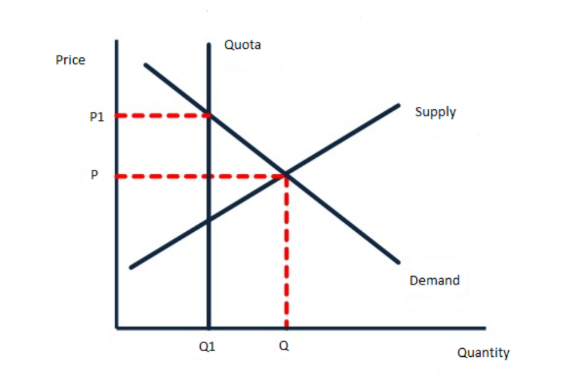

**[3 marks]**

> **[mark-scheme]**
> Award 1 mark for a perfectly inelastic supply curve, labelled
> 
> Award 1 mark for a higher equilibrium price, labelled
> 
> Award 1 mark for a lower equilibrium quantity, labelled

> **[exam-tip]**
> - A quota is drawn as a **vertical** supply curve, because the quantity allowed is fixed by law whatever the price. That is what perfectly inelastic means
> - Introducing a quota restricts the amount supplied, so the vertical line sits to the **left** of the original equilibrium quantity, which raises the price and lowers the quantity
> - Compare this with the questions that **raise** an existing quota, where the vertical line moves right and the price falls. Read the stem carefully before drawing
One way is by hosting trade negotiations between member countries** [1]**, because bringing governments to the table lets them agree mutual reductions in tariffs and quotas that no country would make on its own** [1]**, so the US and Canada could settle their disagreement over the proposed 300% tariff on Bombardier aircraft rather than each raising barriers against the other** [1]**

**[3 marks]**

> **[mark-scheme]**
> Award 1 mark for identifying a relevant way
> 
> Award 1 mark for developing the way
> 
> Award 1 mark for the response being in context
> 
> **Alternative content**
> 
> The answer above is just one example of a response to this question. Other ways could include:
> 
> - Setting and enforcing rules of trade that member countries must follow, which prevents a tariff as high as 300% being imposed unilaterally
> - Providing a formal dispute settlement process, so disagreements are resolved rather than escalating into retaliatory tariffs
> - Monitoring members' trade policies so that barriers removed in a deal are not quietly reintroduced
> 
> Accept any other appropriate response

> **[exam-tip]**
> - The chain must end at **free trade** itself, meaning fewer barriers between the two countries, rather than stopping at the WTO holding a meeting
> - The context mark comes from the stem, so use the 300% tariff, Bombardier, or name the US and Canada
> - Note what the WTO cannot do. It has no power to write off debt or pay subsidies, and confusing it with the IMF or World Bank is a common error

### Q21
The World Trade Organisation sets the rules of international trade and works to reduce the barriers between its members.** [K]** Its 164 members account for 98% of world trade,** [Ap]** so rules agreed at the WTO cover almost every trade flow on earth, and a country that lowers its tariffs can do so knowing its trading partners are bound by the same commitments. That reciprocity is what makes reducing protection possible,** [An]** because no government wants to open its market while others keep theirs closed, and as tariffs and quotas fall imported goods become cheaper, trade volumes rise and consumers gain lower prices and wider choice. The WTO also provides a formal route for settling disagreements,** [Ap]** which matters because trade disputes are common: the US alone has been involved in 422 of them since joining in 1995.** [An]** Without an agreed process each of those disputes could have escalated into retaliatory tariffs and a trade war, so having somewhere to resolve them keeps markets open and gives firms the confidence to invest in exporting.** [An]** Negotiating separately with every partner would also be far slower than negotiating once through a body representing 164 countries.

**[6 marks]**

> **[mark-scheme]**
> This is a ‘levelled response’ question
> 
> - **[Ap]** = application to the data given  (3 marks)
> - **[An]** = analysis / chain of reasoning (3 marks)
> 
> Although there are no separate **[K] marks**, both application and analysis must be built on **clear and accurate economic knowledge and understanding**
> 
> Therefore, each KAA paragraph should follow:
> 
> - Valid knowledge point → Application → Analysis
> - Each valid point made in the answer does not equal a mark, the response is judged holistically against the level descriptors
> 
> **Mark allocation**
> 
> Answers are placed into one of three levels.  **A level 3 answer (5-6 marks)**, will specifically:
> 
> - Demonstrate clear knowledge and understanding by developing relevant points and include appropriate application of economic terms, concepts, theories and calculations
> - Information presented will demonstrate excellent selectivity and organisation. Interpretation of economic information will be excellent, with a thorough analysis of issues
> 
> **Alternative content**
> 
> The answer above is just one example of how to respond to this question. Additional information which could be used in the answer includes:
> 
> - Without the WTO there would be more protectionism and trade negotiations would take far longer
> - Enforcing agreed rules stops members quietly reintroducing barriers once a deal is signed
> - Any other relevant and valid analysis is acceptable

> **[exam-tip]**
> - Both figures earn application marks. The 98% shows the WTO's reach and the 422 disputes show why a settlement process is needed
> - The 422 disputes can be read either way, and the stronger reading is that disputes are inevitable and the WTO's value is in resolving them rather than preventing them
> - No counter-argument and no conclusion is required, analyse is always one-sided

### Q22
One reason is that other countries may apply lower safety standards than the UK** [1]**, because a producer selling into a market with weaker rules has no obligation to meet the stricter requirements UK consumers expect** [1]**, so imported plastic toys containing chemicals banned in the UK reach children here and risk serious illness, particularly when they are sold through online marketplaces that are harder for regulators to police** [1]**

**[3 marks]**

> **[mark-scheme]**
> Award 1 mark for identifying a relevant reason
> 
> Award 1 mark for developing the reason
> 
> Award 1 mark for the response being in context
> 
> **Alternative content**
> 
> The answer above is just one example of a response to this question. Other reasons could include:
> 
> - Foreign manufacturers may not follow product safety requirements during production, so unsafe goods reach UK buyers
> - Consumers cannot inspect goods bought online before purchase, so they lack the information needed to judge whether a product is safe
> - Cutting corners on safety lowers a producer's costs, giving an unfair advantage over UK firms that comply with the rules
> 
> Accept any other appropriate response

> **[exam-tip]**
> - This is an **information failure** as well as a safety issue: buyers cannot tell from a listing that a toy contains banned chemicals, which is why the market alone does not protect them
> - The context mark comes from the stem, so refer to the plastic toys, the banned chemicals or the online marketplaces
> - Finish the chain with the harm to the consumer, not merely with the standards being different

### Q23
Domestic businesses may be forced to close** [1]**, because free trade exposes them to foreign firms whose products are cheaper or better, so customers switch away and domestic sales fall** [1]**

**[2 marks]**

> **[mark-scheme]**
> Award 1 mark for reference to harm to domestic businesses and 1 mark for reference to competition from foreign firms
> 
> Accept any other appropriate response, e.g. profit margins are squeezed (1) because firms must cut prices to match cheaper imports (1), or infant industries cannot establish themselves (1) as they are exposed to large foreign competitors before they have grown (1)

> **[exam-tip]**
> - The second mark is for naming the cause, competition from foreign firms, so simply saying businesses lose out is not enough
> - The question specifies **domestic businesses**, so a disadvantage affecting consumers or the government will not be credited
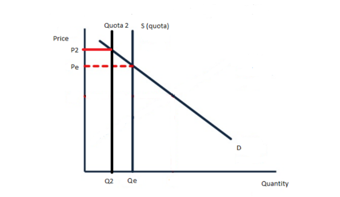

**[3 marks]**

> **[mark-scheme]**
> Award 1 mark for a leftward shift of the perfectly inelastic supply curve, labelled
> 
> Award 1 mark for a higher equilibrium price, labelled
> 
> Award 1 mark for a lower equilibrium quantity, labelled

> **[exam-tip]**
> - A quota is drawn as a **vertical** supply curve, because the quantity allowed in is fixed by law whatever the price. That is what perfectly inelastic means
> - The new quota is **smaller** than the original, so the vertical line moves **left**, which raises the price and lowers the quantity
> - Read this stem carefully. Other questions in this topic raise an existing quota, which moves the line right and lowers the price, so the direction depends entirely on the wording
A trading bloc is a group of countries that agree to reduce or remove the trade barriers between them.** [K]** The AfCFTA, signed by 44 African countries in March 2018, creates a market of 1.2bn people with a combined GDP of \$2.5 trillion,** [Ap]** so a firm in any member country can now sell to customers right across the continent without paying the tariffs that previously made its goods dearer than local rivals.** [An]** Access to that many more customers raises sales and revenue directly. Producing for a market of that size also lets firms operate on a much larger scale,** [An]** spreading fixed costs such as factories and machinery across far more output, so average costs fall and they compete more effectively still. Removing barriers also allows each member to specialise in what it produces most efficiently and import the rest,** [Ap]** which raises productivity and total output across the bloc. Consumers benefit too, since goods from other members arrive without tariffs, so prices are lower and choice is wider.** [An]** Membership can also attract foreign direct investment, because a firm locating in any member country gains tariff-free access to all 1.2bn consumers from a single base.

**[6 marks]**

> **[mark-scheme]**
> This is a ‘levelled response’ question
> 
> - **[Ap]** = application to the data given  (3 marks)
> - **[An]** = analysis / chain of reasoning (3 marks)
> 
> Although there are no separate **[K] marks**, both application and analysis must be built on **clear and accurate economic knowledge and understanding**
> 
> Therefore, each KAA paragraph should follow:
> 
> - Valid knowledge point → Application → Analysis
> - Each valid point made in the answer does not equal a mark, the response is judged holistically against the level descriptors
> 
> **Mark allocation**
> 
> Answers are placed into one of three levels.  **A level 3 answer (5-6 marks)**, will specifically:
> 
> - Demonstrate clear knowledge and understanding by developing relevant points and include appropriate application of economic terms, concepts, theories and calculations
> - Information presented will demonstrate excellent selectivity and organisation. Interpretation of economic information will be excellent, with a thorough analysis of issues
> 
> **Alternative content**
> 
> The answer above is just one example of how to respond to this question. Additional information which could be used in the answer includes:
> 
> - Higher exports raise output and employment in member countries, improving their current accounts
> - Access to cheaper raw materials and components from other members lowers producers' costs
> - Any other relevant and valid analysis is acceptable

> **[exam-tip]**
> - Use both figures. The 1.2bn people and the \$2.5 trillion GDP show the scale of the market and are what earn the application marks
> - The question asks for **benefits**, so give no drawbacks. Analyse is always one-sided
> - One thoroughly developed chain can reach full marks, so take a single benefit several steps rather than listing five

### Q24
**Final answer:** **The correct answer is C**

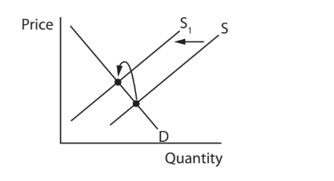

A tariff is a tax on imports, so it raises the cost of supplying US apples, almonds and lentils to the Indian market. Supply shifts to the left from S to S1, which raises the equilibrium price and reduces the equilibrium quantity

**A** is incorrect as it shows the price and quantity changing without the leftward shift of supply that a tariff produces

**B** is incorrect as it shows demand shifting left, but a tariff acts on the sellers' costs rather than on how much consumers want to buy

**D** is incorrect as it shows supply shifting **right**, giving a lower price and higher quantity, which is what a subsidy would do rather than a tariff
**Domestic firms face competition from cheaper foreign producers****[1 mark]**

> **[mark-scheme]**
> Award 1 mark for one correct disadvantage
> 
> Accept any other appropriate response, e.g. rising unemployment as uncompetitive domestic industries decline, the risk of dumping by foreign producers, over-dependence on imported goods, or damage to infant industries that cannot yet compete

### Q25
**Final answer:** **The correct answer is C**

A subsidy pays domestic producers part of their costs, so they can sell abroad at a lower price than their true cost of production while still covering it, which makes their exports cheaper on world markets

**A** is incorrect as free trade means the absence of protection, so it is not a method of protection at all

**B** is incorrect as a tariff is a tax on **imports**, which raises the price of goods coming into a country rather than lowering the price of goods going out

**D** is incorrect as a quota is a physical limit on the quantity of imports allowed in, which restricts volume rather than affecting export prices

### Q26
**Final answer:** **The correct answer is B**

Free trade removes the barriers that keep foreign goods out, so consumers can buy from producers all over the world rather than only from domestic firms

**A** is incorrect as free trade brings cheaper imports and greater competition, both of which push prices down rather than up

**C** is incorrect as cheaper goods and wider choice mean each unit of income buys more, so living standards generally rise

**D** is incorrect as firms gain access to overseas customers, so market opportunities increase rather than decrease
A developed country typically exports high-value manufactured goods and services and imports cheaper primary products** [1]**, because its economy has moved away from the primary sector towards secondary and tertiary production** [1]**, which is exactly what Germany's figures show, with services contributing 69.3% of GDP and manufacturing 30.1% while the primary sector accounts for only 0.6%, so Germany exports cars and electrical goods and imports commodities such as tea and sugar that it barely produces itself** [1]**

**[3 marks]**

> **[mark-scheme]**
> Award 1 mark for identifying a pattern of trade
> 
> Award 1 mark for developing the pattern of trade
> 
> Award 1 mark for the response being in context
> 
> **Alternative content**
> 
> The answer above is just one example of a response to this question. Other patterns could include:
> 
> - Developed countries export finished goods to developing countries and import raw materials from them
> - Trade is more diversified across many industries, so no single product dominates export earnings
> - A large share of exports is services rather than goods, reflecting the size of the tertiary sector
> 
> Accept any other appropriate response

> **[exam-tip]**
> - The three percentages are the whole point of the stem, so use them. The 0.6% primary sector is what explains why Germany must import commodities
> - Cover **both** sides of the pattern, what the country exports and what it imports, since a one-way answer leaves the pattern incomplete
> - Naming actual products, cars and electrical goods out, tea and sugar in, is what earns the context mark

### Q27
One reason is to gain market share** [1]**, because selling below cost undercuts any price a rival can match while still covering its own costs** [1]**, so Chinese barley producers lose sales and some are forced out of the market altogether, leaving Australian exporters dominant enough to raise prices later, which is exactly why China opened an anti-dumping investigation** [1]**

**[3 marks]**

> **[mark-scheme]**
> Award 1 mark for identifying a relevant reason
> 
> Award 1 mark for developing the reason
> 
> Award 1 mark for the response being in context
> 
> **Alternative content**
> 
> The answer above is just one example of a response to this question. Other reasons could include:
> 
> - To dispose of a surplus, since a bumper barley harvest is worth selling cheaply abroad rather than leaving it unsold or letting it spoil
> - To keep production running, because selling below full cost may still cover the variable costs of harvesting and shipping
> - Government subsidies may allow producers to sell below cost while remaining profitable overall
> 
> Accept any other appropriate response

> **[exam-tip]**
> - Dumping only makes sense if the seller gains something later, so a strong answer explains the pay-off: driving out rivals now in order to charge more once competition has gone
> - The context mark comes from the stem, so name barley, Australia or China's anti-dumping investigation
> - There are no marks for defining dumping here, the question tells you what it is

### Q28
**Final answer:** **The correct answer is C**

Free trade is the exchange of goods and services between countries with no tariffs, quotas or other barriers restricting it

**A** is incorrect as globalisation is the wider process by which economies become integrated and interdependent. Free trade contributes to it, but the two are not the same

**B** is incorrect as protectionism means using tariffs and quotas to restrict trade, which is the opposite of trade without restrictions

**D** is incorrect as foreign direct investment is a firm buying or building productive assets abroad, which is investment rather than trade
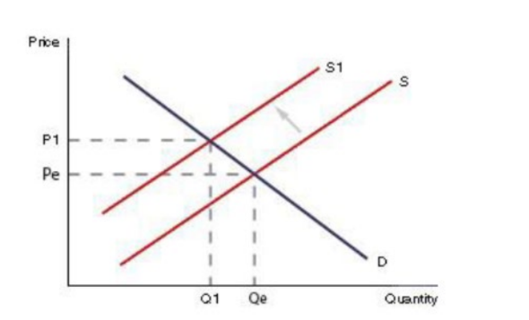

**[3 marks]**

> **[mark-scheme]**
> Award 1 mark for a leftward shift of supply, labelled
> 
> Award 1 mark for a higher equilibrium price, labelled
> 
> Award 1 mark for a lower equilibrium quantity, labelled

> **[exam-tip]**
> - A tariff is a tax that raises the cost of supplying the imported good, so supply shifts **left**, raising the price and reducing the quantity
> - A tariff acts on the seller's costs, so it is always the **supply** curve that moves. Shifting demand instead is the commonest error on this question type
> - All three marks depend on labelling, so name the new curve and mark the new price and quantity on the axes
A subsidy is financial support paid by a government to producers, which lowers their costs of production.** [K]** The Indian Government pays \$725m to its sugar cane farmers,** [Ap]** so each tonne of cane costs those farmers less to produce than it otherwise would, and they are willing to supply more at every price.** [An]** That extra output is one reason for the subsidy: sugar is a staple crop and a government may want to secure domestic supply rather than depend on imports. Lower costs also let Indian farmers sell at a lower price while still covering what production costs them,** [An]** which makes their sugar more competitive against producers in countries such as Australia who receive no such support, so Indian exports rise. Protecting employment is a further motive,** [Ap]** because sugar cane farming supports a very large number of rural households in India, and without the subsidy farmers unable to match world prices would leave the industry,** [An]** so the \$725m keeps those livelihoods intact and prevents the rural unemployment that would follow.

**[6 marks]**

> **[mark-scheme]**
> This is a ‘levelled response’ question
> 
> - **[Ap]** = application to the data given  (3 marks)
> - **[An]** = analysis / chain of reasoning (3 marks)
> 
> Although there are no separate **[K] marks**, both application and analysis must be built on **clear and accurate economic knowledge and understanding**
> 
> Therefore, each KAA paragraph should follow:
> 
> - Valid knowledge point → Application → Analysis
> - Each valid point made in the answer does not equal a mark, the response is judged holistically against the level descriptors
> 
> **Mark allocation**
> 
> Answers are placed into one of three levels.  **A level 3 answer (5-6 marks)**, will specifically:
> 
> - Demonstrate clear knowledge and understanding by developing relevant points and include appropriate application of economic terms, concepts, theories and calculations
> - Information presented will demonstrate excellent selectivity and organisation. Interpretation of economic information will be excellent, with a thorough analysis of issues
> 
> **Alternative content**
> 
> The answer above is just one example of how to respond to this question. Additional information which could be used in the answer includes:
> 
> - Subsidies lower the price of Indian sugar cane and so increase domestic sales
> - Supporting agricultural output helps secure the country's own food supply
> - Any other relevant and valid analysis is acceptable

> **[exam-tip]**
> - The question asks **why** the government gave the subsidy, so every chain must end with a government objective such as protecting jobs, raising output or improving competitiveness
> - Australia's complaint to the WTO tells you the subsidy works, since rivals only object when it puts them at a disadvantage. That is worth using as evidence
> - No counter-argument and no conclusion is required, analyse is always one-sided

### Q29
A trading bloc is a group of countries that agree preferential terms with one another, reducing the trade barriers between members.** [K]** India belongs to the Asia-Pacific Trade Agreement alongside Bangladesh, China, South Korea and Sri Lanka,** [Ap]** so Indian exporters reach those markets without paying the tariffs that firms outside the agreement face, which makes their goods cheaper there than those of non-member competitors.** [An]** Access to a market of that size lets Indian firms produce on a far larger scale, spreading fixed costs across more output and gaining economies of scale, so their average costs fall and they compete more effectively still. Preferential access also encourages India to specialise in what it produces most efficiently,** [An]** because it can rely on other members for the rest, and specialisation raises productivity and total output. Indian consumers benefit too,** [Ap]** since goods from China, South Korea and the other members arrive without tariffs, so prices are lower and choice is wider.** [An]** Membership can also attract foreign direct investment, because a firm locating in India gains tariff-free access to every other member country from a single base.

**[6 marks]**

> **[mark-scheme]**
> This is a ‘levelled response’ question
> 
> - **[Ap]** = application to the data given  (3 marks)
> - **[An]** = analysis / chain of reasoning (3 marks)
> 
> Although there are no separate **[K] marks**, both application and analysis must be built on **clear and accurate economic knowledge and understanding**
> 
> Therefore, each KAA paragraph should follow:
> 
> - Valid knowledge point → Application → Analysis
> - Each valid point made in the answer does not equal a mark, the response is judged holistically against the level descriptors
> 
> **Mark allocation**
> 
> Answers are placed into one of three levels.  **A level 3 answer (5-6 marks)**, will specifically:
> 
> - Demonstrate clear knowledge and understanding by developing relevant points and include appropriate application of economic terms, concepts, theories and calculations
> - Information presented will demonstrate excellent selectivity and organisation. Interpretation of economic information will be excellent, with a thorough analysis of issues
> 
> **Alternative content**
> 
> The answer above is just one example of how to respond to this question. Additional information which could be used in the answer includes:
> 
> - Higher exports raise output and employment in India, improving the current account
> - Access to cheaper raw materials and components from member countries lowers Indian producers' costs
> - Any other relevant and valid analysis is acceptable

> **[exam-tip]**
> - Name the member countries given in the stem. Writing generally about trading blocs without using APTA will not reach the application marks
> - One thoroughly developed chain can reach full marks, so take a single benefit several steps rather than listing five
> - No counter-argument and no conclusion is required, analyse is always one-sided

### Q30
One advantage is an increase in exports** [1]**, because a subsidy of between 2% and 4% on clothing covers part of the producer's costs, so Bangladeshi firms can charge a lower price abroad and still cover what it costs them to produce** [1]**, which makes their clothing more price competitive against rival exporters, raises export earnings and improves the current account** [1]**

**[3 marks]**

> **[mark-scheme]**
> Award 1 mark for identifying a relevant advantage
> 
> Award 1 mark for developing the advantage
> 
> Award 1 mark for the response being in context
> 
> **Alternative content**
> 
> The answer above is just one example of a response to this question. Other advantages could include:
> 
> - More firms enter the market, since subsidies of up to 10% on new products such as home appliances make them profitable to produce, which creates employment
> - The economy diversifies away from depending on clothing alone, which spreads risk across more industries
> - Higher output and employment raise incomes and tax revenue for the Bangladeshi Government
> 
> Accept any other appropriate response

> **[exam-tip]**
> - The chain must end with a benefit to **Bangladesh**, such as export earnings, jobs or the current account, not simply with cheaper products
> - The context mark comes from the figures, so use the 2% to 4% on clothing or the 10% on the new products
> - Explain how a subsidy works, lowering the producer's costs so it can cut its price, rather than asserting that exports rise

### Q31
**Final answer:** **The correct answer is D**

A quota sets a maximum quantity of a good that may be imported, so it restricts trade by limiting volume rather than by raising price

**A** is incorrect as devaluation is a deliberate reduction in the value of a currency by a government, which concerns the exchange rate rather than the quantity of a product

**B** is incorrect as dumping is selling exports below the cost of production, which is about the price charged rather than a limit on quantity

**C** is incorrect as a public good is one that is non-rival and non-excludable, such as street lighting, and has nothing to do with restricting imports
Infant industries are new or recently established industries** [1]** that have not yet grown large enough to compete with established foreign producers** [1]**

**[2 marks]**

> **[mark-scheme]**
> Award 1 mark for reference to a new or newly formed industry and 1 mark for reference to its not yet being established or able to compete
> 
> Accept any other correct and appropriate wording

> **[exam-tip]**
> - 'What is meant by' questions carry two marks and need two parts to the definition, so pair how new the industry is with why that matters
> - The reason this term appears on the specification is that protecting infant industries is a common **justification for protectionism**, so link it to tariffs and quotas in the longer questions
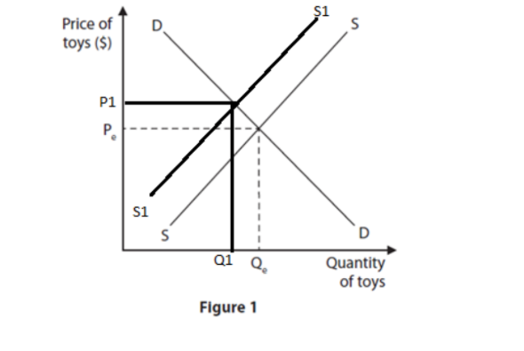

**[3 marks]**

> **[mark-scheme]**
> Award 1 mark for a leftward shift of the supply curve, labelled
> 
> Award 1 mark for a higher equilibrium price, labelled
> 
> Award 1 mark for a lower equilibrium quantity, labelled

> **[exam-tip]**
> - The 10% tariff is a tax on each imported toy, so it raises the cost of supplying them and shifts supply **left**, giving a higher price and a lower quantity
> - At 10% the tariff is relatively small, so draw a modest shift rather than a dramatic one
> - Move only the supply curve, and label the new curve, the new price and the new quantity, since all three marks depend on the labelling

### Q32
**Final answer:** **The correct answer is A**

A trading bloc is defined by its members agreeing to reduce or remove the tariffs and quotas between them, so goods move more freely within the bloc than with countries outside it

**B** is incorrect as income tax is set by each member's own government, and blocs do not require a common rate

**C** is incorrect as members remain free to trade with non-members. The agreement gives preferential terms within the bloc rather than banning outside trade

**D** is incorrect as members are often not neighbours, and sharing a border does nothing to remove trade barriers
One advantage is that domestic producers face less competition** [1]**, because allowing only 600 million litres of US ethanol into the country each year caps how much foreign supply can reach Brazilian buyers** [1]**, so Brazilian ethanol producers win a larger share of the market, sell more and can charge a higher price than open competition would allow** [1]**

**[3 marks]**

> **[mark-scheme]**
> Award 1 mark for identifying a relevant advantage
> 
> Award 1 mark for developing the advantage
> 
> Award 1 mark for the response being in context
> 
> **Alternative content**
> 
> The answer above is just one example of a response to this question. Other advantages could include:
> 
> - Protecting domestic employment, since producers who keep their sales keep their workers
> - Reducing a current account deficit, because limiting imports means less money flowing out of Brazil
> - Protecting an infant industry while it grows large enough to compete internationally
> 
> Accept any other appropriate response

> **[exam-tip]**
> - A quota is a **quantity** limit, not a tax. Explaining it as raising the price of imports directly describes a tariff instead
> - The context mark comes from the figure, so quote the 600 million litres
> - Note that a quota raises no revenue for the government, which is what separates it from a tariff. That distinction is worth knowing for the longer questions

### Q33
Free trade is the exchange of goods and services between countries** [1]** without tariffs, quotas or other barriers restricting it** [1]**

**[2 marks]**

> **[mark-scheme]**
> Award 1 mark for reference to goods or services moving between countries and 1 mark for reference to the absence of taxes, controls or barriers
> 
> Accept any other correct and appropriate wording

> **[exam-tip]**
> - 'What is meant by' questions carry two marks and need two parts to the definition. Saying only 'trade between countries' earns one mark, because it leaves out what makes that trade **free**
> - The second half is where the marks are usually lost, so name the barriers that are absent: tariffs, quotas or restrictions

### Q34
**Final answer:** **The correct answer is B**

A tariff is a tax charged on goods coming into a country, which raises their price and makes domestically produced goods relatively cheaper

**A** is incorrect as a subsidy is money paid **by** a government to producers to reduce their costs, so it lowers prices rather than raising them

**C** is incorrect as a fine is a financial penalty imposed on a firm that breaks the law, not a charge on imports

**D** is incorrect as a pollution permit gives a firm the legal right to discharge a set quantity of polluting material
Dumping is where a firm or country sells goods in an overseas market** [1]** at a price below the cost of producing them** [1]**

**[2 marks]**

> **[mark-scheme]**
> Award 1 mark for reference to selling or exporting goods in another country and 1 mark for reference to the price being below the cost of production
> 
> Accept any other correct and appropriate wording

> **[exam-tip]**
> - 'What is meant by' questions carry two marks and need two parts to the definition, so pair the selling abroad with the price being below cost
> - **Below the cost of production** is the half that earns the second mark. Saying only that goods are sold cheaply abroad describes ordinary competition, not dumping

### Q35
One reason is to protect domestic producers** [1]**, because capping imports at 200,000 tonnes of wheat and 70,000 tonnes of flour limits how much foreign grain can reach the market** [1]**, so Kazakh farmers and millers face less competition, gain a larger share of domestic sales and can charge a higher price than they otherwise could** [1]**

**[3 marks]**

> **[mark-scheme]**
> Award 1 mark for identifying a relevant reason
> 
> Award 1 mark for developing the reason
> 
> Award 1 mark for the response being in context
> 
> **Alternative content**
> 
> The answer above is just one example of a response to this question. Other reasons could include:
> 
> - Protecting domestic employment, since farmers and millers who keep their sales keep their workers
> - Securing the country's own food supply rather than depending on imported wheat and flour
> - Reducing a current account deficit, because limiting imports means less money flowing out of the country
> 
> Accept any other appropriate response

> **[exam-tip]**
> - A quota is a **quantity** limit, not a tax. Explaining it as raising the price of imports directly describes a tariff instead and will not earn the development mark
> - The context mark comes from the tonnages given, so quote the 200,000 and 70,000 figures
> - There are no marks for defining a quota here, name the reason first and then develop it

### Q36
Exports are goods and services produced in one country** [1]** and sold to buyers in another country** [1]**

**[2 marks]**

> **[mark-scheme]**
> Award 1 mark for reference to goods or services and 1 mark for reference to their being sold to another country
> 
> Accept any other correct and appropriate wording

> **[exam-tip]**
> - 'What is meant by' questions carry two marks and need two parts to the definition, so name what is sold and where it goes
> - Include **services** as well as goods. Exports are not only physical products, and tourism, banking and insurance all count
Free trade removes the tariffs and quotas that previously protected domestic producers from foreign competition.** [K]** Under the EU–Vietnam agreement reached in March 2020, goods move between the two without the barriers that once shielded firms on each side,** [Ap]** so an EU business that competed only against other European firms now competes directly against Vietnamese producers as well.** [An]** Wage costs in Vietnam are far below those in the EU, so Vietnamese firms can produce the same goods at a lower cost and sell them at a lower price. EU businesses therefore lose sales to cheaper imports,** [An]** and because they cannot cut their own prices below cost, some see revenue fall to the point where they cut jobs or close altogether, particularly in labour-intensive industries such as clothing and footwear where the cost gap is widest.** [Ap]** Firms that survive may be forced to relocate production to Vietnam to remain competitive,** [An]** which moves employment and output out of the EU even where the business itself continues to trade.

**[6 marks]**

> **[mark-scheme]**
> This is a ‘levelled response’ question
> 
> - **[Ap]** = application to the data given  (3 marks)
> - **[An]** = analysis / chain of reasoning (3 marks)
> 
> Although there are no separate **[K] marks**, both application and analysis must be built on **clear and accurate economic knowledge and understanding**
> 
> Therefore, each KAA paragraph should follow:
> 
> - Valid knowledge point → Application → Analysis
> - Each valid point made in the answer does not equal a mark, the response is judged holistically against the level descriptors
> 
> **Mark allocation**
> 
> Answers are placed into one of three levels.  **A level 3 answer (5-6 marks)**, will specifically:
> 
> - Demonstrate clear knowledge and understanding by developing relevant points and include appropriate application of economic terms, concepts, theories and calculations
> - Information presented will demonstrate excellent selectivity and organisation. Interpretation of economic information will be excellent, with a thorough analysis of issues
> 
> **Alternative content**
> 
> The answer above is just one example of how to respond to this question. Additional information which could be used in the answer includes:
> 
> - Domestic businesses lose the protection that tariffs and quotas previously gave them
> - Infant industries may be unable to establish themselves at all when exposed to established foreign competitors
> - Falling sales can force firms to cut jobs, raising unemployment in the affected industries
> - Any other relevant and valid analysis is acceptable

> **[exam-tip]**
> - The question asks for **disadvantages**, so give no advantages. Analyse is always one-sided and a balanced answer wastes time here
> - The wage cost difference between the EU and Vietnam is the specific detail that makes this answer applied rather than generic
> - Take one chain several steps, from cheaper imports to lost sales to job losses, rather than listing several disadvantages

### Q37
Free trade is the exchange of goods and services between countries without tariffs or other barriers restricting it.** [K]** The EU–Mercosur deal would create the largest free trade area in the world, covering 770 million people,** [Ap]** so EU firms gain access to a market far larger than the one they currently sell into, and more potential customers means higher sales and revenue.** [An]** Mercosur is removing tariffs on 91% of EU goods, worth €4bn, including clothing, chemicals, wine and canned peaches, so firms in those industries can export without the tax that previously made their products dearer than local rivals. Selling into a market of that size also lets EU firms produce on a much larger scale,** [An]** spreading fixed costs across more units and gaining economies of scale, which lowers average costs on everything they make. Spreading sales across two blocs rather than one also reduces risk,** [Ap]** so a fall in European demand threatens a smaller share of a firm's total revenue.

However, free trade opens the door in both directions.** [Ev]** The EU would end 92% of its tariffs on Mercosur imports,** [Ap]** so EU firms face competition from South American producers whose wage costs are considerably lower, and some will lose sales or be driven out of the market entirely.** [An]** EU farmers are especially exposed, because Mercosur producers would be allowed to export a set quantity of beef, sugar and chicken each year at a reduced tariff rate, and agriculture is precisely where South America's cost advantage is greatest. The gain to EU firms therefore depends on **which** firms they are,** [An]** and on whether they compete on quality and brand rather than on price, since a producer that cannot match Mercosur costs gains a bigger market but loses its share of the one it already had.

**[9 marks]**

> **[mark-scheme]**
> This is a ‘levelled response’ question
> 
> - **[Ap]** = application to the data given  (3 marks)
> - **[An]** = analysis / chain of reasoning (3 marks)
> - **[Ev]** = evaluation (3 marks)
> 
> Although there are no separate **[K] marks**, both application and analysis must be built on **clear and accurate economic knowledge and understanding**
> 
> Therefore, each KAA paragraph should follow:
> 
> - Valid knowledge point → Application → Analysis
> - Each valid point made in the answer does not equal a mark, the response is judged holistically against the level descriptors
> 
> **Mark allocation**
> 
> A 9 mark (Level 3) answer will include examples which demonstrate:
> 
> - **Application [Ap]** — clear knowledge and understanding by developing relevant points. Appropriate application of economic terms, concepts, theories and calculations
> - **Analysis [An]** — Information presented will demonstrate excellent selectivity and organisation. Interpretation of economic information will be excellent, with a thorough analysis of issues
> - **Evaluation [Ev]** — Offers more than one viewpoint. The argument is well balanced and coherent, leading to an evaluation that demonstrates full understanding and awareness
> 
> **Alternative content**
> 
> The answer above is just one example of how to respond to this question. Additional information which could be used in the answer includes:
> 
> - Expanding into a second bloc spreads risk if demand falls within the EU
> - On the other side, the overall impact depends on the relative quality and price of EU goods against those made in Mercosur countries
> - EU firms may gain access to cheaper raw materials and components from Mercosur, lowering their own costs
> - Any other relevant and valid analysis is acceptable

> **[exam-tip]**
> - The two tariff figures work as a matched pair: **91%** of EU goods entering Mercosur is the advantage, **92%** of Mercosur goods entering the EU is the drawback. Using both gives you a balanced answer built entirely on the data
> - The question specifies firms **within the EU**, so keep the focus there rather than drifting into what Mercosur producers or EU consumers gain
> - No conclusion is required at 9 marks, but both sides must be developed to matching depth

### Q38
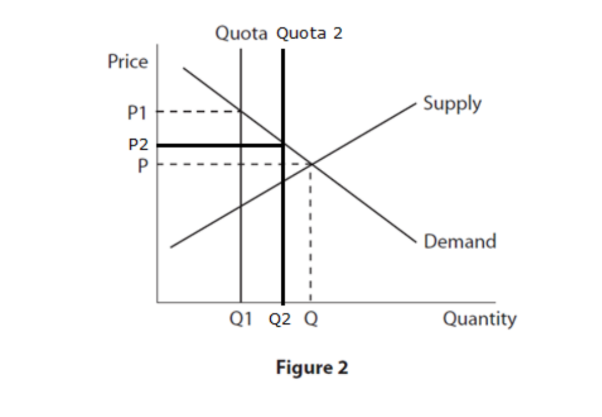

**[3 marks]**

> **[mark-scheme]**
> Award 1 mark for a rightward shift of the perfectly inelastic supply curve, labelled
> 
> Award 1 mark for a lower equilibrium price, labelled
> 
> Award 1 mark for a higher equilibrium quantity, labelled

> **[exam-tip]**
> - A quota is drawn as a **vertical** supply curve, because the quantity is fixed by law no matter what the price is. That is what perfectly inelastic means
> - Raising the quota by 30% allows more haddock to be landed, so the vertical line moves **right**, which lowers the price and raises the quantity
> - Do not draw a quota as a sloping shift like a tariff. The vertical line is what distinguishes a quantity limit from a tax, and the mark scheme requires it

### Q39
The WTO settles trade disputes between member countries** [1]**, acting as a mediator so that disagreements are resolved through an agreed process rather than escalating into retaliatory tariffs** [1]**

**[2 marks]**

> **[mark-scheme]**
> Award 1 mark for reference to a valid role and 1 mark for development of that role
> 
> Accept any other appropriate response, e.g. it hosts trade negotiations (1) in which members agree mutual reductions in tariffs and quotas (1), or it sets the rules of international trade (1) and monitors members to ensure they are followed (1)

> **[exam-tip]**
> - Give one role and then develop it. A list of roles cannot earn the second mark, which is for saying how the one you name actually works
> - Do not confuse the WTO with the IMF or World Bank. It does not lend money or write off debt
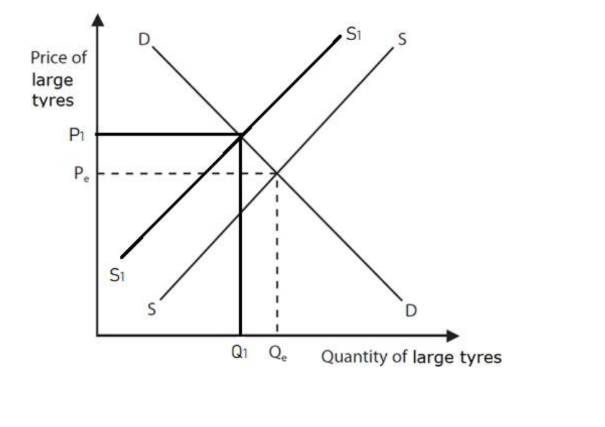

**[3 marks]**

> **[mark-scheme]**
> Award 1 mark for a leftward shift of the supply curve, labelled
> 
> Award 1 mark for a higher equilibrium price, labelled
> 
> Award 1 mark for a lower equilibrium quantity, labelled

> **[exam-tip]**
> - A tariff is a tax that raises the cost of supplying the imported good, so supply shifts **left**, raising the price and reducing the quantity
> - A tariff acts on the seller's costs, so it is always the **supply** curve that moves. Shifting demand instead is the commonest error on this question type
> - All three marks depend on labelling, so name the new curve and mark the new price and quantity on the axes
One advantage is access to a much wider market** [1]**, because removing trade barriers means Ecuadorian goods no longer face tariffs on entry to China** [1]**, so exporters of shrimp, bananas, flowers, cocoa and coffee can sell to an enormous new customer base at prices Chinese buyers find competitive, raising their total sales and revenue** [1]**

**[3 marks]**

> **[mark-scheme]**
> Award 1 mark for identifying a relevant advantage
> 
> Award 1 mark for developing the advantage
> 
> Award 1 mark for the response being in context
> 
> **Alternative content**
> 
> The answer above is just one example of a response to this question. Other advantages could include:
> 
> - Lower input costs, since removing barriers on imports from China lets Ecuadorian businesses buy equipment and materials more cheaply
> - Economies of scale, because producing for a market the size of China spreads fixed costs across far more output
> - Reduced risk, as selling to more than one market means a fall in demand in any one country threatens a smaller share of revenue
> 
> Accept any other appropriate response

> **[exam-tip]**
> - The question specifies **businesses in Ecuador**, so end the chain at higher sales, revenue or lower costs for the firm rather than at benefits to consumers
> - The context mark comes from the stem, so name one of the products listed or refer to the agreement with China

### Q40
**Lower prices for consumers****[1 mark]**

> **[mark-scheme]**
> Award 1 mark for one correct advantage
> 
> Accept any other appropriate response, e.g. increased choice for consumers, wider markets for businesses, greater competition, economies of scale from producing at larger scale, or the opportunity for countries to specialise
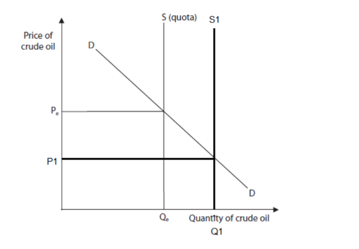

**[3 marks]**

> **[mark-scheme]**
> Award 1 mark for a rightward shift of the perfectly inelastic supply curve, labelled
> 
> Award 1 mark for a lower equilibrium price, labelled
> 
> Award 1 mark for a higher equilibrium quantity, labelled

> **[exam-tip]**
> - A quota is drawn as a **vertical** supply curve, because the quantity allowed in is fixed by law whatever the price. That is what perfectly inelastic means
> - Raising the quota by 20% lets more crude oil enter, so the vertical line moves **right**, which lowers the price and raises the quantity
> - Do not draw a quota as a sloping shift like a tariff. The vertical line is what distinguishes a quantity limit from a tax, and the mark scheme requires it

### Q41
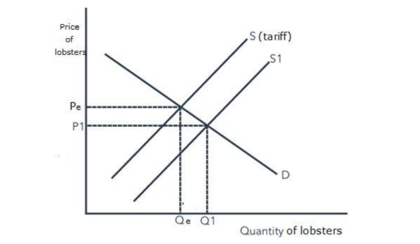

**[3 marks]**

> **[mark-scheme]**
> Award 1 mark for a rightward shift of supply, labelled
> 
> Award 1 mark for a lower equilibrium price, labelled
> 
> Award 1 mark for a higher equilibrium quantity, labelled

> **[exam-tip]**
> - The tariff is **decreased** rather than removed entirely, but the direction is the same: less tax on each imported lobster means cheaper supply, so the curve shifts right
> - A smaller cut produces a smaller shift, so keep the movement modest rather than dropping supply all the way to a no-tariff position
> - Move only the supply curve, and label the new curve, the new price and the new quantity

### Q42
**Final answer:** **The correct answer is B**

The World Trade Organization provides a formal process for resolving disagreements between member countries over trade rules, which stops disputes escalating into retaliatory tariffs

**A** is incorrect as writing off debt is handled by bodies such as the IMF and World Bank, not the WTO

**C** is incorrect as the WTO exists to **reduce** trade barriers, so raising them is the opposite of its purpose

**D** is incorrect as subsidies are paid by national governments, and the WTO in fact monitors them because they can distort fair competition
Consumers gain greater choice** [1]**, because removing tariffs and quotas allows far more foreign goods and services to be imported, so shoppers can buy products that domestic firms do not make at all** [1]**

**[2 marks]**

> **[mark-scheme]**
> Award 1 mark for reference to an advantage for consumers and 1 mark for development of that advantage
> 
> Accept any other appropriate response, e.g. lower prices (1) because imports from lower-cost producers and the extra competition they bring push prices down (1), or better quality (1) as domestic firms must improve to compete with foreign rivals (1)

> **[exam-tip]**
> - The question specifies **consumers**, so an advantage to firms or to the government will not be credited
> - Give one advantage and then develop it. A list cannot earn the second mark, which is for the reason behind the one you name
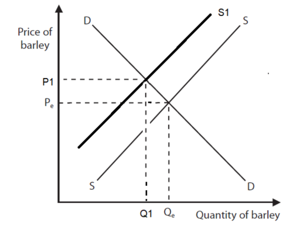

**[3 marks]**

> **[mark-scheme]**
> Award 1 mark for a leftward shift of supply, labelled
> 
> Award 1 mark for a higher equilibrium price, labelled
> 
> Award 1 mark for a lower equilibrium quantity, labelled

> **[exam-tip]**
> - A tariff is a tax that raises the cost of supplying the imported good, so supply shifts **left**, which raises the price and reduces the quantity
> - At 80% this is a very large tariff, so draw a substantial shift rather than a token one
> - A tariff acts on the seller's costs, so it is always the **supply** curve that moves. Shifting demand instead is the commonest error on this question type

### Q43
A trading bloc is a group of countries that agree to reduce or remove the trade barriers between them.** [K]** The RCEP is the world's largest, accounting for around 30% of global trade across 15 members including China, Japan and South Korea,** [Ap]** so joining would give Indian exporters tariff-free access to the three biggest economies in Asia.** [An]** Cheaper access means Indian goods undercut those of non-member competitors, so export sales and revenue rise, and firms selling into a market of that size can produce on a far larger scale, spreading fixed costs across more output and gaining economies of scale that lower average costs. Membership would also make it easier for Indian firms to join regional supply chains,** [An]** sourcing components tariff-free from other members and supplying manufacturers across the bloc, which cuts costs and improves efficiency further. Foreign direct investment would be likely to follow,** [Ap]** because a firm locating in India would reach every RCEP member from a single base, and the jobs created matter particularly for India's young and growing population. Belonging to the largest bloc in the world would also give India more bargaining power in future trade negotiations.

However, removing tariffs works in both directions.** [Ev]** India withdrew from the negotiations in 2019 precisely because of the threat to its domestic industries, particularly agriculture and manufacturing,** [Ap]** and those concerns have not disappeared: Indian farmers and manufacturers would face tariff-free competition from Chinese producers operating at far greater scale and lower cost.** [An]** Firms unable to match those costs would lose sales and some would close, so the employment gained in exporting industries could be offset by losses elsewhere, and the damage would fall hardest on agriculture, which employs a very large share of India's workforce. There is a risk of dependence too,** [An]** since trade concentrated within RCEP leaves India exposed if the region slows, and may come at the expense of ties with the EU and the US.

Overall, whether joining benefits India depends on the terms it can negotiate rather than on membership itself.** [Ev]** The government is right to be seeking what it calls a fair and balanced deal, because the export opportunities across 30% of world trade are real and substantial, but so is the threat to agriculture that caused India to walk away in 2019. If it secures protections or long transition periods for its most vulnerable sectors while gaining access for the industries that can compete, the gains should outweigh the costs. If it joins on the same terms it rejected five years earlier, the outcome is likely to be the one it feared.** [Ev]**

**[12 marks]**

> **[mark-scheme]**
> This is a ‘levelled response’ question
> 
> - **[Ap]** = application to the data given  (4 marks)
> - **[An]** = analysis / chain of reasoning (4 marks)
> - **[Ev]** = evaluation (4 marks)
> 
> Although there are no separate **[K] marks**, both application and analysis must be built on **clear and accurate economic knowledge and understanding**
> 
> Therefore, each KAA paragraph should follow:
> 
> - Valid knowledge point → Application → Analysis
> - Each valid point made in the answer does not equal a mark, the response is judged holistically against the level descriptors
> 
> A concluding paragraph is essential to scoring evaluation marks
> 
> **Mark allocation**
> 
> A 12 mark (Level 3) answer will include answers which:
> 
> - **Application [Ap]** — Demonstrates specific and accurate knowledge and understanding by developing relevant points. Appropriate application of economic terms, concepts, theories and calculations
> - **Analysis [An]** — Information presented will demonstrate excellent selectivity and organisation. Chain of reasoning will be coherent and logical. Interpretation of economic information will be excellent with a thorough analysis of issues
> - **Evaluation [Ev]** — Offers more than one viewpoint. The argument is well balanced and coherent, leading to an evaluation that demonstrates full understanding and awareness. A supported judgement or conclusion is present
> 
> **Alternative content**
> 
> The answer above is just one example of how to respond to this question. Additional information which could be used in the answer includes:
> 
> - Membership creates jobs, which matters for a young and growing population
> - Belonging to the largest trading bloc gives India greater bargaining power in trade negotiations
> - On the other side, Indian firms would need to innovate or cut prices to survive competition from 15 member countries
> - Credit any valid alternative evaluation

> **[exam-tip]**
> - India's withdrawal in 2019 is the most useful detail in the extract, because it tells you exactly which sectors are at risk and gives the counter-argument real specificity
> - The 30% of global trade figure shows the scale of the opportunity and earns application marks, so quote it
> - A conclusion **is** required at 12 marks. The strongest judgement here is that the outcome depends on the **terms** negotiated rather than on whether India joins

### Q44
**Final answer:** **The correct answer is C**

A subsidy is a payment from the government to a producer, which lowers the cost of making each unit, so firms are willing to supply more at every price and output rises

**A** is incorrect as paying a subsidy is money leaving the government, so government spending increases rather than falls

**B** is incorrect as a subsidy makes domestic goods cheaper relative to foreign ones, so consumers switch towards home-produced goods and imports fall

**D** is incorrect as other countries often regard subsidies as unfair support for domestic firms, so they tend to cause trade disputes rather than reduce them

### Q45
**Final answer:** **The correct answer is C**

Protection makes imported goods dearer or scarcer, so consumers buy more from domestic producers instead, which keeps those firms trading and protects the jobs of the people they employ

**A** is incorrect as dumping is selling exports below the cost of production, and protection is used to stop it rather than to allow it

**B** is incorrect as protection restricts trade through tariffs and quotas, which is the opposite of free trade

**D** is incorrect as cutting imports reduces money flowing out of the country, so protection tends to **reduce** a current account deficit rather than increase it

### Q46
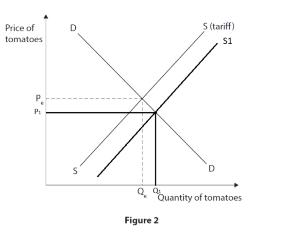

**[3 marks]**

> **[mark-scheme]**
> Award 1 mark for a rightward shift of the supply curve, labelled
> 
> Award 1 mark for a lower equilibrium price, labelled
> 
> Award 1 mark for a higher equilibrium quantity, labelled

> **[exam-tip]**
> - Removing a tariff takes a tax off the imported good, so supplying it becomes cheaper and supply shifts **right**, lowering the price and raising the quantity
> - A tariff acts on the seller's costs, so it is always the **supply** curve that moves. Shifting demand instead is the commonest error on this question type
> - Label the new curve, the new price and the new quantity. Examiner reports single out missing labels as the main reason marks are lost on diagram questions

### Q47
A country's pattern of trade reflects the relative size of its primary, secondary and tertiary sectors.** [K]** Costa Rica is a developing country whose economy rests heavily on the primary sector, which is why it exports agricultural commodities such as coffee, bananas and pineapples, with fruit and vegetables alone making up 73.4% of the £516m it sold to the UK in 2022.** [Ap]** Because so much of its export earnings comes from a narrow group of primary products,** [An]** Costa Rica is exposed to weather, disease and the volatile world prices that commodities are subject to, so its export revenue can swing sharply from year to year through no fault of its own. A developed country such as the UK has a very different structure,** [Ap]** with a much larger secondary and tertiary sector, so it exports manufactured goods and services such as finance and insurance across a wide range of industries.** [An]** That diversity means no single product failing threatens the whole economy. The UK has also exhausted many of its own raw materials and moved away from agriculture,** [An]** so it imports the commodities Costa Rica exports, which is precisely why the two trade with one another: each sells what its own sector structure allows it to produce most efficiently.

**[6 marks]**

> **[mark-scheme]**
> This is a ‘levelled response’ question
> 
> - **[Ap]** = application to the data given  (3 marks)
> - **[An]** = analysis / chain of reasoning (3 marks)
> 
> Although there are no separate **[K] marks**, both application and analysis must be built on **clear and accurate economic knowledge and understanding**
> 
> Therefore, each KAA paragraph should follow:
> 
> - Valid knowledge point → Application → Analysis
> - Each valid point made in the answer does not equal a mark, the response is judged holistically against the level descriptors
> 
> **Mark allocation**
> 
> Answers are placed into one of three levels.  **A level 3 answer (5-6 marks)**, will specifically:
> 
> - Demonstrate clear knowledge and understanding by developing relevant points and include appropriate application of economic terms, concepts, theories and calculations
> - Information presented will demonstrate excellent selectivity and organisation. Interpretation of economic information will be excellent, with a thorough analysis of issues
> 
> **Alternative content**
> 
> The answer above is just one example of how to respond to this question. Additional information which could be used in the answer includes:
> 
> - Developed countries export higher value-added goods and services, so they earn more per unit than a commodity exporter does
> - Developing countries may find their exports face tariffs that rise with the level of processing, which discourages them from moving beyond raw commodities
> - Any other relevant and valid analysis is acceptable

> **[exam-tip]**
> - The question asks how patterns **differ**, so build the answer as a contrast. Describing only Costa Rica leaves half the question unanswered
> - The 73.4% figure is the single strongest piece of evidence available, because it shows just how narrow a developing country's export base can be
> - Frame the difference in terms of the three sectors, which is the economics behind the pattern rather than a description of it

### Q48
A tariff is a tax placed on imported goods, which raises their price in the domestic market.** [K]** Brazil increased the tariff on imported tyres from 0% to 16% in March 2023,** [Ap]** so foreign tyres now cost Brazilian buyers roughly a sixth more than before, and consumers switch towards domestically produced tyres which have become relatively cheaper.** [An]** That is exactly the outcome the government intended, because Brazilian producers had seen output fall as imports rose and were warning they might stop production altogether, so the extra sales protect the industry and the jobs that would otherwise have been lost. The tariff also raises revenue for the Brazilian Government on every imported tyre that still enters,** [An]** money which can fund public services or reduce government debt. Fewer imported tyres means less money flowing out of the country,** [Ap]** so the current account position improves as well.

However, protection removes the pressure that competition places on domestic firms.** [Ev]** With imports 16% dearer, Brazilian producers can sell without matching foreign quality or price,** [An]** so they have less incentive to innovate or control their costs, and over time Brazilian tyres may become worse and more expensive than they would have been. Consumers bear that cost directly: imported tyres cost more, and domestic producers sheltering behind the tariff are likely to raise their own prices too, so the price of **all** tyres rises. Retaliation is a further risk,** [Ap]** since other countries may impose tariffs on Brazilian exports in response, and a trade war would reduce the total volume of trade and slow growth in both economies. Whether the policy succeeds therefore depends on whether the tyre industry uses the protection to become genuinely competitive or simply relies on it indefinitely.

**[9 marks]**

> **[mark-scheme]**
> This is a ‘levelled response’ question
> 
> - **[Ap]** = application to the data given  (3 marks)
> - **[An]** = analysis / chain of reasoning (3 marks)
> - **[Ev]** = evaluation (3 marks)
> 
> Although there are no separate **[K] marks**, both application and analysis must be built on **clear and accurate economic knowledge and understanding**
> 
> Therefore, each KAA paragraph should follow:
> 
> - Valid knowledge point → Application → Analysis
> - Each valid point made in the answer does not equal a mark, the response is judged holistically against the level descriptors
> 
> **Mark allocation**
> 
> A 9 mark (Level 3) answer will include examples which demonstrate:
> 
> - **Application [Ap]** — clear knowledge and understanding by developing relevant points. Appropriate application of economic terms, concepts, theories and calculations
> - **Analysis [An]** — Information presented will demonstrate excellent selectivity and organisation. Interpretation of economic information will be excellent, with a thorough analysis of issues
> - **Evaluation [Ev]** — Offers more than one viewpoint. The argument is well balanced and coherent, leading to an evaluation that demonstrates full understanding and awareness
> 
> **Alternative content**
> 
> The answer above is just one example of how to respond to this question. Additional information which could be used in the answer includes:
> 
> - The tariff may have been introduced to address a trade imbalance, since dearer imports reduce spending abroad
> - On the other side, reduced competition can lower the quality of domestically produced tyres and slow innovation
> - Consumers face higher prices for both imported and domestic tyres
> - Any other relevant and valid analysis is acceptable

> **[exam-tip]**
> - The question asks about benefits **for the Brazilian economy**, so weigh the gain to producers and government against the loss to consumers rather than treating the industry as if it were the whole economy
> - The 0% to 16% figures show the size of the change and earn the application marks, so quote them
> - The quotation about the previous government believing in open trade is a signal that this is a political choice with costs as well as benefits, which is useful evaluative material

### Q49
**Final answer:** **The correct answer is A**

The World Trade Organization exists to encourage free trade between its members, which it does by hosting trade negotiations and settling disputes when countries disagree over trade rules

**B** is incorrect as the WTO deals with governments and their trade policies, not with regulating individual multinational corporations

**C** is incorrect as lending to developing countries is the role of the World Bank and the International Monetary Fund

**D** is incorrect as exchange rates are managed by central banks, and the WTO has no role in stabilising them

### Q50
A trading bloc is a group of countries that agree to reduce or remove trade barriers between themselves.** [K]** By joining the CPTPP in March 2023 the UK gained preferential access to 11 Asia-Pacific economies including Australia, Canada, Japan and Vietnam,** [Ap]** so UK firms can now export to those markets without facing the tariffs that previously made their goods dearer than local rivals.** [An]** Cheaper access means UK exporters can either cut their prices and win customers or keep prices the same and earn more on each sale, so revenue rises either way. Selling into a market of this size also allows firms to produce on a much larger scale,** [An]** spreading fixed costs across far more units and gaining economies of scale that lower the average cost of everything they make, including what they sell at home. Membership also lets UK firms spread their trade beyond Europe,** [Ap]** so a downturn in any one market threatens a smaller share of total sales,** [An]** which makes revenue more stable and reduces the risk of depending on a single trading partner.

**[6 marks]**

> **[mark-scheme]**
> This is a ‘levelled response’ question
> 
> - **[Ap]** = application to the data given  (3 marks)
> - **[An]** = analysis / chain of reasoning (3 marks)
> 
> Although there are no separate **[K] marks**, both application and analysis must be built on **clear and accurate economic knowledge and understanding**
> 
> Therefore, each KAA paragraph should follow:
> 
> - Valid knowledge point → Application → Analysis
> - Each valid point made in the answer does not equal a mark, the response is judged holistically against the level descriptors
> 
> **Mark allocation**
> 
> Answers are placed into one of three levels.  **A level 3 answer (5-6 marks)**, will specifically:
> 
> - Demonstrate clear knowledge and understanding by developing relevant points and include appropriate application of economic terms, concepts, theories and calculations
> - Information presented will demonstrate excellent selectivity and organisation. Interpretation of economic information will be excellent, with a thorough analysis of issues
> 
> **Alternative content**
> 
> The answer above is just one example of how to respond to this question. Additional information which could be used in the answer includes:
> 
> - Access to skilled labour and to cheaper raw materials and components from other member countries
> - Opportunities to specialise in what the UK produces most efficiently and trade for the rest
> - Any other relevant and valid analysis is acceptable

> **[exam-tip]**
> - The question says **for UK firms**, so finish each chain at the business, with higher revenue, lower costs or less risk, rather than at benefits to consumers
> - Name the member countries from the extract. An answer that could have been written without reading the stem will not reach level 3
> - No counter-argument and no conclusion is required, analyse is always one-sided

### Q51
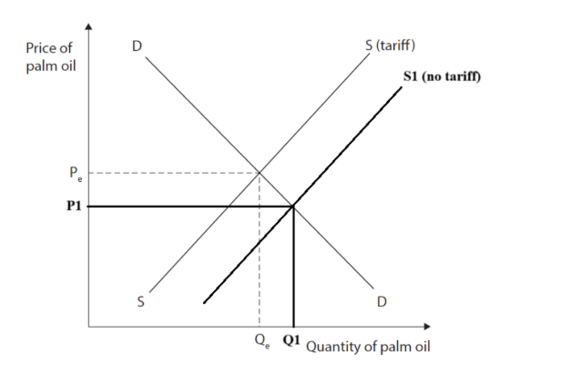

**[3 marks]**

> **[mark-scheme]**
> Award 1 mark for a rightward shift of supply, labelled
> 
> Award 1 mark for a lower equilibrium price, labelled
> 
> Award 1 mark for a higher equilibrium quantity, labelled

> **[exam-tip]**
> - A tariff is a tax that raises the cost of supplying imports, so **removing** it lowers those costs and supply shifts **right**, giving a lower price and a higher quantity
> - Read the direction carefully. Most tariff questions ask about introducing one, which shifts supply left. This question does the opposite
> - Move only the supply curve, and label the new curve, the new price and the new quantity, since all three marks depend on the labelling

### Q52
A subsidy is a payment from a government to producers that lowers their costs of production.** [K]** The US is providing \$369bn through grants, loans and tax credits to firms making batteries, solar panels and wind turbines,** [Ap]** so each unit costs American producers less to make and they are willing to supply more at every price.** [An]** That extra output requires new factories and the millions of green jobs the legislation is intended to create, and employment rises in related industries such as manufacturing and construction too, since those factories have to be built and supplied. Lower production costs also make US solar panels cheaper on world markets,** [An]** so exports become more competitive against foreign rivals and the trade deficit narrows, while domestic firms that would otherwise struggle against Chinese competitors are able to survive. Because renewable energy generates external benefits that a free market under-provides,** [Ap]** subsidising it also moves output closer to the level that is socially optimal rather than merely privately profitable.

However, \$369bn is an enormous commitment.** [Ev]** Every dollar spent supporting green technology is a dollar not spent on healthcare, education or infrastructure, so the opportunity cost is substantial,** [An]** and the government must fund it through taxation or borrowing. There is no guarantee the money reaches the most effective technologies either, since officials rather than the market are choosing which firms to back, and support may be allocated to well-connected companies rather than genuinely innovative ones. Firms can also become dependent on the subsidy,** [An]** so projects that never become self-sustaining collapse the moment it is withdrawn. The reaction abroad matters too: EU and UK politicians already regard the subsidies as damaging to their economies,** [Ap]** so they may retaliate with subsidies of their own to draw green technology firms away, which would cancel out the US advantage and leave both sides poorer.

**[9 marks]**

> **[mark-scheme]**
> This is a ‘levelled response’ question
> 
> - **[Ap]** = application to the data given  (3 marks)
> - **[An]** = analysis / chain of reasoning (3 marks)
> - **[Ev]** = evaluation (3 marks)
> 
> Although there are no separate **[K] marks**, both application and analysis must be built on **clear and accurate economic knowledge and understanding**
> 
> Therefore, each KAA paragraph should follow:
> 
> - Valid knowledge point → Application → Analysis
> - Each valid point made in the answer does not equal a mark, the response is judged holistically against the level descriptors
> 
> **Mark allocation**
> 
> A 9 mark (Level 3) answer will include examples which demonstrate:
> 
> - **Application [Ap]** — clear knowledge and understanding by developing relevant points. Appropriate application of economic terms, concepts, theories and calculations
> - **Analysis [An]** — Information presented will demonstrate excellent selectivity and organisation. Interpretation of economic information will be excellent, with a thorough analysis of issues
> - **Evaluation [Ev]** — Offers more than one viewpoint. The argument is well balanced and coherent, leading to an evaluation that demonstrates full understanding and awareness
> 
> **Alternative content**
> 
> The answer above is just one example of how to respond to this question. Additional information which could be used in the answer includes:
> 
> - Subsidies protect domestic employment in industries that would otherwise lose out to foreign competition
> - On the other side, subsidies may be allocated inefficiently rather than to the most innovative technologies
> - Firms may become dependent on government support, making the projects hard to sustain in the long run
> - Any other relevant and valid analysis is acceptable

> **[exam-tip]**
> - The EU and UK reaction is deliberately in the extract, so use it. The threat of retaliatory subsidies is the strongest evaluation point available
> - Green technology creates **positive externalities**, so naming that concept explains why a government subsidises it rather than leaving it to the market
> - No conclusion is required at 9 marks, but both sides must be developed to matching depth

### Q53
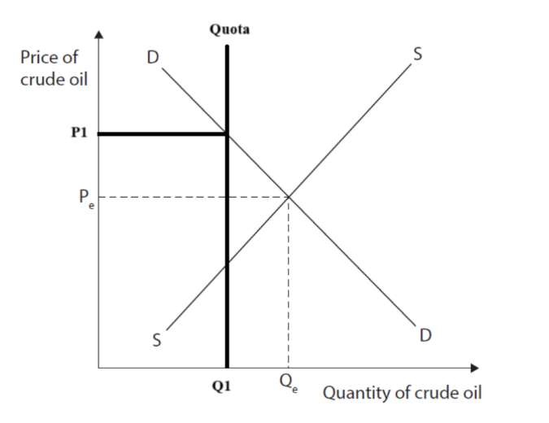

**[3 marks]**

> **[mark-scheme]**
> Award 1 mark for a perfectly inelastic supply curve, labelled
> 
> Award 1 mark for a higher equilibrium price, labelled
> 
> Award 1 mark for a lower equilibrium quantity, labelled

> **[exam-tip]**
> - A quota is drawn as a **vertical** supply curve, because the quantity allowed in is fixed by law whatever the price. That is what perfectly inelastic means
> - Introducing a quota restricts supply, so the vertical line sits to the **left** of the original equilibrium quantity, which raises the price and lowers the quantity
> - Do not draw a quota as a sloping shift like a tariff. The vertical line is what distinguishes a quantity limit from a tax, and the mark scheme requires it
Membership of a free trade area removes the tariffs and quotas that previously protected domestic firms from competition within the bloc.** [K]** The AfCFTA connects 1.3bn people across 55 countries with a combined GDP of \$3.4 trillion,** [Ap]** so South African firms now compete against producers from 54 other countries in their own home market, not only in export markets.** [An]** Many of those competitors have lower costs of production, particularly lower wage costs, so they can undercut South African prices while still covering what production costs them. South African firms therefore lose sales and must either cut their own prices, which squeezes profit margins, or watch their market share fall.** [An]** Some rivals will also have better technology or easier access to raw materials,** [Ap]** which gives them an advantage South African firms cannot close simply by working harder. Firms unable to compete face closure or must reduce their workforce,** [An]** so employment falls in the industries most exposed, and the loss is concentrated in exactly those sectors where South Africa's cost disadvantage is greatest.

**[6 marks]**

> **[mark-scheme]**
> This is a ‘levelled response’ question
> 
> - **[Ap]** = application to the data given  (3 marks)
> - **[An]** = analysis / chain of reasoning (3 marks)
> 
> Although there are no separate **[K] marks**, both application and analysis must be built on **clear and accurate economic knowledge and understanding**
> 
> Therefore, each KAA paragraph should follow:
> 
> - Valid knowledge point → Application → Analysis
> - Each valid point made in the answer does not equal a mark, the response is judged holistically against the level descriptors
> 
> **Mark allocation**
> 
> Answers are placed into one of three levels.  **A level 3 answer (5-6 marks)**, will specifically:
> 
> - Demonstrate clear knowledge and understanding by developing relevant points and include appropriate application of economic terms, concepts, theories and calculations
> - Information presented will demonstrate excellent selectivity and organisation. Interpretation of economic information will be excellent, with a thorough analysis of issues
> 
> **Alternative content**
> 
> The answer above is just one example of how to respond to this question. Additional information which could be used in the answer includes:
> 
> - Infant industries in South Africa may be unable to establish themselves when exposed to larger, established competitors
> - Firms may relocate production to lower-cost member countries, moving jobs out of South Africa
> - Any other relevant and valid analysis is acceptable

> **[exam-tip]**
> - The question asks for **disadvantages to firms**, so give no benefits and keep the focus on businesses rather than consumers. Analyse is always one-sided
> - The scale figures cut both ways, and here 55 countries means 54 sets of competitors, not just a bigger market. Use them that way round
> - Take one chain several steps, from cheaper rivals to lost sales to job cuts, rather than listing separate disadvantages
