# Exam Questions — International Trade
**The Global Economy** · Edexcel IGCSE economics (4EC1)
> Source: [https://www.savemyexams.com/igcse/economics/edexcel/17/topic-questions/](https://www.savemyexams.com/igcse/economics/edexcel/17/topic-questions/) · 53 questions across 1 sets

## Exam Questions (53 questions)

### Q1 — hard — 12 marks

**Q1** [12 marks]

The US CHIPS Act provides up to \$52.7 billion in government subsidies to support domestic semiconductor manufacturing. By January 2025, \$33.7 billion of this had been awarded to 20 companies for 32 projects, expected to create over 125,000 jobs, and the programme is estimated to have sparked \$450 billion in additional private sector investment.

Evaluate whether government subsidies like the CHIPS Act are an effective way to support a domestic industry.

### Q2 — hard — 12 marks

**Q2** [12 marks]

Since November 2020, the WTO's Appellate Body has had no members left to hear appeals, because the appointment of new members has been blocked. Historically, 68% of WTO panel rulings were appealed. The number of new disputes brought to the WTO has fallen to around one-third of the level seen before this crisis began, as countries increasingly 'appeal into the void', knowing no functioning body exists to hear their case.

Evaluate whether the WTO is still an effective organisation for promoting free trade today.

### Q3 — hard — 9 marks

**Q3** [9 marks]

The USMCA trading bloc between the USA, Mexico and Canada eliminates most tariffs between its three members. In 2024, US-Mexico goods trade reached \$839.56 billion, up from \$81.4 billion in 1993, and Canada's direct investment into the US grew over 50% to \$732.9 billion in 2024, making Canada the third-largest foreign investor in the US.

Assess whether the USMCA has benefited its member countries more than it has cost countries outside the bloc.

### Q4 — hard — 9 marks

**Q4** [9 marks]

In October 2024, the EU introduced tariffs of up to 35.3% on Chinese-made electric vehicles, on top of the existing 10% import duty, after finding that Chinese EV producers were benefiting from state subsidies. The exact tariff rate varies by producer: Tesla faces a 9% rate, cooperating Chinese producers face 21.3%, and non-cooperating producers face 36.3%.

Assess whether the EU's tariffs on Chinese electric vehicles are an effective way to protect its domestic car industry.

### Q5 — hard — 9 marks

**Q5** [9 marks]

In 2025, the US doubled its tariffs on imported steel and aluminium to 50%, up from 25%, applying to imports from almost every country, including its largest suppliers Canada and Mexico. These tariffs are estimated to affect 54% of all US goods imports by 2026.

Assess whether these tariffs have benefited the US more than they have cost it.

### Q6 — medium — 6 marks

**Q6** [6 marks]

A different fictional country, Solvara, has recently joined a new trading bloc with several neighbouring countries, agreeing to eliminate all tariffs on trade between members.

Analyse the impact of joining this trading bloc on Solvara's producers.

### Q7 — medium — 6 marks

**Q7** [6 marks]

A fictional country, Meridia, has recently imposed a strict quota on imported furniture in order to protect its small but growing domestic furniture industry.

Analyse the impact of this quota on Meridia's domestic furniture industry.

### Q8 — medium — 3 marks

**Q8** [3 marks]

Many developing countries export a narrow range of primary commodities, such as raw copper, rather than a wide range of manufactured goods.

Explain one reason why this trade pattern could be a problem for a developing country.

### Q9 — medium — 3 marks

**Q9** [3 marks]

A country removes all tariffs on imported furniture, allowing cheaper foreign furniture to enter the domestic market freely.

Explain one way this could affect domestic furniture manufacturers.

### Q10 — medium — 3 marks

**Q10** [3 marks]

A government provides a per-unit subsidy to a domestic car manufacturer that exports most of its cars overseas.

Explain one way this subsidy could benefit the car manufacturer.

### Q11 — easy — 2 marks

**Q11** [2 marks]

A government pays a subsidy of \$4 per unit to a domestic firm. The firm produces 250,000 units per year.

Calculate the total annual cost of this subsidy to the government.

### Q12 — easy — 2 marks

**Q12** [2 marks]

What is meant by the term 'trading bloc'?

### Q13 — easy — 1 marks

**Q13** [1 mark]

State one effect a government subsidy has on the price of a domestic firm's product.

### Q14 — easy — 1 marks

**Q14** [1 mark]

Define the term 'dumping'.

### Q15 — easy — 1 marks

**Q15** [1 mark]

Which one of the following is a disadvantage of using an import quota to protect a domestic industry?

### Q16 — easy — 14 marks

**Q16** [2 marks]

Figure 4 shows the tariff on clothing imported into China in 2018.

| Product Imported | Price yuan (¥) | Tariff (%) |
|---|---|---|
| Clothing | 225 | 8 |

**Figure 4**

Calculate the final selling price of clothing in yuan (¥) after the tariff has been added. You are advised to show your working.

*Source: June 2019 Paper 2R Q4A*

**Q16** [12 marks]

Following a trip to Asia in 2017 by US President Donald Trump, China has reduced tariffs from 17.3% to 7.7% on over 200 consumer products. These include pharmaceuticals, food, health supplements and clothing.

Many multinational corporations may have major financial gains. Nestle’s sales could increase by 15% or \$18.7bn because of the reduction in tariffs. Procter & Gamble, will also benefit from tariff reductions on items ranging from shampoos to electronic toothbrushes.

With reference to the data above and your knowledge of economics, evaluate the possible benefits of reducing the level of tariffs on imported goods and services to China.

*Source: June 2019 Paper 2R Q4C*

### Q17 — easy — 1 marks

**Q17** [1 mark]

A trade bloc is a group of countries that have

*Source: June 2019 Paper 2R Q1B*

### Q18 — easy — 1 marks

**Q18** [1 mark]

What term refers to a firm or country selling an export below the cost of production?

*Source: June 2019 Paper 2 Q3B*

### Q19 — hard — 9 marks

**Q19** [9 marks]

The Association of South East Asian Nations (ASEAN) is a trade bloc. It was set up in 1967 by Indonesia, Malaysia, the Philippines, Singapore and Thailand. Later it was joined by Brunei, Laos, Vietnam, Myanmar and Cambodia and became a 10 member trading bloc in 2016.

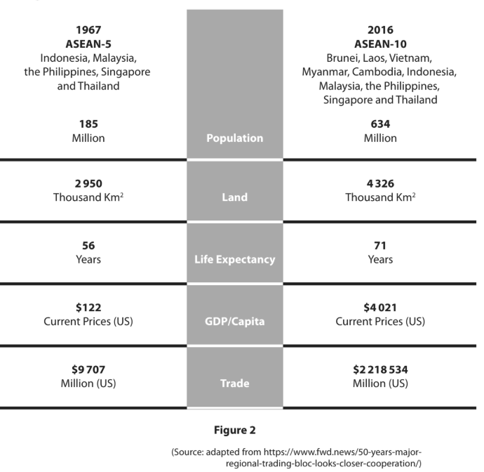

With reference to the data above and your knowledge of economics, assess the benefits for a country, such as Thailand, of being a trade bloc member.

*Source: June 2019 Paper 2 Q2G*

### Q20 — medium — 6 marks

**Q20** [3 marks]

Using the diagram below, draw the effects of the introduction of a quota on the equilibrium price and quantity of a good. Label the new curve, the new equilibrium price and new equilibrium quantity.

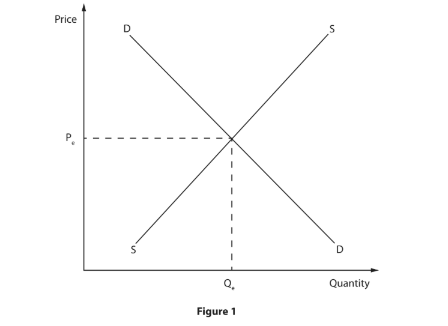

*Source: June 2019 Paper 2 Q1F*

**Q20** [3 marks]

In 2017 the US government wanted to introduce a 300% tariff on imported aircraft made by Canadian manufacturer Bombardier.

Explain **one **way the World Trade Organisation could promote free trade between countries such as Canada and the US.

*Source: June 2019 Paper 2 Q1G*

### Q21 — medium — 6 marks

**Q21** [6 marks]

The World Trade Organisation (WTO) has 164 members representing 98% of world trade. The US joined in 1995 and has been involved in 422 trade disputes.

Analyse the role of the World Trade Organisation (WTO) in the growth of international trade.

*Source: Nov 2020 Paper 2R Q4B*

### Q22 — medium — 3 marks

**Q22** [3 marks]

In December 2018, consumers in the UK were warned to avoid some imported plastic toys because they contained banned chemicals. Many were being sold through online marketplaces.

Explain **one **reason why UK consumers need protecting from some imported goods.

*Source: Nov 2020 Paper 2R Q2F*

### Q23 — easy — 11 marks

**Q23** [2 marks]

Describe **one **disadvantage of free trade for domestic businesses.

*Source: Nov 2020 Paper 2R Q1D*

**Q23** [3 marks]

Using the diagram below, draw the effect of the introduction of a new quota that is less than the original quota. Label the new curve, the new equilibrium price and the new equilibrium quantity.

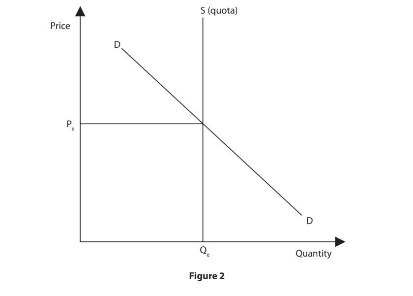

*Source: Nov 2020 Paper 2R Q1F*

**Q23** [6 marks]

In March 2018, 44 African countries signed a deal to create one of the world’s largest trade blocs, the African Continental Free Trade Area (AfCFTA). AfCFTA will create a market of 1.2bn people with a gross domestic product (GDP) of \$2.5 trillion.

Analyse the benefits to a country of being a member of the African Continental Free Trade Area (AfCFTA).

*Source: Nov 2020 Paper 2R Q1H*

### Q24 — easy — 2 marks

**Q24** [1 mark]

In 2019, India introduced tariffs against US agricultural products including apples, almonds and lentils.

Which **one **of the following diagrams shows the Indian market for apples, almonds and lentils following the introduction of the tariffs?

*Source: Nov 2020 Paper 2 Q2A*

**Q24** [1 mark]

State **one **disadvantage of free trade.

*Source: Nov 2020 Paper 2 Q2C*

### Q25 — easy — 1 marks

**Q25** [1 mark]

Which method of protection is used to reduce the price of exports?

*Source: Nov 2020 Paper 2 Q1B*

### Q26 — easy — 4 marks

**Q26** [1 mark]

Which **one **of the following is likely to result from an increase in free trade?

*Source: Jan 2020 Paper 2R Q2B*

**Q26** [3 marks]

In 2017, the tertiary sector contributed 69.3% to Germany’s GDP and the secondary sector contributed 30.1%. In comparison, the primary sector only accounted for 0.6% of GDP.

Explain a typical trade pattern for a developed country such as Germany.

*Source: Jan 2020 Paper 2R Q2F*

### Q27 — medium — 3 marks

**Q27** [3 marks]

In November 2018, China launched its first ever anti-dumping investigation against Australia over the export of Australian barley.

Explain **one **reason why a country such as Australia might export its products below the cost of production.

*Source: Jan 2020 Paper 2 Q1G*

### Q28 — easy — 10 marks

**Q28** [1 mark]

International trade that takes place with no restrictions is known as

*Source: Jan 2020 Paper 2 Q1A*

**Q28** [3 marks]

Using the diagram below, draw the effects of the introduction of a tariff on the equilibrium price and quantity of a good. Label the new curve, the new equilibrium price and quantity.

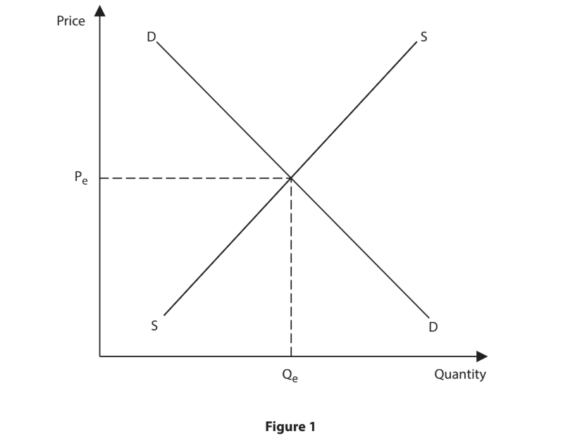

*Source: Jan 2020 Paper 2 Q1F*

**Q28** [6 marks]

Australia has referred India to the World Trade Organization (WTO) because of the \$725m subsidies it pays to its sugar cane farmers.

Analyse why the Indian Government might have given subsidies to its sugar cane farmers.

*Source: Jan 2020 Paper 2 Q1H*

### Q29 — medium — 6 marks

**Q29** [6 marks]

India is a member of the Asia-Pacific Trade Agreement (APTA). This preferential trade agreement has five members including Bangladesh, China, South Korea and Sri Lanka.

With reference to the data above and your knowledge of economics, analyse the benefits for India from being a member of a trading bloc.

*Source: Nov 2021 Paper 2 Q4B*

### Q30 — medium — 3 marks

**Q30** [3 marks]

The Government of Bangladesh provides subsidies of between 2% and 4% on the export of clothing. In 2019, it introduced additional subsidies of up to 10% for the export of 10 new products including home appliances.

Explain **one **advantage of using subsidies for a country such as Bangladesh.

*Source: Nov 2021 Paper 2 Q3C*

### Q31 — easy — 6 marks

**Q31** [1 mark]

Which **one **of the following terms refers to a physical limit on the quantity of imported products allowed into a country?

*Source: Nov 2021 Paper 2 Q1A*

**Q31** [2 marks]

What is meant by the term infant industries?

*Source: Nov 2021 Paper 2 Q1D*

**Q31** [3 marks]

In December 2019, the USA imposed a 10% tariff on toys imported from China.

Using the diagram below, draw the likely effect of the introduction of this tariff on the equilibrium price and quantity of toys imported from China. Label the new curve, the new equilibrium price and new equilibrium quantity.

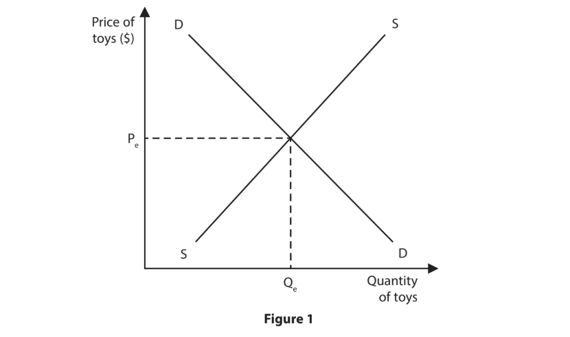

*Source: Nov 2021 Paper 2 Q1F*

### Q32 — easy — 4 marks

**Q32** [1 mark]

Member countries of a trading bloc agree to

*Source: June 2021 Paper 2 Q3B*

**Q32** [3 marks]

Brazil currently only allows a quota of 600 million litres of ethanol per year to be imported from the US.

Explain **one **advantage of using quotas for a country such as Brazil.

*Source: June 2021 Paper 2 Q3C*

### Q33 — easy — 2 marks

**Q33** [2 marks]

What is meant by the term free trade?

*Source: June 2021 Paper 2 Q2D*

### Q34 — easy — 3 marks

**Q34** [1 mark]

Which **one **of the following terms refers to a tax on imported goods?

*Source: June 2021 Paper 2 Q1B*

**Q34** [2 marks]

What is meant by the term dumping?

*Source: June 2021 Paper 2 Q1D*

### Q35 — medium — 3 marks

**Q35** [3 marks]

In 2020, the Kazakhstan Government introduced quotas of 200,000 tonnes on imported wheat and 70,000 tonnes on imported flour.

Explain **one **possible reason why the Kazakhstan Government introduced quotas on imports of wheat and flour.

*Source: June 2022 Paper 2R Q3C*

### Q36 — easy — 8 marks

**Q36** [2 marks]

What is meant by the term exports?

*Source: June 2022 Paper 2R Q1C*

**Q36** [6 marks]

In March 2020, the European Union (EU) and Vietnam reached a free trade agreement.

With reference to the data above and your knowledge of economics, analyse the disadvantages of free trade for domestic businesses located within this free trade area.

*Source: June 2022 Paper 2R Q1H*

### Q37 — hard — 9 marks

**Q37** [9 marks]

After nearly 20 years of negotiations, the European Union (EU) and Mercosur, the South American trading bloc, have agreed a draft trade deal. It would create the largest free trade area in the world consisting of 770 million people. The two blocs currently trade more than €88bn in goods and €34bn in services every year.

The EU would eventually end 92% of the tariffs on Mercosur imports. Mercosur would gradually remove its tariffs on 91% of EU goods, which amounts to €4bn. This includes removing the tariffs on clothing, chemicals, wine and canned peaches. Mercosur farmers would be allowed to export a specific quantity of beef, sugar and chicken at a lower tariff rate to the EU each year.

(Source: [https://www.dw.com/en/eu-mercosur-free-trade-deal-what-you-need-to-](https://www.dw.com/en/eu-mercosur-free-trade-deal-what-you-need-to-) know/a-49414103)

With reference to the data above and your knowledge of economics, assess the advantages of free trade for firms located within the EU.

*Source: June 2022 Paper 2 Q2G*

### Q38 — medium — 3 marks

**Q38** [3 marks]

In December 2019, the UK and the European Union (EU) negotiated North Sea fishing quotas for 2020. It was agreed to increase the fishing quota for haddock by 30%.

Using the diagram below, draw the effects of the introduction of the new quota on the equilibrium price and quantity of haddock. Label the new curve, the new equilibrium price and new equilibrium quantity.

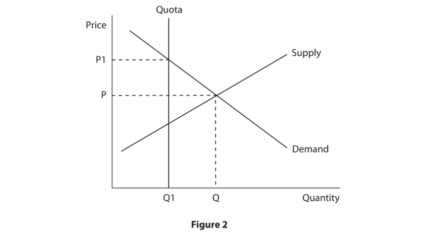

*Source: June 2022 Paper 2 Q1F*

### Q39 — easy — 8 marks

**Q39** [2 marks]

Describe **one **role of the World Trade Organization (WTO).

*Source: Nov 2023 Paper 2 Q1D*

**Q39** [3 marks]

In January 2023, China introduced a tariff on imports of large tyres.

Using the diagram below, draw the effects of the introduction of the tariff on the equilibrium price and quantity of large tyres. Label the new curve, the new equilibrium price and the new equilibrium quantity.

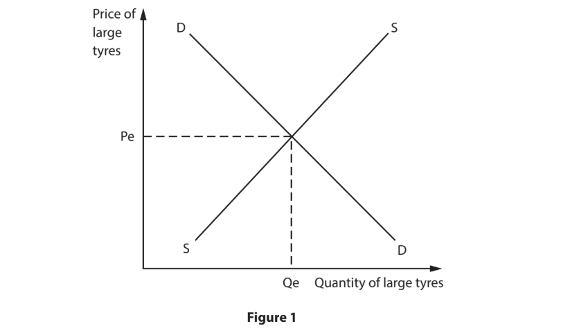

*Source: Nov 2023 Paper 2 Q1F*

**Q39** [3 marks]

In January 2023, China and Ecuador announced they would be signing a free trade agreement after a year of negotiations. The deal is expected to boost Ecuador’s exports of shrimp, bananas, flowers, cocoa and coffee to China.

Explain **one **advantage of free trade for businesses in Ecuador.

*Source: Nov 2023 Paper 2 Q1G*

### Q40 — easy — 4 marks

**Q40** [1 mark]

State **one **advantage of free trade.

*Source: Jan 2023 Paper 2R Q2C*

**Q40** [3 marks]

China announced that in 2021 it would increase its import quota for crude oil by 20%.

Using the diagram below, draw the effect of the introduction of the new quota. Label the new curve, the new equilibrium price and the new equilibrium quantity.

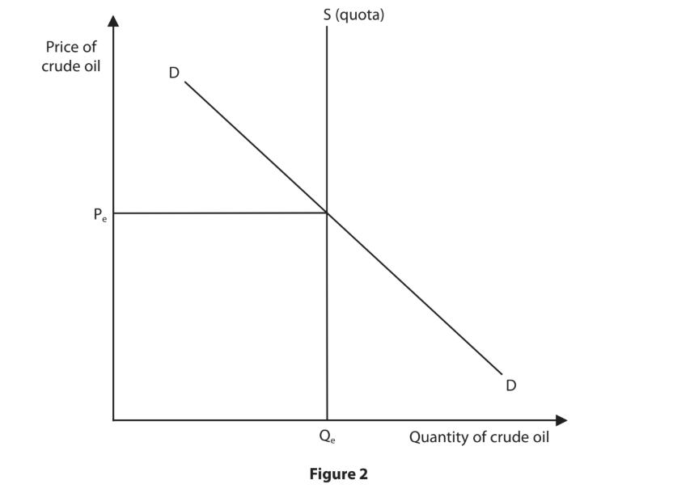

*Source: Jan 2023 Paper 2R Q2F*

### Q41 — medium — 3 marks

**Q41** [3 marks]

In December 2020, the European Union (EU) decreased the 8% import tariff on lobsters from the US.

Using the diagram below, draw the effects of the decrease in the tariff on the equilibrium price and quantity of US lobster imports into the EU. Label the new curve, the new equilibrium price and new equilibrium quantity.

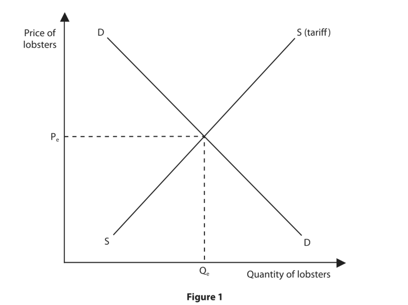

*Source: Jan 2023 Paper 2R Q1F*

### Q42 — easy — 6 marks

**Q42** [1 mark]

Which **one **of the following is a role of the World Trade Organization (WTO)?

*Source: Jan 2023 Paper 2 Q1A*

**Q42** [2 marks]

Describe **one **advantage of free trade for consumers.

*Source: Jan 2023 Paper 2 Q1D*

**Q42** [3 marks]

In May 2020, China introduced a tariff of 80% on Australian barley.

Using the diagram below, draw the effects of the introduction of a tariff on the equilibrium price and quantity of Australian barley. Label the new curve, the new equilibrium price and new equilibrium quantity.

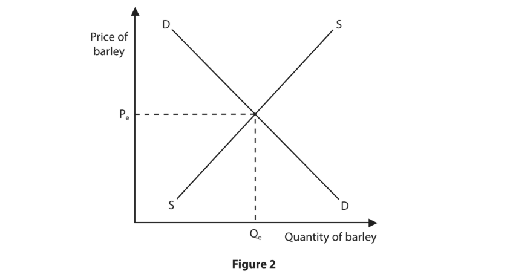

*Source: Jan 2023 Paper 2 Q1F*

### Q43 — hard — 12 marks

**Q43** [12 marks]

In October 2023, India was once again considering joining the Regional Comprehensive Economic Partnership (RCEP).

The RCEP is the world’s largest trading bloc, accounting for about 30% of global trade. It consists of 15 member countries including China, Japan and South Korea, the three largest economies in Asia.

India withdrew from RCEP negotiations in 2019, saying that it had concerns about the impact of the agreement on its domestic industries, particularly agriculture and manufacturing.

The Indian Government has been in talks with RCEP member countries to obtain a fair and balanced trade deal that would benefit all stakeholders.

With reference to the data above and your knowledge of economics, evaluate the possible benefits for India of joining the RCEP trading bloc.

*Source: Nov 2024 Paper 2 Q4C*

### Q44 — easy — 1 marks

**Q44** [1 mark]

Which **one **of the following is an advantage of a government giving subsidies to domestic producers?

*Source: Nov 2024 Paper 2 Q3A*

### Q45 — easy — 1 marks

**Q45** [1 mark]

Which **one **of the following is a reason why there is protection for international trade?

*Source: Nov 2024 Paper 2 Q2B*

### Q46 — medium — 3 marks

**Q46** [3 marks]

In August 2024, India removed a tariff on imports of tomatoes from Nepal.

Using the diagram below, draw the effects of the removal of the tariff on the equilibrium price and quantity of tomatoes in India. Label the new curve, the new equilibrium price and the new equilibrium quantity.

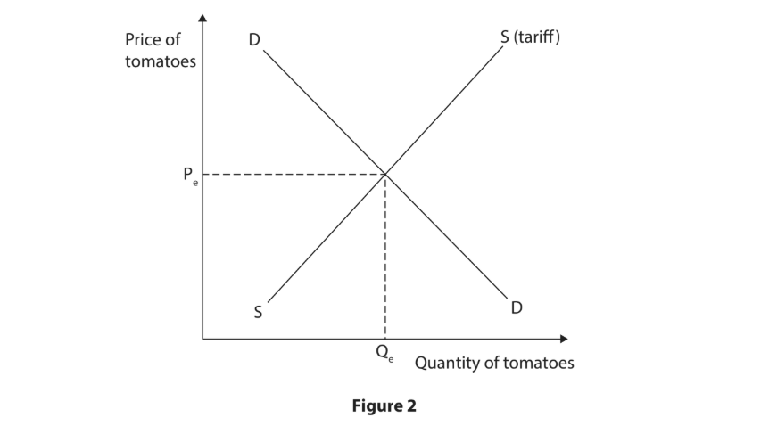

*Source: Nov 2024 Paper 2 Q1F*

### Q47 — medium — 6 marks

**Q47** [6 marks]

Costa Rica is a developing country that relies on the export of agricultural commodities such as coffee, bananas, pineapples and vegetables. In 2022, exports from Costa Rica to the UK were valued at £516m. Vegetables and fruit accounted for 73.4% of all goods exported to the UK from Costa Rica.

With reference to the data above and your knowledge of economics, analyse how the trade patterns may differ between a developed and a developing country.

*Source: June 2024 Paper 2R Q4B*

### Q48 — hard — 9 marks

**Q48** [9 marks]

Brazilian tyre producers previously had a fall in production caused by an increase in imports. As a result, producers were warning that they might need to stop production, which would result in job losses.

In March 2023, the Brazilian Government put an import tariff on tyres. The tariff on tyres increased from 0% to 16%. A government source said, “The previous government believed in more open trade. The current one has a different view and they think they must protect domestic producers.”

With reference to the data above and your knowledge of economics, assess the possible benefits for the Brazilian economy of introducing a tariff on tyres.

*Source: June 2024 Paper 2R Q3E*

### Q49 — easy — 1 marks

**Q49** [1 mark]

Which **one **of the following describes a role of the World Trade Organization (WTO)?

*Source: June 2024 Paper 2R Q2B*

### Q50 — medium — 6 marks

**Q50** [6 marks]

In March 2023, the UK joined the Comprehensive and Progressive Agreement for Trans‐Pacific Partnership (CPTPP), an 11‐member Asia‐Pacific trading bloc, after two years of negotiations. The current members of the CPTPP are Australia, Canada, Japan, Mexico, New Zealand, Singapore, Brunei, Chile, Malaysia, Peru and Vietnam.

With reference to the data above and your knowledge of economics, analyse the advantages for UK firms of the UK joining the CPTPP trading bloc.

*Source: June 2024 Paper 2R Q1H*

### Q51 — medium — 3 marks

**Q51** [3 marks]

The UK Government has removed the 12% import tariff on palm oil from Malaysia.

Using the diagram below, draw the effects of the removal of the tariff on the equilibrium price and quantity of palm oil imported into the UK from Malaysia. Label the new curve, the new equilibrium price and the new equilibrium quantity.

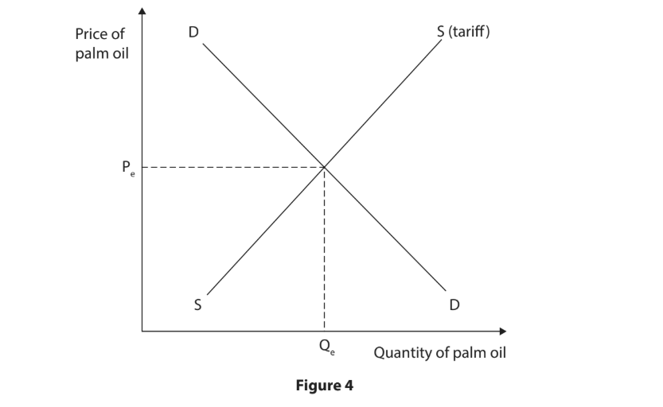

*Source: June 2024 Paper 2 Q3C*

### Q52 — hard — 9 marks

**Q52** [9 marks]

In 2022, President Biden introduced legislation to increase investment in green technology in the US. Subsidies of \$369bn are given through grants, loans and tax credits to public and private firms.

These subsidies are to be used to increase battery, solar panel and wind turbine production in the US creating new factories and millions of new green jobs in the country.

There is widespread opinion amongst EU and UK politicians and business leaders that US subsidies will have a negative impact on their economies.

With reference to the data above and your knowledge of economics, assess the possible benefits for the US of giving subsidies for green technology.

*Source: June 2024 Paper 2 Q2G*

### Q53 — medium — 9 marks

**Q53** [3 marks]

In January 2023, China introduced a quota on imports of crude oil into the country.

Using the diagram below, draw the effects of the introduction of the quota on the equilibrium price and quantity of crude oil in China. Label the new curve, the new equilibrium price and the new equilibrium quantity.

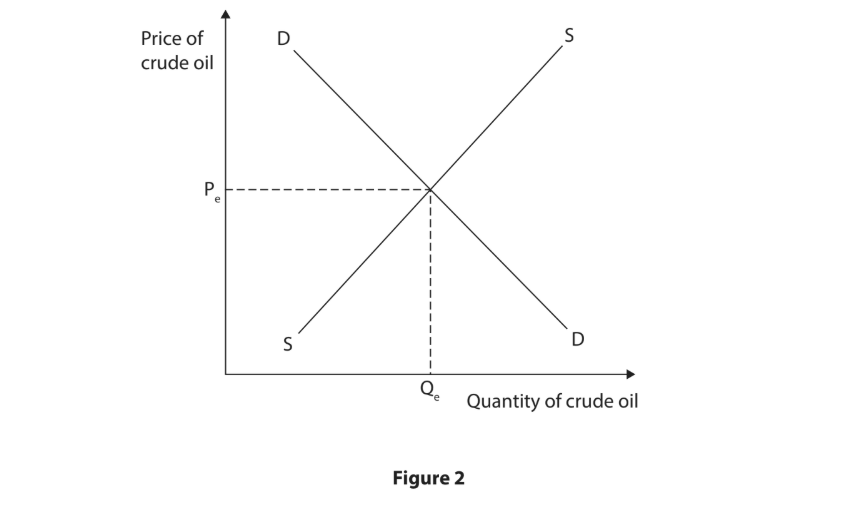

*Source: June 2024 Paper 2 Q1F*

**Q53** [6 marks]

The African Continental Free Trade Area (AfCFTA) is a free trade area that includes most of Africa. It connects 1.3bn people across 55 countries with a combined gross domestic product (GDP) of \$3.4 trillion. South Africa is an important member of the AfCFTA.

With reference to the data above and your knowledge of economics, analyse the disadvantages to firms in South Africa of being a member of the AfCFTA.

*Source: June 2024 Paper 2 Q1H*

