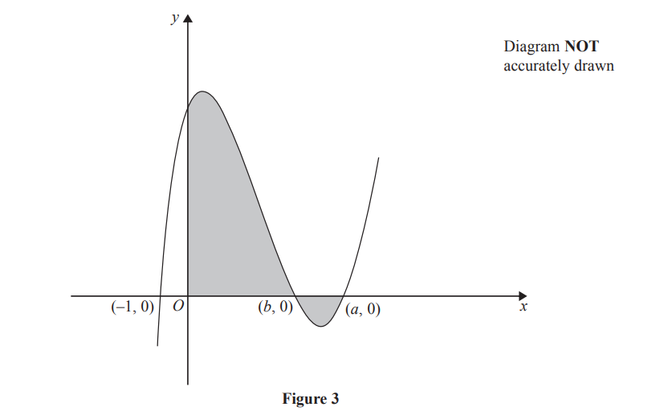
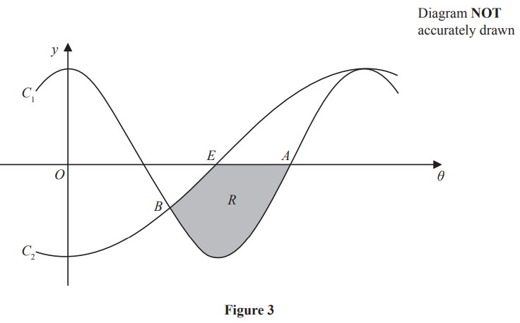

# Exam Questions — Integration
**Calculus** · Edexcel IGCSE Further Pure Maths (4PM1)
> Source: [https://www.savemyexams.com/igcse/further-maths/edexcel/19/topic-questions/calculus/integration/exam-questions/](https://www.savemyexams.com/igcse/further-maths/edexcel/19/topic-questions/calculus/integration/exam-questions/) · 5 questions · total 62 marks

## Q1 — medium — 8 marks · exam-questions

### 11((a)) — 8 marks — structured — from paper Specimen · 4PM1/01

Figure 3 shows a sketch of the curve with equation  $y=f(x)$, which passes through the points with coordinates $(-1,0),(b,0)$ and $(a,0)$ where $0<b<a.$

Given that $f'(x)=6x^{2}--26x+12$ find,

(i) the value of $a$,

(ii) the value of $b$.

## Q2 — medium — 7 marks · exam-questions

### 5((a)) — 2 marks — structured — from paper Specimen · Paper 2
Show that $\mathrm{cos}(A--B)--\mathrm{cos}(A+B)=2\mathrm{sin}A\mathrm{sin}B$

### 5((b)) — 1 mark — structured — from paper Specimen  · Paper 2
Hence express $2\mathrm{sin}5x\mathrm{sin}3x$ in the form  $\mathrm{cos}mx--\mathrm{cos}nx$where $m$ and  $n$ are integers, giving the value of $m$ and the value of $n$,

### 5((c)) — 4 marks — structured — from paper Specimen · Paper 2
(i) Find $\int 4 \sin 5 \\theta \sin 3 \\theta \mathrm{d} \\theta$

(ii) Hence evaluate `integral _ 0 ^ pi / 6 end ^ 4 sin 5 theta sin 3 theta d theta`, giving your answer in the form  $\frac{a\sqrt{b}}{c}$ where $a$, $b$ and  $c$ are integers.

## Q3 — medium — 16 marks · exam-questions

### 11((a)) — 4 marks — structured — from paper June 2024 · Paper 2
Using [formulae ](https://cdn.savemyexams.com/uploads/2026/02/33569-EDX%20IGCSE%20Further%20Pure%20Maths%20Formulae%20Sheet.pdf), show that

(i) $\mathrm{cos}2A=2\mathrm{cos}^{2}A-1$

(3)

(ii) $\mathrm{sin}2A=2\mathrm{sin}A\mathrm{cos}A$

(1)

### 11((b)) — 4 marks — structured — from paper June 2024 · Paper 2
Show that $\mathrm{cos}^{3}A=\frac{\mathrm{cos}3A+3\mathrm{cos}A}{4}$

### 11((c)) — 4 marks — structured — from paper June 2024 · Paper 2
Hence, or otherwise, solve, giving exact values in terms of $π$

$8 \text{cos} ^{3} ( \frac{ \theta }{2} ) - 6 \text{cos} ( \frac{ \theta }{2} ) - 1 = 0$   for `0 less-than or slanted equal to theta less-than or slanted equal to 2 pi`

### 11((d)) — 4 marks — structured — from paper June 2024 · Paper 2
use algebraic integration to find the exact value of

`integral _ 0 ^ pi / 6 end ^ ( 4 cos ^3 theta - sin 2 theta ) d theta`

## Q4 — medium — 14 marks · exam-questions

### 9((a)) — 2 marks — structured — from paper November 2024 · Paper 2
Using a [formula](https://cdn.savemyexams.com/uploads/2026/02/33569-EDX%20IGCSE%20Further%20Pure%20Maths%20Formulae%20Sheet.pdf), show that

$\mathrm{cos}2θ=2\mathrm{cos}^{2}θ-1$

### 9((b)) — 4 marks — structured — from paper November 2024 · Paper 2
Using a [formula](https://cdn.savemyexams.com/uploads/2026/02/33569-EDX%20IGCSE%20Further%20Pure%20Maths%20Formulae%20Sheet.pdf), show that

$\mathrm{cos}2θ=2\mathrm{cos}^{2}θ-1$

Hence show that

$\int_{ \frac{\pi }{3} }^{\frac{3 \pi }{4}} ( 2 \cos ^{2 } \\theta - 1 )   d \\theta = - \frac{a + \sqrt{b} }{c}$

where $a$, $b$ and $c$ are integers to be found.

### 9((c)) — 8 marks — structured — from paper November 2024 · Paper 2

Figure 3 shows part of the curve $C_{1}$ with equation $y=2\mathrm{cos}^{2}θ-1$and part of the curve $C_{2}$ with equation $y=-\mathrm{cos}θ$

Point $B$ is the intersection of  $C_{1}$ and $C_{2}$ as shown in Figure 3

Point $A$$( \frac{3 \mathrm{\pi } }{4} , 0 )$ is the intersection of  $C_{1}$ with the $θ$-axis as shown in Figure 3

Point $E$ $( \frac{\pi }{2} , 0 )$ is the intersection of  $C_{2}$ with the $θ$-axis as shown in Figure 3

The finite region $R$, shown shaded in Figure 3, is bounded by the $θ$-axis, $C_{1}$ and $C_{2}$

Use calculus to find, in its simplest form, the exact area of  $R$

## Q5 — medium — 17 marks · exam-questions

### 10((a)) — 3 marks — structured — from paper November 2023 · Paper 1
Using [formulae](https://cdn.savemyexams.com/uploads/2026/02/33569-EDX%20IGCSE%20Further%20Pure%20Maths%20Formulae%20Sheet.pdf) , show that

(i) $\mathrm{sin}2A=2\mathrm{sin}A\mathrm{cos}A$

(ii) $\mathrm{cos}2A=2\mathrm{cos}^{2}A-1$

### 10((b)) — 4 marks — structured — from paper November 2023 · Paper 1
$f ( \\theta ) = \frac{2 \tan \\theta }{1 + \tan ^{2} \\theta }$

Show that $f(θ)=\mathrm{sin}2θ$

### 10((c)) — 6 marks — structured — from paper November 2023 · Paper 1
Solve, in radians to 3 significant figures, for `negative pi over 2 less-than or slanted equal to x less-than or slanted equal to pi over 2`, the equation

$5 \tan ( x + \frac{\pi }{6} ) = [ 1 + \tan ^{2} ( x + \frac{\pi }{6} ) ] [ 1 - 2 \cos ^{2} ( x + \frac{\pi }{6} ) ]$

### 10((d)) — 4 marks — structured — from paper November 2023 · Paper 1
Using calculus, find the exact value of

$\int_{0}^{ \frac{\pi }{2} } ( \frac{4 \tan \\theta }{1 + \tan ^{2} \\theta } - \cos 5 \\theta + 2 )   \mathrm{d} \\theta$
