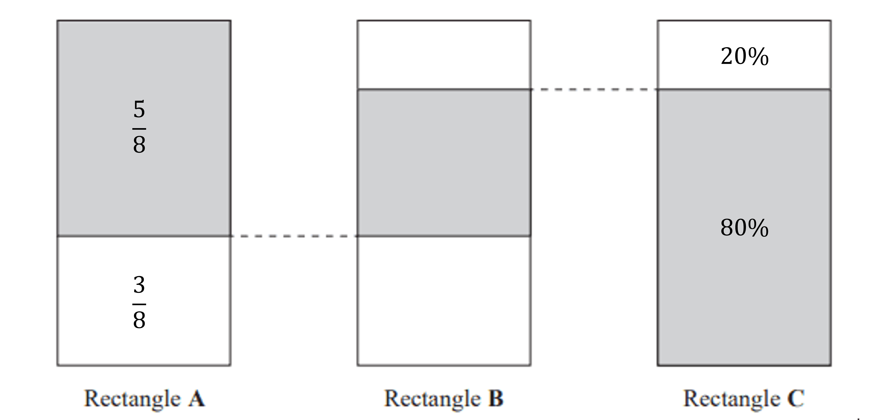

# Mark Schemes — Fractions, Decimals & Percentages
**1. Numbers & the Number System** · Edexcel IGCSE Maths A (4MA1) — 18/Foundation

## Q1 — easy — 2 marks · exam-questions

### 1((c)) — 1 marks
> **[exam-tip]**
> Remember, you can use your calculator. The fraction can simply be entered and your calculator can change it to a decimal.
> 
> A non-calculator method is demonstrated below.

> *Convert the denominator to a power of 10, for example 10, by using equivalent fractions*

$\begin{gathered} 1 \frac{1}{5} & = \frac{1 \times 2}{5 \times 2} \\ = \frac{2}{10} \end{gathered}$

> *The fraction is equivalent to 2 tenths and is written as 2 in the tenths column in decimal form*

$0.2$

**[B1]**

### 1((d)) — 1 marks
> **[exam-tip]**
> Remember, you can use your calculator. You can just multiply the fraction by 100.
> 
> A non-calculator method is demonstrated below.

> *Percentage means parts out of 100*

> *Use equivalent fractions to write *$\frac{7}{10}$* as a fraction with a denominator of 100*

$\begin{gathered} \frac{7}{10} & = \frac{7 \times 10}{10 \times 10} \\ = \frac{70}{100} \end{gathered}$

> *The fraction is 70 parts out of 100 and is therefore equivalent to 70%*

**Final answer:** **70%**

**[B1]**

## Q2 — hard — 3 marks · exam-questions

### 19() — 3 marks
> *Calculate the proportions of rectangle A and rectangle C that are unshaded*

$\begin{gathered} 1 - \frac{5}{8} & = \frac{3}{8} \\ 100 \% - 80 \% & = 20 \% \end{gathered}$

**[M1]**

> *Label the shaded and unshaded parts for rectangle A and rectangle C using the diagram provided (as shown below)*

> *Use the diagram to work out the calculation that gives the shaded section for rectangle B*

$\frac{5}{8} - 20 \%$

**[M1]**

> *Convert both numbers in the calculation to the same form (working in fractions, decimals or percentages will give the same result)*

$\frac{5}{8}-\frac{1}{5}=\frac{17}{40}$

$\frac{17}{40}$

**[A1]**

> **[mark-scheme]**
> **M1**: The first mark is awarded for showing the unshaded part for *either* rectangle A *or* rectangle C  (this can be in equivalent fraction, decimal or percentage form) *or *for calculating the unshaded part in rectangle C i.e.$\frac{1}{5}+\frac{3}{8}=\frac{23}{40}$
> 
> **M1**: Any equivalent calculation in fraction, decimal or percentage form will gain this mark.
> 
> **A1**: The answer must be a fraction as stated in the question.

## Q3 — easy — 2 marks · exam-questions

### 1((c)) — 1 marks
> *Divide 3 by 100*

**Final answer:** **0.03**

**[B1]**

### 1((d)) — 1 marks
> *Use an equivalent fraction with a denominator of 100 because percent is out of 100*

$\frac{7}{50}=\frac{?}{100}$

> *Multiply 50 by 2 to get 100 so do the same to 7*

$\frac{7}{50}=\frac{14}{100}$

> *The numerator is your percentage*

**Final answer:** **14%**

**[B1]**

> **[exam-tip]**
> Alternatively, you can just use your calculator to multiply it by 100.

## Q4 — easy — 2 marks · exam-questions

### 5((b)) — 1 marks
> *"Per-cent" means "out of 100" so write an equivalent fraction out of 100*

$\frac{3}{10} = \frac{30}{100} = 30 \%$

**Final answer:** **30%**

**[B1]**

### 5((c)) — 1 marks
> *Divide the top and the bottom by the highest common factor*

$\frac{48}{150}=\frac{48\div6}{150\div6}=\frac{8}{25}$

$\frac{8}{25}$

**[B1]**

> **[exam-tip]**
> You can use your calculator to check that you have simplified the fraction as much as possible.

## Q5 — easy — 4 marks · exam-questions

### 3((a)) — 1 marks
> *The 3 is in the hundredths column*

$\frac{3}{100}$

**[B1]**

### 3((b)) — 1 marks
> *Multiply the decimal by 100 to convert it to a percentage*

**Final answer:** **90%**

**[B1]**

### 3((c)) — 1 marks
> *Look for the smallest number in the tenths column*

> *There are two numbers with a 2 in the tenths column*

- *Of these two, look for the smallest number in the hundredths column*

`0.2 bottom 0 4 , 0.24`

> *For the three numbers with a 4 in the tenths column, look at the numbers in the hundredths column*

> **[exam-tip]**
> You can use a placeholder if needed. For example, 0.4 is the same as 0.40 and 0.400.

`0.4 bottom 0 , 0.4 bottom 0 8 , 0.48`

**Final answer:** **0.204, 0.24, 0.4, 0.408, 0.48**

**[B1]**

### 3((d)) — 1 marks
> *Convert *$\frac{7}{10}$* to a decimal*

$\frac{7}{10}=0.7$

> *Add the decimals together*

`0.93 bottom + 0.70 1.63`

**Final answer:** **1.63**

**[B1]**

## Q6 — easy — 2 marks · exam-questions

### 1() — 1 marks
Divide the numerator by the denominator

$3\div5=0.6$

**Final answer:** **0.6**

**[B1]**

### 2() — 1 marks
Change the fraction into a decimal by dividing the numerator by the denominator

$3\div20=0.15$

Multiply the decimal by 100

$0.15\times100=15$

**Final answer:** **15%**

**[B1]**

## Q7 — easy — 3 marks · exam-questions

### 1() — 3 marks
Change the fractions into decimals by dividing the numerator by the denominator

$3\div11=0.273\,7\div26=0.269\,$

**[M1]**

Change the percentage to a decimal

$23\div100=0.23$

**[M1]**

Order from smallest to largest

$0.23,0.26,0.267,0.269,0.273$

Rewrite in the original format

$23 \% 0.26 0.267 \frac{7}{26} \frac{3}{11}$

**[A1]**
