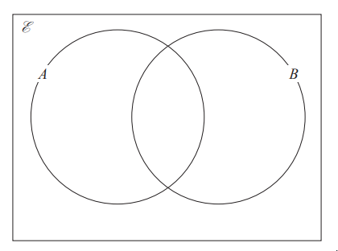
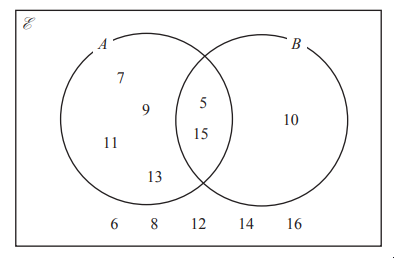
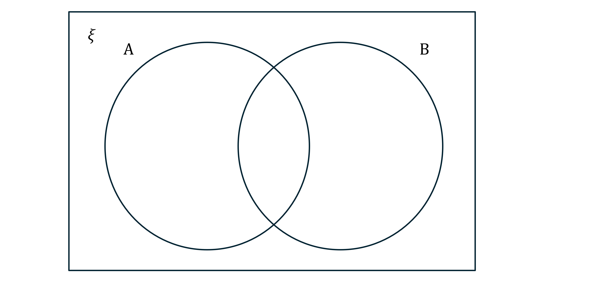

# Exam Questions — Set Notation & Venn Diagrams
**1. Numbers & the Number System** · Edexcel IGCSE Maths A (4MA1) — 18/Foundation
> Source: [https://www.savemyexams.com/igcse/maths/edexcel/a/18/foundation/topic-questions/numbers-and-the-number-system/set-notation-and-venn-diagrams/exam-questions/](https://www.savemyexams.com/igcse/maths/edexcel/a/18/foundation/topic-questions/numbers-and-the-number-system/set-notation-and-venn-diagrams/exam-questions/) · 4 questions · total 16 marks

## Q1 — easy — 5 marks · exam-questions

### 6((a)) — 3 marks — command: complete — structured — from paper Specimen paper · 4MA1/1F
`calligraphic E = { 1 , 2 , 3 , 4 , 5 , 6 , 7 , 8 , 9 , 10 , 11 , 12 }` 
$A = \{ 1 , 2 , 3 , 4 , 6 , 12 \}$
$B = \{ 2 , 3 , 5 , 7 , 11 \}$

Complete the Venn diagram to show this information.

### 6((b)) — 2 marks — command: list — structured — from paper Specimen paper · 4MA1/1F
List the members of the set

(i)  $A\capB$

(ii)  $B'$

## Q2 — medium — 3 marks · exam-questions

### 15() — 3 marks — command: complete — structured — from paper 2023 June · 4MA1/1F
`calligraphic E = { 5 , 6 , 7 , 8 , 9 , 10 , 11 , 12 , 13 , 14 , 15 , 16 , 17 , 18 , 19 , 20 }`

`A = { odd numbers } B = { multiples of 5 }`

Complete the Venn diagram for this information.

## Q3 — medium — 3 marks · exam-questions

### 15((a)) — 1 mark — command: list — structured — from paper 2023 Nov · 4MA1/1F
Here is a Venn diagram.

List the members of the set $A$

### 15((b)) — 1 mark — command: list — structured — from paper 2023 Nov · 4MA1/1F
List the members of the set $A\capB$

### 15((c)) — 1 mark — command: list — structured — from paper 2023 Nov · 4MA1/1F
List the members of the set $( A \cup B ) '$

## Q4 — medium — 5 marks · exam-questions

### 1() — 3 marks — command: complete — structured
`xi = { 2 , 4 , 6 , 8 , 10 , 12 , 14 , 16 , 18 , 20 , 22 , 24 , 26 , 28 , 30 } A = { Multiples of 3 } B = { Factors of 12 }`

Complete the Venn diagram to show this information.

### 2() — 1 mark — command: list — structured
List the members of the set  $A\capB$.

### 3() — 1 mark — command: find — structured
Find  $\mathrm{n} ( A \cup B )$
