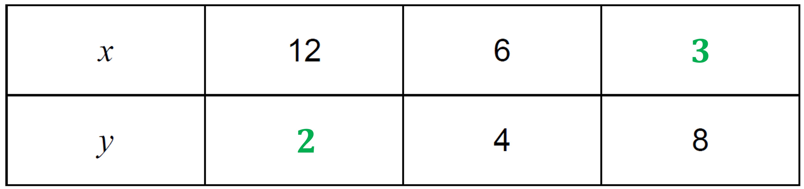
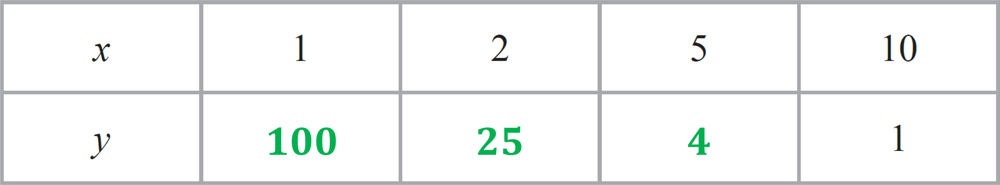
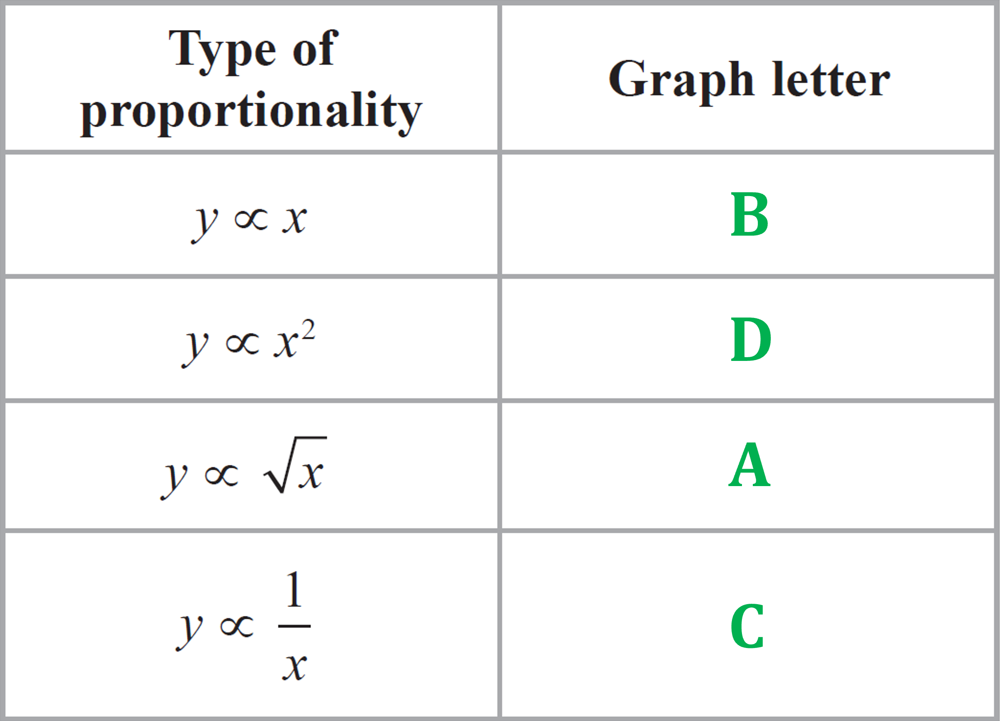
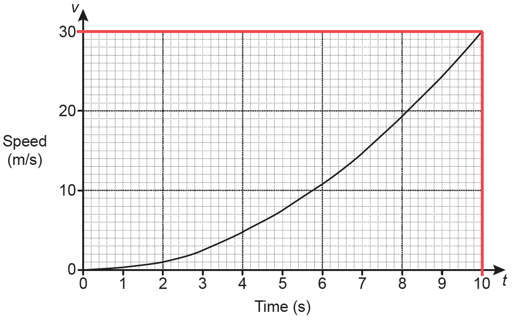
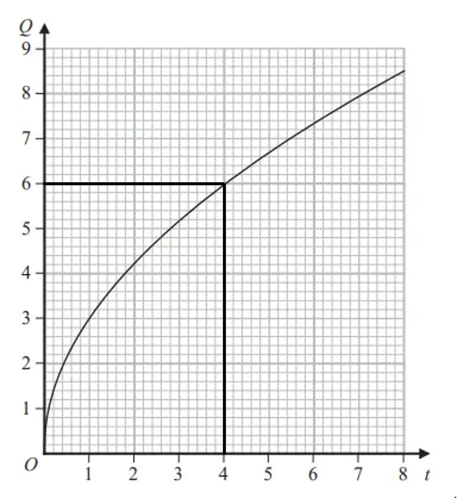
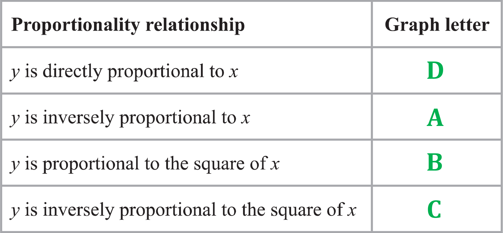

# Mark Schemes — Direct & Inverse Proportion
**Numbers & the Number System** · Edexcel IGCSE Maths A (4MA1) — 18/Higher

## Q1 — medium — 3 marks · exam-questions

### 9() — 3 marks
> *It may not be obvious at first, but this is an inverse proportion question.  *
*The number of hours spent by each cleaner is inversely proportional to the number of cleaners.*
*Use the inverse proportion relationship  *$y=\frac{k}{x}$*,  with **y** as the number of hours per cleaner and **x** as the number of cleaners  Then use the numbers in the question to find the value of **k**.*

$\begin{gathered} 4.5 & = \frac{k}{5} \\ 4.5 \times 5 & = k \\ 22.5 & = k \end{gathered}$

**[1]**

> *Now use the value of **k** to find the number of hours spent by each cleaner when the number of cleaners is 3.*

$\begin{gathered} y & = \frac{22.5}{3} \\ y & = 7.5 \end{gathered}$

**[1]**

> *Be careful now!  The cleaners are paid £8.20 for each hour **or part of an hour** that they work.  *
*So you need to multiply £8.20 by **8** to find the amount each cleaner will be paid. *
*Remember to give your final answer to 2 decimal places, as we are talking about money.*

$\begin{gathered} 8.20 \times 8 & = 65.6 \end{gathered}$

**£65.60****  [1]**

## Q2 — medium — 3 marks · exam-questions

### 24() — 3 marks
> *Use the inverse proportion relationship  *$p=\frac{k}{t}$*,  and substitute the known values of **p** and **t**  from the question.*

$\begin{gathered} 12 & = \frac{k}{4} \end{gathered}$

**[1]**

> *Solve that equation to find the value of **k**.*

$\begin{gathered} 12 \times 4 & = k \\ 48 & = k \end{gathered}$

**[1]**

> *Now use the equation with that value of **k** and the new value of **t** to find the corresponding value of **p.*

$\begin{gathered} p & = \frac{48}{6} \end{gathered}$

**p**** = 8****  [1]**

## Q3 — medium — 3 marks · exam-questions

### 13() — 3 marks
> *Use the inverse proportion relationship  *$d=\frac{k}{c}$*,  and substitute the known values of **c** and **d** from the question.*

$\begin{gathered} 25 & = \frac{k}{280} \end{gathered}$

**[1]**

> *Solve that equation to find the value of **k**.*

$\begin{gathered} 25 \times 280 & = k \\ 7000 & = k \end{gathered}$

**[1]**

> *Now use the equation with that value of **k** and the new value of **c** to find the corresponding value of **d.*

$\begin{gathered} d & = \frac{7000}{350} \end{gathered}$

**d**** = 20**** [1]**

## Q4 — medium — 3 marks · exam-questions

### 10() — 3 marks
> *Use the inverse proportion relationship  *$y=\frac{k}{x}$*,  and substitute the known values of **x** and **y** from the question.*

$\begin{gathered} 36 & = \frac{k}{1.5} \end{gathered}$

**[1]**

> *Solve that equation to find the value of **k**.*

$\begin{gathered} 36 \times 1.5 & = k \\ 54 & = k \end{gathered}$

**[1]**

> *Now use the equation with that value of **k** and the new value of **x** to find the corresponding value of **y.*

$\begin{gathered} y & = \frac{54}{6} \end{gathered}$

**y**** = 9****  [1]**

## Q5 — medium — 4 marks · exam-questions

### 6((a)) — 3 marks
> *Substitute the values of **x** into the formula to find the corresponding values of **T**.*

$\begin{gathered} T_{1200} & = \frac{4500}{1200} = 3.75 \\ \\ T_{2500} & = \frac{4500}{2500} = 1.8 \end{gathered}$

**[1]**

> *Now subtract the two values to find the difference. Remember to give your final answer as degrees Celsius.*

$\begin{gathered} 3.75 - 1.8 & = 1.95 \end{gathered}$

**[1]**

**Final answer:** $1.95^{\circ}C$**  [1]**

### 6((b)) — 1 marks
> *You need to know what the graphs look like for the different proportionality relationships.  See the revision notes on proportion for examples of these. Note however that 'inversely proportional' means that one variable is going down while the other is going up, so B and D are the only possible options here.  D, however, is the correct answer.*

**D****  [1]**

## Q6 — medium — 4 marks · exam-questions

### 17((a)) — 3 marks
> *Use the inverse proportion relationship *$T=kr^{3}$*,  and substitute the known values of **T** and **r**  from the question.*

$\begin{gathered} 21.76 & = k \times 4^{3} \end{gathered}$

**[1]**

> *Then solve this equation to find the value of **k**.*

$\begin{array}{rcl} k = \frac{21.76}{4^{3}} \\ = 0.34 \end{array}$

**[1]**

> *Rewrite the inverse proportion relationship replacing **k** with 0.34.*

$T=0.34r^{3}$**  [1]**

### 17((b)) — 1 marks
> *Replace **r** with 6 in the formula from part (a).*

$T=0.34\times6^{3}$

> *Evaluate.*

$T=73.44$ **[1]**

## Q7 — medium — 2 marks · exam-questions

### 10() — 2 marks
> *Use the inverse proportion relationship  *$y=\frac{k}{x}$*,  and substitute the known corresponding values of **y** and **x** from the question (i.e., **y** = 4 when **x** = 6). *
*Then solve this equation to find the value of **k**.*

$\begin{gathered} 4 & = \frac{k}{6} \\ 4 \times 6 & = k \\ 24 & = k \end{gathered}$

> *Now use the equation with that value of **k** and the unpaired values of **x** and **y** to find the corresponding values of the other variable**. **First when **x **= 12.*

$\begin{gathered} y & = \frac{24}{12} = 2 \end{gathered}$

> *Then when **y** = 8.*

$8=\frac{24}{x}\,\,x=\frac{24}{8}=3$

> *Finally enter those values in the table.*

**  [2]**

**2 marks for both values in the table correct (no working required). **
**1 mark for one value correct, for finding the value k = 24, or for correctly setting up the equation 4 = k/6.**

## Q8 — medium — 4 marks · exam-questions

### 9() — 4 marks
> *Call the rate of flow "**R** ", and call the angle of turn "**T** ". *
*Use the direct proportion relationship  *$R=kT$*,  and substitute the known corresponding values **R **= 14 and **T** = 180 from the question. *
*Then solve to find the value of **k**.*

$14=k\times180\,\,k=\frac{14}{180}=\frac{7}{90}$

**[1]**

> *Now use the equation with that value of **k**. Substitute in **T **= 135 to find the corresponding value of **R**.*

$\begin{gathered} R & = \frac{7}{90} \times 135 = 10.5 \end{gathered}$

**[1]**

> *So with the tap at 135°, the rate is 10.5 litres per minute. *
*Now divide the size of the tank (79.8 litres) by the rate (10.5 litres/min) to find out how many minutes it will take to fill the tank**.*

$\begin{array}{rcl} 79.8 \div 10.5 & = 7.6 \text{minutes} \end{array}$

**[1]**

*State your conclusion.*

**It will take 7.6 minutes to fill the tank.  That is longer than 7**$\frac{1}{2}$** = 7.5 minutes.  So no, it will not take less than 7**$\frac{1}{2}$** minutes to fill the tank.****  [1]**

**There are other ways to answer this question.  Any correct method supported by correct working will earn full marks.**

## Q9 — medium — 4 marks · exam-questions

### 17((a)) — 3 marks
> *Start by multiplying 15 by 4 by 8 to see how many 'person work hours' are required to complete the task.*

$15\times4\times8=480$

**[1]**

> *For 5 people and 6 hours per day, call the number of days that will be required "**d** ". *
*Then **d** × 5 × 6 also has to be equal to 480.*

$\begin{array}{rcl} d \times 5 \times 6 & = 480 \\ 30 d & = 480 \\ d & = 480 \div 30 \\ d & = 16 \end{array}$

**[1]**

**16 days**** [1]**

### 17((a)) — 1 marks
> *The answer relies on the assumption that every 'person work hour' is the same as every other one!*

**It is assumed that each worker does the same amount of work in an hour.  If some people worked slower then the actual answer would be higher, or if some people worked faster then the actual answer would be lower.****  ****[1]**

## Q10 — medium — 1 marks · exam-questions

### 4() — 1 marks
> *From your knowledge of proportionality graphs you should know that the graph for direct proportion is a straight line. *
*So that rules out graph C.*

> *You should also know that with direct proportion, if one variable goes up then the other goes up to. *
*That means that the graph will go 'up to the right'. *
*So that rules out graph A.*

> *How about graphs B and D then? *
*Remember that the direct proportion equation is **y **=** kx**. *
*That means that when **x **is 0, then **y** = **k**(0) = 0  (and that is true whatever **k** is equal to!). *
*And that means that the direct proportion graph must go through the origin (0, 0). *
*So that rules out graph B.*

**Graph D**** [1]**

## Q11 — medium — 5 marks · exam-questions

### 1() — 5 marks
> *Find out how many minutes it takes to make one card by dividing the time by 3.*

$48\div3=16\mathrm{minutes}$

**[1] **

> *Find out how many minutes it will take to complete the order by multiplying by 80.*

$16\times80=1280\mathrm{minutes}$

**[1] **

> *She plans to work 8 hours a day for 3 days so multiply the values together to find out how many hours she plans to work.*

$8\times3=24\mathrm{hours}$

**[1] **

> *Convert to the same units to compare. 1 hour = 60 minutes.*

$24\mathrm{hours}=24\times60\mathrm{minutes}=1440\mathrm{minutes}$

**[1] **

> *The order needs 1280 minutes to complete and she plans to work 1440 minutes. Compare and interpret these values.*

**Yes**** because ****1280 minutes is less than 1440 minutes**** ****[1] **

## Q12 — medium — 3 marks · exam-questions

### 6() — 3 marks
> *Use the inverse proportion relationship  *$y=\frac{k}{x}$*,  and substitute the known values of **x** and **y** from the question.*

$\begin{gathered} 0.04 & = \frac{k}{80} \end{gathered}$

**[1]**

> *Solve that equation to find the value of **k**.*

$\begin{gathered} 0.04 \times 80 & = k \\ 3.2 & = k \end{gathered}$

**[1]**

> *Now use the equation with that value of **k** and the new value of **x** to find the corresponding value of **y.*

$\begin{gathered} y & = \frac{3.2}{32} \end{gathered}$

**y**** = 0.1****  [1]**

## Q13 — medium — 2 marks · exam-questions

### 16() — 2 marks
> *Use the inverse proportion relationship  *$y=\frac{k}{\sqrt{x}}$*,  and substitute the known values of **x** and **y** from the question.*

$\begin{gathered} 6 & = \frac{k}{ \sqrt{4} } = \frac{k}{2} \end{gathered}$

> *Solve that equation to find the value of **k**.*

$\begin{gathered} 6 \times 2 & = k \\ 12 & = k \end{gathered}$

**[1]**

> *Now make sure the other **x** and **y **pairs 'work' with that value of **k.*

$\begin{gathered} y & = \frac{12}{ \sqrt{16} } = \frac{12}{4} = 3 ✓ \\ \\ y & = \frac{12}{ \sqrt{36} } = \frac{12}{6} = 2 ✓ \end{gathered}$

> *All three **x** and **y **pairs work in the inverse proportion equation with the same value of **k**. *
*Therefore they "fit the relationship that **y** is inversely proportional to *$\sqrt{x}$*".*

$6=\frac{12}{\sqrt{4}},3=\frac{12}{\sqrt{16}},2=\frac{12}{\sqrt{36}}$**   [1]**

## Q14 — medium — 8 marks · exam-questions

### 2((a)) — 2 marks
> *First of all figure out how many letters **one** person can put into envelopes in **one** hour. Start by dividing 600 by 2, to see how many Sam and her two friends did in one hour.*

$600\div2=300$

> *That is how many three of them did in one hour. Divide that by 3 to see how many one of them did in one hour.*

$300 \div 1 = 100 \text{letters} \div \text{hour} ( \text{per} \text{person} )$

**[1]**

> *So each person can put 100 letters in envelopes in one hour. To see how many four people can do in two hours, multiply that by 4 (the number of people) and 2 (the number of hours).*

$100\times4\times2=800$

**800 letters****  [1]**

### 2((b)) — 4 marks
> *From part (a) we know that one person can put 100 letters per hour into envelopes. *
*That means that five people can do 5×100 (=500) in one hour. Divide 1000 (the number of letters) by that to find how long it would take five people.*

$\frac{1000}{5\times100}=\frac{1000}{500}=2\mathrm{hours}$

**[2] **
**1 mark for using 100 per person per hour rate from part (a) **
**1 mark for correctly calculating the length of time for five people**

> *Similarly, four people can do 4×100 (=400) in one hour. *
*Divide 1000 (the number of letters) by that to find how long it would take four people.*

$\frac{1000}{4\times100}=\frac{1000}{400}=2.5\mathrm{hours}$

**[1] **
**1 mark for correctly calculating the length of time for four people**

> *Now just subtract 2 from 2.5 to work out the difference.*

$2.5-2=0.5$

**0.5 hours longer****  [1]**

**'30 minutes longer' or '1/2 an hour longer' will also get the mark here.**

### 2((c)) — 2 marks
> *Sam's maths is okay. *
*2 hours × 12 = 24 hours, which is the length of one day. *
*So scaling up '600 letters in 2 hours' by a factor of 12 gives (in theory!) how many letters three people could put in envelopes in 24 hours. *
*But no one could keep putting letters into envelopes at the same rate for 24 hours in a row!*

**Sam has assumed that the three people will be working for 24 hours straight putting letters into envelopes.  This is not reasonable because 'working all day' does not usually mean 'working for 24 hours'.****  [1]**

**This means that Sam's figure of 7200 is an overestimate.  The three people will not be able to work for 24 hours, or if they did they certainly wouldn't be able to work at the same rate for all that time.****  [1]**

## Q15 — medium — 6 marks · exam-questions

### 1() — 5 marks
i)* **First see how long it takes him to swim one length. Divide 93 (the length in seconds) by 3 (the number of lengths)*

$93\div3=31\mathrm{seconds}/\mathrm{lap}$

** **** [1]**

> *Then multiply that by 100, to see the theoretical length of time to swim 100 lengths.*

$31\times100=3100\mathrm{seconds}$

**[1]**

> *Then divide that by 60 (the number of seconds in a minute) to see how many minutes that is.*

$3100\div60=51.666...\mathrm{minutes}$

**[1]**

> *Now write your conclusion.*

**51.666...  < 55.  So he can swim that distance in less than 55 minutes.**** [1]**

ii)* **We've assumed here that Donald's performance on every length is the same.*

**I assumed that he swims at the same rate on every length. ****[1]**

### 1((c)) — 1 marks
> *Donald will almost certainly start to get tired as he swims more and more lengths!*

**As he swims more and more lengths, Donald will get tired and begin to slow down.****  [1]**

## Q16 — medium — 4 marks · exam-questions

### 1() — 4 marks
Work out the cost of 1kg of bananas

$4.20\div3=1.40$

**[M1]**

Multiply by 5 and subtract from the total cost to find the cost of 700g cherries

$\begin{gathered} 1.40 \times 5 & = 7 \\ 10.40 - 7 & = 3.40 \end{gathered}$

**[M1]**

Divide by 7 and multiply by 10 to find the cost of 1kg of cherries

- Alternatively, you can divide by 700 and then multiply by 1000

$\begin{gathered} 3.40 \div 7 & = 0.4857... \\ 0.4857... \times 10 & = 4.857... \end{gathered}$

**[M1]**

Round to 2 decimal places

**Final answer:** **£4.86**

**[A1]**

## Q17 — hard — 4 marks · exam-questions

### 21() — 4 marks
> *Use the direct proportion relationship  *$y=kx^{2}$*,  and substitute in the known values of **x** and **y**.*

$\begin{gathered} 36 & = k \times 3^{2} \end{gathered}$

**[1]**

> *Now solve that equation to find the value of **k**.*

$\begin{gathered} 36 & = k \times 9 \\ 36 \div 9 & = k \\ 4 & = k \end{gathered}$

**[1]**

> *Now use the equation with that value of **k** and the new value of **x** to find the corresponding value of **y.*

$\begin{gathered} y & = 4 \times 5^{2} \\ y & = 4 \times 25 \end{gathered}$

**[1]**

$y=100$** **** [1]**

## Q18 — hard — 5 marks · exam-questions

### 1() — 3 marks
Write the formula

$Q = k \times \sqrt[3]{t}$

**[M1]**

Substitute in numbers to find k

$14.7 = k \times \sqrt[3]{343} 
k = 2.1$

**[M1]**

Substitute k back in to the equation

$Q = 2.1 \sqrt[3]{t}$

[A1]

### 2() — 2 marks
Substitute 16.8 into the equation

$16.8 = 2.1 \sqrt[3]{t}$

**[M1]**

$\begin{gathered} \sqrt[3]{t} & = \frac{16.8}{2.1} \\ \sqrt[3]{t} & = 8 \\ t = 8^{3} \end{gathered}$

Rearrange to find t

$t=512$

**[A1]**

## Q19 — hard — 3 marks · exam-questions

### 22() — 3 marks
> *Use the inverse proportion relationship  *$h=\frac{k}{r^{2}}$*,  and substitute the known values of **h** and **r** from the question. *
*Then solve this equation to find the value of **k**.*

$\begin{gathered} 3.4 & = \frac{k}{5^{2}} \\ 3.4 \times 5^{2} & = k \\ 85 = k \end{gathered}$

**[1]**

> *Now use the equation with that value of **k** and the new value of **r** to find the corresponding value of **h.*

$\begin{gathered} h & = \frac{85}{8^{2}} \end{gathered}$

**[1]**

$h=\frac{85}{64}$**  [1]**

**That fraction is equal to 1.328125.  If you give your answer as a decimal, any answer in the range 1.32 to 1.33 would get the mark.**

## Q20 — hard — 4 marks · exam-questions

### 24() — 4 marks
> *Use the equation version  *$y=\frac{k}{x^{2}}$*  of the inverse proportion relationship,  and substitute in the known corresponding values of **x** and **y** from the table.*

$\begin{gathered} 1 & = \frac{k}{10^{2}} \end{gathered}$

**[1]**

> *Then solve that equation to find the value of **k**.*

$\begin{gathered} 1 \times 10^{2} & = k \\ 1 \times 100 & = k \\ 100 & = k \end{gathered}$

**[1]**

> *Now use the equation with that value of **k,** and substitute in the other values of **x** to find the corresponding values of y**.*

$\begin{gathered} y & = \frac{100}{1^{2}} = \frac{100}{1} = 100 \\ \\ y & = \frac{100}{2^{2}} = \frac{100}{4} = 25 \\ \\ y & = \frac{100}{5^{2}} = \frac{100}{25} = 4 \end{gathered}$

**  [2]**

**Final answer:** **One mark for ****one**** correct answer.  Two marks for ****all three**** answers correct.**

## Q21 — hard — 3 marks · exam-questions

### 24() — 3 marks
> *Use the inverse proportion relationship  *$I=\frac{k}{d^{2}}$*,  and substitute the known values of *$I$* and **d** from the question. *
*Then solve this equation to find the value of **k**.*

$\begin{gathered} 30 & = \frac{k}{2^{2}} \\ 30 \times 2^{2} & = k \\ 30 \times 4 & = k \\ 120 & = k \end{gathered}$

**[1]**

> *Now use the equation with that value of **k** and the new value of **d** to find the corresponding value of *$I$*.*

$\begin{gathered} I & = \frac{120}{10^{2}} \\ I & = \frac{120}{100} \end{gathered}$

**[1]**

$I=1.2$**  [1]**

## Q22 — hard — 3 marks · exam-questions

### 20() — 3 marks
> *Use the inverse proportion relationship  *$T=\frac{k}{d^{2}}$*,  and substitute the known values of **T** and **d** from the question. *
*Then solve this equation to find the value of **k**.*

$\begin{gathered} 12 & = \frac{k}{8^{2}} \\ 12 \times 8^{2} & = k \\ 768 & = k \end{gathered}$

**[1]**

> *Now use the equation with that value of **k** and the new value of **d** to find the corresponding value of **T.*

$\begin{gathered} T & = \frac{768}{0.5^{2}} \end{gathered}$

**[1]**

**T**** = 3072**** [1]**

## Q23 — hard — 2 marks · exam-questions

### 12() — 2 marks
> *You need to know what the graphs look like for the different proportionality relationships, and especially for  *$y\proptox$*  and  *$y\propto\frac{1}{x}$*.  See the revision notes on proportion for examples of these. *

> *But there are other things you could use to help you here:*

> *Of the four relationships shown, only *$y\propto\frac{1}{x}$* has one variable going down while the other goes up.  So that has to be graph C.*

> $y\proptox$*  in equation form is  *$y=kx$*, which is the equation of a straight line.  So that has to be graph B.*

> *With  *$y\proptox^{2}$*,  **y **is going to go up 'faster' than a straight line, because **x** is squared.  So that has to be graph D.*

> *And with  *$y\propto\sqrt{x}$*,  **y** is going to go up 'slower' than a straight line, because we are taking the square root of **x**.  So that has to be graph A.*

**  [2]**

**One mark for ****at least two**** correct answers.  Two marks for ****all four**** answers correct.**

## Q24 — hard — 3 marks · exam-questions

### 9() — 3 marks
> *Work out the number oof machine days needed*

$6\times9=54$

**[1]**

> *Calculate how many machine days are used in the first three days*

$3+4+5=12$

> *Find out how many machine days are remaining*

$54-12=42$

> *Divide by 6 to find out how many more days are needed with all 6 machines*

$42\div6=7$

**[1]**

> *Write down the total number of days including the first three days*

**10 days ****[1]**

## Q25 — hard — 3 marks · exam-questions

### 15() — 3 marks
> *Use the inverse proportion relationship  *$A=\frac{k}{C^{2}}$*,  and substitute the known values of **A** and **C** from the question.*

$\begin{gathered} 40 = \frac{k}{1.5^{2}} \end{gathered}$

**[1]**

> *Then solve this equation to find the value of **k**.*

$\begin{gathered} 40 \times 1.5^{2} & = k \\ 90 = k \end{gathered}$

> *Now use the equation with that value of **k** and the new value of **A.*

$\begin{gathered} 1000 = \frac{90}{C^{2}} \end{gathered}$

> *Solve to find **C**.*

`table columnalign right center left columnspacing 0px end | 1000 C ^2 | = 90 | C ^2 | = 90 / 1000 | | C = sqrt( 90 / 1000 ) | |`

**[1]**

> *Complete using a calculator or by hand.*

`table columnalign right center left columnspacing 0px end | C = sqrt( 9 / 100 ) = 3 / 10 | |`

**C**** = 0.3 or **$\frac{3}{10}$**  [1]**

## Q26 — hard — 5 marks · exam-questions

### 16((a)) — 3 marks
> *We are not told whether to use direct or inverse proportion. However the graph is the shape of direct proportion with **t**2** so use direct proportion relationship *$R=kt^{2}$*.*

> *Get known values of **R** and **t** from the graph. For example, when **t** = 2, **R** = 10 or when **t **= 4**, R **= 40**. **Here we will use **t **= 4**, R **= 40.*

$\begin{gathered} 40 = k \times 4^{2} \end{gathered}$

**any correct pair of values for t and R substituted into the direct proportion formula ****[1]**

> *Then solve this equation to find the value of **k**.*

$\begin{array}{rcl} 40 = 16 k \\ k = \frac{40}{16} = 2.5 \end{array}$

**[1]**

> *Rewrite the direct proportion relationship replacing **k** with 2.5.*

$R=2.5t^{2}$**  [1]**

> *Check this answer using another pair of values for **t** and **R** from the graph. For example using **t** = 2, **R** = 10;*

$\begin{gathered} R = 2.5 \times 2^{2} = 10 , \text{correct} \end{gathered}$

### 16((b)) — 2 marks
> $R=\frac{8}{5x}$* and from part (a), *$R=2.5t^{2}$*. Therefore;*

$\frac{8}{5x}=2.5t^{2}$

**[1]**

> *Rearrange to find **t** in terms of **x**.*

$\begin{gathered} 8 = 2.5 t^{2} \times 5 x \\ 8 = 12.5 t^{2} x \\ \div 12.5 & = \div 12.5 \\ 0.64 & = t^{2} x \\ \frac{0.64}{x} & = t^{2} \end{gathered}$

> *Square root both sides to find **t** in terms of **x**.*

$\begin{gathered} t = \sqrt{ \frac{0.64}{x} } \end{gathered}$

> *This can be simplified to;*

`| t = (sqrt( 0 . 64 ))/(sqrt( x) or t = ( 0 . 8)/(sqrt( x) | |`  **which is in the form expected if ****t**** is inversely proportional to **`| _ _ sqrt( x | |`  **[1]**

## Q27 — hard — 3 marks · exam-questions

### 14() — 3 marks
> *Use the inverse proportion relationship  *$F=\frac{k}{v^{2}}$*,  and substitute the known values of **F** and **v**  from the question.*

$\begin{gathered} 6.5 & = \frac{k}{4^{2}} \end{gathered}$

**[1]**

> *Then solve this equation to find the value of **k**.*

$\begin{gathered} 6.5 \times 4^{2} & = k \\ 104 & = k \end{gathered}$

**[1]**

> *Rewrite the formula using the value of **k** that was found.*

$F=\frac{104}{v^{2}}$**  [1]**

## Q28 — hard — 4 marks · exam-questions

### 20((a)) — 3 marks
> *Use the inverse proportion relationship  *$T=\frac{k}{m^{2}}$*,  and substitute the known values of **T** and **m**  from the question.*

$\begin{gathered} 30 & = \frac{k}{0.5^{2}} \end{gathered}$

**[1]**

> *Then solve this equation to find the value of **k**.*

$\begin{gathered} 30 \times 0.5^{2} & = k \\ 7.5 & = k \end{gathered}$

**[1]**

> *Rewrite the formula using the value of **k** that was found.*

$T=\frac{7.5}{m^{2}}$**  [1]**

### 20((b)) — 1 marks
> *Substitute the new value of **m** into the equation found in part (a).*

$\begin{gathered} T & = \frac{7.5}{0.1^{2}} \end{gathered}$

**T**** = 750****  [1]**

## Q29 — hard — 5 marks · exam-questions

### 16((a)) — 3 marks
> *Use the inverse proportion relationship  *$y=\frac{k}{x^{2}}$*,  and substitute a pair of corresponding values of **y**  and **x**  from the question. *
*It doesn't matter which pair you use, as long as you use an **x  **and a **y  **that 'go together'. *
*So choose a pair that makes the calculations easy!*

$\begin{gathered} 9 & = \frac{k}{2^{2}} \end{gathered}$

**[1]**

> *Then solve this equation to find the value of **k**.*
* **Any **corresponding pair of values chosen in the previous step will give you the same value for **k**.*

$\begin{gathered} 9 \times 2^{2} & = k \\ 36 & = k \end{gathered}$

**[1]**

> *Rewrite the formula using the value of **k** that was found.*

$y=\frac{36}{x^{2}}$**  [1]**

### 16((b)) — 2 marks
> *Use the equation found in part (a) with the new value of **y. **Then rearrange to make **x**2**  the subject.*

$\begin{gathered} 144 & = \frac{36}{x^{2}} \\ x^{2} & = \frac{36}{144} \\ x^{2} & = 1 \frac{1}{4} \end{gathered}$

**[1]**

> *Solve for **x** by taking the square root of both sides. *
*Remember to choose the positive value of **x  **for the final answer**,**  because the question states that** x > **0.*

$x=\sqrt{\frac{1}{4}}\,x=\frac{1}{2}\mathrm{or}-\frac{1}{2}\,\mathrm{But}x>0$

$x=\frac{1}{2}$**  [1]**

**Giving the answer in digital form as x**** = 0.5 ****will also get the mark.**

## Q30 — hard — 5 marks · exam-questions

### 15((a)) — 3 marks
> *Use the inverse proportion relationship  *$P=\frac{k}{\sqrt{q}}$*,  and substitute the known values of **P**  and **q**  from the question.*

$\begin{gathered} 10 & = \frac{k}{ \sqrt{0.0064} } \end{gathered}$

**[1]**

> *Then solve this equation to find the value of **k**.*

$\begin{gathered} 10 \times \sqrt{0.0064} & = k \\ 0.8 & = k \end{gathered}$

**[1]**

> *Rewrite the formula using the value of **k**  that was found.*

$P=\frac{0.8}{\sqrt{q}}$**  [1]**

### 15((b)) — 2 marks
> *Use the equation found in part (a) with the new value of **P. **Then rearrange to make *$\sqrt{q}$* the subject.*

$\begin{gathered} 20 & = \frac{0.8}{ \sqrt{q} } \\ \sqrt{q} & = \frac{0.8}{20} \\ \sqrt{q} & = 0.04 \end{gathered}$

**[1]**

> *Solve for **q**  by squaring both sides.*

$q=0.04^{2}$

**q ****= 0.0016****  [1]**

**Giving the answer in fraction form as  **$q=\frac{1}{625}$**, ****or in standard form as **** **$q=1.6\times10^{-3}$**, ****will also get the mark.**

## Q31 — hard — 5 marks · exam-questions

### 21((a)) — 3 marks
> *Use the inverse proportion relationship  *$y=\frac{k}{\sqrt{x}}$*,  and substitute the known values of **x**  and **y**  from the question.*

$\begin{gathered} 4 & = \frac{k}{ \sqrt{9} } \end{gathered}$

**[1]**

> *Then solve this equation to find the value of **k**.*

$4=\frac{k}{3}\,k=4\times3=12$

**[1]**

> *Finally rewrite the equation with the value of **k** substituted in**.*

$y=\frac{12}{\sqrt{x}}$**  [1]**

### 21((b)) — 2 marks
> *Use the equation from part (a) and substitute in **x** = 25.*

$\begin{gathered} y & = \frac{12}{ \sqrt{25} } \end{gathered}$

**[1]**

> *Then finish working out the value of **y**.*

$y=\frac{12}{5}=2.4$

$y=2.4$**  [1]**

$y=\frac{12}{5}$**  **** ****or  **$y=2\frac{2}{5}$**will also get the mark here.**

## Q32 — hard — 3 marks · exam-questions

### 25() — 3 marks
> *Start by multiplying 15 by 8 to see how many 'machine hours' are required to complete the task.*

$15\times8=120$

**[1]**

> *In 6 hours the 15 machines will have completed 15 × 6 'machine hours' of the work. *
*Subtract that from 120 to see how many 'machine hours' are left to complete.*

$\begin{gathered} 120 - ( 15 \times 6 ) & = 120 - 90 = 30 \end{gathered}$

> *So there are 30 'machine hours' of work left to do. *
*After 3 machines break down, there will be 15 - 3 = 12 machines left to complete the work. *
*Divide 30 by 12 to see how long it will take the remaining 12 machines to complete the work.*

$\frac{30}{12}=\frac{6\times5}{6\times2}=\frac{5}{2}=2.5$

**[1]**

> *So the remaining machines will have to work for 2.5 more hours to complete the work. *
*But now be careful! *
*We want the **total** number of hours worked by each of the machines that didn't break down. *
*That is the original 6 hours plus the extra 2.5 hours we just calculated.*

$6+2.5=8.5$

**8.5 hours**** [1]**

## Q33 — hard — 1 marks · exam-questions

### 12() — 1 marks
> $V=\frac{k}{H}$* is the inverse proportion equation for **V**  and **H**, so you should know right away that '**V** is inversely proportional to **H'  **is correct.*

> *V**  cannot be both inversely proportional to **H**  and directly proportional to **H**, so '**V** is directly proportional to **H'  **cannot be correct.*

> *V**  also cannot be both inversely proportional to **H**  and inversely proportional to 1/**H**, so you might suspect that '**V** is inversely proportional to *$\frac{1}{H}$*'  **cannot be correct.  And indeed it is not correct.*

> *But why is '**V**  is directly proportional to *$\frac{1}{H}$*' **correct? *
*Remember that the basic direct proportion equation is **y** = **kx. **Now notice that  *$V=\frac{k}{H}$*  is the same as  *$V = k ( \frac{1}{H} )$*. *
*That is the direct proportion equation, with **V** in the place of **y** and *$\frac{1}{H}$* in the place of **x**.*

> *So '**V  **is directly proportional to *$\frac{1}{H}$*'**  is indeed correct.*

**Final answer:** **V****  is inversely proportional to ****H   ****     **

**V  ****is directly proportional to **$\frac{1}{H}$**  ****[1]**

## Q34 — hard — 1 marks · exam-questions

### 14() — 1 marks
> *The two 'standard' proportionality equations are  *$y=kx$*(direct proportion)  and  *$y=\frac{k}{x}$* (inverse proportion), where **k** is a constant. So rearrange the equation in the question to make **y**  the subject, and compare it to the 'standard' equations.*

$x y = c

y = c \div x

y = \frac{c}{x} 

y = c ( \frac{1}{x} )$

> *So **y**  is equal to a constant times *$\frac{1}{x}$*.  That is the direct proportion relationship, with the constant called "**c** " instead of "**k **", and with *$\frac{1}{x}$* taking the place of "**x** " in the 'standard' equation. *
*Therefore **y**  is directly proportional to  *$\frac{1}{x}$*. *
*(That is the same thing as **y**  being inversely proportional to **x**, but that isn't one of the answer options!)*

**y****  is directly proportional to  **$\frac{1}{x}$**  ****[1]*** *

## Q35 — hard — 4 marks · exam-questions

### 3() — 4 marks
> *Start by calculating how many 'person hours' it takes to deliver the leaflets to 270 houses. *
*This means multiplying the number of people by how many hours it takes them to do the task.*

$3\times2.5=7.5$

**[1]**

> *But now you need to scale that figure up for delivering to 405 houses instead of 270. *
*To do this, divide 7.5 by 270 to get the 'person hours per house'. Then multiply by 405 to get the number of person hours required for the larger task. *
*(You could also do it in one step and just multiply 7.5 by the fraction 405/270.)*

$7.5\div270=\frac{1}{36}\,\,\frac{1}{36}\times405=11.25$

**[1]**

> *So delivering to 405 houses will require 11.25 person hours to complete. *
*Divide that by the number of people (5) to see how many hours it will take them to complete the deliveries.*

$11.25\div5=2.25$

**[1]**

> *Don't forget to convert that to hours and minutes, as asked for in the question. *
*2.25 hours = 2*$\frac{1}{4}$*hours. *
*And there are 60 minutes in an hour, so 1/4 hour is 15 minutes.*

**2 hours 15 minutes****  [1]**

## Q36 — hard — 3 marks · exam-questions

### 14() — 3 marks
> *Use the inverse proportion relationship  *$y=\frac{k}{\sqrt{x}}$*,  and substitute the known values of **x** and **y** from the question.*

$\begin{gathered} 40 & = \frac{k}{ \sqrt{9} } \end{gathered}$

**[1]**

> *Then solve the equation to find the value of **k**.*

$\begin{gathered} k & = 40 \times \sqrt{9} = 40 \times 3 = 120 \end{gathered}$

**[1]**

> *For the final answer, just substitute that value of **k** into  *$y=\frac{k}{\sqrt{x}}$*.*

$y=\frac{120}{\sqrt{x}}$**  [1]**

## Q37 — hard — 3 marks · exam-questions

### 15((d)) — 3 marks
> *Start by writing down the direct proportion relationship  *$v=kt^{2}$*.*

$\begin{gathered} v & = k t^{2} \end{gathered}$

**[1]**

> *To work out the value of **k** you need a corresponding pair of **v** and **t** values. *
*You can get these from the graph by drawing a line up to the graph from some value of **t **on the horizontal axis, and then across to the vertical axis to see what value of **v** it corresponds to. *
*Look for a place where the graph intersects the grid, ideally at a set of 'nice' **v** and **t** values. *
*The simplest one is to go up from **t** = 10, and across to find the corresponding value **v** = 30.*

> *Now put those values into the equation.*

$\begin{gathered} 30 & = k ( 10 )^{2} \end{gathered}$

**[1]**

> *Finally, solve to find the value of **k. **Then use that value of **k **in the equation for your final answer.*

$\begin{gathered} k & = \frac{30}{( 10 )^{2}} = \frac{30}{100} = 0.3 \end{gathered}$

$v=0.3t^{2}$**  [1]**

**Values of**** ****k between 0.25 and 0.33 will get the mark here. k written in fraction form, for example k = 3/10, will also get the mark.**

## Q38 — hard — 5 marks · exam-questions

### 15((a)) — 3 marks
> *Set up an initial formula using **k** to represent the constant of proportionality*

$\begin{gathered} P \propto \frac{1}{ \sqrt{q} } \\ P = \frac{k}{ \sqrt{q} } \end{gathered}$

**[M1]**

> *Substitute the values of **P **and **q*

$10=\frac{k}{\sqrt{0.0064}}$

**[M1]**

> *Solve to find the value of **k*

$\begin{gathered} 10 \times \sqrt{0.0064} & = k \end{gathered}$

$\begin{gathered} k = 0.8 \end{gathered}$

> *Substitute the value of **k** into the the initial formula*

$P=\frac{0.8}{\sqrt{q}}$

**[A1]**

### 15((b)) — 2 marks
> *Substitute** P** into the formula derived form part (a) of the question*

$20=\frac{0.8}{\sqrt{q}}$

> *Solve the equation to find the value of **q**, using the balance method or an equivalent method for solving*

$\begin{gathered} 20 \times \sqrt{q} & = 0.8 \\ \sqrt{q} & = \frac{0.8}{20} \\ q = ( \frac{0.8}{20} )^{2} \end{gathered}$

**[M1]**

> *Evaluate using a calculator*

**Final answer:** $q=0.0016$** (or equivalent fraction answer)**

**[A1]**

## Q39 — hard — 5 marks · exam-questions

### 16((a)) — 3 marks
> *Start with a direct proportion equation with the constant of proportionality, **k**, to be worked out*

$Q=k\sqrt{t}$

**[M1]**

> *Read off the coordinates of a point from the graph to substitute into the equation*

*When ***t***=4, ***Q***=6*

> *Use this point in the equation to calculate **k*

$\begin{gathered} 6 = k \sqrt{4} \\ 6 = 2 k \\ k = 3 \end{gathered}$

**[M1]**

> *Write out the equation with your value of **k*

$Q=3\sqrt{t}$

**[A1]**

> **[mark-scheme]**
> **A1**: Your answer for *k* may be in the range 2.95-3.05 if you have read coordinates from the graph slightly differently.

### 16((b)) — 2 marks
> *Set up an equation using*

- *the equation from part (a)*
- *the percentage multiplier for a 20% increase (1.2)*
- *the values for **t** and **Q** from part (a), **t**=4 and **Q**=6*

> *The increased version of **Q** will be *$1.2\times6$*, and the increased version of **t** can be written as 4**x*

- *x** will be the percentage multiplier that turns 4 into the new version of **t*

> *Substitute *$Q=1.2\times6$* and *$t=4x$* into the equation from part (a), and solve for **x*

$\begin{gathered} 1.2 \times 6 & = 3 \sqrt{4 x} \\ \frac{1.2 \times 6}{3} & = \sqrt{4 x} \\ ( \frac{1.2 \times 6}{3} )^{2} & = 4 x \\ 5.76 & = 4 x \\ 1.44 & = x \end{gathered}$

**[M1]**

> *That is the multiplier for a percentage increase of 44%*

**Final answer:** **44%**

**[A1]**

> **[exam-tip]**
> You could use any other corresponding coordinates for *Q* and *t* to set up and solve the equation, e.g. $t=1$ and $Q=3$.
> 
> If you are very confident with the algebra you could also say that "$Q$ is directly proportional to $\sqrt{t}$" means that $t$ is proportional to $Q^{2}$
> 
> $t=kQ^{2}$
> 
> If $Q$ is increased by 20% to $1.2Q$, then
> 
> $t = k ( 1.2 Q )^{2} = 1.44 ( k Q^{2} )$
> 
> That gives you the percentage multiplier directly, and shows that $t$ increases by 44%.

## Q40 — very_hard — 4 marks · exam-questions

### 13((a)) — 2 marks
> *Use the inverse proportion relationship  *$y=\frac{k}{x^{2}}$*,  and substitute in **any one** pair of corresponding **x** and **y** values from the table.  (Pick the pair that will make your calculations the easiest!) Then solve the equation to find the value of **k**.*

$\begin{gathered} 9 & = \frac{k}{1^{2}} \\ 9 \times 1^{2} & = k \\ 9 \times 1 & = k \\ 9 & = k \end{gathered}$

**[1]**

> *Now give the equation for **y** with that value of **k** inserted**.*

$y=\frac{9}{x^{2}}$**  [1]**

### 13((b)) — 2 marks
> *Substitute **y **= 16 into the equation from part (a). Then rearrange and solve to find the corresponding value of **x**.*

$\begin{array}{ccc}16 & = & \frac{9}{x} ^{2} \\ 16 \times x ^{2} & = & 9 \\ x ^{2} & = & 9 \div 16 \\ x ^{2} & = & \frac{9}{16} \\ x & = & \sqrt{\frac{9}{16}} \\ x & = & \pm \frac{3}{4}\end{array}$

**[1]**

$x=\frac{3}{4}$**  [1]**

**Be sure to give the ****positive**** value of ****x****, as asked for in the question.**

## Q41 — very_hard — 3 marks · exam-questions

### 16() — 3 marks
> *Use the direct proportion relationship  *$y = k \sqrt[3]{x}$*,  and substitute in the known values of **x** and **y**.*

$\begin{array}{rcl} 1 \frac{1}{6} & = k \times \sqrt[3]{8} \end{array}$

**[1]**

> *Now solve that equation to find the value of **k**.  Note that  *$2^{3}=8$*,  therefore  *$\sqrt[3]{8} = 2$*.*

$\begin{gathered} \frac{7}{6} & = k \times 2 \\ \frac{7}{6} \div 2 & = k \\ \frac{7}{12} & = k \end{gathered}$

**[1]**

> *Now use the equation with that value of **k** and the new value of **x** to find the corresponding value of **y.**  Note that  *$4^{3}=64$*,  therefore  *$\sqrt[3]{64} = 4$*.*

$\begin{gathered} y & = \frac{7}{12} \times \sqrt[3]{64} \end{gathered}$

$y=\frac{7}{3}$**  [1]**

## Q42 — very_hard — 5 marks · exam-questions

### 14() — 5 marks
> *Use the inverse proportion relationship  *$y=\frac{k_{1}}{d^{2}}$*,  and substitute in the known corresponding values of **y** and **d**. *
*Be careful!  There are two different constants of proportionality in this question. *
*We'll call the one connecting **y** and **d **in this part *$k_{1}$*, to distinguish it from the constant that connects **x** and **d**.*

$\begin{array}{ccc}4 & = & k_\frac{{1}}{10} ^{2} \end{array}$

**[1]**

> *Now solve that equation to find the value of *$k_{1}$* and use that value to write an equation for **y** in terms of **d**.*

$\begin{gathered} 4 \times 10^{2} & = k_{1} \\ 4 \times 100 & = k_{1} \\ 400 & = k_{1} \\ \\ y & = \frac{400}{d^{2}} \end{gathered}$

**[1]**

> *Next use the direct proportion relationship  *$d=k_{2}x^{2}$*,  and substitute in the known corresponding values of **x** and **d**.  (We use *$k_{2}$* here to represent the constant of proportionality connecting **x** and **d**.) *
*Solve that equation to find the value of *$k_{2}$*, and use that value to write an equation for **d** in terms of **x**.*

$\begin{gathered} 24 & = k_{2} \times 2^{2} \\ 24 & = 4 k_{2} \\ \frac{24}{4} & = k_{2} \\ 6 & = k_{2} \\ \\ d & = 6 x^{2 } \end{gathered}$

**[1]**

> *Now substitute that expression for **d** into the equation  *$\begin{gathered} y & = \frac{400}{d^{2}} \end{gathered}$*  from above.*

$\begin{gathered} y & = \frac{400}{( 6 x^{2} )^{2}} \end{gathered}$

**[1]**

> *Finally, expand the brackets and simplify to get the final answer. Note that  *$( 6 x^{2} )^{2} = 6^{2} \times ( x^{2} )^{2} = 36 x^{4}$*.*

$y=\frac{400}{36x^{4}}\,\,y=\frac{4\times100}{4\times9x^{4}}$

$y=\frac{100}{9x^{4}}$**  [1]**

## Q43 — very_hard — 3 marks · exam-questions

### 15() — 3 marks
> *First of all, note that we are not given any corresponding pairs of values for **T** and **L**.  Therefore we'll need to answer this question without finding the value of the constant of proportionality **k. **Start by writing down the direct proportion relationship  *$T=k\times\sqrt{L}$*,  using *$T_{1}$* to represent the initial period and *$L_{1}$* to represent the original length.*

$\begin{gathered} T_{1} & = k \times \sqrt{L_{1} } \end{gathered}$

**[1]**

> *Now write down the equation for the situation after the length is increased. *
*Call the new period *$T_{2}$*. *
*Increasing a quantity by 40% is the same as multiplying it by 1.4, so the new length will be  *$1.4L_{1}$*. *
*Remember that  *$T_{1}=k\times\sqrt{L_{1}}$*  (from above), and also that by the laws of surds  *$\sqrt{1.4L_{1}}=\sqrt{1.4}\times\sqrt{L_{1}}$* .*

$\begin{gathered} T_{2} & = k \times \sqrt{1.4 L_{1} } \\ T_{2} & = k \times \sqrt{1.4} \times \sqrt{L_{1} } \\ T_{2} & = \sqrt{1.4} \times ( k \times \sqrt{L_{1} } ) \\ T_{2} & = \sqrt{1.4} \times T_{1} \end{gathered}$

**[1]**

> *Finally, use your calculator to find the value of *$\sqrt{1.4}$* and interpret that multiplier as a percentage increase.*

$\begin{array}{rcl} T_{2} & = 1.183215... \times T_{1} \end{array}$

**18.3% increase (3 s.f.)****  [1]**

**Answers from 18.3 to 18.4 would get you the mark here.**

## Q44 — very_hard — 1 marks · exam-questions

### 14() — 1 marks
> *Use the direct proportion relationship  *$D=k\timesn^{3}$*. *
*When **n **is doubled, replace **n **in the equation by **2n**.*

$\begin{gathered} D & = k \times n^{3} \end{gathered}$

*When ***n*** is doubled, then*

$\begin{gathered} D & = k \times ( 2 n )^{3} \\ D & = k \times 8 n^{3} \\ D & = 8 \times ( k \times n^{3} ) \end{gathered}$

**When ****n**** is doubled ****D**** is multiplied by **$2^{3}=8$**,  not by  **$2\times3=6$**.**** **** [1]**

## Q45 — very_hard — 2 marks · exam-questions

### 16() — 2 marks
> *You need to know what the graphs look like for the different proportionality relationships, and especially for  *$y\proptox$*  and  *$y\propto\frac{1}{x}$*.  See the revision notes on proportion for examples of these. But there are other things you could use to help you here:*

> *'y is directly proportional to **x**' in equation form is  *$y=kx$*,  which is the equation of a straight line.  So that has to be graph D.*

> *'y is directly proportional to the square of **x**' in equation form is  *$y=kx^{2}$*.  That is a quadratic and its graph has the shape of a parabola, so that has to be graph B.*

> *Graphs A and C both show the 'standard' inverse proportion curve shape for  *$x>0$*.  However 'y is inversely proportional to **x**' in equation form is  *$y=\frac{k}{x}$*.  Assuming  *$k>0$*,  **y** is going to be positive when **x** is positive, and negative when **x** is negative.  So that has to be graph A.*

> *'y is inversely proportional to the square of **x**' in equation form is  *$y=\frac{k}{x^{2}}$*.  Assuming  *$k>0$*,  **y** is going to be positive when **x** is positive **and** when **x** is negative.  So that has to be graph C.*

**  [2]**

**Final answer:** **One mark for ****at least two**** correct answers.  Two marks for ****all four**** answers correct.**

## Q46 — very_hard — 4 marks · exam-questions

### 20() — 4 marks
> *Set up a relationship between *$h$* and *$p$

$\begin{gathered} h \propto \frac{1}{p} \\ h = \frac{k}{p} \end{gathered}$

**[1]**

> *Find the value of *$k$* using *$h=10$* and *$p=6$

$\begin{gathered} 10 = \frac{k}{6} \\ k = 60 \\ \therefore h & = \frac{60}{p} \end{gathered}$

**[1]**

> *Set up a relationship between *$p$* and *$t$

$\begin{gathered} p \propto \sqrt{t} \\ p = m \sqrt{t} \end{gathered}$

> *Find the value of *$m$* using *$t=144$* and *$p=6$

$\begin{gathered} 6 = m \sqrt{144} \\ 6 = 12 m \\ m = 0.5 \\ \therefore p & = 0.5 \sqrt{t} \end{gathered}$

**both formulas [1]**

> *Substitute *$p$* into *$h$

$h=\frac{60}{0.5\sqrt{t}}$** or **$h=\frac{120}{\sqrt{t}}$** or **$h=\frac{120\sqrt{t}}{t}$** ****[1]**

## Q47 — very_hard — 4 marks · exam-questions

### 20() — 4 marks
> *Be careful!  There are two different constants of proportionality in this question. *
*We'll call the one connecting *$y$* and *$x$*  **"*$k_{1}$*" and the one connecting *$x$* and **T**  "*$k_{2}$*" to distinguish them.*

> *Write two algebraic statements to represent the two statements of proportion given in the question.*

* *$y=\frac{k_{1}}{\sqrt{x}}$*  **and**  *$x=k_{2}T^{3}$

> *We are given a value for *$y$* and **T** so we need to connect *$y$* and **T**. Substitute *$x=k_{2}T^{3}$* into *$y=\frac{k_{1}}{\sqrt{x}}$*.*

$\begin{gathered} y = \frac{k_{1} }{ \sqrt{k_{2} T^{3}} } \end{gathered}$

> *This can be written as;*

$\begin{gathered} y = \frac{k_{1} }{ \sqrt{k_{2} } \times \sqrt{T^{3}} } \end{gathered}$

> *Which can be further rewritten as;*

$\begin{gathered} y = \frac{k_{1} }{ \sqrt{k_{2} } } \times \frac{1}{ \sqrt{T^{3}} } \end{gathered}$

> *It is important to realise here that *$k_{1}$* and *$k_{2}$* are both constants, so *$\frac{k_{1}}{\sqrt{k_{2}}}$* can be combined into a single unknown constant, let's just call it *$k$*. Therefore;*

$\begin{gathered} y = k \times \frac{1}{ \sqrt{T^{3}} } \end{gathered}$* or  *$\begin{gathered} y = \frac{k}{ \sqrt{T^{3}} } \end{gathered}$

**[1]**

> *Next substitute in the given corresponding values of *$y$* and **T**.  *

$\begin{array}{rcl} 8 = \frac{k}{ \sqrt{25^{3}} } \end{array}$

> *Solve that equation to find the value of *$k$*.*

$\begin{gathered} 8 \times \sqrt{25^{3}} & = k \\ k = 1000 \end{gathered}$

**[1]**

> *Therefore;*

$\begin{gathered} y = \frac{1000}{ \sqrt{T^{3}} } \end{gathered}$

> *Now substitute *$\begin{gathered} y = 27 \end{gathered}$* into this formula.*

$\begin{gathered} 27 = \frac{1000}{ \sqrt{T^{3}} } \end{gathered}$

**[1]**

> *Finally, solve to find **T**.*

$\begin{gathered} \sqrt{T^{3}} & = \frac{1000}{27} \\ \sqrt{T} & = \frac{10}{3} \\ T = \frac{100}{9} \end{gathered}$

**  **$\begin{array}{cc} T = & \frac{100}{ } 9\end{array}$**[1]**

## Q48 — very_hard — 5 marks · exam-questions

### 17((a)) — 3 marks
> *Write "*$y$* is directly proportional to the cube of *$x$*" as a formula.*

$y=kx^{3}$

**[1]**

> *"*$y=20h$* when  *$x=h$*"**. Substitute these into the formula.*

> * *$20h=kh^{3}$

**[1]**

> *Rearrange to find *$k$* **in terms of *$h$*. (Divide both sides by *$h^{3}$*)*

$\begin{gathered} \frac{20 h}{h^{3}} & = k \end{gathered}$

> *Simplify.*

$\begin{array}{rcl} k = \frac{20}{h^{2}} \end{array}$

> *Now replace *$k$* with *$\frac{20}{h^{2}}$* in the original formula.*

$\begin{array}{rcl} y = \frac{20}{h^{2}} x^{3} \end{array}$

$y=\frac{20x^{3}}{h^{2}}$** [1]**

### 17((b)) — 2 marks
> *From part (a) we know that *$y=\frac{20x^{3}}{h^{2}}$*. Substitute *$y=67.5h$* into this.*

$67.5h=\frac{20x^{3}}{h^{2}}$

**[1]**

> *Multiply both sides by *$h^{2}$* and divide by 20.  *

$\begin{array}{rcl} 67.5 h^{3} & = 20 x^{3} \\ 3.375 h^{3} & = x^{3} \end{array}$

> *Cube root both sides to find *$x$* **in terms of *$h$*.*

$\begin{gathered} \sqrt[3]{3.375 h^{3}} & = x \\ x = \sqrt[3]{3.375} \times \sqrt[3]{h^{3}} \\ = 1.5 h \end{gathered}$

$x=1.5h$** [1]**

## Q49 — very_hard — 6 marks · exam-questions

### 16((a)) — 3 marks
> *Use the inverse proportion relationship  *$A=\frac{k}{r^{2}}$*,  and substitute the known values of **A** and **r**  from the question.*

$\begin{gathered} 5 & = \frac{k}{0.3^{2}} \end{gathered}$

**[1]**

> *Then solve this equation to find the value of **k**.*

$\begin{gathered} 5 \times 0.3^{2} & = k \\ 0.45 & = k \end{gathered}$

**[1]**

> *Rewrite the formula using the value of **k** that was found.*

$A=\frac{0.45}{r^{2}}$**  [1]**

### 16((b)) — 3 marks
> *Use the equation found in part (a) with the new value of **r.*

$\begin{gathered} A & = \frac{0.45}{( 7.5 A )^{2}} \end{gathered}$

**[1]**

> *Expand the brackets and rearrange. *
*Remember that *$( 7.5 A )^{2} = 7.5^{2} \times A^{2}$*.*

$A=\frac{0.45}{56.25A^{2}}\,A\timesA^{2}=\frac{0.45}{56.25}\,A^{3}=\frac{1}{125}$

**[1]**

> *Solve for **A** by taking the cube root of both sides, using a calculator or by hand.*

$A = \sqrt[3]{\frac{1}{125}} A = 1 \text{fifth}$

$A=\frac{1}{5}$**  [1]**

**Giving the answer in digital form as A**** = 0.2 ****will also get the mark.**

## Q50 — very_hard — 4 marks · exam-questions

### 18() — 4 marks
> *First figure out how much of the work is left after two days. It would take Beth 8 days to complete ALL the work. *
*So after 2 days she will have completed 2/8 of it.*

$1-\frac{2}{8}=1-\frac{1}{4}=\frac{3}{4}\mathrm{of} \mathrm{the} \mathrm{work} \mathrm{left} \mathrm{after}2\mathrm{days}$

**[1]**

> *Beth can do 1/8 of the work in one day, and Mia can do 1/10 of the work in one day. *
*Add those together to find out how much of the work they can do in one day together.*

$\frac{1}{8}+\frac{1}{10}=\frac{5}{40}+\frac{4}{40}=\frac{9}{40}$

**[1]**

> *So together they can do 9/40 of the work in one day. *
*They need to complete 3/4 of the work. *
*So divide 3/4 by 9/40 to see how many days it will take them.*

$\frac{3}{4}\div\frac{9}{40}=\frac{3}{4}\times\frac{40}{9}=\frac{3\times4\times10}{4\times3\times3}=\frac{10}{3}$

**[1]**

> *Now just convert 10/3 into a mixed number as your answer.*

**3**$\frac{1}{3}$** days**** [1]**

**You would also get full marks for working in decimals or percentages instead of fractions. **
**Any other valid method supported by correct working would also receive full marks.**

## Q51 — very_hard — 4 marks · exam-questions

### 22((a)) — 3 marks
> *Use the direct proportion relationship  *$y=kx^{3}$*,  and substitute in the known values of **x** and **y**.*

$\begin{gathered} 17 & = k \times 4^{3} \end{gathered}$

**[1]**

> *Now solve that equation to find the value of **k**.*

$k=17\div4^{3}\,\,k=\frac{17}{4^{3}}\,\,k=\frac{17}{64}$

**[1]**

> *Now substitute that value of **k** back into the  *$y=kx^{3}$*  equation.*

$\begin{array}{ccc} y & = & \frac{17}{ } 64 x^{ } 3\end{array}$  **[1]**

**You will also get the mark for writing 17/64 in digital form as 0.265625.**

### 22((b)) — 1 marks
> *Start with the inverse proportion relationship  *$m=\frac{k}{\sqrt{r}}$*.*

> *Say that  **r** = **R**  (where **R** is some particular number).  Then*

$m=\frac{k}{\sqrt{R}}$

> *If that value of **r** is multiplied by 4, then **r** = 4**R**.  In that case*

$m = \frac{k}{ \sqrt{4 R} } = \frac{k}{ \sqrt{4} \times \sqrt{R} } = \frac{k}{2 \sqrt{R} } = ( \frac{k}{ \sqrt{R} } ) \div 2$

> *So the value of **m**  has been divided by 2, compared to its original value.*

$\div2$**  ****[1]**

## Q52 — very_hard — 5 marks · exam-questions

### 26() — 5 marks
> *Use the inverse proportion relationship  *$P=k_{1}Q^{2}$*,  and substitute in the known corresponding values of **P** and **Q**. *
*Be careful!  There are two different constants of proportionality in this question. *
*We'll call the one connecting **P** and **Q **in this part *$k_{1}$*, to distinguish it from the constant that connects **Q** and **R**.*

$\begin{gathered} 1.25 & = k_{1} \times 0.5^{2} \end{gathered}$

> *Now solve that equation to find the value of *$k_{1}$* and use that value to write an equation for **P** in terms of **Q**.*

$1.25\div0.5^{2}=k_{1}\,1.25\div0.25=k_{1}\,5=k_{1}\,\,P=5Q^{2}$

> *Next use the inverse proportion relationship  *$Q=\frac{k_{2}}{R}$*,  and substitute in the known corresponding values of **Q** and **R**.  (We use *$k_{2}$* here to represent the constant of proportionality connecting **Q** and **R**.) *
*Solve that equation to find the value of *$k_{2}$*, and use that value to write an equation for **Q** in terms of **R**.*

`| 0.5 | = k _ 2 / 6 | | 0.5 x 6 | = k _ 2 | | 3 | = k _ 2 | | _ _ _ | Q | = 3 / R | |`

**[3] **
**1 mark for setting up a correct proportionality equation connecting P and Q OR Q and R.**** ****1 mark for finding one of the constants of proportionality. 1 mark for finding both constants of proportionality.**

> *Now use the **P** and **Q **equation to work out the value of **Q** when **P**  is 0.8.*

$0.8=5Q^{2}\,Q^{2}=\frac{0.8}{5}=0.16\,Q=\sqrt{0.16}=0.4$

> *(Although *$( - 0.4 )^{2}$* is also equal to 0.16, the question says that **P, Q, **and **R**  have positive values.)*

> *Finally, use the **Q** and **R **equation to work out the value of **R** when **Q**  is 0.4.*

$0.4=\frac{3}{R}\,R=\frac{3}{0.4}$

**[1]**

$R=7.5$**  [1]**

$R=\frac{15}{2}$**  ****or **** **$R=7\frac{1}{2}$**  will also get the mark.**

## Q53 — very_hard — 4 marks · exam-questions

### 11() — 4 marks
> *First of all, note that we are not given any corresponding pairs of values for **y** and **x**.  Therefore we'll need to answer this question without finding the value of the constant of proportionality **k.*

> *Use the direct proportion relationship  *$y=kx^{2}$*. *
*We want to know what happens when **x** is increased by 15%, however. 15% increase means 'multiply by 1.15', so replace **x **with 1.15**x** in the proportion equation. *
*Remember to put 1.15**x **in brackets, since that entire expression needs to be squared!.*

$\begin{gathered} y & = k ( 1.15 x )^{2} \end{gathered}$

**[2] **
**1 mark for using the direct proportion equation**** ****1 mark for using 1.15x in place of x**

> *Now eliminate the brackets by squaring what's inside.*

$y=k\times1.15^{2}\timesx^{2}\,\,y=1.3225kx^{2}$

> *If **x** is **not** increased, then **y** is just equal to **kx**2**. *
*Here we have increased **x **by 15% and **y** has become equal to 1.3225 times **kx**2**. *
*So we need to figure out what percentage increase 1.3225 is the 'increase multiplier' for. *
*To do this, subtract 1 from 1.3225 and then multiply by 100.*

$1.3225-1=0.3225\,\,0.3225\times100=32.25$

**[1]**

**y**** increases by 32.25%****  [1]**

## Q54 — very_hard — 4 marks · exam-questions

### 15() — 4 marks
> *First of all, note that we are not given any corresponding pairs of values for **V** and **p**.  Therefore we'll need to answer this question without finding the value of the constant of proportionality **k.*

> *Use the inverse proportion relationship  *$p=\frac{k}{V}$*. (Note that if **V **is inversely proportional to **p**, then  *$V=\frac{k}{p}$*  and  *$p=\frac{k}{V}$*  are both true.) *
*We want to know what happens when **V** is increased by 25%, however. 25% increase means 'multiply by 1.25', so replace **V **with 1.25**V** in the proportion equation.*

$\begin{gathered} p & = \frac{ k}{1.25 V} \end{gathered}$

**[2] **
**1 mark for using the inverse proportion equation**** **
**1 mark for using 1.25V in place of V**

> *Now rewrite that equation as a multiple of **k/V**.*

$p=\frac{1}{1.25}\times\frac{k}{V}=0.8\times\frac{k}{V}$

> *If **V** is **not** increased, then **p** is just equal to **k/V**. *
*Here we have increased **P **by 25% and **p** has become equal to 0.8 times **k/V**. *
*That is less than **k/V**, so the pressure has decreased. *
*So we need to figure out what percentage decrease 0.8 is the 'decrease multiplier' for. *
*To do this, subtract 0.8 from 1 and then multiply by 100.*

$1-0.8=0.2\,\,0.2\times100=20$

**[1]**

**The pressure decreases by 20%**** [1]**

## Q55 — very_hard — 4 marks · exam-questions

### 9() — 4 marks
> *Use the direct proportion relationship  *$x=k_{1}y$*,  and substitute in the known corresponding values of **x** and **y**. *
*Be careful!  There are two different constants of proportionality in this question. *
*We'll call the one connecting **x** and **y **in this part *$k_{1}$*, to distinguish it from the constant that connects **y** and **z**.*

$\begin{gathered} 10 & = k_{1} \times 60 \end{gathered}$

> *Now solve that equation to find the value of *$k_{1}$* and use that value to write an equation for **y** in terms of **x**.*

$10\div60=k_{1}\,\frac{1}{6}=k_{1}\,\,x=\frac{1}{6}y\,y=6x$

**[1]**

> *Next use the direct proportion relationship  *$z=k_{2}y$*,  and substitute in the known corresponding values of **y** and **z**.  (We use *$k_{2}$* here to represent the constant of proportionality connecting **y** and **z**.) *
*Solve that equation to find the value of *$k_{2}$*, and use that value to write an equation for **z** in terms of **y**.*

$\begin{gathered} 1.6 & = k_{2} \times 8 \\ \frac{1.6 }{8} & = k_{2} \\ 0.2 & = k_{2} \\ \\ z & = 0.2 y \end{gathered}$

**[1]**

> *Now substitute 6**x** in place of **y** in that last equation. (We know from before that **y **= 6**x**.)*

$z = 0.2 ( 6 x )$

**[1]**

> *Now just expand the brackets and give your answer in its final form.*

$z = ( 0.2 \times 6 ) x$

**z**** = 1.2****x****  [1]**

$z=\frac{6x}{5}$**  ****or  **$z=\frac{6}{5}x$**  will also get the mark.**
