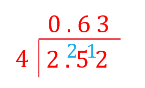
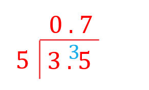

# Mark Schemes — Powers, Roots & Standard Form
**Numbers & the Number System** · Edexcel IGCSE Maths A (4MA1) — 18/Higher

## Q1 — easy — 2 marks · exam-questions

### 19() — 2 marks
> *Find the value of each number.*

> *Use the index law *$a^{-1}=\frac{1}{a}$*.*

$5^{-1}=\frac{1}{5}=0.2$

> *Any number raised to the power of zero is always 1.*

*5**0 **= 1*

> *Write the numbers out.*

$5^{-1}=0.20.5-55^{0}=1$

> *Order the numbers.*

$-55^{-1}=0.20.55^{0}=1$

> *Write the numbers in order of size in their original form.*

$-5,5^{-1},0.5,5^{0}$** **** **
**At least one of 5****-1**** or 5****0 ****evaluated correctly ****[1] **** **
**Fully correct answer ****[1]**

## Q2 — easy — 1 marks · exam-questions

### 11() — 1 marks
> *Simplify using the index law: *$a^{m n} = ( a^{m} )^{n}$*.*

$( 125 )^{ \frac{2}{3} } = 125^{^{1 \frac{1}{3} \times 2}}^{ = ( ( 125 )^{1} \frac{1}{3}} )^{2}$

> *Simplify using the index law:  *$a^{1 \frac{1}{3}} = \sqrt[3]{a}$* and 5**3** = 125.*

$( \sqrt[3]{125} )^{2} = ( 5 )^{2}$

**25**** [1]**

## Q3 — easy — 1 marks · exam-questions

### 14((b)) — 1 marks
> *Simplify using the index law: *$a^{-x}=\frac{1}{a^{x}}.$* *

$3^{-2}=\frac{1}{3^{2}}$

$\frac{1}{9}$**[1]**

## Q4 — easy — 2 marks · exam-questions

### 19((a)) — 1 marks
> $10^{-4}=\frac{1}{10^{4}}=\frac{1}{10000}$*, so 7.8 × 10**-4 **is the same as *$7.8\times\frac{1}{10000}=7.8\div10000$* *

$7.8\div10000=0.00078$

> *Check your answer by counting how many times you need to move the decimal point to get from where it is in the question to where it is in the answer.  *
*n **= -4 so this should be 4 units.*

**0.00078**** ****[1]**

### 19((b)) — 1 marks
> *Standard form will be written as **a** × 10**n**. *
*Ignore the place value and find the value of **a, a **must be a number greater than 1 and less than 10.*

**a*** = 9.56*

> *The original number is greater than 1 so **n** will be positive. Count how many times you need to multiply **a** by 10 to get to the original number.*

*95 600 000  = 9.56 × 10 000 000*

> *10 000 000 = 10**7**, therefore **n** = 7.*

** 9.56 × 10****7**** ****[1]**

## Q5 — easy — 2 marks · exam-questions

### 16() — 2 marks
> *Type the problem into your calculator, use the standard form buttons and the arrow keys to type the whole expression in in one go.*

$7.5\times10^{4}\times2.5\times10^{3}=187500000$

** ****[1]**

> *Convert to standard form. Standard form will be written as **a** × 10**n**, **where 1 ≤ **a **< 10, therefore **a **= 1.875.*

$\begin{gathered} 187500000 & = 1.875 \times 100000000 \\ = 1.875 \times 10^{8} \end{gathered}$

**1.875 × 10****8**** ****[1]**

## Q6 — easy — 1 marks · exam-questions

### 8() — 1 marks
> *Standard form will be written as **a** × 10**n**, where 1 ≤ **a **< 10. Ignore the place value and find the leading non-zero digit. Use this to find the value of **a**.*

**a*** = 6.8*

> *The original number is smaller than 1 so **n** will be negative. Count how many times you need to divide **a** by 10 to get the original number.*

*0.000068 = 6.8 ÷ 10 ÷ 10 ÷ 10 ÷ 10 ÷ 10*

> *Therefore **n** = -5.*

**6.8 × 10****-5**** ****[1]**

## Q7 — easy — 2 marks · exam-questions

### 19((a)) — 1 marks
> *Standard form will be written as **a** × 10**n**. *
*Ignore the place value and find the leading non-zero digit. Use this to find the value of **a**.*

**a*** = 4.23*

> *The original number is smaller than 1 so **n** will be negative. Count how many times you need to divide **a** by 10 to get the original number. *
*The easiest way to do this is to see how many places the decimal point would have to move from where it is in the question to where it is in the answer. *

*0.000423 = 4.23 ÷ 10 ÷ 10 ÷ 10 ÷ 10*

> *Therefore **n** = -4.*

**4.23 × 10****-4**** ****[1]**

### 19((b)) — 1 marks
> *4.5 × 10**4  **= 4.5 × 10 × 10 × 10 × 10 = 4.5 × 10 000*

$4.5\times10000=45000$

> *Check your answer by counting how many times you need to move the decimal point to get from where it is in the question to where it is in the answer.  *
*n **= 4 so this should be 4 units.*

**45000 ****[1]**

## Q8 — easy — 2 marks · exam-questions

### 8((a)) — 1 marks
> *Standard form will be written as **a** × 10**n**, **where 1 ≤ **a **< 10. Ignore the place value and find the leading non-zero digit. Use this to find the value of **a**.*

**a*** = 5.62*

> *The original number is smaller than 1 so **n** will be negative. Count how many times you need to divide **a** by 10 to get the original number. The easiest way to do this is to see how many places the decimal point would have to move from where it is in the question to where it is in the answer. *

*0.00562 = 5.62 ÷ 10 ÷ 10 ÷ 10*

> *Therefore **n** = -3.*

**5.62 × 10****-3**** ****[1]**

### 8((b)) — 1 marks
> *1.452 × 10**3  **= 1.452 × 10 × 10 × 10 = 1.452 × 1000*

$1.452\times1000=1452$

> *Check your answer by counting how many times you need to move the decimal point to get from where it is in the question to where it is in the answer.  *
*n **= 3 so this should be 3 units to the right.*

**1452 ****[1]**

## Q9 — easy — 1 marks · exam-questions

### 14((a)) — 1 marks
> *The reciprocal of *$a$* is *$\frac{1}{a}$*.*

$\frac{1}{5}$**[1]**

## Q10 — easy — 1 marks · exam-questions

### 1((a)) — 1 marks
> *Use the law of indices that *$x^{a}\timesx^{b}=x^{a+b}$*.*

$5^{17}\times5^{2}=5^{17+2}$

**5****19** **[1]**

## Q11 — easy — 4 marks · exam-questions

### 1((a)) — 1 marks
> *Use the law of indices that *$x^{a}\timesx^{b}=x^{a+b}$*.*

$3^{4}\times3^{5}=3^{4+5}=3^{9}$

> *Write the value of *$m$*.*

$m=9$ **[1] **
**Note that the answer is the value of ****m****, not "3****9****"**

### 1((b)) — 1 marks
> *Use the law of indices that *$( x^{a )^{b} = x^{a} b}$*.*

$( 5^{3} )^{7 = 5^{3} \times 7} = 5^{21}$

> *Write the value of *$n$*.*

$n=21$ **[1] **
**Note that the answer is the value of ****n****, not "5****21****"**

### 1((c)) — 2 marks
> *Use the index law that *$x^{a}\timesx^{b}=x^{a+b}$* to simplify the numerator.*

`| 7 ^ 10 / 7 ^ p | = 7 ^ 6 | |`

**[1]**

> *Rearrange so that 7**p** appears on its own side.*

`| 7 ^ 10 | = 7 ^ 6 x 7 ^ p | | 7 ^ 10 / 7 ^ 6 | = 7 ^ p | |`

> *And use the index law that *$\frac{x^{a}}{x^{b}}=x^{a-b}$* to simplify the left hand side to a single power of 7.*

$\begin{gathered} 7^{4} & = 7^{p} \end{gathered}$

> *Write the value of *$p$*.*

$p=4$ **[1]**

## Q12 — easy — 2 marks · exam-questions

### 3((a)) — 1 marks
> *2.46 × 10**6** is the same as 2.46 × 1 000 000.*

*2.46 × 1 000 000 = 2 460 000*

**2 460 000** **[1]**

### 4((b)) — 1 marks
> *Standard form will be written as **a** × 10**n**. *
*Ignore the place value and find the value of **a, a **must be a number greater than 1 and less than 10.*

**a*** = 7.4*

> *The original number is less than 1 so **n** will be negative. Count how many times you need to divide **a** by 10 to get to the original number.*

*0.000 74  = 7.4 ÷ 10 000*

> *10 000 = 10**4**, therefore **n** = −4.*

**7.4 × 10****−4**** ****[1]**

## Q13 — easy — 1 marks · exam-questions

### 3() — 1 marks
> *For a number to be in standard form; *$a\times10^{n}$* where *$1\leqa<10$* and *$n>0$* or *$n<0$

> *The first option, 0.9 × 10**-3**, has a value of **a** which is too small*

> *The second option, 6 × 10**0.5**, has** **a value of **n** which is not an integer*

> *The fourth option, 12 × 10**7**, has a value of **a** which is too large*

> *The third option, 5.2 × 10**-4**, has a value of **a** which is between 1 and 10, and an integer, non-zero, power of 10*

**The third option, 5.2 × 10****-4 ****is correct ****[1]**

## Q14 — easy — 1 marks · exam-questions

### 4() — 1 marks
> *Let's use a test value of **a** = -2, which satisfies **a** < -1*

*The first option, *$1 \frac{1}{2} a = 1 \frac{1}{2} ( - 2 ) = - 1$

*The second option, *$a=-2$

*The third option, *$a^{2} = ( - 2 )^{2} = 4$

*The fourth option, *$a^{3} = ( - 2 )^{3} = - 8$

**The third option, **$a^{2}$**, is the largest value ****[1]**

## Q15 — easy — 3 marks · exam-questions

### 1((a)) — 2 marks
> *i) Standard form will be written as **a** × 10**n**, **where 1 ≤ **a **< 10. Ignore the place value and find the leading non-zero digit. Use this to find the value of **a**.*

**a*** = 6.5*

> *The original number is larger than 1 so **n** will be positive. Count how many times you need to multiply **a** by 10 to get the original number. *
*The easiest way to do this is to see how many places the decimal point would have to move from where it is in the question to where it is in the answer. *

*6500 = 6.5 × 10 × 10 × 10*

> *Therefore **n** = 3.*

**6.5 × 10****3**** ****[1]**

> *ii) Follow the same process for 0.0584, except **n** will be negative as the number is smaller than 1*

**a*** = 5.84*

*0.0584 = 5.84 ÷ 10 ÷ 10*

**5.84 × 10****-2**** ****[1]**

### 1((b)) — 1 marks
> *You should be able to enter this calculation directly into your calculator, but you may also wish to rewrite it as follows to make it easier to work out*

$( 4.2 \times 10^{5 ) \times ( 1.8 \times 10^{-2} } ) = 4.2 \times 1.8 \times 10^{5 \times 10^{-2} }$

> *Combining the first two terms*

$7.56\times10^{5}\times10^{-2}$

> *Combining the second two terms using the indices law; *$x^{m}\timesx^{n}=x^{m+n}$

$7.56\times10^{5+-2}=7.56\times10^{3}$

> *This answer is in standard form as the leading number is between 1 and 10, and the power of 10 is an integer*

$7.56\times10^{3}$ **[1]**

## Q16 — easy — 3 marks · exam-questions

### 1((a)) — 2 marks
> *We want to find out how many times 6.48×10**-5** kg fits into 0.35 kg*

$\frac{0.35}{6.48\times10^{-5}}=5401.234568...$

**[1]**

**5401 ****[1]**

### 1((b)) — 1 marks
**The weight for a grain of salt is only an average; each grain may weigh more or less which would result in a different value for the number of grains of salt ****[1]**

## Q17 — easy — 4 marks · exam-questions

### 2() — 4 marks
> *We will find the weight per seed, in grams. This is already done for poppy seeds*

> *250 pumpkin seeds weigh 21 grams, so we can find the weight per seed*

$\frac{21}{250}=0.084\mathrm{grams}=8.4\times10^{-2}\mathrm{grams}$

**[1]**

*One sesame seed weighs *$3.64\times10^{-6}$* kilograms* *There are 1000 grams in 1 kilogram, so we need to multiply by 1000 to go from kilograms to grams e.g. 3kg=3000g*

$3.64\times10^{-6}\times1000=3.64\times10^{-6}\times10^{3}=3.64\times10^{-3}\mathrm{grams}$

**[1]**

> *We now know that*

*Poppy seeds weigh *$3\times10^{-4}$* grams* 
*Pumpkin seeds weigh *$8.4\times10^{-2}$* grams* 
*Sesame seeds weigh *$3.64\times10^{-3}$* grams*

**All written in same format (either standard form or as ordinary numbers) ****[1]**

> *Putting these in order, with the lightest first*

**Poppy seeds, Sesame seeds, Pumpkin seeds** **[1]**

## Q18 — easy — 5 marks · exam-questions

### 3() — 5 marks
> *We want to find out how many times 2.7×10**-11** grams fits in to 3.5 kilograms*
*First of all, we need them to be in the same units; either grams or kilograms*
*There are 1000 grams in 1 kilogram*

*3.5 kilograms = 3.5 × 1000 = 3500 grams*

**[1]**

> *Now find how many times 2.7×10**-11** grams fits in to 3500 grams*

$\frac{3500}{2.7\times10^{-11}}=1.29629\times10^{14}$

**Method and answer**** [2]**

> *Round to 2 significant figures*

$1.3\times10^{14}$ **[2]** 
**Answer must be in standard form, and rounded to 2 significant figures**

## Q19 — easy — 2 marks · exam-questions

### 6((a)) — 1 marks
> *Count the number of places after the 7 to get the power of 10*

$7.6\times10^{7}$

**[B1]**

### 6((b)) — 1 marks
> *Counting the zero before the decimal point, the number of zeros in front of the 5 will be the same as the power of 10*

**Final answer:** **0.00054**

**[B1]**

## Q20 — easy — 4 marks · exam-questions

### 9((a)) — 1 marks
> *This is the same as *$5.87\times0.0001$

$5.87\times0.0001=0.000587$

$0.000587$

**[B1]**

### 9((b)) — 1 marks
> *Standard form is written as *$a\times10^{n}$*, **where *$1\leqa<10$

> *Ignore the place value and find the leading non-zero digit*

> *Use this to find the value of *$a$

$a=8.4$

> *Count how many times you need to multiply *$a$* by *$10$* **to get the original number*

$8.4\times10^{7}$

**[B1]**

### 9((c)) — 2 marks
> $K$* is the number of times the number of neurons in a monkey brain needs to be multiplied to get the number of neurons in a human brain. Use the inverse operation to work it out*

$( 8.5 \times 10^{10} ) \div ( 1.47 \times 10^{9} )$

**[M1]**

$=57.82...$

> *Round to 1 decimal place*

$57.8$

**[A1]**

## Q21 — medium — 3 marks · exam-questions

### 15() — 3 marks
> *Identify the calculation you will need to work out.*

*Thickness of 500 sheets = 500 × thickness of one sheet = 500 × (9 × 10**-3**)*

> *Evaluate by multiplying 9 by 500.*

*500 × 9 × 10**-3 **= 4500 × 10**-3*

**[1]**

> *This is not in standard form as **a** is not in the interval 1 ≤ **a **< 10. Convert to standard form by first converting 4500 to standard form.*

*4500 × 10**-3 **= 4.5 × 10**3** × 10**-3*

**[1]**

> *Simplify using the law of indices **a**m** **×** a**n **= **a**m+n**.*

*Thickness of 500 sheets = 4.5 × 10**3-3 **= 4.5 × 10**0**  = 4.5 × 1 = 4.5 cm*

**No, the paper tray is not deep enough as 500 sheets are 4.5 cm thick ****[1]**

## Q22 — medium — 4 marks · exam-questions

### 1() — 1 marks
Type into your calculator or move the numbers three place values to the right

**Final answer:** **0.0045**

**[B1]**

### 2() — 1 marks
The number is 3.4289

Count the number of times you need to multiply this by 10 to get the original number

$3.4289\times10^{5}$

**[B1]**

### 3() — 2 marks
Subtract the population of Hungary from the population of Indonesia

$2.43\times10^{8}-9.6\times10^{7}=$

**[M1]**

$1.47\times10^{8}$

**[A1]**

## Q23 — medium — 2 marks · exam-questions

### 20() — 2 marks
> *Convert each number to an ordinary number to make comparing them easier.*

> *0.038 × 10**2**.*

$0.038\times100=3.8$

> *3800 × 10**-4**.*

$3800\div10000=0.38$

> *0.38 × 10**-1**.*

$0.38\div10=0.038$

> *Write the numbers out.*

$0.038\times10^{2}=3.83800\times10^{-4}=0.383800.38\times10^{-1}=0.038$

> *Order the numbers.*

$0.38\times10^{-1}=0.0383800\times10^{-4}=0.380.038\times10^{2}=3.8380$

> *Write the numbers in order of size in their original form.*

$0.38\times10^{-1},3800\times10^{-4},0.038\times10^{2},380$** **** **
**At least one evaluated correctly, or three in correct order ****[1] **** Fully correct answer ****[1]**

## Q24 — medium — 4 marks · exam-questions

### 17((a)) — 1 marks
> *Any number raised to the power of zero is always 1.*

**10****0**** = 1 ****[1]**

### 17((b)) — 1 marks
> *Simplify using the index law: *$a^{-x}=\frac{1}{a^{x}}.$* *

$10^{-2}=\frac{1}{10^{2}}$

$\frac{1}{100}$**[1]**

### 17((c)) — 2 marks
> *Convert each number to an ordinary number to make comparing them easier.*

> *2.73 × 10**3**.*

$2.73\times1000=2730$

> *27.3 × 10**-3**.*

$27.3\div1000=0.0273$

> *273 × 10**2**.*

$273\times100=27300$

> *Write the numbers out.*

$2.73\times10^{3}=273027.3\times10^{-3}=0.0273273\times10^{2}=273000.00273$

> *Order the numbers.*

$0.0027327.3\times10^{-3}=0.02732.73\times10^{3}=2730273\times10^{2}=27300$

> *Write the numbers in order of size in their original form.*

$0.00273,27.3\times10^{-3},2.73\times10^{3},273\times10^{2}$** **** **
**At least one evaluated correctly, or three in correct order ****[1] **** Fully correct answer ****[1]**

## Q25 — medium — 3 marks · exam-questions

### 10((a)) — 1 marks
> *Simplify using the index law:  *$a^{\frac{1}{2}}=\sqrt{a}$* and 10**2** = 100.*

`sqrt index _ of 100 = 10`

**10**** [1]**

### 10((b)) — 2 marks
> *Simplify using the index law: *$a^{m n} = ( a^{m} )^{n}$*.*

$( 125 )^{ \frac{2}{3} } = 125^{^{1 \frac{1}{3} \times 2}}^{ = ( ( 125 )^{1} \frac{1}{3}} )^{2}$

> *Simplify using the index law:  *$a^{1 \frac{1}{3}} = \sqrt[3]{a}$* and 5**3** = 125.*

$( \sqrt[3]{125} )^{2} = ( 5 )^{2}$

**25**** [1]**

## Q26 — medium — 4 marks · exam-questions

### 9((a)) — 1 marks
> *Simplify using the index law:  *$a^{\frac{1}{2}}=\sqrt{a}$* and 6**2** = 36.*

`sqrt index _ of 36 = 6`

**6**** [1]**

### 9((b)) — 1 marks
> *Any number raised to the power of zero is always 1.*

**23****0**** = 1 ****[1]**

### 9((c)) — 2 marks
> *Simplify using the index law: *$a^{-x}=\frac{1}{a^{x}}.$* *

$( 27 ) ^{ - } \frac{2}{3} = \frac{1}{open} \text{parentheses} 27 ) ^{\frac{2}{3}}$

**[1]**

> *Simplify using the index law: *$a^{m n} = ( a^{m} )^{n}$*.*

$\frac{1}{27^{^{\frac{2}{3}}}}=\frac{1}{27^{^{\frac{1}{3}\times2}}}^{}$

> *Simplify using the index law:  *$a^{1 \frac{1}{3}} = \sqrt[3]{a}$* and 3**3** = 27.*

$\frac{1}{( \sqrt[3]{27} )^{2}} = \frac{1}{3^{2}}$

$\frac{1}{9}$**[1]**

## Q27 — medium — 4 marks · exam-questions

### 10((a)) — 1 marks
> *All of the masses are given in standard form, **a **× 10**n** **, where 1 ≤ **a **< 10, so the planet with the greatest mass is the planet with the greatest value of **n.** *

**Jupiter**** [1]**

### 10((b)) — 1 marks
> *Identify the calculation.*

*Mass (Venus) - mass (Mercury) = 4.869 × 10**24** - 3.302 × 10**23*

> *Type the problem directly into your calculator.*

*4.869 × 10**24** - 3.302 × 10**23** = 4.5388 × 10**24*

**4.5388 × 10****24**** kg ****[1]**

### 10((c)) — 2 marks
> *Find the scale factor by dividing the distance of Neptune from Earth by the distance of Venus from Earth.*

$\frac{\mathrm{Distance}(\mathrm{Neptune})}{\mathrm{Distance}(\mathrm{Venus})}=\frac{4.35\times10^{9}}{4.14\times10^{7}}$

> *Type the problem directly into your calculator.*

$\frac{4.35\times10^{9}}{4.14\times10^{7}}=105.072...$

**[1] **
**Yes, because 105.07... > 100  ****[1]**

## Q28 — medium — 2 marks · exam-questions

### 7() — 2 marks
> *You should be able to type directly into your calculator.*

$\begin{gathered} ( 13.8 \times 10^{7 ) \times ( 5.4 \times 10^{-12} } ) & = 7.452 \times 10^{- 4} \end{gathered}$

**[1]**

> *Convert to an ordinary number.*

$\begin{gathered} 7.452 \times 10^{- 4} & = 7.452 \times 0.0001 = 0.0007452 \end{gathered}$

$0.0007452$**[1]**

## Q29 — medium — 4 marks · exam-questions

### 17((a)) — 1 marks
> *Any number raised to the power of zero is always 1.*

**10****0**** = 1 ****[1]**

### 17((b)) — 1 marks
> $10^{-5}=\frac{1}{10^{5}}=\frac{1}{100000}=0.00001$*, so 6.7 × 10**-5 **is the same as *$6.7\times0.00001$* *

$6.7\times0.00001=0.000067$

> *Check your answer by counting how many times you need to move the decimal point to get from where it is in the question to where it is in the answer.  *
*n **= -5 so this should be 5 units.*

**0.000067**** ****[1]**

### 17((c)) — 2 marks
> *Evaluate the number parts first by multiplying 3 by 9.*

$\begin{gathered} ( 3 \times 10^{7} ) \times ( 9 \times 10^{6} ) & = ( 3 \times 9 ) \times ( 10^{7} \times 10^{6} ) \\ = 27 \times ( 10^{7} \times 10^{6} ) \end{gathered}$

**[1]**

> *Evaluate the powers using the law of indices **a**m** × a**n **= **a**m+n**.*

$27 \times ( 10^{7 } \times 10^{6 ) = 27 \times 10^{(} \text{parentheses} 7 + 6 )} = 27 \times 10^{13}$

> *This is not in standard form as **a** is not in the interval 1 ≤ **a **< 10. Convert to standard form by first converting 27 to standard form.*

*27 × 10**13 **= 2.7 × 10**1** × 10**13*

> *Simplify using the law of indices **a**m** **×** a**n **= **a**m+n**.*

**2.7 × 10****14**** ****[1]**

## Q30 — medium — 2 marks · exam-questions

### 14((c)) — 2 marks
> *Evaluate the number parts first by multiplying 3 by 9.*

$\begin{gathered} 9 \times 10^{4} \times 3 \times 10^{3} & = 9 \times 3 \times 10^{4} \times 10^{3} \\ = 27 \times ( 10^{4} \times 10^{3} ) \end{gathered}$

**[1]**

> *Evaluate the powers using the law of indices **a**m** × a**n **= **a**m+n**.*

$27 \times ( 10^{4 } \times 10^{3} ) = 27 \times 10^{( 4 + 3 )} = 27 \times 10^{7}$

> *This is not in standard form as **a** is not in the interval 1 ≤ **a **< 10. Convert to standard form by first converting 27 to standard form.*

*27 × 10**7 **= 2.7 × 10**1** × 10**7*

> *Simplify using the law of indices **a**m** **×** a**n **= **a**m+n**.*

**2.7 × 10****8**** ****[1]**

## Q31 — medium — 2 marks · exam-questions

### 9() — 2 marks
> *Evaluate the number parts first by multiplying 3 by 9.*

$\begin{gathered} ( 9 \times 10^{- 4} ) \times ( 3 \times 10^{7 ) & = ( 9 \times 3 ) \times ( 10^{-4} } \times 10^{7 ) \\ = 27 \times ( 10^{-4} } \times 10^{7} ) \end{gathered}$

**[1]**

> *Evaluate the powers using the law of indices **a**m** × a**n **= **a**m+n**.*

$27 \times ( 10^{- 4} \times 10^{7 ) = 27 \times 10^{(} \text{parentheses} - 4 + 7 )} = 27 \times 10^{3}$

> *This is not in standard form as **a** is not in the interval 1 ≤ **a **< 10. Convert to standard form by first converting 27 to standard form.*

*27 × 10**3 **= 2.7 × 10**1** × 10**3*

> *Simplify using the law of indices **a**m** **×** a**n **= **a**m+n**.*

**2.7 × 10****4**** ****[1]**

## Q32 — medium — 3 marks · exam-questions

### 15((a)) — 1 marks
> *Simplify using the index law: *$a^{-x}=\frac{1}{a^{x}}.$* *

$25^{-3}=\frac{1}{25^{3}}$

> *Use your calculator to evaluate the answer.*

$\frac{1}{15625}$**[1] **
**The answer in standard form of 6.4 × 10****-5 ****is also accepted**

### 15((b)) — 2 marks
> *Type into your calculator. *

$350^{3}=42875000$

**[1]**

> *Convert to standard form.*

$42875000=4.2875\times10000000$

$4.2875\times10^{7}$**[1]**

## Q33 — medium — 1 marks · exam-questions

### 12() — 1 marks
$64^{\frac{1}{4}}$** means **`fourth root of 64`** not **$\frac{1}{4}\times64$ **[1]**

## Q34 — medium — 3 marks · exam-questions

### 10((a)) — 2 marks
> *Identify the calculation.*

*Surface area of Atlantic Ocean − Surface area of Indian Ocean = 1.06 × 10**8** − 6.86 × 10**7*

> *Type the calculation directly into your calculator.*

*1.06 × 10**8** − 6.86 × 10**7 **= 37 400 000*

**[1]**

> *Convert this answer to standard form. Standard form will be written as **a** × 10**n**. *
*Ignore the place value and find the value of **a, a **must be a number greater than 1 and less than 10.*

**a*** = 3.74*

> *Count how many times you need to multiply **a** by 10 to get to the original number.*

*37 400 000  = 3.74 × 10**7*

**3.74 × 10****7**** ****[1]**

### 10((b)) — 1 marks
> *Form an equation from the information.*

$\begin{array}{ccc} \text{surface} \text{area} of Pacific Ocean & = & k \times [ \text{surface} \text{area} of Arctic Ocean ] \\ 1.56 \times 10^{8} & = & k ( 1.41 \times 10^{7} ) \end{array}$

> *Solve the equation by dividing both sides by 1.41 × 10**7**.*

$\begin{gathered} k = \frac{1.56 \times 10^{8} }{1.41 \times 10^{7} } = ( 1.56 \times 10^{8} ) \div ( 1.41 \times 10^{7} ) \end{gathered}$

> *Type this directly into your calculator, in either of the two forms above.*

$\begin{array}{rcl} k = 11.06382979... \end{array}$

> *Round your answer to the nearest whole number as requested.*

$\begin{gathered} k = 11 \end{gathered}$* ***[1]**

## Q35 — medium — 3 marks · exam-questions

### 14() — 3 marks
> *Rewrite 8 as 2**3*

$( \sqrt[4]{2^{3}} )^{5}$

**[1]**

> *A fourth-root, *`fourth root of blank`*, can be rewritten as a power of *$\frac{1}{4}$

$( ( 2^{3} )^{1 \frac{1}{4}} )^{5}$

> *Use the law of indices; *$( x^{m )^{n} = x^{m} \times n}$

$( ( 2 ^{3} ) ^{1} \text{fourth} ) ^{5} = ( 2^{3} \times 1 \text{fourth} ) ^{5} = ( 2 ^{\frac{3}{4}} ) ^{5}$

**[1]**

> *Apply the same rule again*

$( 2 ^{\frac{3}{4}} ) ^{5} = 2 ^{\frac{3}{4}} \times 5 = 2 ^{\frac{15}{4}}$

$2^{\frac{15}{4}}$ **[1]**

## Q36 — medium — 3 marks · exam-questions

### 11((b)) — 3 marks
> *Rewrite 9 as a power of 3 using 9=3**2*

$3^{n} = 177147 \times ( 3^{2} )^{5}$

**[1]**

> *Use the law of indices; *$( x^{n )^{m} = x^{n} \times m}$

$3^{n}=177147\times3^{2\times5}\,3^{n}=177147\times3^{10}$

**[1]**

> *Use the fact that we were told; *$177147=3^{11}$

$3^{n}=3^{11}\times3^{10}$

> *Use the law of indices; *$x^{m}\timesx^{n}=x^{m+n}$

$3^{n}=3^{11+10}=3^{21}$

> *Compare both sides of the equation to see the value of *$n$

$n=21$ **[1]**

## Q37 — medium — 9 marks · exam-questions

### 5((a)) — 2 marks
> *We need to find out how many sweets there are per packet, which will be the number of sweets, shared between (divided by) the total number of packets*

$\frac{1.47\times10^{7}}{3.5\times10^{5}}$

**[1]**

**42** **[1]**

### 5((b)) — 3 marks
> *There are 288 days where sweets are made each year, and 1.47×10**7** sweets made each day*

*288 × 1.47×10**7*

**[1]**

*= 4 233 600 000*

**[1]**

> *Write in standard form*

**4.2336×10****9** **[1]** 
**The number at the front needs to be at least 1 decimal place**

### 5((c)) — 4 marks
> *i) 1.47×10**7** sweets are made every day, and the machines operate for 15 hours each day*

*1.47×10**7 **÷ 15 = 980 000 sweets per hour*

**[1]**

> *There are 152 machines*

*980 000 ÷ 152 = 6447.368...*

**[1]**

> *Round to the nearest 10*

**6450** **[1]**

> *ii) *

**This assumes that all the machines work at the same rate** **[1]**

## Q38 — medium — 4 marks · exam-questions

### 8((a)) — 1 marks
> *Use place value to convert out of standard form by by multiplying 9.3 by 10 000 000 (which is equivalent to *$10^{7}$*)*

> *One power of 10 turns 9.3 to 93, and then you need 6 zeroes after that for the other 6 powers of 10*

**Final answer:** **93 000 000**

**[B1]**

### 8((b)) — 1 marks
> *First look for the numbers with the smallest power of 10*

$9.8\times10^{6}$* (Hungary)*

$5.7\times10^{6}$* (Singapore)*

> *Then select the number with the smallest starting value*

$5.7<9.8$

**Final answer:** **Singapore**

**[B1]**

### 8((c)) — 2 marks
> *Use subtraction to calculate the difference in populations (a calculator can be used to solve the calculation)*

$1.382\times10^{9}-1.327\times10^{9}=55000000$

**[M1]**

> *Write the answer in standard form as stated in the question*

$5.5\times10^{7}$

**[A1]**

## Q39 — hard — 2 marks · exam-questions

### 22((a)) — 1 marks
> *Simplify using the index law: *$a^{-x}=\frac{1}{a^{x}}.$* *

$2^{-3}=\frac{1}{2^{3}}=\frac{1}{8}$

$\frac{1}{8}$**[1]**

### 22((b)) — 1 marks
> *Simplify using the index laws  *$a^{\frac{1}{2}}=\sqrt{a}$* and *$a^{1}=a$*.*

$5\sqrt{5}=5^{1}\times5^{\frac{1}{2}}$

> *Simplify using the index laws  *$a^{m}\timesa^{n}=a^{m+n}$*.*

$5^{1 } \times 5^{1 \frac{1}{2} } = 5^{( 1 + 1 \frac{1}{2} )} = 5^{1 1 \frac{1}{2}}$

$k=1\frac{1}{2}$**[1]**

## Q40 — hard — 4 marks · exam-questions

### 12((a)) — 2 marks
> *Simplify using the index law: *$a^{-x}=\frac{1}{a^{x}}.$* *

$81^{-\frac{1}{2}}=\frac{1}{81^{\frac{1}{2}}}$

**[1]**

> *Simplify using the index law: *$a^{\frac{1}{2}}=\sqrt{a}$*.*

$\frac{1}{81^{\frac{1}{2}}}=\frac{1}{\sqrt{81}}=\frac{1}{9}$

$\frac{1}{9}$**[1]**

### 12((b)) — 2 marks
> *Simplify using the index law: *$a^{m n} = ( a^{m} )^{n}$*.*

$( \frac{64}{125} )^{^{ \frac{2}{3} }} = ( \frac{64}{125} )^{^{1 \frac{1}{3} \times 2} } = ( ( \frac{64}{125} )^{^{1 \frac{1}{3}}} )^{2}$

**[1]**

> *Simplify using the index law:  *$a^{1 \frac{1}{3}} = \sqrt[3]{a}$*.*

$( \frac{ \sqrt[3]{64} }{ \sqrt[3]{125} } )^{2} = ( \frac{4}{5} )^{2}$

> *Square the numerator and the denominator separately.*

$\frac{16}{25}$**[1]**

## Q41 — hard — 3 marks · exam-questions

### 10((a)) — 1 marks
> *Simplify using the index law: *$a^{\frac{1}{2}}=\sqrt{a}$*.*

$64^{\frac{1}{2}}=\sqrt{64}=8$

$8$ **[1]**

### 10((b)) — 2 marks
> *Simplify using the index law: *$a^{-x}=\frac{1}{a^{x}}.$* *

$( \frac{8}{125} ) ^{ - } \frac{2}{3} = \frac{1}{open} \text{parentheses} \frac{8}{125} ) ^{\frac{2}{3}} = ( \frac{125}{8} ) ^{\frac{2}{3}}$

**[1]**

> *Simplify using the index law: *$a^{m n} = ( a^{m} )^{n}$*.*

$( \frac{125}{8} )^{^{ \frac{2}{3} }} = ( \frac{125}{8} )^{^{1 \frac{1}{3} \times 2} } = ( ( \frac{125}{8} )^{1 \frac{1}{3}} )^{2}$

> *Simplify using the index law:  *$a^{1 \frac{1}{3}} = \sqrt[3]{a}$*.*

$( \frac{ \sqrt[3]{125} }{ \sqrt[3]{8} } )^{2} = ( \frac{5}{2} )^{2}$

> *Square the numerator and the denominator separately.*

$\frac{25}{4}$**[1]**

## Q42 — hard — 5 marks · exam-questions

### 15((a)) — 1 marks
> *Separate the problem using the index law: *$\sqrt{a\timesb}=\sqrt{a}\times\sqrt{b}$*.*

$\sqrt[3]{8 \times 10^{6 } } = \sqrt[3]{8 \times \sqrt[3]{10}^{6} }$

> *Evaluate the cube root of 8 using 2**3** = 8 and simplify using the index law:  *$a^{1 \frac{1}{3}} = \sqrt[3]{a}$*.*

$\sqrt[3]{8 \times \sqrt[3]{10}^{6} = 2 \times ( 10^{6} )^{1} \frac{1}{3}}$

> *Simplify using the index law: *$a^{m n} = ( a^{m} )^{n}$*.*

$2\times10^{\frac{6}{3}}=2\times10^{2}$

> *Evaluate the answer using 10**2** = 100. *

**200** **[1]**

### 15((b)) — 2 marks
> *Simplify using the index law: *$a^{-x}=\frac{1}{a^{x}}.$* *

$144^{\frac{1}{2}}\times64^{-\frac{1}{3}}=144^{\frac{1}{2}}\times\frac{1}{64^{\frac{1}{3}}}$

**[1]**

> *Simplify using the index laws *$a^{\frac{1}{2}}=\sqrt{a}$* and *$a^{1 \frac{1}{3}} = \sqrt[3]{a}$*.*

$144^{1 \frac{1}{2}} \times \frac{1}{64^{1 \frac{1}{3}}} = \sqrt{144} \times \frac{ 1}{ \sqrt[3]{64} }$

> *Evaluate the square root of 144 and the cube root of 64 using 12**2 **= 144 and 4**3** = 64.*

$\sqrt{144} \times \frac{ 1}{ \sqrt[3]{64} } = 12 \times 1 \frac{1}{4} = \frac{12}{4} = 3$

**3 ****[1]**

### 15((c)) — 2 marks
> *This equation can be solved by making the bases the same on both sides. Change 81 so that it has a base of 3.*

`81 = 9 ^ 2 = ( 3 ^2 ) ^2 = 3 ^ 4 ^`

> *Use the index law *$a^{-x}=\frac{1}{a^{x}}$* to rewrite *$\frac{1}{81}$* with a base of 3 and a negative index.*

$\frac{1}{81}=\frac{1}{3^{4}}=3^{-4}$

**[1]**

> *Set each side equal to each other. If the bases are the same then the indices must be the same, therefore if*

$3^{-4}=3^{2x}$

> *then*

$2x=-4$

> *Solve the equation by dividing both sides by 2.*

$x=\frac{-4}{2}$

$x=-2$**[1]**

## Q43 — hard — 3 marks · exam-questions

### 16((a)) — 1 marks
> *Standard form will be written as **a** × 10**n**. Ignore the place value and find the leading non-zero digit. Use this to find the value of **a**.*

**a*** = 6.4*

> *The original number is greater than 1 so **n** will be positive. Count how many times you need to multiply **a** by 10 to get to the original number.*

*640 000 000  = 6.4 × 100 000 000*

> *100 000 000 = 10**8**, therefore **n** = 8.*

** 6.4 × 10****8**** ****[1]**

### 16((b)) — 2 marks
> *You should be able to type directly into your calculator.*

$\begin{gathered} ( 3 \times 10^{7} ) \div ( 6 \times 10^{4} ) & = 500 \end{gathered}$

**[1]**

> *Convert to standard form.*

$500=5\times100=5\times10\times10$

$5\times10^{2}$* ***[1]**

## Q44 — hard — 4 marks · exam-questions

### 18((a)) — 1 marks
> *Standard form will be written as **a** × 10**n**. *
*a **must be a number greater than 1 and less than 10. Ignore the zeroes to find the value of **a.*

**a*** = 5.4*

> *The original number is greater than 1 so **n** will be positive. Count how many times you need to multiply **a** by 10 to get to the original number.*

*5400 000  = 5.4 ×  1 000 000*

> *1 000 000 = 10**6**, therefore **n** = 6.*

** 5.4 × 10****6**** ****[1]**

### 18((b)) — 1 marks
> $10^{-4}=\frac{1}{10^{4}}=\frac{1}{10000}$*, so 3.2 × 10**-4 **is the same as *$3.2\times\frac{1}{10000}=3.2\div10000$* *

$3.2\div10000=0.00032$

> *Check your answer by counting how many times you need to move the decimal point to get from where it is in the question to where it is in the answer.  *
*n **= -4 so this should be 4 units.*

**0.00032**** ****[1]**

### 18((c)) — 2 marks
> *Identify the calculation you will need to work out.*

*Mass (star) = 315 × mass (sun) = 315 × (2 × 10**30**)*

> *Evaluate by multiplying 2 by 315.*

*315 × 2 × 10**30 **= 630 × 10**30*

**[1]**

> *This is not in standard form as **a** is not in the interval 1 ≤ **a **< 10. Convert to standard form by first converting 630 to standard form.*

*630 × 10**30 **= 6.3 × 10**2** × 10**30*

> *Simplify using the law of indices **a**m** **×** a**n **= **a**m+n**.*

**6.3 × 10****32**** kg ****[1]**

## Q45 — hard — 3 marks · exam-questions

### 8((a)) — 1 marks
> $10^{-6}=\frac{1}{10^{6}}=\frac{1}{1000000}$*, so 7.97 × 10**-6 **is the same as *$7.97\times\frac{1}{1000000}=7.97\div1000000$* *

$7.97\div1000000=0.00000797$

> *Check your answer by counting how many times you need to move the decimal point to get from where it is in the question to where it is in the answer.  *
*n **= -6 so this should be 6 units.*

**0.00000797**** ****[1]**

### 8((b)) — 2 marks
> *Write the problem as a fraction.*

$\frac{2.52\times10^{5}}{4\times10^{-3}}$

> *Evaluate the number parts first by dividing 2.52 by 4. Use the bus stop method.*

**[1]**

> *Evaluate the powers using the law of indices **a**m** ÷ a**n **= **a**m-n**.*

$0.63 \times \frac{ 10^{5}{10^{-3} } } = 0.63 \times 10^{5 } \div 10^{- 3} = 0.63 \times 10^{( 5 - - 3 )} = 0.63 \times 10^{8}$

> *This is not in standard form as **a** is not in the interval 1 ≤ **a **< 10. Convert to standard form by first converting 0.63 to standard form.*

*0.63 × 10**8 **= 6.3 × 10**-1** × 10**8*

> *Simplify using the law of indices **a**m** **×** a**n **= **a**m+n**.*

**6.3 × 10****7**** ****[1]**

## Q46 — hard — 3 marks · exam-questions

### 19() — 3 marks
> *Make **p** the subject by taking the square-root of both sides. *

$p=\sqrt{\frac{x-y}{xy}}$

> *Substitute the values given for **x **and **y **into the expression for p.*

$p = \sqrt{ \frac{ 8.5 \times 10^{9} - 4 \times 10^{8} }{( 8.5 \times 10^{9} ) ( 4 \times 10^{8} )} }$

> *Type the problem into your calculator, use the square root, fraction, standard form buttons and the arrow keys to type the whole expression in in one go.*

$\sqrt{ \frac{ 8.5 \times 10^{9 - 4 \times 10^{8} }{( 8.5 \times 10^{9} ) ( 4 \times 10^{8} )} } = 4.880935... \times 10^{-5} }$

** Either part of the fraction evaluated correctly ****[1] **** **
**Both parts of the fraction evaluated correctly ****[1]**

> *Round your answer to 2 significant figures.*

**4.9 × 10****-5**** ****[1]**

## Q47 — hard — 4 marks · exam-questions

### 9((a)) — 2 marks
> *Substitute the values given for **w **and **d **into the expression for **T**.*

$T = \sqrt{ \frac{ 5.6 \times 10^{- 5} }{( 1.4 \times 10^{- 4} )^{3}} }$

> *Type the problem into your calculator, use the square root, fraction, standard form buttons and the arrow keys to type the whole expression in in one go.*

$\sqrt{ \frac{ 5.6 \times 10^{- 5} }{( 1.4 \times 10^{- 4} )^{3}} } = 4517.5395...$

** ****[1]**

> *Convert to standard form.*

$\begin{gathered} 4517.5395... & = 4.517539... \times 1000 \\ = 4.517539... \times 10^{3} \end{gathered}$

** ****[1]**

> *Round your answer to 3 significant figures. *
*The third significant figure is the digit 1, however this is followed by a 7 which is greater than 5 s round it up to a 2.*

**4.52 × 10****3**** ****[1]**

### 9((b)) — 2 marks
> *To increase **w** by 10%, multiply it by 1.1 and to increase **d** by 5% multiply it by 1.05.*

> *Therefore **T **will become:*

> $T = \sqrt{ \frac{w \times 1.1}{( d \times 1.05 )^{3}} } = \sqrt{ \frac{5.6 \times 10^{- 5} \times 1.1}{( 1.4 \times 10^{- 4} \times 1.05 )^{3}} } = 4403.66....$* *

**[1]**

> *The increase of 5% on the denominator is cubed, whilst the increase on the numerator is not, therefore the scale factor is less than 1 so **T **decreases.*

**4.40... × 10****3****  <  4.51... × 10****3 **
**T ****has decreased ****[1]**

## Q48 — hard — 4 marks · exam-questions

### 16((a)) — 1 marks
> *8.2 × 10**5  **= 8.2 × 10 × 10 × 10 × 10 × 10  = 8.2 × 100 000*

$8.2\times100000=820000$

> *Check your answer by counting how many times you need to move the decimal point to get from where it is in the question to where it is in the answer.  *
*n **= 5 so this should be 5 units.*

**820 000 ****[1]**

### 16((b)) — 1 marks
> *Standard form will be written as **a** × 10**n**, where 1 ≤ **a **< 10. Ignore the place value and find the leading non-zero digit. Use this to find the value of **a**.*

**a*** = 3.76*

> *The original number is smaller than 1 so **n** will be negative. Count how many times you need to divide **a** by 10 to get the original number.*

*0.000 376  = 3.76  ÷ 10 ÷ 10 ÷ 10 ÷ 10*

> *Therefore **n** = -4.*

**3.76 × 10****-4**** ****[1]**

### 16((c)) — 2 marks
> *Write the problem as a fraction.*

$\frac{2.3\times10^{12}}{4.6\times10^{3}}$

> *Evaluate the number parts first by recognising that 2.3 divided by 4.6 = 0.5.*

$\frac{2.3}{4.6}=\frac{23}{46}=\frac{1}{2}$

**[1]**

> *Evaluate the powers using the law of indices **a**m** ÷ a**n **= **a**m-n**.*

$1 \frac{1}{2} \times ( 10^{12 } \div 10^{3} ) = 1 \frac{1}{2} \times 10^{( 12 - 3 )} = 0.5 \times 10^{9}$

> *This is not in standard form as **a** is not in the interval 1 ≤ **a **< 10. Convert to standard form by first converting 0.5 to standard form.*

*0.5 × 10**9 **= 5 × 10**-1** × 10**9*

> *Simplify using the law of indices **a**m** **×** a**n **= **a**m+n**.*

**5 × 10****8**** ****[1]**

## Q49 — hard — 2 marks · exam-questions

### 16() — 2 marks
> *Write the problem as a fraction.*

$\frac{3.5\times10^{6}}{5\times10^{-3}}$

> *Evaluate the number parts first by dividing 3.5 by 5. Use the bus stop method.*

**[1]**

> *Evaluate the powers using the law of indices **a**m** ÷ a**n **= **a**m-n**.*

$0.7 \times ( 10^{6 } \div 10^{- 3} ) = 0.7 \times 10^{( 6 - - 3 )} = 0.7 \times 10^{9}$

> *This is not in standard form as **a** is not in the interval 1 ≤ **a **< 10. Convert to standard form by first converting 0.7 to standard form.*

*0.7 × 10**9 **= 7 × 10**-1** × 10**9*

> *Simplify using the law of indices **a**m** **×** a**n **= **a**m+n**.*

**7 × 10****8**** ****[1]**

## Q50 — hard — 3 marks · exam-questions

### 19((a)) — 3 marks
> *Rewrite the bases, 8 and 4, as powers of 2 with brackets around them.*

$( 2^{3} )^{2} \times \sqrt[3]{( 2^{2} )^{6} }$

**[1]**

> *Apply the index law *$( a^{m )^{n} = a^{m} n}$*.*

$= 2^{6} \times \sqrt[3]{2^{12} }$

> *Use the index law *$\sqrt[n]{a} = a^{ \frac{1}{n} }$* to rewrite in index form and then simplify again.*

$= 2^{6 \times ( 2^{12} )^{1} \frac{1}{3}} 
= 2^{6} \times 2^{4}$

**[1]**

> *Finally, use the index law to write *$a^{m}\timesa^{n}=a^{m+n}$* in the form asked for.*

**Answer = 2****10**** [1]**

## Q51 — hard — 3 marks · exam-questions

### 20() — 3 marks
> *First write *$a^{\frac{3}{2}}$* in terms of **n**.*

$( 25 \times 10^{14 n} )^{ \frac{3}{2} }$

> *Apply the distributive law to the terms in the brackets.*

$= 25^{ \frac{3}{2} } \times ( 10^{14 n} )^{ \frac{3}{2} }$

> *Put "*$25^{\frac{3}{2}}$*" directly into your calculator.*

$= 125 \times ( 10^{14 n} )^{ \frac{3}{2} }$

**"125" or "10****21n****" (see below)**** [1]**

> *Use the law *$( a^{m )^{n} = a^{m} n}$* to rewrite *$( 10^{14 n} )^{ \frac{3}{2} }$*.*

$=125\times10^{21n}$

**[1]**

> *Convert to standard form.*

$=1.25\times10^{2}\times10^{21n}\,=1.25\times10^{21n+2}$

$1.25\times10^{21n+2}$ **[1]**

## Q52 — hard — 3 marks · exam-questions

### 17() — 3 marks
*81 can be rewritten as a power of 3*

- *81=3**4*

$\frac{ \sqrt[3]{81}{3} = \frac{ \sqrt[3]{3}^{4} } }{3}$

**[1]**

> *A cube-root can be rewritten as a power of *$\frac{1}{3}$

$\frac{\sqrt[3]{3^{4}}}{3} = ( 3^{4} ) ^{1} \frac{third}{3}$

> *Simplify the top of the fraction, using the indices law *$( x^{m )^{n} = x^{m} \times n}$

$( 3^{4} ) ^{begin} \text{display} \text{style} 1 \frac{third}{3} = 3^{begin} \text{display} \text{style} \frac{4}\frac{{3}}{3}$

**[1]**

*Simplify using *$x^{m}\divx^{n}=x^{m-n}$ *Remember that 3=3**1*

$\frac{3^{\frac{4}{3}}}{3}=3^{\frac{4}{3}-1}=3^{\frac{1}{3}}$

$3^{\frac{1}{3}}$ **[1]** 
**Full working must be shown for final answer mark**

## Q53 — hard — 3 marks · exam-questions

### 15((b)) — 3 marks
> *Change 4% into a decimal multiplier*

$0.04\times4.5\times10^{157}$

**[M1]**

> *Convert 0.04 into standard form or multiply 0.04 and 4.5*

$4\times10^{-2}\times4.5\times10^{157}\mathrm{or}0.18\times10^{157}$

**[M1]**

> *Calculate the answer*

$1.8\times10^{156}$

**[A1]**
