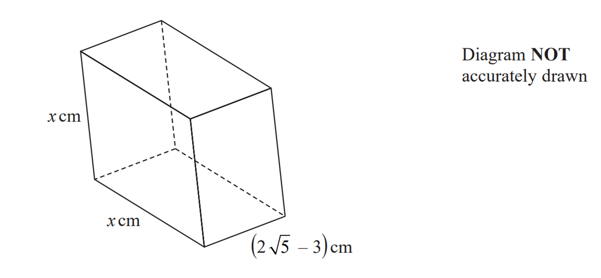

# Exam Questions — Surds
**Numbers & the Number System** · Edexcel IGCSE Maths A (4MA1) — 18/Higher
> Source: [https://www.savemyexams.com/igcse/maths/edexcel/a/18/higher/topic-questions/1-numbers-and-the-number-system/surds/exam-questions/](https://www.savemyexams.com/igcse/maths/edexcel/a/18/higher/topic-questions/1-numbers-and-the-number-system/surds/exam-questions/) · 35 questions · total 102 marks

## Q1 — medium — 4 marks · exam-questions

### 25((a)) — 2 marks — command: prove — structured — from paper 2014	June · 1MA0/1H
Show that $\frac{12}{\sqrt{3}}$ can be rewritten as $4\sqrt{3}$

### 25((b)) — 2 marks — command: prove — structured — from paper 2014	June · 1MA0/1H
Show that $( \sqrt{2} + \sqrt{8} )^{2} = 18$

## Q2 — medium — 2 marks · exam-questions

### 22((c)) — 2 marks — command: prove — structured — from paper 2015	June · 1MA0/1H
Show that $( \sqrt{12} - \sqrt{3} )^{2} = 3$

## Q3 — medium — 2 marks · exam-questions

### 18() — 2 marks — structured — from paper 2015	November · 1MA0/1H
Show that $\frac{10}{\sqrt{5}}$ can be rewritten as $2\sqrt{5}$

## Q4 — medium — 2 marks · exam-questions

### 1() — 2 marks — command: prove — structured
Show that $\frac{\sqrt{12}}{\sqrt{3+2}}$

can be written in the form $a\sqrt{b}$where $a$ is a simplified fraction and $b$ is an integer.

## Q5 — medium — 3 marks · exam-questions

### 17((a)) — 3 marks — command: prove — structured — from paper Jan 2020 · 4MA1/1H
Show that `( 6 + 2 sqrt index _ of 12 ) ^2 = 12 ( 7 + 4 sqrt( 3 )`

Show each stage of your working.

## Q6 — medium — 3 marks · exam-questions

### 22() — 3 marks — command: prove — structured — from paper June 2018 · 4MA1/2HR
Show that $\frac{\sqrt{20}+\sqrt{80}}{\sqrt{3}}$ can be expressed in the form $\sqrt{a}$ where $a$ is an integer.

Show your working clearly.

## Q7 — medium — 2 marks · exam-questions

### 21((a)) — 2 marks — structured — from paper June 2018 · 4MA1/2H
Show that $\sqrt{45}+\sqrt{20}=5\sqrt{5}$ 
Show your working clearly.

## Q8 — medium — 2 marks · exam-questions

### 12((a)) — 2 marks — structured — from paper Specimen 2015 · J560/04
Without using a calculator, show that $\sqrt{20}=2\sqrt{5}$.

## Q9 — hard — 3 marks · exam-questions

### 1() — 3 marks — command: show — structured
Rationalise the denominator $\frac{3}{8-\sqrt{2}}$

Show each stage of your working. Give your answer in the form  $a+b\sqrt{2}$ where $a$ and $b$ are fractions in their simplest forms.

## Q10 — hard — 4 marks · exam-questions

### 26((a)) — 2 marks — structured — from paper 2012	November · 1MA0/1H
Show that $\frac{5}{\sqrt{2}}$ can be written as $\frac{5\sqrt{2}}{2}$

### 26((b)) — 2 marks — command: prove — structured — from paper 2012	November · 1MA0/1H
Show that $( 2 + \sqrt{3} )^{2} - ( 2 - \sqrt{3} )^{2} = 8 \sqrt{3}$

## Q11 — hard — 2 marks · exam-questions

### 21() — 2 marks — command: prove — structured — from paper 2014	November · 1MA0/1H
Show that $( 1 + \sqrt{2} ) ( 3 - \sqrt{2} ) = 1 + 2 \sqrt{2}$

## Q12 — hard — 2 marks · exam-questions

### 20((a)) — 1 mark — command: find — structured — from paper 2018	June · 1MA1/2H
Martin did this question.

| Rationalise the denominator of     $\frac{14}{2+\sqrt{3}}$ |
|---|

Here is how he answered the question.

$\begin{gathered} \frac{14}{2 + \sqrt{3} } & = \frac{14 \times ( 2 - \sqrt{3} )}{( 2 + \sqrt{3} ) ( 2 - \sqrt{3} )} \\ \\ = \frac{28 - 14 \sqrt{3} }{4 + 2 \sqrt{3} - 2 \sqrt{3} + 3} \\ = \frac{28 - 14 \sqrt{3} }{7} \\ = 4 - 2 \sqrt{3} \end{gathered}$

Martin's answer is wrong.

Find Martin's mistake.

### 20((b)) — 1 mark — command: find — structured — from paper 2018	June · 1MA1/2H
Sian did this question.

| Rationalise the denominator of    $\frac{5}{\sqrt{12}}$ |
|---|

Here is how she answered the question.

*      *$\begin{gathered} \frac{5}{ \sqrt{12} } & = \frac{5 \sqrt{12} }{ \sqrt{12} \times \sqrt{12} } \\ \\ = \frac{5 \times 3 \sqrt{2} }{12} \\ = \frac{5 \sqrt{2} }{4} \end{gathered}$

Sian's answer is wrong.

Find Sian's mistake.

## Q13 — hard — 3 marks · exam-questions

### 19() — 3 marks — command: simplify — structured — from paper 2015	Spec1 · 1MA1/1H
Simplify fully  $\frac{( 6 - \sqrt{5} ) ( 6 + \sqrt{5} )}{ \sqrt{31} }$

You must show your working.

## Q14 — hard — 3 marks · exam-questions

### 13() — 3 marks — command: state — structured — from paper 2018	June · 1MA1/1H
Show that $\sqrt{5} ( \sqrt{8} + \sqrt{18} )$ can be written in the form $a\sqrt{10}$ and state the value of $a$. You must show your full working.

## Q15 — hard — 2 marks · exam-questions

### 14() — 2 marks — command: prove — structured — from paper 2015	Spec2 · 1MA1/1H
Show that    $\frac{( 4 - \sqrt{3} ) ( 4 + \sqrt{3} )}{ \sqrt{13} }$ simplifies to  $\sqrt{13}$.

## Q16 — hard — 5 marks · exam-questions

### 18((a)) — 2 marks — command: prove — structured — from paper June 2019 · 1MA1/1H
Show that $\sqrt{3}+\sqrt{12}$ can be rewritten as $3\sqrt{3}$

### 18((b)) — 3 marks — command: prove — structured — from paper June 2019 · 1MA1/1H
Show that $( \frac{1}{ \sqrt{3} } )^{7} = \frac{ \sqrt{3} }{81}$

## Q17 — hard — 3 marks · exam-questions

### 14((b)) — 3 marks — command: give — structured — from paper Specimen 2016 · 4MA1/2H
Rationalise the denominator of  $\frac{4}{7-\sqrt{5}}$

Show each stage of your working.

Give your answer in the form $a+b\sqrt{5}$ where $a$ and $b$ are fractions in their simplest forms.

## Q18 — hard — 2 marks · exam-questions

### 13((b)) — 2 marks — command: express — structured — from paper Jan 2020 · 4MA1/1HR
Given that $y$ is a prime number,

express $\frac{3}{2-\sqrt{y}}$ in the form $\frac{a+b\sqrt{y}}{c-y}$ where $a$ , $b$ and $c$are integers.

## Q19 — hard — 3 marks · exam-questions

### 22() — 3 marks — command: simplify — structured — from paper Nov 2020 · 4MA1/1H
Without using a calculator, rationalise the denominator of $\frac{6}{3-\sqrt{7}}$

Simplify your answer. 
You must show each stage of your working.

## Q20 — hard — 3 marks · exam-questions

### 21() — 3 marks — structured — from paper Jan 2019 · 4MA1/1HR
Show that  $\frac{\sqrt{8}}{\sqrt{8}-2}$ can be written in the form $n+\sqrt{n}$ , where $n$ is an integer.

Show your working clearly.

## Q21 — hard — 2 marks · exam-questions

### 21((b)) — 2 marks — command: express — structured — from paper June 2018 · 4MA1/2H
Express $\frac{2}{\sqrt{3}-1}$ in the form $p+\sqrt{q}$

where $p$ and $q$ are integers. 
Show your working clearly.

## Q22 — hard — 3 marks · exam-questions

### 22() — 3 marks — command: prove — structured — from paper June 2019 · 8300/2H
Show that  $( 5 \sqrt{3} - \sqrt{12} )^{2}$  simplifies to an integer.

## Q23 — hard — 3 marks · exam-questions

### 14((b)) — 3 marks — structured — from paper Specimen paper · 4MA1/2H
Rationalise the denominator of  $\frac{4}{7-\sqrt{5}}$

Show each stage of your working.

Give your answer in the form $a+b\sqrt{5}$ where $a$ and $b$ are fractions in their simplest forms.

## Q24 — hard — 3 marks · exam-questions

### 15((b)) — 3 marks — command: express — structured — from paper 2023 Nov · 4MA1/2H
Express $\frac{\sqrt{125}+\sqrt{80}}{\sqrt{3}}$ in the form $\sqrt{n}$ where $n$ is an integer.
Show your working clearly.

## Q25 — very_hard — 4 marks · exam-questions

### 21() — 4 marks — command: prove — structured — from paper 2017	June · 1MA0/1H
$a=\sqrt{8}+2$ 
$b=\sqrt{8}-2$ 
$T=a^{2}-b^{2}$

Show that $T=c\sqrt{2}$ stating the value of $c$

## Q26 — very_hard — 3 marks · exam-questions

### 21() — 3 marks — command: prove — structured — from paper 2017	November · 1MA1/1H
Show that  $\frac{6-\sqrt{8}}{\sqrt{2}-1}$  can be written in the form $a+b\sqrt{2}$  where $a$ and $b$ are integers.

## Q27 — very_hard — 3 marks · exam-questions

### 23() — 3 marks — command: prove — structured — from paper 2015	Sample · 1MA1/1H
Show that $\frac{1}{1+\frac{1}{\sqrt{2}}}$ can be written as $2-\sqrt{2}$

## Q28 — very_hard — 3 marks · exam-questions

### 13() — 3 marks — command: find — structured — from paper Jan 2022 · 4MA1/2HR
$\begin{array}{rcl} a = \sqrt{8} + 4 \\ b = \sqrt{8} - 4 \end{array}$

$(a--b)(a+b)$ can be written in the form $y\sqrt{4y}$

Find the value of $y$ 
Show your working clearly.

## Q29 — very_hard — 3 marks · exam-questions

### 19() — 3 marks — command: rearrange — structured — from paper Jan 2019 · 4MA1/1H
Rationalise the denominator of $\frac{a+\sqrt{4b}}{a-\sqrt{4b}}$ where $a$ is an integer and $b$ is a prime number.

Simplify your answer.

## Q30 — very_hard — 3 marks · exam-questions

### 15((b)) — 3 marks — command: prove — structured — from paper Jan 2021 · 4MA1/1HR
Show that $\frac{2}{6-3\sqrt{2}}$ can be written in the form $\frac{a+\sqrt{a}}{b}$

where $a$ and $b$ are integers. 
Show your working clearly.

## Q31 — very_hard — 3 marks · exam-questions

### 17() — 3 marks — command: express — structured — from paper Nov 2021 · 4MA1/2H
Express $\frac{8}{\sqrt{5}-1}$ in the form $\sqrt{a}+b$ where a and b are integers.

Show each stage of your working clearly.

## Q32 — very_hard — 3 marks · exam-questions

### 20() — 3 marks — command: find — structured — from paper Jan 2020 · 4MA1/2H
The area of a rectangle is $18$ $\mathrm{cm}^{2}$

The length of the rectangle is $( \sqrt{7 } + 1 )$ $\mathrm{cm}$.

Without using a calculator and showing each stage of your working, find the width of the rectangle.

Give your answer in the form $a\sqrt{b}+c$ where $a$, $b$ and $c$ are integers.

.....................$\mathrm{cm}$

## Q33 — very_hard — 3 marks · exam-questions

### 16() — 3 marks — command: give — structured — from paper June 2019 · 4MA1/2H
Show that $\frac{4+\sqrt{8}}{\sqrt{2}-1}$can be written in the form $a+b\sqrt{2}$, where $a$ and $b$ are integers.

Show each stage of your working clearly and give the value of a and the value of $b$.

## Q34 — very_hard — 4 marks · exam-questions

### 15() — 4 marks — command: prove — structured — from paper Nov 2017 · J560/04
Show that $\frac{( 4 + 2 \sqrt{5} )}{ \sqrt{5} - 1}$ can be simplified to $\frac{3\sqrt{5}+7}{2}$

## Q35 — very_hard — 4 marks · exam-questions

### 23() — 4 marks — command: find — structured — from paper 2023 June · 4MA1/2H
The diagram shows a cuboid with a square cross section.

The volume of the cuboid is $( 13 + 6 \sqrt{5} )$cm3

Without using a calculator, find the value of $x$
Give your answer in the form $a+\sqrt{b}$ where $a$ and $b$ are integers. 
Show your working clearly
