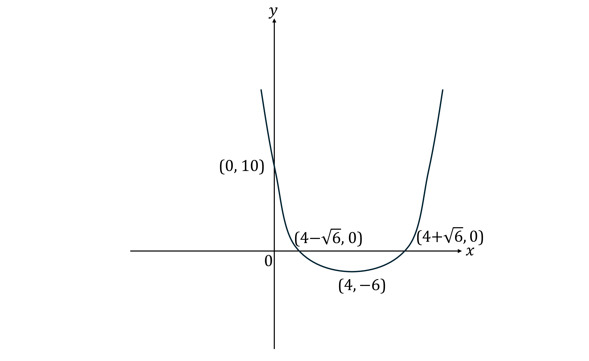

# Mark Schemes — Completing the Square
**Equations, Formulae & Identities** · Edexcel IGCSE Maths A (4MA1) — 18/Higher

## Q1 — medium — 2 marks · exam-questions

### 13() — 2 marks
> *The formula for completing the square for a quadratic in the form*$x^{2}+bx+c$*is*$( x + \frac{b}{2} )^{2} - ( \frac{b}{2} )^{2} + c$*.*

> *Complete the square by dividing the middle term (6) by 2.*

$\begin{gathered} x^{2} + 6 x - 7 & = ( x + \frac{6}{2} )^{2 } - ( \frac{6}{2} )^{2} - 7 \\ = ( x + 3 )^{2} - 3^{2} - 7 \end{gathered}$

**Correct expression in the brackets**** [1]**

> *Simplify.*

$\begin{gathered} ( x + 3 )^{2} - 9 - 7 \end{gathered}$

$( x + 3 )^{2} - 16$* ***[1]**

## Q2 — medium — 2 marks · exam-questions

### 11() — 2 marks
> *The formula for completing the square for a quadratic in the form*$x^{2}+bx+c$*is*$( x + \frac{b}{2} )^{2} - ( \frac{b}{2} )^{2} + c$*.*

> *Complete the square by dividing the middle term (2) by 2.*

$\begin{gathered} x^{2} + 2 x - 8 & = ( x + \frac{2}{2} )^{2 } - ( \frac{2}{2} )^{2} - 8 \\ = ( x + 1 )^{2} - 1^{2} - 8 \end{gathered}$

**Correct expression in the brackets**** [1]**

> *Simplify.*

$\begin{gathered} ( x + 1 )^{2} - 1 - 8 \end{gathered}$

$( x + 1 )^{2} - 9$* ***[1]**

## Q3 — medium — 2 marks · exam-questions

### 16((b)) — 2 marks
> *The formula for completing the square for a quadratic in the form*$x^{2}+bx+c$*is*$( x + \frac{b}{2} )^{2} - ( \frac{b}{2} )^{2} + c$*.*

> *Complete the square by dividing the middle term (-10) by 2.*

$\begin{gathered} x^{2} - 10 x + 40 & = ( x - \frac{10}{2} )^{2 } - ( \frac{10}{2} )^{2} + 40 \\ = ( x - 5 )^{2} - 5^{2} + 40 \end{gathered}$

**[1]**

> *Simplify.*

$( x - 5 )^{2} - 25 + 40 = ( x - 5 )^{2} + 15$

$( x - 5 )^{2} + 15$* ***[1]**

## Q4 — medium — 1 marks · exam-questions

### 23() — 1 marks
*Quadratic curves given in the form **y** = (**x** + **p**)**2** + **q** have turning points at (-**p**, **q**)* *Use this rule on **y** = (**x** + 3)**2** + 5*

**p*** = -3,  ***q*** = 5*

**(-3, 5)** **[1]**

## Q5 — medium — 3 marks · exam-questions

### 19((a)) — 3 marks
> *The format required is in completed square form. *

> *Compare the given expression to the perfect square (**x -** 5)**2 **= **x**2** - 10**x** + 25. *

> *This has same same first two terms as the given expression, but the third term is 3 more (22 + 3 = 25) so we need to subtract 3 from the perfect square.*

$\begin{gathered} x^{2} - 10 x + 22 & = ( x - 5 )^{2} - 3 \end{gathered}$

** ****Comparing with (x-5)****2**** [1] **
**Comparing 22 with 25**** [1]**

> *Check by expanding and simplifying.*

$\begin{gathered} ( x - 5 )^{2} - 3 & = ( x - 5 ) ( x - 5 ) - 3 \\ = x^{2} - 10 x + 25 - 3 \\ = x^{2} - 10 x + 22 \end{gathered}$

`equation` **[1]**

## Q6 — medium — 3 marks · exam-questions

### 20((a)) — 3 marks
> *The formula for completing the square for a quadratic in the form*$x^{2}+bx+c$*is*$( x + \frac{b}{2} )^{2} - ( \frac{b}{2} )^{2} + c$*.*

> *Complete the square by dividing the middle term (6) by 2.*

$\begin{gathered} x^{2} - 6 x + 11 & = ( x - \frac{6}{2} )^{2 } - ( \frac{6}{2} )^{2} + 11 \\ = ( x - 3 )^{2} - 3^{2} + 11 \end{gathered}$

**Correct expression in the brackets**** [1] **
**Correct comparison outside of brackets**** [1]**

> *Simplify.*

$\begin{gathered} ( x - 3 )^{2} - 9 + 11 \end{gathered}$

$( x - 3 )^{2} + 2$* ***[1]**

## Q7 — medium — 4 marks · exam-questions

### 17((a)) — 4 marks
> *The format required is in completed square form. *

> *Compare the given expression to the perfect square (**x **+ 4)**2 **= **x**2 **+ 8**x** + 16. *

> *This has same same first two terms as the given expression, but the third term is 13 more (16 - 3 = 13) so we need to subtract 13 from the perfect square.*

$\begin{gathered} x^{2} + 8 x + 3 & = ( x + 4 )^{2} - 16 + 3 \\ = ( x + 4 )^{2} - 13 \end{gathered}$

** ****Comparing with (x+4)****2**** [1]**
**Comparing 16 with 3**** [1]**

> *Check by expanding and simplifying.*

$\begin{gathered} ( x + 4 )^{2} - 13 & = ( x + 4 ) ( x + 4 ) - 13 \\ = x^{2} + 8 x + 16 - 13 \\ = x^{2} + 8 x + 3 \end{gathered}$

`equation` **[1]**

## Q8 — medium — 3 marks · exam-questions

### 16() — 3 marks
> *The format required is in completed square form. *

> *Compare the given expression to the perfect square using half of the middle term. *

> *Compare **x**2 **- 10**x** + 16 to (**x **- 5)**2 **= **x**2 **- 10**x** + 25. *

> *This has same same first two terms as the given expression, but the third term is 9 more (25 - 16 = 9) so we need to subtract 9 from the perfect square.*

$\begin{gathered} x^{2} - 10 x + 16 & = ( x - 5 )^{2} - 9 \end{gathered}$

** ****Comparing with (x-5)****2**** [1] **
**Comparing 16 with 9**** [1]**

> *Check by expanding and simplifying.*

$\begin{gathered} ( x - 5 )^{2} - 9 & = ( x - 5 ) ( x - 5 ) - 9 \\ = x^{2} - 10 x + 25 - 9 \\ = x^{2} - 10 x + 16 \end{gathered}$

`equation` **[1]**

## Q9 — medium — 2 marks · exam-questions

### 8((c)) — 2 marks
*The result required is in completed square form.*

> *To complete the square, set up a squared bracket with two terms; *$x$* and half of the coefficient of the *$x$* term - in this case 5. *

> *The squared brackets would then produce an extra, unwanted constant term, so we need to subtract this; in this case the unwanted constant would be 5**2** = 25.*

$\begin{array}{rcl} x^{2} + 10 x + 14 & = ( x + 5 )^{2} - 25 + 14 \end{array}$

**[1]**

$\begin{gathered} = ( x + 5 )^{2} - 11 \end{gathered}$

`equation` **[1]**

## Q10 — medium — 3 marks · exam-questions

### 13() — 3 marks
> *This question is effectively asking you to "complete the square"*

> *Halve the coefficient of *$x$* and put it in a bracket, squared*

$(x+2)^{2}$

**[1]**

> *Subtract the number in the bracket, squared*

$(x+2)^{2}-4$

> *This is equivalent to *$x^{2}+4x$* (you could check by expanding it), so we just need to subtract 9 to make it equivalent to the original expression*

$(x+2)^{2}-4-9\,(x+2)^{2}-13$

$a=2$**              **
$b=-13$ **[2]**

**3 marks for fully correct answer, 2 marks if either a or b correct**

## Q11 — hard — 4 marks · exam-questions

### 25((a)) — 3 marks
> *The formula for completing the square for a quadratic in the form*$x^{2}+bx+c$*is*$( x + \frac{b}{2} )^{2} - ( \frac{b}{2} )^{2} + c$*.*

> *Complete the square by dividing the middle term (-8) by 2.*

$\begin{gathered} x^{2} - 8 x + 21 & = ( x - \frac{8}{2} )^{2 } - ( \frac{8}{2} )^{2} + 21 \\ = ( x - 4 )^{2} - 4^{2} + 21 \end{gathered}$

**Correct expression in the brackets**** [1] **
**Correct values outside of the brackets (may be simplified) ****[1]**

> *Simplify.*

$\begin{gathered} ( x - 4 )^{2} - 4^{2} + 21 & = ( x - 4 )^{2} - 16 + 21 \\ = ( x - 4 )^{2} + 5 \end{gathered}$

$a=4,b=5$* ***[1]**

### 25((b)) — 1 marks
> *M** is the minimum point, or the turning point of the graph. The turning point of *$( x - a )^{2 } + b$*is at the point *$(a,b).$

$a=4,b=5$

$(4,5)$* ***[1]**

## Q12 — hard — 3 marks · exam-questions

### 19() — 3 marks
i) *The expression for the answer is in the form for completing the square.*

> *The formula for completing the square for a quadratic in the form*$x^{2}+bx+c$*is*$( x + \frac{b}{2} )^{2} - ( \frac{b}{2} )^{2} + c$*.*

> *Complete the square by dividing the middle term (-6) by 2.*

$\begin{gathered} x^{2} - 6 x + 1 & = ( x - \frac{6}{2} )^{2 } - ( \frac{6}{2} )^{2} + 1 \\ = ( x - 3 )^{2} - 3^{2} + 1 \end{gathered}$

**[1]**

> *Simplify.*

$\begin{gathered} ( x - 3 )^{2} - 3^{2} + 1 & = ( x - 3 )^{2} - 9 + 1 \\ = ( x - 3 )^{2} - 8 \end{gathered}$

$a=3,b=8$* ***[1]**

ii) *The turning point of *$( x - a )^{2 } - b$*is at the point *$(a,-b).$

$a=3,b=8$

$(3,-8)$* ***[1]**

## Q13 — hard — 2 marks · exam-questions

### 19((b)) — 2 marks
> *The formula for completing the square for a quadratic in the form*$ax^{2}+bx+c$* is *$a ( x + \frac{b}{2 a} )^{2} - \frac{b^{2}}{4 a} + c$*. Applying this formula gives*

$3 x^{2} + 12 x + 19 = 3 ( x + \frac{12}{2 \times 3} )^{2} - \frac{12^{2}}{4 \times 3} + 19$

**[1]**

> *Simplify.*

$\begin{array}{rcl} 3 x^{2} + 12 x + 19 & = 3 ( x + 2 )^{2} - 12 + 19 \\ = 3 ( x + 2 )^{2} + 7 \end{array}$

$\therefore 3 x^{2} + 12 x + 19 = 3 ( x + 2 )^{2} + 7$* ***[1]**

**i.e.  **$a=3,b=2,c=7$**.**

## Q14 — hard — 3 marks · exam-questions

### 17((c)) — 3 marks
> *The formula for completing the square for a quadratic in the form*$ax^{2}+bx+c$* is *$a ( x + \frac{b}{2 a} )^{2} - \frac{b^{2}}{4 a} + c$*. Applying this formula gives*

$4 x^{2} - 8 x + 7 = 4 ( x + \frac{- 8}{2 \times 4} )^{2} - \frac{( - 8 )^{2}}{4 \times 4} + 7$

**[1]**

> *Simplify.*

$\begin{array}{rcl} 4 x^{2} - 8 x + 7 & = 4 ( x - 1 )^{2} - 4 + 7 \\ = 4 ( x - 1 )^{2} + 3 \end{array}$

**[1]**

** **$\therefore 4 x^{2} - 8 x + 7 = 4 ( x - 1 )^{2} + 3$* ***[1]**

**i.e.  **$a=4,b=-1,c=3$**.**

## Q15 — hard — 4 marks · exam-questions

### 23((a)) — 3 marks
> *The formula for completing the square for a quadratic in the form*$ax^{2}+bx+c$* is *$a ( x + \frac{b}{2 a} )^{2} - \frac{b^{2}}{4 a} + c$*. *

> *Applying this formula gives*

$3 x^{2} - 12 x + 7 = 3 ( x + \frac{- 12}{2 \times 3} )^{2} - \frac{( - 12 )^{2}}{4 \times 3} + 7$

**[1]**

> *Simplify.*

$\begin{gathered} 3 x^{2} - 12 x + 7 & = 3 ( x - 2 )^{2} - 12 + 7 \\ = 3 ( x - 2 )^{2} - 5 \end{gathered}$

**[1] **

$\therefore 3 x^{2} - 12 x + 7 = 3 ( x - 2 )^{2} - 5$* ***[1]**

**i.e.  **$a=3,b=-2,c=-5$**.**

### 23((b)) — 1 marks
> *Quadratic graphs are parabolas that have a line of symmetry that passes through the turning point.*

> *The quadratic graph *$y=3x^{2}-12x+7$* is a positive quadratic (positive x**2** term) so its turning point will be a minimum point.*

> *The minimum point is found by completing the square.*

$3 x^{2} - 12 x + 7 = 3 ( x - 2 )^{2} - 5$

> *The minimum point of *$a ( x + b )^{2} + c$* is *$( - b , c )$*.*

$\therefore Min. \text{point} \text{is} ( 2 , - 5 )$

*The line of symmetry will be a vertical line passing through this point, but we need its equation for the answer.*

> *Vertical lines have equations of the form *$x=k$*.*

**The line of symmetry L has equation**** **$x=2$ **[1]**

**You could sketch the graph if it helps you to see the symmetry.**

## Q16 — hard — 2 marks · exam-questions

### 21((c)) — 2 marks
> *The formula for **completing the square** for a quadratic in the form*$x^{2}+bx+c$*is*$( x + \frac{b}{2} )^{2} - ( \frac{b}{2} )^{2} + c$*.*

> *Apply the formula, dividing the middle term (*$6\sqrt{2}$*) by 2.  Try not be put off by the surd!*

$\begin{gathered} x^{2} + 6 \sqrt{2} x - 1 & = ( x + \frac{6 \sqrt{2} }{2} )^{2} - ( \frac{6 \sqrt{2} }{2} )^{2} - 1 \\ = ( x + 3 \sqrt{2} )^{2} - ( 3 \sqrt{2} )^{2} - 1 \end{gathered}$

**[1]**

> *Simplify.*

$\begin{gathered} ( x + 3 \sqrt{2} )^{2} - ( 3 \sqrt{2} )^{2} + 1 & = ( x + 3 \sqrt{2} )^{2} - 18 - 1 \\ = ( x + 3 \sqrt{2} )^{2} - 19 \end{gathered}$

$\thereforex^{2}+6\sqrt{2}x-1=(x+3\sqrt{2})^{2}-19$* ***[1]**

**i.e.  **$a=3\sqrt{2},b=-19$

## Q17 — hard — 3 marks · exam-questions

### 25() — 3 marks
> *The formula for completing the square for a quadratic in the form*$x^{2}+bx+c$*is*$( x + \frac{b}{2} )^{2} - ( \frac{b}{2} )^{2} + c$*.*

> *Complete the square by dividing the middle term (14) by 2.*

$\begin{gathered} x^{2} + 14 x + 52 & = ( x + \frac{14}{2} )^{2 } - ( \frac{14}{2} )^{2} + 52 \\ = ( x + 7 )^{2} - 7^{2} + 52 \end{gathered}$

**Correct expression in the brackets**** [1] **
**Correct values outside of the brackets (may be simplified) ****[1]**

> *Simplify.*

$\begin{gathered} ( x + 7 )^{2} - 7^{2} + 52 & = ( x + 7 )^{2} - 49 + 52 \\ = ( x + 7 )^{2} + 3 \end{gathered}$**  **

*Quadratic curves given in the form **y** = (**x** + **p**)**2** + **q** have turning points at (-**p**, **q**)* *Use this rule on **y** = (**x** + 7)**2** + 3*

**p*** = -7,  ***q*** = 3*

**(-7, 3)** **[1]**

## Q18 — hard — 7 marks · exam-questions

### 18((a)) — 7 marks
i) *The format required is in completed square form.*

> *The formula for completing the square for a quadratic in the form*$x^{2}+bx+c$*is*$( x + \frac{b}{2} )^{2} - ( \frac{b}{2} )^{2} + c$*.*

> *Complete the square by dividing the middle term (4) by 2.*

$\begin{gathered} x^{2} + 4 x - 16 & = ( x + \frac{4}{2} )^{2 } - ( \frac{4}{2} )^{2} - 16 \\ = ( x + 2 )^{2} - 2^{2} - 16 \end{gathered}$

**Correct expression in the brackets**** [1] **
**Comparison outside of brackets**** [1]**

> *Simplify.*

$\begin{gathered} ( x + 2 )^{2} - 4 - 16 \end{gathered}$

$( x + 2 )^{2} - 20$* ***[1]**

ii) *The expression has already been converted into completed square form so the easiest way to solve it is to use this form.*

> *Substitute **x**2 **+ 4**x **- 16 for the form found in part (i).*

$\begin{gathered} ( x + 2 )^{2} - 20 & = 0 \end{gathered}$

> *Add 20 to both sides of the equation.*

$\begin{array}{rcl} ( x + 2 )^{2} & = 20 \end{array}$

**[1]**

> *Take the square root of both sides of the equation.*

$\begin{gathered} ( x + 2 )^{2} & = 20 \\ \sqrt{ } & = \sqrt{ } \\ x + 2 & = \pm \sqrt{20} \end{gathered}$

**[1]**

> *Solve by subtracting 2 from each side.*

$\begin{gathered} x & = \pm \sqrt{20} - 2 \end{gathered}$

**[1]**

> *This is solved but not in the simplest form as the surd can still be simplified.  *

> *Simplify the surd by looking for the biggest factor of 20 that is a square number.*

$\begin{gathered} x & = \pm \sqrt{20 - 2 = \pm \sqrt{4} \times 5} - 2 = \pm \sqrt{4} \sqrt{5} - 2 \end{gathered}$

> *Write the answer as simply as possible.*

$x=2\sqrt{5}-2\mathrm{or}x=-2\sqrt{5}-2$** [1]**

** **

## Q19 — hard — 3 marks · exam-questions

### 16() — 3 marks
*Method 1*

*Expand the right-hand side and collect the *$bx$*terms* * *

$\begin{array}{rcl} ( x + b )^{2} & = ( x + b ) ( x + b ) \\ = x^{2} + b x + b x + b^{2} \\ = x^{2} + 2 b x + b^{2} \end{array}$ * *

*Make *$x^{2}-12x+a$* equal to *$x^{2}+2bx+b^{2}$* by comparing each term* *The *$x^{2}$* terms are equal* *The *$x$* terms are equal if*

$-12=2b$

*Solve this equation to find *$b$* (by dividing both sides by 2)*

$\begin{array}{rcl} - \frac{12}{2} & = b \\ - 6 & = b \end{array}$

$b=-6$ **[1]**

*The number terms on the end are equal if*

$a=b^{2}$

**[1]**

*Substitute in *$b=-6$

$a = ( - 6 )^{2}
a = 36$

$a=36$ **[1]**

*Method 2*

*Complete the square on *$x^{2}-12x+a$* by replacing *$x^{2}-12x$* with *$( x - 6 )^{2} - 36$

$x^{2} - 12 x + a = ( x - 6 )^{2} - 36 + a$

$( x - 6 )^{2} - 36 + a$* must equal *$( x + b )^{2}$ *The brackets are equal if*

$b=-6$

$b=-6$ **[1]**

*The numbers outside the brackets are equal if*

$-36+a=0$

**[1]**

*Solve the equation to find *$a$* (by adding *$36$* to both sides)*

$a=36$

$a=36$ **[1]**

## Q20 — hard — 4 marks · exam-questions

### 9((a)) — 4 marks
i) *Halve the coefficient of **x **and this will be the value of **k**.*

$k=\frac{8}{2}=4$

**[1]**

> *Expand *$( x + 4 )^{2}$* by multiplying out *$( x + 4 ) ( x + 4 ).$

$( x + 4 )^{2} = x^{2} + 4 x + 4 x + 16
( x + 4 )^{2} = x^{2} + 8 x + 16$

> *You want the constant term to be -9 so subtract 16 from sides to get rid of the constant term. Then subtract 9 from both sides to make the constant term -9.*

$( x + 4 )^{2} - 16 - 9 = x^{2} + 8 x - 9$

> *Find the value of **h** by simplifying the term at the end.*

$h=-16-9=-25$

$(x+4)^{2}-25$ **[1]**

ii) *Rewrite the equation using the solution from part (i).*

$( x + 4 )^{2} - 25 = 0$

> *Add 25 to both sides.*

$( x + 4 )^{2} = 25$

> *Square root both sides. Remember there are two values, a positive and a negative.*

$x+4=\pm\sqrt{25}\,x+4=\pm5$

**[1]**

> *Subtract 4 from both sides.*

$x=-4\pm5$

> *Work out the two values separately.*

$\begin{gathered} x = - 4 + 5 = 1 \\ x = - 4 - 5 = - 9 \end{gathered}$

$x=-9$** ****or**** **$x=1$**[1]**

## Q21 — hard — 4 marks · exam-questions

### 18((a)) — 2 marks
> *Halve the coefficient of **x **and this will be the value of **k**.*

$k=\frac{-18}{2}=-9$

**[1]**

> *Expand *$( x - 9 )^{2}$* by multiplying out *$( x - 9 ) ( x - 9 ).$

$( x - 9 )^{2} = x^{2} - 9 x - 9 x + 81
( x - 9 )^{2} = x^{2} - 18 x + 81$

> *You want the constant term to be -27 so subtract 81 from sides to get rid of the constant term. *

> *Then subtract 27 from both sides to make the constant term -27.*

$( x - 9 )^{2} - 81 - 27 = x^{2} - 18 x - 27$

> *Find the value of **h** by simplifying the term at the end.*

$h=-81-27=-108$

$(x-9)^{2}-108$ **[1]**

### 18((b)) — 2 marks
> *Rewrite the equation using the solution from part (a).*

$( x - 9 )^{2} - 108 = 0$

> *Add 108 to both sides.*

$( x - 9 )^{2} = 108$

> *Square root both sides. Remember there are two values, a positive and a negative.*

$x-9=\pm\sqrt{108}$

**[1]**

> *Add 9 to both sides.*

$x=9\pm\sqrt{108}$

> *Simplify the expressions using your calculator.*

$x=9+6\sqrt{3}$** ****or**** **$x=9-6\sqrt{3}$**[1]**

**Rounding to 3sf is acceptable: **$x=19.4$** or **$x=-1.39$

## Q22 — hard — 6 marks · exam-questions

### 1() — 6 marks
Start the process to complete the square

$( x - 4 )^{2} - 16 + 10$

**[M1]**

Simplify

$( x - 4 )^{2} - 6$

**[A1]**

Use the completed square form to find the coordinates of the turning point

$( 4 , - 6 )$

Find the roots using the completed square

$\begin{gathered} ( x - 4 )^{2} - 6 & = 0 \\ ( x - 4 )^{2} & = 6 \\ x - 4 & = \pm \sqrt{6} \\ x & = 4 \pm \sqrt{6} \end{gathered}$

**[M1 A1]**

Sketch the graph with labelled intersections

- When $x=0$, $y=10$

**[B1 B1]**

> **[mark-scheme]**
> **M1 : **Process to complete the square.
> 
> **A1: **Correct completed square.
> 
> **M1: **Method to solve the completed square for $x$.
> 
> **B1: **For curve intercepting y axis at (0, 10).
> 
> **B1: **For a fully correct labelled graph.

## Q23 — hard — 5 marks · exam-questions

### 8((c)) — 2 marks
*The result required is in completed square form.* 
*To complete the square, set up a squared bracket with two *
*terms; *$x$* and half of the coefficient of the *$x$* term - in this case 5. *
*The squared brackets would then produce an extra, unwanted constant term, so we need to subtract this; in this case the unwanted constant would be 5**2** = 25.*

$\begin{gathered} x^{2} + 10 x + 14 & = ( x + 5 )^{2} - 25 + 14 \end{gathered}$

**[1]**

$\begin{gathered} = ( x + 5 )^{2} - 11 \end{gathered}$

`equation` **[1]**

### 8((c)) — 3 marks
*This is a positive quadratic (U-shape) so the turning point will be a minimum point.* 
*Using the answer to part i)*

*the minimum point has coordinates (-5, -11)*

> *(*$( x + 5 ) ^{2} \ge 0$* for all values of *$x$* and is minimum when *$( x + 5 ) = 0$*, *$x=-5$*.) *

> *No other points are required but to get the graph in the correct location we do need to know the *$y$*-axis intercept - which is when *$x=0$* - which is 14.*

**U-shape graph**** [1]*** *
**Turning point**** [1]*** *
**Graph in correct place**** [1]**

## Q24 — hard — 3 marks · exam-questions

### 19() — 3 marks
**Method 1**

> *To complete the square, start by taking a factor of 3 out of the first two terms*

$3 x^{2} - 6 x + 5 = 3 ( x^{2} - 2 x ) + 5$

**[M1]**

> *Then complete the square on the function in the brackets*

- *Halve the coefficient of  *$x$* for the constant inside the curved brackets*
- *and subtract that value squared*

$3 [ ( x - 1 )^{2} - 1^{2} ] + 5$

**[M1]**

> *Expand the square brackets and simplify*

$= 3 ( x - 1 )^{2} - 3 + 5
= 3 ( x - 1 )^{2} + 2$

> *That's in the form required, with *$a=3$*, *$b=1$* and *$c=2$

$3 ( x - 1 )^{2} + 2$

**[A1]**

**Method 2**

> *You could expand the *$a(x--b)^{2}+c$* and compare coefficients*

$\begin{gathered} a ( x - b )^{2} + c & = a ( x^{2} - 2 b x + b^{2} ) + c \\ = a x^{2} - 2 a b x + a b^{2} + c \end{gathered}$

**[M1]**

> *Set that equal to the original quadratic*

$3x^{2}-6x+5=ax^{2}-2abx+ab^{2}+c$

> *Comparing coefficients*

$a=3$

$\begin{gathered} - 2 a b & = - 6 \\ - 2 \times 3 \times b & = - 6 \\ b = 1 \end{gathered}$

$\begin{gathered} a b^{2} + c & = 5 \\ 3 \times 1^{2} + c & = 5 \\ c + 3 & = 5 \\ c = 2 \end{gathered}$

**[M1]**

$3 ( x - 1 )^{2} + 2$

**[A1]**

> **[mark-scheme]**
> For Method 2:
> 
> **M1**: For expanding the expression correctly.
> 
> **M1**: For equating the coefficients of at least two of these.
> 
> **A1**: For writing the correct answer with *a*, *b* and *c* in the right places.

## Q25 — very_hard — 4 marks · exam-questions

### 23((a)) — 3 marks
> *The result required is in completed square form. As the coefficient of **x**2 **is not 1, begin by factorising the number 2 from the first two terms of the expression. *

$\begin{gathered} 2 x^{2} + 16 x + 35 & = 2 ( x^{2 } + 8 x ) + 35 \end{gathered}$

**[1]**

> *Complete the square on the expression in the brackets. *

> *Set up a squared bracket with two terms; *$x$* and half of the coefficient of the *$x$* term - in this case 4. *

> *Considering that (**x **+ 4)**2 **= **x**2 **+ 8**x** + 16, we need to subtract 16.*

$\begin{gathered} 2 ( x^{2 } + 8 x ) + 35 & = 2 [ ( x + 4 )^{2} - 16 ] + 25 \end{gathered}$

> *Multiply out the 2.*

$\begin{gathered} 2 x^{2} + 16 x + 35 & = 2 [ ( x + 4 )^{2} - 16 ] + 35 \\ = 2 ( x + 4 )^{2} - 32 + 35 \end{gathered}$

**[1]**

$\begin{gathered} = 2 ( x + 4 )^{2} + 3 \end{gathered}$

$\begin{gathered} a & = 2 , b = 4 , c = 3 \end{gathered}$ **[1]**

### 23((b)) — 1 marks
> *The turning point of *$a ( x + b )^{2 } + c$*is at the point *$(-b,c).$

$b=4,c=3$

$(-4,3)$* ***[1]**

## Q26 — very_hard — 4 marks · exam-questions

### 20((a)) — 3 marks
*Completing the square is easiest when dealing with a single, positive **x**2** term, so take a factor of -3.*

> *To avoid fractions, take this factor out of the **x**2** and **x** terms only.*

$7 + 12 x - 3 x^{2} = 7 - 3 ( x^{2} - 4 x )$

**[1]**

> *Complete the square for the part in brackets.*

$7 - 3 ( x^{2} - 4 x ) = 7 - 3 [ ( x - 2 )^{2} - 4 ]$

**[1]**

> *Expand and rearrange into the required form.*

$\begin{array}{rcl} 7 - 3 [ ( x - 2 )^{2} - 4 ] & = 7 - 3 ( x - 2 )^{2} + 12 \\ = 19 - 3 ( x - 2 )^{2} \end{array}$

$\therefore7+12x-3x^{2}=19-3(x-2)^{2}$ **[1]**

**i.e. **$a=19,b=-3,c=-2$**.**

### 20((b)) — 1 marks
> *The maximum point is found by completing the square.*

$7 + 12 x - 3 x^{2} - 12 x + 7 = 19 - 3 ( x - 2 )^{2}$

> *The maximum point of *$a + b ( x + c )^{2}$* is *$( - c , a )$*.*

$\therefore Max. \text{point} \text{is} ( 2 , 19 )$

> *You can also deduce this logically - the maximum value will be when *$( x - 2 ) = 0$* as this will be the least amount possible to subtract from 19.  *$x-2=0$* when *$x=2$* and of course *$19-0=19$*.*

**The coordinates of A, the maximum point are **$(2,19)$ **[1]**

## Q27 — very_hard — 3 marks · exam-questions

### 23() — 3 marks
*Completing the square is easiest when dealing with a single, positive **x**2** term, so take a factor of -2.*

> *To avoid fractions, take this factor out of the **x**2** and **x** terms only.*

$7 - 12 x - 2 x^{2} = 7 - 2 ( x^{2} + 6 x )$

**[1]**

> *Complete the square for the part in brackets.*

$7 - 2 ( x^{2} + 6 x ) = 7 - 2 [ ( x + 3 )^{2} - 9 ]$

**[1]**

> *Expand and rearrange into the required form.*

$\begin{gathered} 7 - 2 [ ( x + 3 )^{2} - 9 ] & = 7 - 2 ( x + 3 )^{2} + 18 \\ = 25 - 2 ( x + 3 )^{2} \end{gathered}$

$\therefore7-12x-2x^{2}=25-2(x+3)^{2}$ **[1]**

**i.e. **$a=25,b=-2,c=3$**.**

## Q28 — very_hard — 2 marks · exam-questions

### 27((a)) — 2 marks
*Completing the square is easiest when dealing with a single, positive **x**2** term, so take a factor of -1.*

> *This is only necessary for the **x**2** and **x** terms so leave 5 as it is.*

$5 + 6 x - x^{2} = 5 - ( x^{2} - 6 x )$

> *Complete the square for the part in brackets.*

$5 - ( x^{2} - 6 x ) = 5 - [ ( x - 3 )^{2} - 9 ]$

**[1]**

> *Expand and rearrange into the required form.*

$\begin{array}{rcl} 5 - [ ( x - 3 )^{2} - 9 ] & = 5 - ( x - 3 )^{2} + 9 \\ = 14 - ( x - 3 )^{2} \end{array}$

$\thereforef(x)=5+6x-x^{2}=14-(x-3)^{2}$ **[1]**

**i.e. **$p=14,q=3$**.**

## Q29 — very_hard — 4 marks · exam-questions

### 22() — 4 marks
*Completing the square is easiest when dealing with a single, positive **x**2** term, so take a factor of -2.*

> *To avoid fractions, take this factor out of the **x**2** and **x** terms only.*

$5 + 12 x - 2 x^{2} = 5 - 2 ( x^{2} - 6 x )$

**[1]**

> *Complete the square for the part in brackets.*

$5 - 2 ( x^{2} - 6 x ) = 5 - 2 [ ( x - 3 )^{2} - 9 ]$

**[1]**

> *Expand and rearrange into the required form.*

$\begin{array}{rcl} 5 - 2 [ ( x - 3 )^{2} - 9 ] & = 5 - 2 ( x - 3 )^{2} + 18 \\ = 23 - 2 ( x - 3 )^{2} \end{array}$

**[1]**

** **$\therefore5+12x-2x^{2}=23-2(x-3)^{2}$ **[1]**

**i.e. **$a=23,b=-2,c=-3$**.**

## Q30 — very_hard — 2 marks · exam-questions

### 29((a)) — 2 marks
*Completing the square is easiest when dealing with a single, positive **x**2** term, so take a factor of -1.*

> *This is only necessary for the **x**2** and **x** terms so leave 7 as it is.*

$7 - 4 x - x^{2} = 7 - ( x^{2} + 4 x )$

> *Complete the square for the part in brackets.*

$7 - ( x^{2} + 4 x ) = 7 - [ ( x + 2 )^{2} - 4 ]$

**[1]**

> *Expand and rearrange into the required form.*

$\begin{gathered} 7 - [ ( x + 2 )^{2} - 4 ] & = 7 - ( x + 2 )^{2} + 4 \\ = 11 - ( x + 2 )^{2} \end{gathered}$

$\therefore7-4x-x^{2}=11-(x+2)^{2}$ **[1]**

**i.e. **$p=11,q=2$**.**

## Q31 — very_hard — 3 marks · exam-questions

### 25((a)) — 3 marks
*Factorise the 2 out of the first two terms* * *

$2 [ x^{2} - 3 x ] + 5$

**[1]**

*Complete the square on the expression inside the square brackets (by writing it as (**x** + **p**)**2** - **p**2 **where **p** is half of -3)* * *

$2 [ ( x - \frac{3}{2} )^{2} - ( - \frac{3}{2} )^{2} ] + 5
= 2 [ ( x - \frac{3}{2} )^{2} - \frac{9}{4} ] + 5$

**correct inside square-shaped brackets**** [1] **

*Expand the square-shaped brackets* * *

$2 ( x - \frac{3}{2} )^{2} - \frac{9}{2} + 5$ * *

*Simplify *$-\frac{9}{2}+5$* into one number* * *

$2 ( x - \frac{3}{2} )^{2} + 1 \frac{1}{2}$ * *

*This is in the form **a**(**x** - **b**)**2** + **c** * *Read off **a**, **b** and **c** (**b** will be positive, as the negative sign is already given in **x** - **b**)*

$a=2,b=\frac{3}{2},c=\frac{1}{2}$ **[1]**

**a**** = 2, ****b**** = 1.5 and ****c**** = 0.5 are also accepted**

## Q32 — very_hard — 4 marks · exam-questions

### 25() — 4 marks
> *The formula for completing the square for a quadratic in the form*$x^{2}+bx+c$*is*$( x + \frac{b}{2} )^{2} - ( \frac{b}{2} )^{2} + c$*.*

> *Complete the square.*

$( x + 2 )^{2 } - 4 - 3$

**Correct expression in the brackets**** [1] **
**Correct values outside of the brackets (may be simplified) ****[1]**

> *Simplify.*

$( x + 2 )^{2 } - 7$

**[1]**

> *The turning point of *$( x + a )^{2 } - b$*is at the point *$(-a,b)$

$(-2,-7)$* ***[1]**
