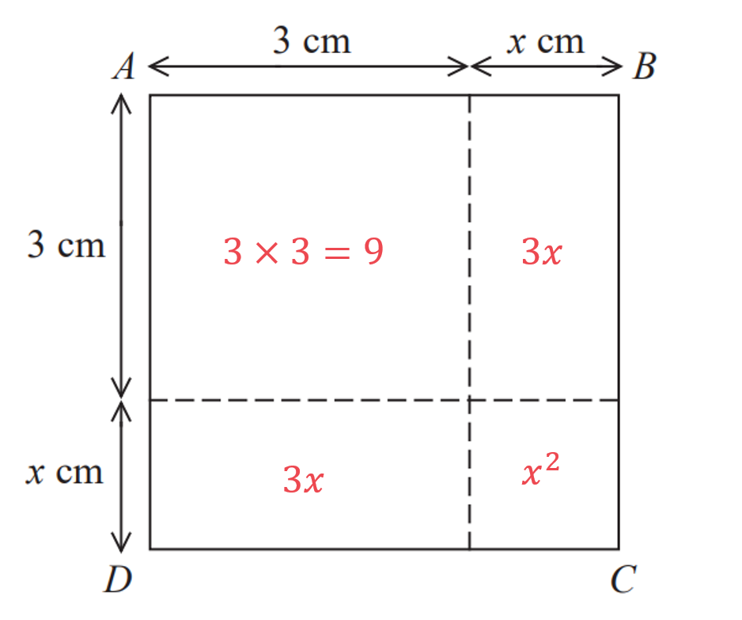

# Mark Schemes — Expanding Brackets
**Equations, Formulae & Identities** · Edexcel IGCSE Maths A (4MA1) — 18/Higher

## Q1 — easy — 1 marks · exam-questions

### 8((a)) — 1 marks
*Multiply the term outside the brackets by all the terms inside the brackets*

$3\times2y-3\times5$

$6y-15$ **[1]**

## Q2 — easy — 3 marks · exam-questions

### 11((a)) — 1 marks
*Multiply the term outside the brackets by all the terms inside the brackets*

$4\times3x+4\times5$

$12x+20$ **[1]**

### 11((b)) — 2 marks
*Multiply the terms outside the brackets by all the terms inside the brackets*

$2\timesx-2\times4+3\timesx+3\times5$

**first or second pair of terms correct** **[1]**

*Simplify the terms (by multiplying their parts together)*

$2x-8+3x+15$

*Collect the **x** terms*

$2x+3x=5x$

*Collect the numbers* * *

$-8+15=7$

> *Write down the final answer*

$5x+7$ **[1]**

## Q3 — easy — 3 marks · exam-questions

### 4((a)) — 1 marks
*Multiply the term outside the brackets by all the terms inside the brackets*

$3\times2+3\timest$

$6+3t$ **[1]**

### 4((b)) — 2 marks
*Multiply the term outside the brackets by all the terms inside the brackets*

$3x\times2x+3x\times5$

> *Simplify the terms (using *$x\timesx=x^{2}$*)*

$6x^{2}+15x$ **[1]**

## Q4 — easy — 1 marks · exam-questions

### 4((c)) — 1 marks
*Multiply the term outside the brackets by all the terms inside the brackets*

$4\timesx+4\times2$

$4x+8$ **[1]**

## Q5 — easy — 1 marks · exam-questions

### 6((a)) — 1 marks
*Multiply the term outside the brackets by all the terms inside the brackets*

$2m\timesm+2m\times3$

> *Simplify the terms (using *$m\timesm=m^{2}$*)*

$2m^{2}+6m$ **[1]**

## Q6 — easy — 2 marks · exam-questions

### 3((c)) — 2 marks
*Multiply the terms outside the brackets by all the terms inside the brackets*

$5\timesy-5\times2+2\timesy-2\times3$

**first or second pair of terms correct** **[1]**

*Simplify the terms (by multiplying their parts together)*

$5y-10+2y-6$

*Collect the **y** terms*

$5y+2y=7y$

*Collect the numbers* * *

$-10-6=-16$

> *Write down the final answer*

$7y-16$ **[1]**

## Q7 — easy — 3 marks · exam-questions

### 10((a)) — 1 marks
*Multiply the term outside the brackets by all the terms inside the brackets*

$x\timesx+x\times2$

> *Simplify the terms (using *$x\timesx=x^{2}$*)*

$x^{2}+2x$ **[1]**

### 10((b)) — 2 marks
*Multiply the terms outside the brackets by all the terms inside the brackets*

$3\timesy+3\times2+4\timesx-4\times1$

**first or second pair of terms correct** **[1]**

*Simplify the terms (by multiplying their parts together)*

$3y+6+4x-4$

*The 3**y** and 4**x** are not "like" terms (so cannot be combined any further) Collect the numbers* * *

$6-4=2$

> *Write down the final answer*

$3y+4x+2$ **[1]**

**The final answer can have the three terms in any order**

## Q8 — easy — 1 marks · exam-questions

### 2((c)) — 1 marks
> *Multiply the term outside the brackets by all the terms inside the brackets*

$x\timesx-x\times3$

> *Simplify the terms (using *$x\timesx=x^{2}$*)*

$x^{2}-3x$ **[1]**

## Q9 — easy — 2 marks · exam-questions

### 3((a)) — 2 marks
*Multiply the terms outside the brackets by all the terms inside the brackets*

$3\timesy-3\times2+5\times2y+5\times1$

**first or second pair of terms correct** **[1]**

*Simplify the terms (by multiplying their parts together)*

$3y-6+10y+5$

*Collect the **y** terms*

$3y+10y=13y$

*Collect the numbers* * *

$-6+5=-1$

> *Write down the final answer*

$13y-1$ **[1]**

## Q10 — easy — 1 marks · exam-questions

### 7((b)) — 1 marks
*Multiply the term outside the brackets by all the terms inside the brackets*

$3y\times4y-3y\times3$

> *Simplify the terms (by multiplying their parts together and using *$y\timesy=y^{2}$*)*

$12y^{2}-9y$ **[1]**

## Q11 — easy — 2 marks · exam-questions

### 11((a)) — 2 marks
*Multiply the terms outside the brackets by all the terms inside the brackets*

$3\timesx+3\times4+2\times5x-2\times1$

**first or second pair of terms correct** **[1]**

*Simplify the terms (by multiplying their parts together)*

$3x+12+10x-2$

*Collect the **x** terms*

$3x+10x=13x$

*Collect the numbers* * *

$12-2=10$

> *Write down the final answer*

$13x+10$ **[1]**

## Q12 — easy — 1 marks · exam-questions

### 7() — 1 marks
*Multiply the term outside the brackets by all the terms inside the brackets*

$7\timesx+7\times5$

$7x+35$ **[1]**

## Q13 — easy — 2 marks · exam-questions

### 1((c)) — 2 marks
*Multiply the term outside the bracket by each of the terms inside the bracket.*

> *Be careful with the second term being negative - we would assume this is *$+ 4 t \times ( - 2 )$* and so a positive multiplied by a negative would result in a negative.*

$\begin{gathered} 4 t ( 3 t - 2 ) & = 4 t \times 3 t - 4 t \times 2 \\ = 12 t^{2} - 8 t \end{gathered}$

**Final answer:** $4t(3t-2)=12t^{2}-8t$** **

**One term correct**** [1] **
**Fully correct**** [1]**

## Q14 — easy — 1 marks · exam-questions

### 1() — 1 marks
> *Expand the brackets by multiplying everything inside the brackets by everything outside the brackets.*

$4x^{2}\times3x+4x^{2}\times5$

> *Simplify by completing the multiplications.*

$12x^{3}+20x^{2}$* ***[1]**

> *If you try to combine the two different terms together, then you may end up with the incorrect answer of *$32x^{2}$*.*

> *If you add the numbers but multiply the *$x$*'s you may get the incorrect answer of *$7x^{3}+9x^{2}$*.*

> *If you multiply only part of the terms inside and outside the brackets, *$4x^{2}\times3+5$* then you will end up with the incorrect answer of *$12x^{2}+5$*.*

## Q15 — easy — 1 marks · exam-questions

### 3() — 1 marks
> *Expand these double brackets by multiplying everything in the first bracket by everything in the second bracket.*

$2x\times3x-4\times3x+2x\times5-4\times5$

> *Simplify by completing the multiplications.*

$6x^{2}-12x+10x-20$

> *Simplify by collecting "like" terms.*

$6x^{2}-2x-20$

> *Select the *$x$* term that appears in the given options.*

$-2x$* ***[1]**

> *If you forget the negative sign then you will get the incorrect answer of *$2x$*.*

> *If you get the incorrect sign for the *$-12x$* term then you will add this to the *$10x$* and get the incorrect answer of *$22x$*.*

> *If you get the incorrect sign for the *$10x$* term then you will add this to the *$-12x$* and get the incorrect answer of *$-22x$*.*

## Q16 — easy — 2 marks · exam-questions

### 5() — 2 marks
> *Write out the squared brackets as a set of identical double brackets.*

$( x - 8 ) ( x - 8 )$

> *Multiply everything in the first bracket by everything in the second bracket.*

$x\timesx-8\timesx-8\timesx-8\times-8$

> *Simplify by completing the multiplications.*

$x^{2}-8x-8x+64$

**[1]**

> *Simplify by collecting "like" terms.*

$x^{2}-16x+64$* ***[1]**

## Q17 — medium — 2 marks · exam-questions

### 4((d)) — 2 marks
*Multiply the terms inside the first bracket by 3 and the second bracket by -2*

$3\timesm+3\times4-2\times4m-2\times1$

*Simplify the terms (by multiplying their parts together)*

$3m+12-8m-2$

**first or second pair of terms correct** **[1]**

*Collect the **m** terms*

$3m-8m=-5m$

*Collect the numbers* * *

$12-2=10$

> *Write down the final answer*

$-5m+10$ **[1]**

## Q18 — medium — 2 marks · exam-questions

### 2() — 2 marks
*Multiply the terms inside the first bracket by 5 and the second bracket by -2*

$5 \times p + 5 \times 3 - 2 \times 1 - 2 \times ( - 2 p )$

*Simplify the terms (by multiplying their parts together and being careful with signs)*

$5p+15-2+4p$

**first or second pair of terms correct** **[1]**

*Collect the **p** terms*

$5p+4p=9p$

*Collect the numbers* * *

$15-2=13$

> *Write down the final answer*

$9p+13$ **[1]**

## Q19 — medium — 2 marks · exam-questions

### 14((a)) — 2 marks
*Multiply all terms in the first bracket by all terms in the second bracket* * *

$p \times p + p \times ( - 4 ) + 9 \times p + 9 \times ( - 4 )$ * *

*Simplify the terms (by multiplying their parts together)* * *

$p^{2}-4p+9p-36$

**3 out of 4 terms correct**** [1]**

*Collect the "like" **p** terms* * *

$-4p+9p=5p$ * *

> *Write out the final answer *

$p^{2}+5p-36$ **[1]**

## Q20 — medium — 2 marks · exam-questions

### 11((c)) — 2 marks
*Multiply all terms in the first bracket by all terms in the second bracket* * *

$x\timesx+x\times6+4\timesx+4\times6$ * *

*Simplify the terms (by multiplying their parts together)* * *

$x^{2}+4x+6x+24$

**3 out of 4 terms correct**** [1]**

*Collect the "like" **x** terms* * *

$4x+6x=10x$ * *

> *Write out the final answer *

$x^{2}+10x+24$ **[1]**

## Q21 — medium — 2 marks · exam-questions

### 4((c)) — 2 marks
*Multiply all terms in the first bracket by all terms in the second bracket* * *

$m\timesm+m\times10+3\timesm+3\times10$ * *

*Simplify the terms (by multiplying their parts together)* * *

$m^{2}+3m+10m+30$

**3 out of 4 terms correct**** [1]**

*Collect the "like" **m** terms* * *

$3m+10m=13m$ * *

> *Write out the final answer *

$m^{2}+13m+30$ **[1]**

## Q22 — medium — 2 marks · exam-questions

### 1() — 2 marks
Multiply the brackets

$p^{2}-6p+11p-66$

**[M1]**

Simplify the middle terms

$p^{2}+5p-66$

**[A1]**

## Q23 — medium — 2 marks · exam-questions

### 4((d)) — 2 marks
*Multiply all terms in the first bracket by all terms in the second bracket* * *

$x \times x + x \times 3 + ( - 5 ) \times x + ( - 5 ) \times 3$ * *

*Simplify the terms (by multiplying their parts together)* * *

$x^{2}+3x-5x-15$

**3 out of 4 terms correct**** [1]**

*Collect the "like" **x** terms* * *

$3x-5x=-2x$ * *

> *Write out the final answer *

$x^{2}-2x-15$** ****[1]**

## Q24 — medium — 2 marks · exam-questions

### 21((a)) — 2 marks
*Multiply all terms in the first bracket by all terms in the second bracket* * *

$y \times y + y \times ( - 5 ) + ( - 2 ) \times y + ( - 2 ) \times ( - 5 )$ * *

*Simplify the terms (by multiplying their parts together)* * *

$y^{2}-5y-2y+10$

**3 out of 4 terms correct**** [1]**

*Collect the "like" **y** terms* * *

$-5y-2y=-7y$ * *

> *Write out the final answer *

$y^{2}-7y+10$ **[1]**

## Q25 — medium — 2 marks · exam-questions

### 19((a)) — 2 marks
*Multiply all terms in the first bracket by all terms in the second bracket* * *

$y\timesy+y\times5+2\timesy+2\times5$ * *

*Simplify the terms (by multiplying their parts together)* * *

$y^{2}+5y+2y+10$

**3 out of 4 terms correct**** [1]**

*Collect the "like" **y** terms* * *

$5y+2y=7y$ * *

> *Write out the final answer *

$y^{2}+7y+10$ **[1]**

## Q26 — medium — 2 marks · exam-questions

### 2() — 2 marks
*Multiply all terms in the first bracket by all terms in the second bracket* * *

$m\timesm+m\times3+7\timesm+7\times3$ * *

*Simplify the terms (by multiplying their parts together)* * *

$m^{2}+3m+7m+21$

**3 out of 4 terms correct**** [1]**

*Collect the "like" **m** terms* * *

$3m+7m=10m$ * *

> *Write out the final answer *

$m^{2}+10m+21$ **[1]**

## Q27 — medium — 2 marks · exam-questions

### 11((b)) — 2 marks
*Multiply all terms in the first bracket by all terms in the second bracket* * *

$2 x \times x + 2 x \times ( - 4 ) + 1 \times x + 1 \times ( - 4 )$ * *

*Simplify the terms (by multiplying their parts together)* * *

$2x^{2}-8x+x-4$

**3 out of 4 terms correct**** [1]**

*Collect the "like" **x** terms* * *

$-8x+x=-7x$ * *

> *Write out the final answer *

$2x^{2}-7x-4$ **[1]**

## Q28 — medium — 2 marks · exam-questions

### 12((c)) — 2 marks
*Multiply all terms in the first bracket by all terms in the second bracket* * *

$2 x \times x + 2 x \times ( - 8 ) + 3 \times x + 3 \times ( - 8 )$ * *

*Simplify the terms (by multiplying their parts together)* * *

$2x^{2}-16x+3x-24$

**3 out of 4 terms correct**** [1]**

*Collect the "like" **x** terms* * *

$-16x+3x=-13x$ * *

> *Write out the final answer *

$2x^{2}-13x-24$ **[1]**

## Q29 — medium — 2 marks · exam-questions

### 10((c)) — 2 marks
*Multiply all terms in the first bracket by all terms in the second bracket* * *

$2 t \times t + 2 t \times 5 + ( - 3 ) \times t + ( - 3 ) \times 5$ * *

*Simplify the terms (by multiplying their parts together)* * *

$2t^{2}+10t-3t-15$

**3 out of 4 terms correct**** [1]**

*Collect the "like" **t** terms* * *

$10t-3t=7t$ * *

> *Write out the final answer *

$2t^{2}+7t-15$ **[1]**

## Q30 — medium — 2 marks · exam-questions

### 8((e)) — 2 marks
> *Write the squared bracket out as two brackets multiplied together  *

> $( w - 5 ) ( w - 5 )$*  *

*Multiply all terms in the first bracket by all terms in the second bracket* * *

$w \times w + w \times ( - 5 ) + ( - 5 ) \times w + ( - 5 ) \times ( - 5 )$ * *

*Simplify the terms (by multiplying their parts together)* * *

$w^{2}-5w-5w+25$

**3 out of 4 terms correct**** [1]**

*Collect the "like" **w** terms* * *

$-5w-5w=-10w$ * *

> *Write out the final answer *

$w^{2}-10w+25$ **[1]**

## Q31 — medium — 2 marks · exam-questions

### 1((a)) — 2 marks
*Two ways to expand two brackets are using FOIL and a grid.* *Whichever method you use, the two terms in the first bracket each get multiplied by both terms in the second bracket.*

|   | $y$ | $+4$ |
|---|---|---|
| $2$ | $2y$ | $+8$ |
| $-y$ | $-y^{2}$ | $-4y$ |

**3 terms correct**** [1]**

> *Add together the terms inside the grid and collect like terms to simplify.*

$\begin{gathered} ( y + 4 ) ( 2 - y ) & = 2 y + 8 - y^{2} - 4 y \\ = 8 - 2 y - y^{2} \end{gathered}$

$(y+4)(2-y)=8-2y-y^{2}$** [1]**

## Q32 — medium — 2 marks · exam-questions

### 5((a)) — 2 marks
> *Be careful, the "-" in the middle means this is two separate single brackets (rather than expanding two brackets).*

*"3**x**" will be multiplied by both terms in the first bracket.* *"-**x**" will be multiplied by both terms in the second bracket.*

$\begin{gathered} 3 x ( 2 x + 3 ) - x ( 3 x + 5 ) & = 3 x \times 2 x + 3 x \times 3 + ( - x ) \times 3 x + ( - x ) \times 5 \\ = 6 x^{2} + 9 x - 3 x^{2} - 5 x \end{gathered}$

**At least 3 correct terms**** [1]**

> *Collect like terms to simplify the answer.*

$6x^{2}+9x-3x^{2}-5x=3x^{2}+4x$

$3x(2x+3)-x(3x+5)=3x^{2}+4x$**[1]**

## Q33 — medium — 2 marks · exam-questions

### 10() — 2 marks
> *Expand both sets of brackets by multiplying everything inside the first bracket by 4 and everything inside the second bracket by -1.*

$4 \times 2 c + 4 \times 3 + ( - 1 ) \times 5 c + ( - 1 ) \times ( - 1 )$

> *Simplify by completing the multiplications.*

$8c+12-5c+1$

$8c+12$** or **$-5c+1$** seen**** [1]**

> *Simplify by collecting "like" terms.*

$3c+13$* ***[1]**

## Q34 — medium — 2 marks · exam-questions

### 1() — 2 marks
> *Expand, using FOIL or an equivalent method*

$m^{2}+9m-5m-45$

**[M1]**

> *Collect terms and simplify the expression*

$m^{2}+4m-45$

**[A1]**

## Q35 — hard — 3 marks · exam-questions

### 10() — 3 marks
*Expand the last two brackets (by multiplying all terms in the second bracket by all terms in the third bracket)*

$( x + 2 ) ( x + 3 ) = x^{2} + 2 x + 3 x + 6$

**3 out of 4 terms correct**** [1]**

*Collect the "like" **x** terms*

$x^{2}+5x+6$

> *Put the result above in brackets and multiply it by the first (unused) bracket  *

> $( x + 1 ) ( x^{2} + 5 x + 6 )$*  *

> *Expand these brackets (by multiplying all terms in the first bracket by all terms in the second)  *

$x^{3}+5x^{2}+6x+x^{2}+5x+6$

**4 out of 6 terms correct**** [1]**

> *Collect the "like" **x**2** and **x** terms  *

> $x^{3}+6x^{2}+11x+6$*  *

> *This is now in the form *$ax^{3}+bx^{2}+cx+d$* where **a** = 1, **b** = 6, **c** = 11 and **d** = 6 (all positive whole numbers)*

$x^{3}+6x^{2}+11x+6$ **[1]**

> **[exam-tip]**
> In a 'show that' question you must write out every expansion step; stating only the final answer or the values of a, b, c and d scores no marks.

## Q36 — hard — 3 marks · exam-questions

### 13() — 3 marks
*Expand the last two brackets (by multiplying all terms in the second bracket by all terms in the third bracket)* * *

$( x + 5 ) ( 4 x - 3 ) = 4 x^{2} - 3 x + 20 x - 15$

**3 out of 4 terms correct**** [1]**

*Collect the "like" **x** terms* * *

$4x^{2}+17x-15$ * *

> *Put the result above in brackets and multiply it by the first (unused) bracket  *

> $( 3 x - 1 ) ( 4 x^{2} + 17 x - 15 )$*  *

> *Expand these brackets (by multiplying all terms in the first bracket by all terms in the second)  *

$12x^{3}+51x^{2}-45x-4x^{2}-17x+15$

**4 out of 6 terms correct**** [1]**

> *Collect the "like" **x**2** and **x** terms *

$12x^{3}+47x^{2}-62x+15$ **[1]**

## Q37 — hard — 3 marks · exam-questions

### 18() — 3 marks
*Method 1*

*Expand the brackets (by multiplying all terms in the first bracket by all terms in the second)* * *

$\sqrt{a \times \sqrt{a} + \sqrt{a} \times ( - 2 \sqrt{b} ) + \sqrt{4} b} \times \sqrt{a + \sqrt{4} b} \times ( - 2 \sqrt{b} )
= \sqrt{a \sqrt{a} - 2 \sqrt{a} \sqrt{b} + \sqrt{4} b} \sqrt{a - 2 \sqrt{4} b} \sqrt{b}$ * *

*Simplify *$\sqrt{4b}$* using the surd rule that *$\sqrt{xy}=\sqrt{x}\sqrt{y}$ * *

$\sqrt{4b}=\sqrt{4}\sqrt{b}=2\sqrt{b}$

**[1]**

*Replace *$\sqrt{4b}$*with *$2\sqrt{b}$*in the expansion above and cancel the middle terms* * *

$\sqrt{a} \sqrt{a} - \cancel{2 \sqrt{a} \sqrt{b} } + \cancel{2 \sqrt{b} \sqrt{a} } - 4 \sqrt{b} \sqrt{b} 
= \sqrt{a} \sqrt{a} - 4 \sqrt{b} \sqrt{b}$ * *

*Simplify *$\sqrt{a}\sqrt{a}$* using the surd rule that *$\sqrt{x} \sqrt{x} = ( \sqrt{x} )^{2} = x$ * *

$\sqrt{a}\sqrt{a}=a$

**[1]**

> *Replace *$\sqrt{a}\sqrt{a}$* with *$a$* and *$\sqrt{b}\sqrt{b}$* with *$b$* in the expansion*

$a-4b$* ***[1]**

> *Method 2*

*Simplify *$\sqrt{4b}$* using the surd rule that *$\sqrt{xy}=\sqrt{x}\sqrt{y}$ * *

$\sqrt{4b}=\sqrt{4}\sqrt{b}=2\sqrt{b}$

**[1]**

*Replace *$\sqrt{4b}$*with *$2\sqrt{b}$*in the question* * *

$( \sqrt{a} + 2 \sqrt{b} ) ( \sqrt{a} - 2 \sqrt{b} )$ * *

*This is the "difference of two squares", (**p** + **q**)(**p** - **q**) = **p**2** - **q**2* *Use the "difference of two squares" to expand the brackets* * *

$( \sqrt{a} )^{2} - ( 2 \sqrt{b} )^{2}$ * *

*Square the terms* * *

$a-2^{2}b$

**[1]**

$a-4b$**[1]**

## Q38 — hard — 6 marks · exam-questions

### 18((a)) — 3 marks
*Expand the last two brackets (by multiplying all terms in the second bracket by all terms in the third bracket)* * *

$( x + 3 ) ( 3 x + 7 ) = 3 x^{2} + 7 x + 9 x + 21$

**3 out of 4 terms correct**** [1]**

*Collect the "like" **x** terms* * *

$3x^{2}+16x+21$ * *

> *Put the result above in brackets and multiply it by the first (unused) bracket  *

> $( 2 x + 1 ) ( 3 x^{2} + 16 x + 21 )$*  *

> *Expand these brackets (by multiplying all terms in the first bracket by all terms in the second)  *

$6x^{3}+32x^{2}+42x+3x^{2}+16x+21$

**4 out of 6 terms correct**** [1]**

> *Collect the "like" **x**2** and **x** terms  *

> $6x^{3}+35x^{2}+58x+21$*  *

> *This is now in the form *$ax^{3}+bx^{2}+cx+d$* where **a** = 6, **b** = 35, **c** = 58 and **d** = 21 (all whole numbers)*

$6x^{3}+35x^{2}+58x+21$ **[1]**

### 18((b)) — 3 marks
*This is a quadratic inequality question*

*Method 1*

*Expand the brackets on the left, by writing it as (1 - **x**)(1 - **x**)* * *

$1-2x+x^{2}<\frac{9}{25}$ * *

*Multiply both sides by 25* * *

$25-50x+25x^{2}<9$ * *

*Subtract 9 from both sides* * *

$16-50x+25x^{2}<0$

**[1]*** *

*Reorder the terms* * *

$25x^{2}-50x+16<0$ * *

*Either "see" the factorisation or use solutions from a calculator that solves quadratic equations to skip to the next line* * *

$( 5 x - 8 ) ( 5 x - 2 ) < 0$

*Find the critical points (the values of **x** that make each bracket zero)* * *

$\frac{8}{5}$* **and** *$\frac{2}{5}$

**[1]*** *

*These are the **x**-intercepts of the positive quadratic graph *$y = ( 5 x - 8 ) ( 5 x - 2 )$

> *Find where the graph is below the **x**-axis, "< 0"*

*between the ***x***-intercepts*

$\frac{2}{5}<x<\frac{8}{5}$** [1]**

*Method 2*

*See that if *$a^{2}<\frac{9}{25}$* then *$a$* must be any number between *$-\frac{3}{5}<a<\frac{3}{5}$* (as "squaring" this part of the number line gives values that are <*$\frac{9}{25}$*)* * *

$-\frac{3}{5}<1-x<\frac{3}{5}$

**[1]*** *

*Multiply both sides by -1 (this will flip the inequality signs too)* * *

$\frac{3}{5}>-1+x>-\frac{3}{5}$ * *

*Add 1 to both sides* * *

$1+\frac{3}{5}>x>-\frac{3}{5}+1\,\frac{8}{5}>x>\frac{2}{5}$

**adding 1 to both sides ****[1]*** *

> *Write with the inequality signs the standard way round*

$\frac{2}{5}<x<\frac{8}{5}$* ***[1]**

## Q39 — hard — 3 marks · exam-questions

### 4() — 3 marks
> *Method 1*

> *Add the two parts together to write down an expression for the side of the square.*

$AB=AD=3+x$

> *The total area of the square will be this expression squared. Form an expression for the total area of the square.*

$Total \text{area} = ( 3 + x ) ^{2}$

** ****[1]**

> *Expand the brackets, remember to multiply each term in the first by each term in the second.*

$\begin{gathered} ( 3 + x ) ( 3 + x ) & = 9 + 3 x + 3 x + x^{2} \end{gathered}$

> *Simplify.*

$\begin{gathered} \text{Total} \text{area} & = x^{2} + 6 x + 9 \end{gathered}$

> *Form an equation by setting this equal to 10.*

$\begin{gathered} x^{2} + 6 x + 9 & = 10 \end{gathered}$

**[1]**

> *Reach the equation given in the question by subtracting 9 from each side.*

$\begin{gathered} x^{2} + 6 x + 9 & = 10 \\ - 9 & = - 9 \\ x^{2} + 6 x & = 1 \end{gathered}$

$x^{2}+6x=1$** [1]**

> *Method 2*

> *Write down an expression for the area of each part of the square individually.*

**At least two correct ****[1]**

> *The total area of the square will be the total of these four areas added together. *

> *Form an expression for the total area of the square.*

$\mathrm{Total} \mathrm{area}=9+3x+3x+x^{2}$

> *Form an equation by setting the total area equal to 10.*

$\begin{array}{rcl} 9 + 3 x + 3 x + x^{2} & = 10 \end{array}$

**[1]**

> *Simplify.*

$\begin{gathered} x^{2} + 6 x + 9 & = 10 \end{gathered}$

> *Reach the equation given in the question by subtracting 9 from each side.*

$\begin{gathered} x^{2} + 6 x + 9 & = 10 \\ - 9 & = - 9 \\ x^{2} + 6 x & = 1 \end{gathered}$

$x^{2}+6x=1$** [1]**

## Q40 — hard — 3 marks · exam-questions

### 13((a)) — 3 marks
*This can be considered as expanding three brackets, with the factor "5**x**" being the first bracket.*

> *The order of expanding brackets does not matter but it is easier here to start with the last two brackets.*

$\begin{gathered} 5 x ( x + 2 ) ( 3 x - 4 ) & = 5 x ( 3 x^{2} - 4 x + 6 x - 8 ) \\ = 5 x ( 3 x^{2} + 2 x - 8 ) \end{gathered}$

**Expanding two brackets/factors**** [1]**

> *Now expand the "third" bracket, which in this case would be like expanding one bracket.*

$5 x ( 3 x^{2} + 2 x - 8 ) = 15 x^{3} + 10 x^{2} - 40 x$

**Expanding the third bracket/factor**** [1]**

$5x(x+2)(3x-4)=15x^{3}+10x^{2}-40x$ **[1]**

## Q41 — hard — 3 marks · exam-questions

### 18() — 3 marks
> *Expand the two brackets/factors on the left hand side.*

$( 8 - \sqrt{x} ) ( 5 + \sqrt{x} ) = 40 + 8 \sqrt{x} - 5 \sqrt{x} - ( \sqrt{x} )^{2}$

> *Simplify as far as possible.*

$40 + 8 \sqrt{x} - 5 \sqrt{x} - ( \sqrt{x} )^{2} = 40 + 3 \sqrt{x} - x$

**[1]**

> *Now compare the left hand side and right hand side of the equation.*

$40+3\sqrt{x}-x=y\sqrt{x}+21$

> *The constant parts should be equal.*

$\begin{gathered} 40 - x & = 21 \\ x = 19 \end{gathered}$

**[1]**

*(This meets the requirement that **x** is a prime number.)* *The "*$\sqrt{x}$*" terms should also be equal.*

$\begin{array}{rcl} 3 \sqrt{x} & = y \sqrt{x} \\ y = 3 \end{array}$

$x=19,y=3$** [1]**

## Q42 — hard — 3 marks · exam-questions

### 9((b)) — 3 marks
> *Although this may at first appear to be a quadratic equations question, it's actually a linear equations question "in disguise"!*

> *Expand the brackets, noting that *$( 2 x + 5 )^{2} = ( 2 x + 5 ) ( 2 x + 5 )$*.*

$4x^{2}+10x+10x+25=4x^{2}-2x+6x-3$

**[1]**

> *Collect like terms on both sides.*

$4x^{2}+20x+25=4x^{2}+4x-3$

> *Now subtract *$4x^{2}$* from both sides, to reveal the linear equation!*

$\begin{gathered} 4 x^{2} + 20 x + 25 & = 4 x^{2} + 4 x - 3 \\ - 4 x^{2 } & = - 4 x^{2} \\ 20 x + 25 & = 4 x - 3 \end{gathered}$

> *Solve the linear equation. Subtract *$4x$* from both sides.*

$\begin{gathered} 16 x + 25 & = - 3 \end{gathered}$

> *Subtract 25 from both sides.*

$\begin{gathered} 16 x & = - 28 \end{gathered}$

**[1]**

> *Divide both sides by 16.*

$\begin{gathered} x & = \frac{- 28}{16} = - \frac{7}{4} \end{gathered}$

$x=-\frac{7}{4}$ ** [1]**

**−1.75 is accepted**

## Q43 — hard — 3 marks · exam-questions

### 17((b)) — 3 marks
> *Although this may at first appear to be a quadratic equations question, it's actually a linear equations question "in disguise"!*

> *First rewrite *$\text{fg} ( x ) = \mathrm{f} ( x )$* in terms of *$x$* using composite functions.*

$( x - 10 )^{2} + 6 = x^{2} + 6$

**[1]**

> *Expand the brackets; *$( x - 10 )^{2} = ( x - 10 ) ( x - 10 )$*.*

$x^{2}-20x+100+6=x^{2}+6$

**[1]**

> *Collect like terms on the left hand side.*

$x^{2}-20x+106=x^{2}+6$

> *Now subtract *$x^{2}$* from both sides, to reveal the linear equation!*

$\begin{gathered} x^{2} - 20 x + 106 & = x^{2} + 6 \\ - x^{2} & = - x^{2} \\ - 20 x + 106 & = 6 \end{gathered}$

> *Subtract 106 from both sides.*

$\begin{gathered} - 20 x & = - 100 \end{gathered}$

> *And divide both sides by -20.*

$\begin{gathered} x & = \frac{- 100}{- 20} = 5 \end{gathered}$

$x=5$ ** [1]**

## Q44 — hard — 3 marks · exam-questions

### 14() — 3 marks
> *Expand the first two brackets by multiplying all terms in the first bracket by all terms in the second bracket.*

$( 4 x^{2} + x - 12 x - 3 ) ( 5 x + 6 )$

**At least 3 out of 4 terms correct**** [1]**

> *Simplify the first bracket by collecting the "like" terms.*

$( 4 x^{2} - 11 x - 3 ) ( 5 x + 6 )$

> *Now there are two sets of brackets, expand these two brackets (multiply all the terms in the first bracket by all the terms in the second bracket).*

$20x^{3}+24x^{2}-55x^{2}-66x-15x-18$

**At least 3 out of 6 terms correct**** [1]**

> *Simplify the expression by collecting the "like" terms.*

$20x^{3}-31x^{2}-81x-18$ **[1]**

## Q45 — hard — 1 marks · exam-questions

### 24((a)) — 1 marks
> *Expand the two brackets on the left hand side (multiply everything in the first bracket by everything in the second bracket).*

$x ( x^{2} - x + x - 1 ) = x^{3} - x$

> *Simplify inside the bracket by collecting "like" terms.*

$x ( x^{2} - 1 ) = x^{3} - x$

> *Expand the single bracket on the left hand side by multiplying everything inside the bracket by the value outside the bracket.*

$x^{3}-x$* ***[1]**

**Correct expansion of a pair of brackets must be shown to get the answer mark**

## Q46 — hard — 3 marks · exam-questions

### 25() — 3 marks
> *Expand the first two brackets by multiplying everything in the first bracket by everything in the second bracket.*

$( x \times x + ( - 3 ) \times x + x \times 2 + ( - 3 ) \times 2 ) ( x + 5 )$

> *Simplify by completing the multiplications.*

$( x^{2} - 3 x + 2 x - 6 ) ( x + 5 )$

**4 terms in the first bracket with at least 3 of them correct**** [1]**

> *Simplify the terms inside the first bracket by collecting "like" terms.*

$( x^{2} - x - 6 ) ( x + 5 )$

> *Expand the two remaining brackets by multiplying all three terms inside the first bracket by each of the terms inside the second bracket.*

$x^{2} \times x + x^{2} \times 5 + ( - x ) \times x + ( - x ) \times 5 + ( - 6 ) \times x + ( - 6 ) \times 5$

> *Simplify by completing the multiplications.*

$x^{3}+5x^{2}-x^{2}-5x-6x-30$

**Correct multiplication of 3 or 4 of the previous terms by **$x$** and **$5$** [1]**

> *Simplify by collecting "like terms".*

$x^{3}+4x^{2}-11x-30$* ***[1]**

## Q47 — hard — 3 marks · exam-questions

### 8() — 3 marks
> *Expand the brackets on the left hand side.*

$\begin{gathered} a \times 3 x + a \times ( - 10 ) & \equiv 21 x + 2 b \\ 3 a x - 10 a & \equiv 21 x + 2 b \end{gathered}$

**[1]**

> *Compare the *$x$* terms on both sides.*

$3ax=21x$

> *Solve the equation to find the value of *$a$*.*

$\begin{array}{rcl} 3 a & = 21 \\ a = \frac{21}{3} \end{array}$

$a=7$* ***[1]**

> *Compare the constant terms in the original expanded identity.*

$-10a=2b$

> *Substitute *$a=7$* into the equation.*

$-10\times7=2b$

> *Solve to find the value of *$b$*.*

$\begin{gathered} - 70 & = 2 b \\ - 35 & = b \end{gathered}$

$\begin{array}{rcl} b = - 35 \end{array}$* ***[1]**

## Q48 — hard — 3 marks · exam-questions

### 26() — 3 marks
> *Expand the first two brackets by multiplying everything in the first bracket by everything in the second bracket.*

$( x \times x + 5 \times x + x \times 2 + 5 \times 2 ) ( x + a )$

> *Simplify by completing the multiplications.*

$( x^{2} + 5 x + 2 x + 10 ) ( x + a )$

> *Simplify the terms inside the first bracket by collecting "like" terms.*

$( x^{2} + 7 x + 10 ) ( x + a )$

> *Expand the two remaining brackets by multiplying all three terms inside the first bracket by each of the terms inside the second bracket.*

$x^{2}\timesx+x^{2}\timesa+7x\timesx+7x\timesa+10\timesx+10\timesa$

> *Simplify by completing the multiplications.*

$x^{3}+ax^{2}+7x^{2}+7ax+10x+10a$

> *Simplify by collecting "like terms".*

$x^{3} + ( a + 7 ) x^{2} + ( 7 a + 10 ) x + 10 a$

> *Equate the expanded expression to the given result.*

$x^{3} + ( a + 7 ) x^{2} + ( 7 a + 10 ) x + 10 a \equiv x^{3} + b x^{2} + c x - 30$

> *Compare the constant term on both sides.*

$10a=-30$

> *Solve to find the values of *$a$*.*

$a=\frac{-30}{10}$

$a=-3$* ***[1]**

> *Compare the *$x^{2}$* term on both sides.*

$\begin{gathered} ( a + 7 ) x^{2} & = b x^{2} \\ a + 7 & = b \end{gathered}$

> *Substitute *$a=-3$* into the equation and solve to find the value of *$b$*.*

$( - 3 ) + 7 = b$

$b=4$* ***[1]**

> *Compare the *$x$* term on both sides.*

$\begin{array}{rcl} ( 7 a + 10 ) x & = c x \\ 7 a + 10 & = c \end{array}$

> *Substitute *$a=-3$* into the equation and solve to find the value of *$c$*.*

$\begin{gathered} 7 \times ( - 3 ) + 10 & = c \\ - 21 + 10 & = c \end{gathered}$

$c=-11$** [1]**

## Q49 — hard — 4 marks · exam-questions

### 18() — 4 marks
> *Expand the double brackets by multiplying everything inside the first bracket by everything inside the second bracket.*

$( 3 x^{2} + 2 ) ( 2 x + 5 ) = 3 x^{2} \times 2 x + 2 \times 2 x + 3 x^{2} \times 5 + 2 \times 5$

> *Simplify.*

$6x^{3}+4x+15x^{2}+10$

**At least 3 out of 4 terms correct**** [1]**

> *Expand the second term in the original expression by multiplying everything inside the bracket by the value outside the bracket.*

$- 6 x ( x^{2} - 3 ) = - 6 x \times x^{2} - 6 x \times - 3$

> *Simplify.*

$-6x^{3}+18x$

**[1]**

> *Write down both expanded parts of the original expression.*

$6x^{3}+4x+15x^{2}+10-6x^{3}+18x$

**[1]**

> *Simplify by collecting "like" terms.*

$15x^{2}+22x+10$* ***[1]**

## Q50 — hard — 3 marks · exam-questions

### 17() — 3 marks
> *Expand the first two brackets by multiplying all of the terms in the first bracket by all of the terms in the second bracket.*

$( x \times x + 1 \times x + x \times ( - 1 ) + 1 \times ( - 1 ) ) ( x + 2 )$

> *Simplify.*

$( x^{2} + x - x - 1 ) ( x + 2 )$

**At least 3 out of 4 correct terms in expanded expression**** [1] **
**All 4 correct terms in expanded expression**** [1]**

> *Collect "like" terms.*

$( x^{2} - 1 ) ( x + 2 )$

> *Expand the remaining two brackets by multiplying all of the terms in the first bracket by all of the terms in the second bracket*

$( x^{2} \times x + ( - 1 ) \times x + x^{2} \times 2 + ( - 1 ) \times 2 )$

> *Simplify.*

$x^{3}-x+2x^{2}-2$

> *Rearrange in decreasing powers of *$x$*.*

$x^{3}+2x^{2}-x-2$ **[1]**

## Q51 — hard — 4 marks · exam-questions

### 13((b)) — 4 marks
> *Expand the first two brackets by multiplying all of the terms in the first bracket by all of the terms in the second bracket.*

$( 2 x \times x + ( - 1 ) \times x + 2 x \times 5 + ( - 1 ) \times 5 ) ( 3 x - 2 )$

> *Simplify.*

$( 2 x^{2} - x + 10 x - 5 ) ( 3 x - 2 )$

**At least 3 out of 4 correct terms in expanded expression**** [1] **
**All 4 correct terms in expanded expression**** [1]**

> *Collect "like" terms.*

$( 2 x^{2} + 9 x - 5 ) ( 3 x - 2 )$

> *Expand the remaining two brackets by multiplying everything in the first bracket by everything in the second bracket.*

$2 x^{2} \times 3 x + 2 x^{2} \times ( - 2 ) + 9 x \times 3 x + 9 x \times ( - 2 ) + ( - 5 ) \times 3 x + ( - 5 ) \times ( - 2 )$

> *Simplify.*

$6x^{3}-4x^{2}+27x^{2}-18x-15x+10$

> *Collect "like" terms.*

$6x^{3}+23x^{2}-33x+10$ **[1]**

## Q52 — hard — 3 marks · exam-questions

### 17((a)) — 3 marks
> **[exam-tip]**
> You can multiply any pair of brackets together first. Choose the pair you think looks easiest to get the first mark.

> *Multiply a pair of brackets together*

$\begin{gathered} ( x + 6 ) ( x + 6 ) ( 3 x - 2 ) & = ( x^{2} + 6 x + 6 x + 36 ) ( 3 x - 2 ) \\ = ( x^{2} + 12 x + 36 ) ( 3 x - 2 ) \end{gathered}$

**[M1]**

> *Multiply the quadratic by the 3rd bracket*

$\begin{gathered} ( x^{2} + 12 x + 36 ) ( 3 x - 2 ) & = 3 x ( x^{2} + 12 x + 36 ) - 2 ( x^{2} + 12 x + 36 ) \\ = 3 x^{3} + 36 x^{2} + 108 x - 2 x^{2} - 24 x - 72 \end{gathered}$

**[M1]**

> *Then collect "like" terms together to simplify*

$3x^{3}+34x^{2}+84x-72$

**[A1]**

## Q53 — hard — 3 marks · exam-questions

### 16() — 3 marks
> *Start by expanding a pair of brackets *

$( x - 5 ) ( x + 4 ) 
= x^{2} + 4 x - 5 x - 20 
= x^{2} - x - 20$

**[M1]**

> *Multiply by the remaining bracket*

$( 2 x + 3 ) ( x^{2} - x - 20 )$

$=2x^{3}-2x^{2}-40x+3x^{2}-3x-60$

**[M1]**

> *Simplify by collecting like terms*

$2x^{3}+x^{2}-43x-60$

**[A1]**
