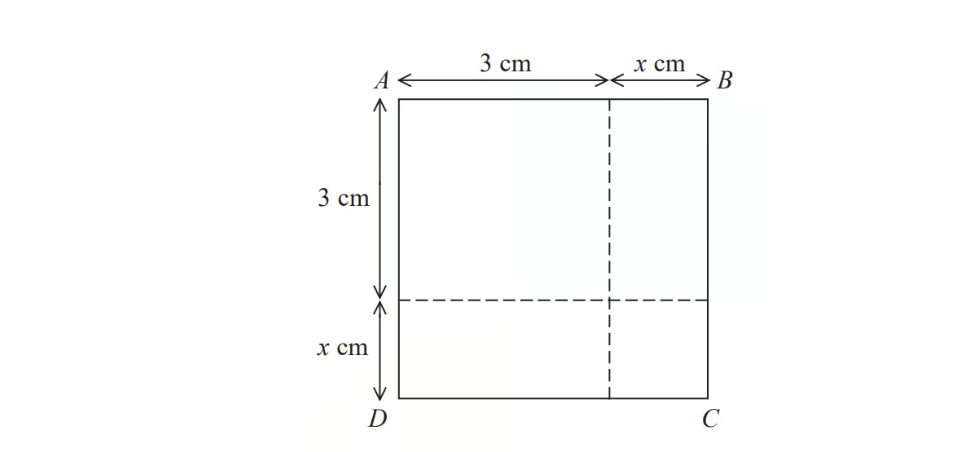

# Exam Questions — Expanding Brackets
**Equations, Formulae & Identities** · Edexcel IGCSE Maths A (4MA1) — 18/Higher
> Source: [https://www.savemyexams.com/igcse/maths/edexcel/a/18/higher/topic-questions/2-equations-formulae-and-identities/expanding-brackets/exam-questions/](https://www.savemyexams.com/igcse/maths/edexcel/a/18/higher/topic-questions/2-equations-formulae-and-identities/expanding-brackets/exam-questions/) · 53 questions · total 123 marks

## Q1 — easy — 1 marks · exam-questions

### 8((a)) — 1 mark — command: expand — structured — from paper 2012	June · 1MA0/1H
Expand    $3(2y-5)$

## Q2 — easy — 3 marks · exam-questions

### 11((a)) — 1 mark — command: expand — structured — from paper 2012	November · 1MA0/1H
Expand  $4(3x+5)$

### 11((b)) — 2 marks — command: simplify — structured — from paper 2012	November · 1MA0/1H
Expand and simplify      $2 ( x - 4 ) + 3 ( x + 5 )$

## Q3 — easy — 3 marks · exam-questions

### 4((a)) — 1 mark — command: expand — structured — from paper 2013	June · 1MA0/1H
Expand       $3 ( 2 + t )$

### 4((b)) — 2 marks — command: expand — structured — from paper 2013	June · 1MA0/1H
Expand    $3 x ( 2 x + 5 )$

## Q4 — easy — 1 marks · exam-questions

### 4((c)) — 1 mark — command: expand — structured — from paper 2013	November · 1MA0/1H
Expand      $4 ( x + 2 )$

## Q5 — easy — 1 marks · exam-questions

### 6((a)) — 1 mark — command: expand — structured — from paper 2014	June · 1MA0/1H
Expand       $2 m ( m + 3 )$

## Q6 — easy — 2 marks · exam-questions

### 3((c)) — 2 marks — command: simplify — structured — from paper 2014	November · 1MA0/2H
Expand and simplify      $5 ( y - 2 ) + 2 ( y - 3 )$

## Q7 — easy — 3 marks · exam-questions

### 10((a)) — 1 mark — command: expand — structured — from paper 2015	November · 1MA0/1H
Expand      $x ( x + 2 )$

### 10((b)) — 2 marks — command: simplify — structured — from paper 2015	November · 1MA0/1H
Expand and simplify        $3 ( y + 2 ) + 4 ( x - 1 )$

## Q8 — easy — 1 marks · exam-questions

### 2((c)) — 1 mark — command: expand — structured — from paper 2016	June · 1MA0/2H
Expand      $x(x-3)$

## Q9 — easy — 2 marks · exam-questions

### 3((a)) — 2 marks — command: simplify — structured — from paper 2015	Spec2 · 1MA1/2H
Expand and simplify       $3 ( y - 2 ) + 5 ( 2 y + 1 )$

## Q10 — easy — 1 marks · exam-questions

### 7((b)) — 1 mark — command: expand — structured — from paper 2015	June · 1MA0/2H
Expand     $3y(4y-3)$

## Q11 — easy — 2 marks · exam-questions

### 11((a)) — 2 marks — command: simplify — structured — from paper 2013	March · 1MA0/2H
Expand and simplify       $3 ( x + 4 ) + 2 ( 5 x - 1 )$

## Q12 — easy — 1 marks · exam-questions

### 7() — 1 mark — command: expand — structured — from paper 2015	June · 1MA0/2H
Expand    $7(x+5)$

## Q13 — easy — 2 marks · exam-questions

### 1((c)) — 2 marks — command: expand — structured — from paper Jan 2021 · 4MA1/2HR
Expand  $4t(3t--2)$

## Q14 — easy — 1 marks · exam-questions

### 1() — 1 mark — command: expand — structured — from paper Nov 2019 · 8300/2H
Expand $4x^{2}(3x+5)$

Circle your answer.

| $32x^{3}$ | $12x^{3}+20x^{2}$ | $7x^{3}+9x^{2}$ | $12x^{2}+5$ |
|---|---|---|---|

## Q15 — easy — 1 marks · exam-questions

### 3() — 1 mark — command: circle — structured — from paper Nov 2019 · 8300/3H
$(2x--4)(3x+5)$is expanded and simplified. 
Circle the term which is part of the answer.

| $2x$ | $-2x$ | $22x$ | $-22x$ |
|---|---|---|---|

## Q16 — easy — 2 marks · exam-questions

### 5() — 2 marks — command: simplify — structured — from paper Nov 2017 · 8300/3H
Multiply out and simplify $( x - 8 )^{2}$

## Q17 — medium — 2 marks · exam-questions

### 4((d)) — 2 marks — command: simplify — structured — from paper 2016	June · 1MA0/1H
Expand and simplify       $3 ( m + 4 ) - 2 ( 4 m + 1 )$

## Q18 — medium — 2 marks · exam-questions

### 2() — 2 marks — command: simplify — structured — from paper 2018	June · 1MA1/3H
Expand and simplify         $5 ( p + 3 ) - 2 ( 1 - 2 p )$

## Q19 — medium — 2 marks · exam-questions

### 14((a)) — 2 marks — command: simplify — structured — from paper 2012	June · 1MA0/2H
Expand and simplify     $( p + 9 ) ( p - 4 )$

## Q20 — medium — 2 marks · exam-questions

### 11((c)) — 2 marks — command: simplify — structured — from paper 2012	November · 1MA0/1H
Expand and simplify        $(x+4)(x+6)$

## Q21 — medium — 2 marks · exam-questions

### 4((c)) — 2 marks — command: simplify — structured — from paper 2013	June · 1MA0/1H
Expand and simplify  $( m + 3 ) ( m + 10 )$

## Q22 — medium — 2 marks · exam-questions

### 1() — 2 marks — command: simplify — structured
Expand and simplify $( p - 6 ) ( p + 11 )$

## Q23 — medium — 2 marks · exam-questions

### 4((d)) — 2 marks — command: simplify — structured — from paper 2013	November · 1MA0/1H
Expand and simplify         $( x - 5 ) ( x + 3 )$

## Q24 — medium — 2 marks · exam-questions

### 21((a)) — 2 marks — command: simplify — structured — from paper 2014	June · 1MA0/2H
Expand and simplify            $( y - 2 ) ( y - 5 )$

## Q25 — medium — 2 marks · exam-questions

### 19((a)) — 2 marks — command: simplify — structured — from paper 2016	November · 1MA0/2H
Expand and simplify           $( y + 2 ) ( y + 5 )$

## Q26 — medium — 2 marks · exam-questions

### 2() — 2 marks — command: simplify — structured — from paper 2015	Sample · 1MA1/1H
Expand and simplify        $( m + 7 ) ( m + 3 )$

## Q27 — medium — 2 marks · exam-questions

### 11((b)) — 2 marks — command: simplify — structured — from paper 2013	March · 1MA0/2H
Expand and simplify                        $( 2 x + 1 ) ( x - 4 )$

## Q28 — medium — 2 marks · exam-questions

### 12((c)) — 2 marks — command: simplify — structured — from paper 2014	November · 1MA0/1H
Expand and simplify      $( 2 x + 3 ) ( x - 8 )$

## Q29 — medium — 2 marks · exam-questions

### 10((c)) — 2 marks — command: simplify — structured — from paper 2015	November · 1MA0/1H
Expand and simplify                $( 2 t - 3 ) ( t + 5 )$

## Q30 — medium — 2 marks · exam-questions

### 8((e)) — 2 marks — command: simplify — structured — from paper 2017	June · 1MA0/2H
Expand and simplify               $( w - 5 )^{2}$

## Q31 — medium — 2 marks · exam-questions

### 1((a)) — 2 marks — command: simplify — structured — from paper Jan 2022 · 4MA1/2H
Expand and simplify  $( y + 4 ) ( 2 - y )$

## Q32 — medium — 2 marks · exam-questions

### 5((a)) — 2 marks — command: simplify — structured — from paper June 2021 · 4MA1/1H
Expand and simplify  $3x(2x+3)--x(3x+5)$

## Q33 — medium — 2 marks · exam-questions

### 10() — 2 marks — command: simplify — structured — from paper Nov 2020 · 8300/3H
Expand and simplify fully  $4(2c+3)--(5c--1)$

## Q34 — medium — 2 marks · exam-questions

### 1() — 2 marks — command: expand — structured
Expand and simplify  $( m + 9 ) ( m - 5 )$

## Q35 — hard — 3 marks · exam-questions

### 10() — 3 marks — command: prove — structured — from paper 2017	June · 1MA1/1H
Show that $(x+1)(x+2)(x+3)$ can be written in the form $ax^{3}+bx^{2}+cx+d$ where  $a,b,c$ and $d$ are positive integers.

## Q36 — hard — 3 marks · exam-questions

### 13() — 3 marks — command: prove — structured — from paper 2015	Spec1 · 1MA1/2H
Show that

$( 3 x - 1 ) ( x + 5 ) ( 4 x - 3 ) = 12 x^{3} + 47 x^{2} - 62 x + 15$

for all values of $x$.

## Q37 — hard — 3 marks · exam-questions

### 18() — 3 marks — command: simplify — structured — from paper 2015	Spec2 · 1MA1/2H
Simplify fully $( \sqrt{a + \sqrt{4} b} ) ( \sqrt{a} - 2 \sqrt{b} )$

## Q38 — hard — 6 marks · exam-questions

### 18((a)) — 3 marks — command: prove — structured — from paper June 2019 · 1MA1/3H
Show that $(2x+1)(x+3)(3x+7)$ can be written in the form $ax^{3}+bx^{2}+cx+d$   where $a,b,c$ and $d$ are integers.

### 18((b)) — 3 marks — command: solve — structured — from paper June 2019 · 1MA1/3H
Solve           $( 1 - x )^{2} < \frac{9}{25}$

## Q39 — hard — 3 marks · exam-questions

### 4() — 3 marks — command: prove — structured — from paper June 2017 · 1MA1/1H

The area of square $ABCD$ is $10$ cm2.

Show that $x^{2}+6x=1$

## Q40 — hard — 3 marks · exam-questions

### 13((a)) — 3 marks — command: simplify — structured — from paper Jan 2022 · 4MA1/1H
Expand and simplify            $5 x ( x + 2 ) ( 3 x - 4 )$

## Q41 — hard — 3 marks · exam-questions

### 18() — 3 marks — command: find — structured — from paper Jan 2021 · 4MA1/1H
Given that $( 8 - \sqrt{x} ) ( 5 + \sqrt{x} ) = y \sqrt{x} + 21$  where $x$ is a prime number and $y$ is an integer,

find the value of $x$ and the value of $y$.

Show each stage of your working clearly.

x = .............................................................

y = ............................................................

## Q42 — hard — 3 marks · exam-questions

### 9((b)) — 3 marks — command: solve — structured — from paper June 2021 · 4MA1/1H
Solve $(2x+5)^{2}=(2x+3)(2x--1)$

$x=$ ......................................

## Q43 — hard — 3 marks · exam-questions

### 17((b)) — 3 marks — command: solve — structured — from paper Jan 2021 · 4MA1/2HR
The functions $f$and $g$ are defined as

$\begin{gathered} \mathrm{f} ( x ) & = x^{2} + 6 \\ \mathrm{g} ( x ) & = x - 10 \end{gathered}$

Solve the equation $\mathrm{fg}(x)=f(x)$

Show clear algebraic working.

## Q44 — hard — 3 marks · exam-questions

### 14() — 3 marks — command: simplify — structured — from paper Nov 2020 · 4MA1/1HR
Expand and simplify $(4x+1)(x--3)(5x+6)$

## Q45 — hard — 1 marks · exam-questions

### 24((a)) — 1 mark — command: prove — structured — from paper June 2018 · 4MA1/1HR
Show that $x ( x - 1 ) ( x + 1 ) = x^{3} - x$

## Q46 — hard — 3 marks · exam-questions

### 25() — 3 marks — command: simplify — structured — from paper Nov 2021 · 8300/3H
Expand and simplify fully $( x - 3 ) ( x + 2 ) ( x + 5 )$

## Q47 — hard — 3 marks · exam-questions

### 8() — 3 marks — command: work_out — structured — from paper Nov 2019 · 8300/2H
Here is an identity.

$a(3x--10)\equiv21x+2b$

Work out the values of $a$ and $b$.

## Q48 — hard — 3 marks · exam-questions

### 26() — 3 marks — command: work_out — structured — from paper June 2019 · 8300/2H
$(x+5)(x+2)(x+a)\equivx^{3}+bx^{2}+cx--30$

Work out the values of the integers $a,b$and $c$.

$\begin{gathered} a & = ...................... \\ b & = ...................... \\ c & = ...................... \end{gathered}$

## Q49 — hard — 4 marks · exam-questions

### 18() — 4 marks — command: simplify — structured — from paper Nov 2017 · 8300/3H
Expand and simplify $(3x^{2}+2)(2x+5)--6x(x^{2}--3)$

## Q50 — hard — 3 marks · exam-questions

### 17() — 3 marks — command: simplify — structured — from paper Nov 2020 · J560/04
Expand and simplify.

$( x + 1 ) ( x - 1 ) ( x + 2 )$

## Q51 — hard — 4 marks · exam-questions

### 13((b)) — 4 marks — command: simplify — structured — from paper Nov 2017 · J560/04
Expand and simplify.

$(2x-1)(x+5)(3x-2)$

## Q52 — hard — 3 marks · exam-questions

### 17((a)) — 3 marks — command: expand — structured — from paper 2023 June · 4MA1/2H
Expand and simplify $(x+6)(3x--2)(x+6)$

## Q53 — hard — 3 marks · exam-questions

### 16() — 3 marks — command: expand — structured — from paper 2023 Nov · 4MA1/2H
Expand and simplify $( 2 x + 3 ) ( x - 5 ) ( x + 4 )$
